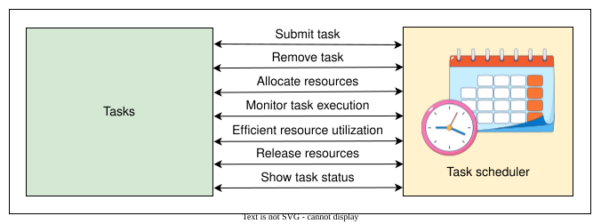
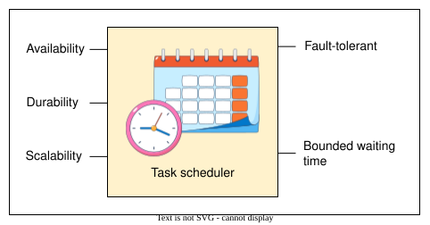

# Requirements_of_a_Distributed_Task_Scheduler's_Design

Source: https://www.educative.io/courses/grokking-the-system-design-interview/requirements-of-a-distributed-task-schedulers-design

---

[Home](https://www.educative.io/)

[Courses](https://www.educative.io/search?tab=courses)

[Grokking Modern System Design Interview](https://www.educative.io/courses/grokking-the-system-design-interview)

# Requirements of a Distributed Task Scheduler's Design

Explore the functional requirements essential for a distributed task scheduler, focusing on task submission, resource allocation, and efficient utilization. Define critical non-functional criteria such as availability, durability, and fault tolerance.

We'll cover the following...

- [Requirements](https://www.educative.io/courses/grokking-the-system-design-interview/requirements-of-a-distributed-task-schedulers-design#Requirements)
  - [Functional requirements](https://www.educative.io/courses/grokking-the-system-design-interview/requirements-of-a-distributed-task-schedulers-design#Functional-requirements)
  - [Non-functional requirements](https://www.educative.io/courses/grokking-the-system-design-interview/requirements-of-a-distributed-task-schedulers-design#Non-functional-requirements)
- [Building blocks we will use](https://www.educative.io/courses/grokking-the-system-design-interview/requirements-of-a-distributed-task-schedulers-design#Building-blocks-we-will-use)

## Requirements[#](https://www.educative.io/courses/grokking-the-system-design-interview/requirements-of-a-distributed-task-schedulers-design#Requirements)

We will outline the functional and non-functional requirements for designing a distributed task scheduler.

### Functional requirements[#](https://www.educative.io/courses/grokking-the-system-design-interview/requirements-of-a-distributed-task-schedulers-design#Functional-requirements)

The system must support the following core capabilities:

- **Submit tasks:** Users can submit tasks for execution.
- **Allocate resources:** The system assigns the necessary resources to each task.
- **Remove tasks:** Users can cancel submitted tasks.
- **Monitor task execution:** The system tracks execution and reschedules tasks if they fail.
- **Efficient resource utilization:** Resources (CPU and memory) must be used efficiently to optimize time and cost. For example, light tasks should not occupy heavy resources. Fairness ensures that all tenants receive equitable access to resources within their cost class.
- **Release resources:** The system reclaims resources immediately after a task completes.
- **Show task status:** Users can view the current status of their tasks.

Functional requirements of the distributed task scheduler

### Non-functional requirements[#](https://www.educative.io/courses/grokking-the-system-design-interview/requirements-of-a-distributed-task-schedulers-design#Non-functional-requirements)

The design must meet the following quality standards or non-functional requirements:

- **Availability:** The system must be highly available to schedule and execute tasks.
- **Durability:** Submitted tasks must persist and not be lost.
- **Scalability:** The system must handle an increasing volume of tasks.
- **Fault tolerance:** The system must operate uninterrupted despite component faults.
- **Bounded waiting time:** Tasks should not wait indefinitely before execution. If the wait time exceeds a specific threshold, the user must be notified.

Non-functional requirements of distributed task scheduler

Now that we have defined the system requirements, we can select the appropriate infrastructure components.

## Building blocks we will use[#](https://www.educative.io/courses/grokking-the-system-design-interview/requirements-of-a-distributed-task-schedulers-design#Building-blocks-we-will-use)

We will utilize the following building blocks in the design:

Building blocks of a task scheduler

- [**Rate limiter**](https://www.educative.io/courses/grokking-the-system-design-interview/system-design-the-rate-limiter)**:** Limits the number of tasks to ensure system reliability.
- [**Sequencer**](https://www.educative.io/courses/grokking-the-system-design-interview/system-design-sequencer)**:** Assigns unique identifiers to tasks.
- [**Database(s)**](https://www.educative.io/courses/grokking-the-system-design-interview/introduction-to-databases)**:** Stores task information.
- [**Distributed queue**](https://www.educative.io/courses/grokking-the-system-design-interview/system-design-the-distributed-messaging-queue)**:** Arranges tasks in execution order.
- [**Monitoring**](https://www.educative.io/courses/grokking-the-system-design-interview/system-design-distributed-monitoring)**:** Checks resource health and detects failed tasks.

With these requirements and components identified, we will proceed to design the task scheduling system in the next lesson.

System Design: The Distributed Task Scheduler

Design of a Distributed Task Scheduler

Ask

[Requirements](https://www.educative.io/courses/grokking-the-system-design-interview/requirements-of-a-distributed-task-schedulers-design#Requirements)

[Functional requirements](https://www.educative.io/courses/grokking-the-system-design-interview/requirements-of-a-distributed-task-schedulers-design#Functional-requirements)

[Non-functional requirements](https://www.educative.io/courses/grokking-the-system-design-interview/requirements-of-a-distributed-task-schedulers-design#Non-functional-requirements)

[Building blocks we will use](https://www.educative.io/courses/grokking-the-system-design-interview/requirements-of-a-distributed-task-schedulers-design#Building-blocks-we-will-use)