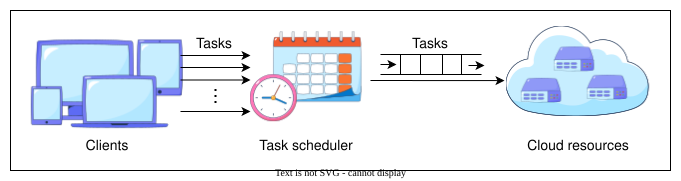
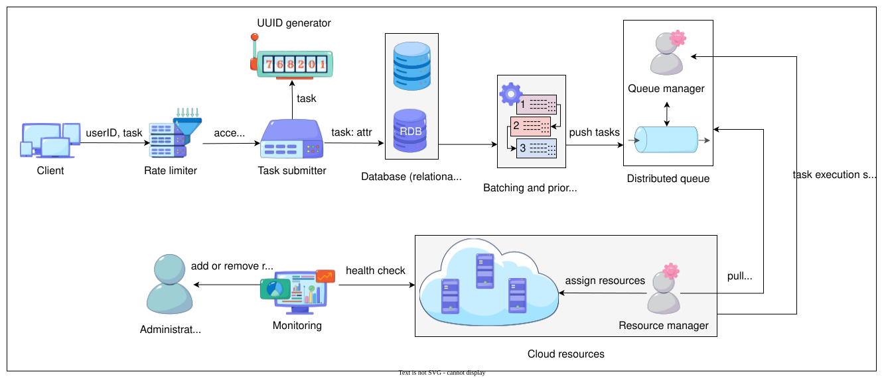

# Design_of_a_Distributed_Task_Scheduler

Source: https://www.educative.io/courses/grokking-the-system-design-interview/design-of-a-distributed-task-scheduler

---

[Home](https://www.educative.io/)

[Courses](https://www.educative.io/search?tab=courses)

[Grokking Modern System Design Interview](https://www.educative.io/courses/grokking-the-system-design-interview)

# Design of a Distributed Task Scheduler

Examine the core components of a distributed task scheduler, including the rate limiter, distributed queue, and resource manager. Learn how to integrate these elements into a scalable System Design that manages task prioritization, dependencies, and fault tolerance across a cluster.

We'll cover the following...

- [Components](https://www.educative.io/courses/grokking-the-system-design-interview/design-of-a-distributed-task-scheduler#Components)
- [Design](https://www.educative.io/courses/grokking-the-system-design-interview/design-of-a-distributed-task-scheduler#Design)
- [Task submitter](https://www.educative.io/courses/grokking-the-system-design-interview/design-of-a-distributed-task-scheduler#Task-submitter)

Let’s identify the core components of this design.

## Components[#](https://www.educative.io/courses/grokking-the-system-design-interview/design-of-a-distributed-task-scheduler#Components)

Scheduling operates at different levels. An organization running its own cluster schedules internal workloads based on available capacity, job priority, and execution order. In contrast, a cloud provider operates a multi-tenant scheduler that must enforce strong isolation, fairness, and priority controls across customer workloads.

Regardless of the use case, the high-level components remain consistent:

- **Clients:** Entities initiating task execution.
- **Resources:** The computing infrastructure where tasks execute.
- **Scheduler:** The system that matches clients to resources and determines execution order.

Scheduler puts tasks into a queue for resource allocation

Incoming tasks are placed in a *queue* for several reasons:

- **Resource availability:** Sufficient resources may not be immediately available.
- **Dependencies:** Some tasks must wait for others to complete.
- **Decoupling:** Clients can hand off work asynchronously without waiting for immediate execution.

Most tasks are short-lived (seconds to minutes). For long-running tasks, the application should support periodic checksumming to enable recovery from failures.

This design assumes each task fits within the resource limits of a single node. Workloads that span multiple nodes must be decomposed by the application layer or coordinated by a higher-level cluster orchestrator.

## Design[#](https://www.educative.io/courses/grokking-the-system-design-interview/design-of-a-distributed-task-scheduler#Design)

A task submission includes the following information:

- **Resource requirements:** This includes CPU cores, RAM, disk space, IOPS, and ports. As exact quantification is difficult for clients, we offer tiered resources (e.g., basic, regular, premium).
- **Dependency:** Tasks are classified by their execution order:

  - **Dependent tasks:** Must execute sequentially based on a provided list of prerequisites.
  - **Independent tasks:** Have no prerequisites and can run in parallel.

The following illustration depicts the task scheduler design:

The design of task scheduler

- **Clients:** Individuals or organizations submitting tasks.
- **Rate limiter:** Limits the number of tasks based on the client’s subscription and system load. If the limit is exceeded, the system rejects the task to ensure reliability.
- **Task submitter:** A cluster of nodes that admits tasks passing the rate limiter.
- **Unique ID generator:** Assigns a unique identifier to each admitted task.
- **Database:** Stores task data in two formats:

  - **Relational database (RDB):** Stores metadata such as task IDs, user IDs, resource requirements, execution caps, and retry counts. (See [Types of Databases](https://www.educative.io/courses/grokking-the-system-design-interview/types-of-databases)).
  - **Graph database (GDB):** Stores the Directed Acyclic Graph (DAG) of dependent tasks. This structure allows topological sorting to schedule dependencies correctly. (See [Types of Databases](https://www.educative.io/courses/grokking-the-system-design-interview/types-of-databases)).

## Database Schema

|  |  |  |
| --- | --- | --- |
| **Column Name** | **Data Type** | **Description** |
| TaskID | Integer | Uniquely identifies each task. |
| UserID | Integer | This is the ID of the task owner. |
| SchedulingType | VarChar | This can be either once, daily, weekly, monthly, or annually. |
| TotalAttempts | Integer | This is the maximum number of retries in case a task execution fails. |
| ResourceRequirements | VarChar | Clients have to specify the type of the offered resource categories, such as Basic, Regular, or Premium. The specified resource category is saved in the form of a string in the RDB. |
| ExecutionCap | Time | This is the maximum time allowed for the task execution. (This time starts when a resource is allocated to the task.) |
| Status | VarChar | This can be waiting, in progress, done, or failed. |
| DelayTolerance | Time | This indicates how much delay we can sustain before starting a task. |
| ScriptPath | VarChar | The path of the script that needs to be executed. The script is a file placed in a file system. The file should be made accessible so that it can be executed, just like how we mount Google Drive in the Google Colaboratory and then execute our code files there. |

> **Note:** Using geo-replicated data stores allows multiple instances of the scheduler to run in different data centers, improving scale and utilization.

- **Batching and prioritization:** Tasks stored in the RDB are grouped into batches and prioritized based on attributes like delay tolerance or execution caps. The top K priority tasks are pushed to the distributed queue, where K is determined by available resources and subscription levels.

AI Powered

Saved

1 attempt left

Reset

Durable task storage

Why do we store tasks in a database? Why should we not push the tasks directly to the queue?

This is your last attempt.

- **Distributed queue:** Holds tasks waiting to be executed. It persists tasks until they execute successfully. If a task fails, the queue makes it visible again for retry.
- **Queue manager:** Manages the distributed queue. It handles task visibility, deletes successfully executed tasks, and enforces retry limits for failed tasks. It also manages queue selection based on load (peak vs. off-peak).
- **Resource manager:** Tracks free resources and assigns them to tasks pulled from the queue. It monitors execution status and terminates tasks that exceed their allocated resource limits.
- **Monitoring service:** Checks the health of resources and the resource manager. It alerts administrators to repair failed resources or decommission unused ones. (See [detailed discussion](https://www.educative.io/courses/grokking-the-system-design-interview/system-design-distributed-monitoring)).

## Task submitter[#](https://www.educative.io/courses/grokking-the-system-design-interview/design-of-a-distributed-task-scheduler#Task-submitter)

To ensure high availability, the **task submitter** operates as a cluster of nodes. Each node admits tasks, requests IDs, and writes to the database.

A **cluster manager** monitors these nodes via heartbeats. It maintains a mapping of tasks to the admitting node. If a node fails, the cluster manager reassigns its tasks to a healthy node. The cluster manager itself is replicated to prevent a single point of failure.

This concludes the high-level design of the task scheduling system. The next lesson will cover design considerations in depth.

Requirements of a Distributed Task Scheduler's Design

Design Considerations of a Distributed Task Scheduler

Ask

[Components](https://www.educative.io/courses/grokking-the-system-design-interview/design-of-a-distributed-task-scheduler#Components)

[Design](https://www.educative.io/courses/grokking-the-system-design-interview/design-of-a-distributed-task-scheduler#Design)

[Task submitter](https://www.educative.io/courses/grokking-the-system-design-interview/design-of-a-distributed-task-scheduler#Task-submitter)