# Design_Considerations_of_a_Distributed_Task_Scheduler

Source: https://www.educative.io/courses/grokking-the-system-design-interview/design-considerations-of-a-distributed-task-scheduler

---

[Home](https://www.educative.io/)

[Courses](https://www.educative.io/search?tab=courses)

[Grokking Modern System Design Interview](https://www.educative.io/courses/grokking-the-system-design-interview)

# Design Considerations of a Distributed Task Scheduler

Discover the essential design considerations for building a reliable distributed task scheduler. Implement priority-based queueing, delay tolerance, and execution caps to prevent starvation and resource monopolization. Learn to ensure task idempotency and safely execute untrusted tasks through sandboxing and performance isolation.

We'll cover the following...

- [Queueing](https://www.educative.io/courses/grokking-the-system-design-interview/design-considerations-of-a-distributed-task-scheduler#Queueing)
- [Execution cap](https://www.educative.io/courses/grokking-the-system-design-interview/design-considerations-of-a-distributed-task-scheduler#Execution-cap)
- [Prioritization](https://www.educative.io/courses/grokking-the-system-design-interview/design-considerations-of-a-distributed-task-scheduler#Prioritization)
- [Resource capacity optimization](https://www.educative.io/courses/grokking-the-system-design-interview/design-considerations-of-a-distributed-task-scheduler#Resource-capacity-optimization)
- [Task idempotency](https://www.educative.io/courses/grokking-the-system-design-interview/design-considerations-of-a-distributed-task-scheduler#Task-idempotency)
- [Schedule and execute untrusted tasks](https://www.educative.io/courses/grokking-the-system-design-interview/design-considerations-of-a-distributed-task-scheduler#Schedule-and-execute-untrusted-tasks)

## Queueing[#](https://www.educative.io/courses/grokking-the-system-design-interview/design-considerations-of-a-distributed-task-scheduler#Queueing)

A **distributed queue** is a fundamental building block of a scheduler. The simplest approach is first come, first served (FCFS), in which the scheduler dequeues tasks from the queue and assigns them to available nodes. However, if all resources are busy, small tasks can be blocked by long-running ones.

This head-of-line blocking degrades system reliability and availability. To guarantee low-latency handling of urgent tasks such as security notifications, a pure FCFS policy is insufficient. Instead, tasks are classified into priority tiers:

- **Urgent:** Tasks that cannot be delayed.
- **Delayable:** Tasks that can wait for resources.
- **Periodic:** Tasks executed on a schedule (e.g., every hour).

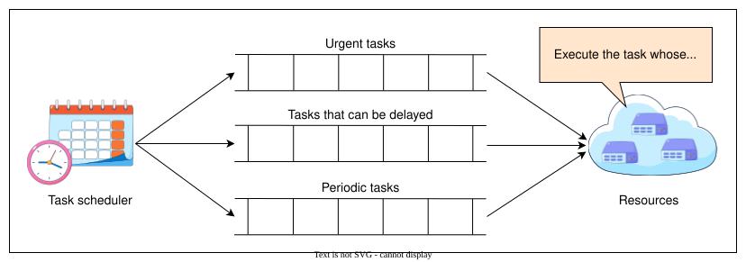

Multiple queues based on the task categories

To prevent starvation, the system monitors non-urgent queues. If a task approaches its delay limit, the scheduler moves it to the urgent queue for immediate processing.

Let’s explore parameters that help the scheduler utilize resources efficiently.

## Execution cap[#](https://www.educative.io/courses/grokking-the-system-design-interview/design-considerations-of-a-distributed-task-scheduler#Execution-cap)

Some tasks take very long to execute and occupy the resource, blocking other tasks. Long-running tasks can monopolize resources, blocking other work. This often happens due to bugs, such as infinite loops. To mitigate this, we enforce an **execution cap**.

Clients can specify a time limit for their tasks. If a task exceeds this cap, the scheduler terminates it, releases the resource, and notifies the client. If no cap is set, the system applies a default upper bound.

For legitimate long-running tasks, such as training machine learning models, the scheduler may pause and resume execution to accommodate urgent work. Clients should implement checkpointing to periodically save state, allowing the task to resume its progress after an interruption.

1.

What if a long task is 90% executed, but before it completes, the machine that was executing this task fails?

Show Answer

Did you find this helpful?

## Prioritization[#](https://www.educative.io/courses/grokking-the-system-design-interview/design-considerations-of-a-distributed-task-scheduler#Prioritization)

Certain tasks require immediate execution, such as emergency safety checks or real-time transaction alerts. If these are delayed, the feature becomes useless.

To handle this, the scheduler assigns a **delay tolerance** to each task. This parameter defines the maximum acceptable wait time. The scheduler prioritizes tasks with the shortest delay tolerance, postponing flexible tasks to ensure urgent ones meet their deadlines.

1.

How do we determine the value of delay tolerance?

Show Answer

Did you find this helpful?

## Resource capacity optimization[#](https://www.educative.io/courses/grokking-the-system-design-interview/design-considerations-of-a-distributed-task-scheduler#Resource-capacity-optimization)

Resources often experience **peak time** loads (e.g., >80% utilization) while remaining idle during off-peak hours. Efficient design requires balancing utilization across these periods.

Non-urgent tasks, such as friend suggestion generation, can be deferred and scheduled during periods of lower system load. Cloud platforms continuously monitor capacity utilization relative to workload demand. When demand rises, the system scales out by provisioning additional instances. When demand falls, it scales in to reduce infrastructure costs.

## Task idempotency[#](https://www.educative.io/courses/grokking-the-system-design-interview/design-considerations-of-a-distributed-task-scheduler#Task-idempotency)

If a task executes successfully but the acknowledgment fails (e.g., due to a network error), the scheduler will retry the task. If the task is not designed to handle retries, this can lead to incorrect results, such as duplicate transactions.

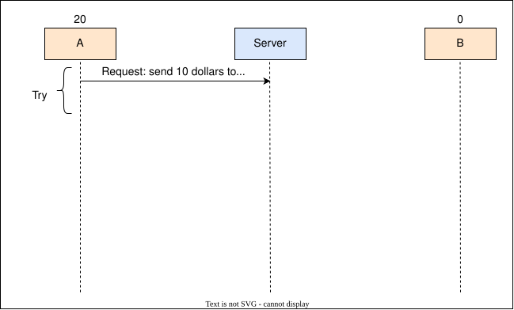

1 / 11

A has 20 dollars. It makes a request to send 10 dollars to B, which has 0 dollars. A is the sender, and B is the receiver

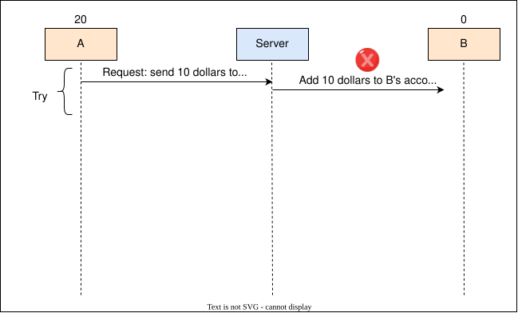

1 / 11

The server starts the operation of adding 10 dollars to B’s account, which doesn’t execute successfully

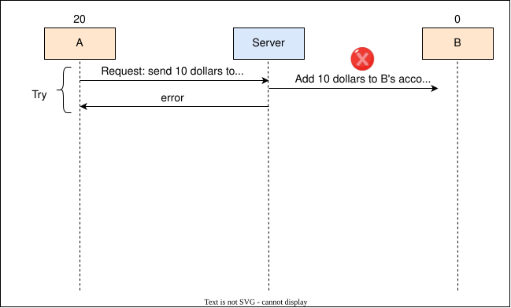

1 / 11

The server sends an error message to A

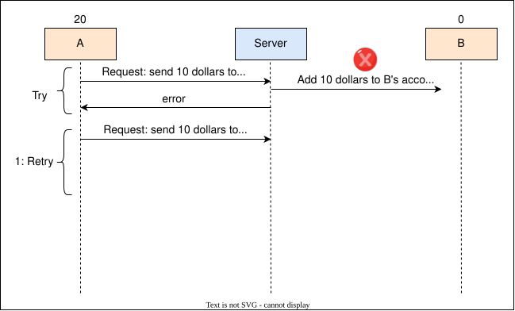

1 / 11

A retries the transaction

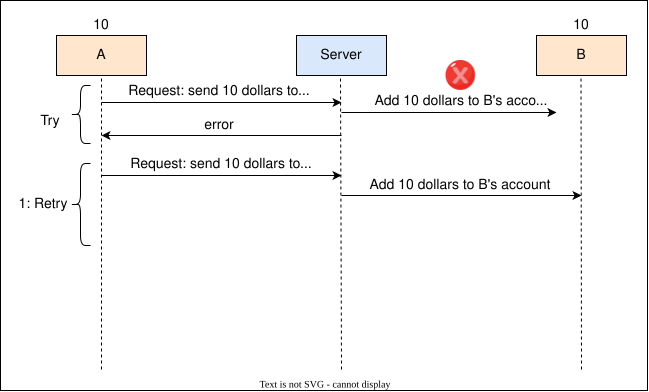

1 / 11

The server starts the operation of adding 10 dollars to B’s account

To prevent data corruption, tasks must be idempotent. An **idempotent task** produces the same result regardless of how many times it is executed.

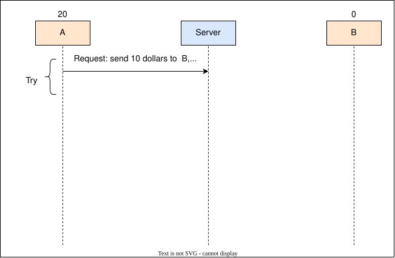

1 / 10

A makes a request to send 10 dollars to B with the idempotence key that is added by the application

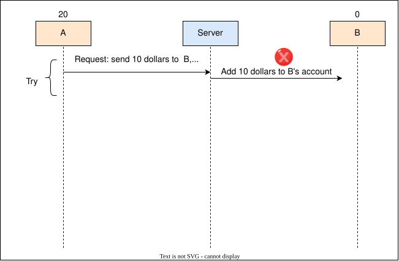

1 / 10

The server starts the operation of adding 10 dollars to B’s account, which doesn’t execute successfully

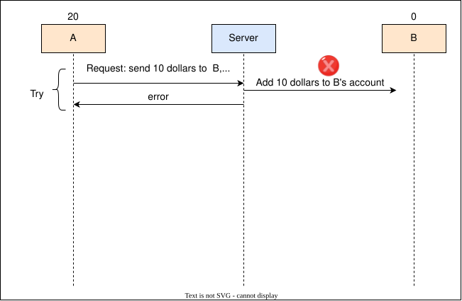

1 / 10

The server sends an error message to A

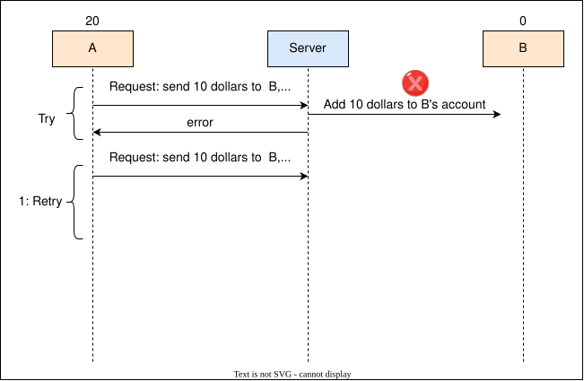

1 / 10

A retries the transaction, and the same idempotence key is attached with the retried request

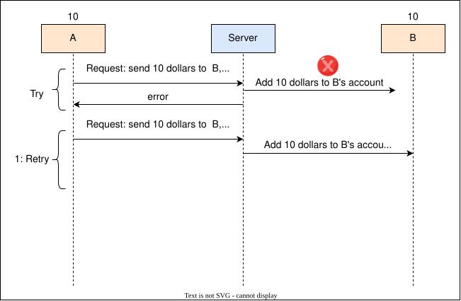

1 / 10

The server starts the operation of adding 10 dollars to B’s account

For example, consider uploading a video. To ensure idempotency, the developer assigns a unique identifier (e.g., the file name) to the video. If the scheduler retries the upload, the system detects the existing identifier and either overwrites the file or ignores the duplicate. This ensures the final state remains consistent even after multiple execution attempts.

1.

How should we handle task execution that can never be completed because of an infinite loop in the payload of that task?

Show Answer

Did you find this helpful?

## Schedule and execute untrusted tasks[#](https://www.educative.io/courses/grokking-the-system-design-interview/design-considerations-of-a-distributed-task-scheduler#Schedule-and-execute-untrusted-tasks)

Before proceeding, let’s ask ourselves: What are the untrusted tasks, and how should we manage them?  
If you’re unsure how to do this, click the “Show Hint” button.

In a shared environment, tasks may contain latent bugs or malicious code. A bad actor could disrupt other tenants or damage the underlying infrastructure. Security is essential when providing infrastructure-as-a-service.

- **Authentication and authorization:** Strictly control access to resources.
- **Sandboxing:** Isolate code execution using containers (Docker) or virtual machines.
- **Performance isolation:** Monitor resource utilization and cap or terminate tasks that exhibit atypical behavior.

AI Powered

Saved

3 attempts left

Reset

Same task fails multiple times

Why does idempotency matter even when we have robust machine acknowledgments in place?

You have 3 attempts to answer.

In the next lesson, we will evaluate the design of our distributed task scheduler.

Design of a Distributed Task Scheduler

Evaluation of a Distributed Task Scheduler's Design

Ask

[Queueing](https://www.educative.io/courses/grokking-the-system-design-interview/design-considerations-of-a-distributed-task-scheduler#Queueing)

[Execution cap](https://www.educative.io/courses/grokking-the-system-design-interview/design-considerations-of-a-distributed-task-scheduler#Execution-cap)

[Prioritization](https://www.educative.io/courses/grokking-the-system-design-interview/design-considerations-of-a-distributed-task-scheduler#Prioritization)

[Resource capacity optimization](https://www.educative.io/courses/grokking-the-system-design-interview/design-considerations-of-a-distributed-task-scheduler#Resource-capacity-optimization)

[Task idempotency](https://www.educative.io/courses/grokking-the-system-design-interview/design-considerations-of-a-distributed-task-scheduler#Task-idempotency)

[Schedule and execute untrusted tasks](https://www.educative.io/courses/grokking-the-system-design-interview/design-considerations-of-a-distributed-task-scheduler#Schedule-and-execute-untrusted-tasks)