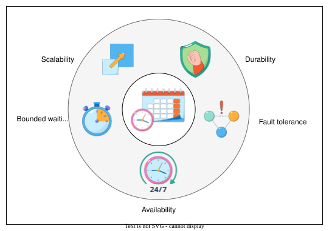

# Evaluation_of_a_Distributed_Task_Scheduler's_Design

Source: https://www.educative.io/courses/grokking-the-system-design-interview/evaluation-of-a-distributed-task-schedulers-design

---

[Home](https://www.educative.io/)

[Courses](https://www.educative.io/search?tab=courses)

[Grokking Modern System Design Interview](https://www.educative.io/courses/grokking-the-system-design-interview)

# Evaluation of a Distributed Task Scheduler's Design

Evaluate the proposed distributed task scheduler design against key non-functional requirements, such as availability, durability, and scalability. Learn how distributed components and replication strategies ensure fault tolerance and bounded waiting time.

We'll cover the following...

- [Requirements compliance](https://www.educative.io/courses/grokking-the-system-design-interview/evaluation-of-a-distributed-task-schedulers-design#Requirements-compliance)
  - [Availability](https://www.educative.io/courses/grokking-the-system-design-interview/evaluation-of-a-distributed-task-schedulers-design#Availability)
  - [Durability](https://www.educative.io/courses/grokking-the-system-design-interview/evaluation-of-a-distributed-task-schedulers-design#Durability)
  - [Scalability](https://www.educative.io/courses/grokking-the-system-design-interview/evaluation-of-a-distributed-task-schedulers-design#Scalability)
  - [Fault tolerance](https://www.educative.io/courses/grokking-the-system-design-interview/evaluation-of-a-distributed-task-schedulers-design#Fault-tolerance)
  - [Bounded waiting time](https://www.educative.io/courses/grokking-the-system-design-interview/evaluation-of-a-distributed-task-schedulers-design#Bounded-waiting-time)
- [Conclusion](https://www.educative.io/courses/grokking-the-system-design-interview/evaluation-of-a-distributed-task-schedulers-design#Conclusion)

## Requirements compliance[#](https://www.educative.io/courses/grokking-the-system-design-interview/evaluation-of-a-distributed-task-schedulers-design#Requirements-compliance)

Let’s evaluate how the proposed distributed task scheduler design fulfills the non-functional requirements identified in the previous lesson.

### Availability[#](https://www.educative.io/courses/grokking-the-system-design-interview/evaluation-of-a-distributed-task-schedulers-design#Availability)

Every component in the design is distributed to ensure availability. The rate limiter and task submitters are replicated; if one node fails, others take over. The task queue is also distributed. Additionally, continuous monitoring ensures resources are added or removed to meet demand.

### Durability[#](https://www.educative.io/courses/grokking-the-system-design-interview/evaluation-of-a-distributed-task-schedulers-design#Durability)

Tasks are stored in a persistent distributed database immediately upon submission. They remain in storage until they are pushed to the queue near their execution time, ensuring no data is lost.

### Scalability[#](https://www.educative.io/courses/grokking-the-system-design-interview/evaluation-of-a-distributed-task-schedulers-design#Scalability)

The system scales horizontally at every layer. We can add nodes to the task submitter cluster, the distributed relational database, and the distributed queue as the number of tasks increases. We can also provision additional queues for specific task types and scale compute resources based on the resource-to-demand ratio.

Non-functional requirements fulfilled by our task scheduler system

### Fault tolerance[#](https://www.educative.io/courses/grokking-the-system-design-interview/evaluation-of-a-distributed-task-schedulers-design#Fault-tolerance)

Tasks remain in the queue until they are successfully executed. If a task fails, the system retries it up to a maximum number of attempts. To handle tasks with infinite loops, the system terminates them after a specified timeout and notifies the user.

### Bounded waiting time[#](https://www.educative.io/courses/grokking-the-system-design-interview/evaluation-of-a-distributed-task-schedulers-design#Bounded-waiting-time)

Users do not wait indefinitely. The system enforces a maximum waiting time limit. If a task cannot be scheduled within this window, the system notifies the user to retry.

AI Powered

Saved

12 attempts left

Reset

Task scheduler

Hi, I’m Ed. In this session, we will focus on some questions related to the task scheduler-like system. Do you want to be mentored or evaluated?

You have 12 attempts to answer.

## Conclusion[#](https://www.educative.io/courses/grokking-the-system-design-interview/evaluation-of-a-distributed-task-schedulers-design#Conclusion)

Task schedulers operate either at the OS level or at the data center (cluster) level. Data center scheduling relies on distributed coordination to manage multi-tenant workloads across heterogeneous and geographically distributed resources. Distributed queues serve as a core building block, enabling horizontal scaling as task volume increases.

We also evaluated the limitations of FIFO queues. A robust task scheduler must prioritize tasks, which we achieved by using a delay-tolerance parameter. To handle dependencies, we executed tasks according to a DAG stored in a graph database. Finally, we discussed using a monitoring service to dynamically optimize capacity by adding or removing resources as demand changes.

Design Considerations of a Distributed Task Scheduler

System Design: The Sharded Counters

Ask

[Requirements compliance](https://www.educative.io/courses/grokking-the-system-design-interview/evaluation-of-a-distributed-task-schedulers-design#Requirements-compliance)

[Availability](https://www.educative.io/courses/grokking-the-system-design-interview/evaluation-of-a-distributed-task-schedulers-design#Availability)

[Durability](https://www.educative.io/courses/grokking-the-system-design-interview/evaluation-of-a-distributed-task-schedulers-design#Durability)

[Scalability](https://www.educative.io/courses/grokking-the-system-design-interview/evaluation-of-a-distributed-task-schedulers-design#Scalability)

[Fault tolerance](https://www.educative.io/courses/grokking-the-system-design-interview/evaluation-of-a-distributed-task-schedulers-design#Fault-tolerance)

[Bounded waiting time](https://www.educative.io/courses/grokking-the-system-design-interview/evaluation-of-a-distributed-task-schedulers-design#Bounded-waiting-time)

[Conclusion](https://www.educative.io/courses/grokking-the-system-design-interview/evaluation-of-a-distributed-task-schedulers-design#Conclusion)