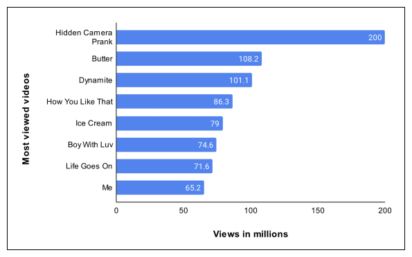
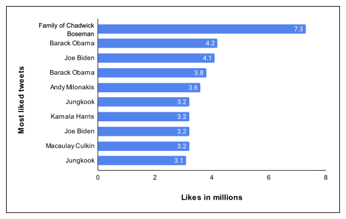

# System_Design_The_Sharded_Counters

Source: https://www.educative.io/courses/grokking-the-system-design-interview/system-design-the-sharded-counters

---

[Home](https://www.educative.io/)

[Courses](https://www.educative.io/search?tab=courses)

[Grokking Modern System Design Interview](https://www.educative.io/courses/grokking-the-system-design-interview)

# System Design: The Sharded Counters

Define the challenge of scaling counters in high-traffic applications, where millions of concurrent writes lead to severe lock contention. Explore why traditional counting methods fail under the heavy hitters problem. Understand the necessity of sharded counters in System Design to handle massive write throughput reliably.

We'll cover the following...

- [Problem statement](https://www.educative.io/courses/grokking-the-system-design-interview/system-design-the-sharded-counters#Problem-statement)
- [How will we design sharded counters?](https://www.educative.io/courses/grokking-the-system-design-interview/system-design-the-sharded-counters#How-will-we-design-sharded-counters)

## Problem statement[#](https://www.educative.io/courses/grokking-the-system-design-interview/system-design-the-sharded-counters#Problem-statement)

Large-scale social platforms such as Facebook, Twitter, and YouTube process high volumes of concurrent user traffic. Users generate continuous read and write operations, including views, likes, and comments. For example, a post from an account with millions of followers can receive a very high number of likes immediately after publication. Although maintaining a counter for a single post is straightforward, updating counters for thousands of high-traffic posts concurrently introduces contention, hot partitions, and throughput bottlenecks. This pattern is commonly referred to as the **heavy hitters problem**.

This scenario demonstrates how simple counting operations become difficult to manage with precision and performance at scale. The figure below illustrates YouTube videos viewed by millions of users within 24 hours:

YouTube videos’ views in 24 hours

Twitter processes approximately 6,000 tweets per second, totaling about 500 million tweets daily. The system must handle billions of “likes” generated by these tweets. The table below displays the most liked tweets in a single day:

Most liked tweets in a single day

How do we handle millions of write requests for thousands of tweets per minute? Write operations require exclusive access, creating bottlenecks that reads do not. As concurrent writes to a specific counter increase, lock contention grows non-linearly. Eventually, the system spends more time acquiring locks than updating the counter.

## How will we design sharded counters?[#](https://www.educative.io/courses/grokking-the-system-design-interview/system-design-the-sharded-counters#How-will-we-design-sharded-counters)

We have divided the design of sharded counters into three lessons:

1. [**High-level design**](https://www.educative.io/courses/grokking-the-system-design-interview/high-level-design-of-sharded-counters)**:** We discuss the high-level architecture and API design.
2. [**Detailed design**](https://www.educative.io/courses/grokking-the-system-design-interview/detailed-design-of-sharded-counters)**:** We explore the implementation details and evaluate the proposed design.
3. [**Quiz**](https://www.educative.io/courses/grokking-the-system-design-interview/quiz-on-the-sharded-counters-design)**:** We review the major concepts with a quiz.

Let’s begin with the high-level solution sketch.

Evaluation of a Distributed Task Scheduler's Design

High-Level Design of Sharded Counters

Ask

[Problem statement](https://www.educative.io/courses/grokking-the-system-design-interview/system-design-the-sharded-counters#Problem-statement)

[How will we design sharded counters?](https://www.educative.io/courses/grokking-the-system-design-interview/system-design-the-sharded-counters#How-will-we-design-sharded-counters)