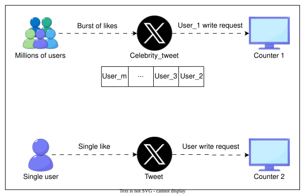
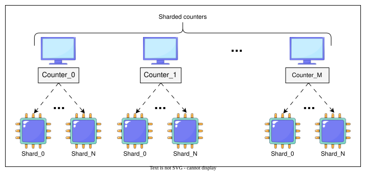

# High-Level_Design_of_Sharded_Counters

Source: https://www.educative.io/courses/grokking-the-system-design-interview/high-level-design-of-sharded-counters

---

[Home](https://www.educative.io/)

[Courses](https://www.educative.io/search?tab=courses)

[Grokking Modern System Design Interview](https://www.educative.io/courses/grokking-the-system-design-interview)

# High-Level Design of Sharded Counters

Discover why high-volume features like social media likes require distributed counting systems. Learn to design sharded counters that distribute write requests across parallel computational units to eliminate contention and improve scalability. Outline the necessary APIs for creating, updating, and reading these high-performance counters.

We'll cover the following...

- [High-level solution sketch](https://www.educative.io/courses/grokking-the-system-design-interview/high-level-design-of-sharded-counters#High-level-solution-sketch)
- [API design for sharded counters](https://www.educative.io/courses/grokking-the-system-design-interview/high-level-design-of-sharded-counters#API-design-for-sharded-counters)
  - [Create counter](https://www.educative.io/courses/grokking-the-system-design-interview/high-level-design-of-sharded-counters#Create-counter)
  - [Write counter](https://www.educative.io/courses/grokking-the-system-design-interview/high-level-design-of-sharded-counters#Write-counter)
  - [Read counter](https://www.educative.io/courses/grokking-the-system-design-interview/high-level-design-of-sharded-counters#Read-counter)

## High-level solution sketch[#](https://www.educative.io/courses/grokking-the-system-design-interview/high-level-design-of-sharded-counters#High-level-solution-sketch)

Handling millions of likes on a single tweet can create contention on a shared counter. If each like generates a write request to the same counter, the updates are serialized at that resource. This serialization increases write latency and limits overall throughput.

Real-time applications require low latency. To achieve this, we must eliminate the bottleneck caused by concurrent writes to a single data point.

The following illustration demonstrates this problem:

Celebrity vs. common people tweet

A single counter cannot handle millions of concurrent writes. The solution is a **sharded counter** (or distributed counter). This approach splits the counter into multiple shards, each running in parallel on a different node. By balancing write requests across these shards, we reduce contention and improve performance.

When a user likes a tweet, the system forwards the request to the counter service. The service selects an available shard and increments it. The illustration below shows a counter with multiple shards:

he rate limiter accepts or rejects requests based on throttle rules

In the illustration, the total number of shards is (N+1)\text{(N+1)}(N+1). We select N\text{N}N based on the expected load.

A popular YouTube video may experience a burst of incoming views. At upload time, the system initializes a set of counter shards. For each view event, the system selects a shard (for example, via random or hash-based routing) and increments that shard’s counter. To compute the total view count, the system aggregates the values across all shards.

Sharded counters are suitable for any high-volume counting scenario, such as Facebook posts or YouTube videos.

## API design for sharded counters[#](https://www.educative.io/courses/grokking-the-system-design-interview/high-level-design-of-sharded-counters#API-design-for-sharded-counters)

We will define the essential APIs for interacting with sharded counters, using Twitter as a context:

- Create counter
- Write counter
- Read counter

### Create counter[#](https://www.educative.io/courses/grokking-the-system-design-interview/high-level-design-of-sharded-counters#Create-counter)

The `\createCounter` API initializes a distributed counter.

Ace Editor

1

createCounter(counter\_id, number\_of\_shards)

הההההההההההההההההההההההההההההההההההההההההההההההההההההההההההההההההההההההההההההההההההההההההההההההההההההההההההההההההההההההההההההההההההההההההההההההההההההההההההההההההההההההההההההההההההההההההההההההההההההההההההההההההההההההההההההההההההההההההההההההההההההההההההההההההההההההההההההההההההההההההההההההההההההההההההההההההההההההההההההההההההההההההההההההההההההההההההההההההההההההההההההההההההההההההההההההההההההההההההההההההההההההההההההההההההההההההההההההההההההההההההההההההההההההההההההההההההההההההההההההההההההההההההההההההההההההההההההההה

XXXXXXXXXXXXXXXXXXXXXXXXXXXXXXXXXXXXXXXXXXXXXXXXXXXXXXXXXXXXXXXXXXXXXXXXXXXXXXXXXXXXXXXXXXXXXXXXXXXXXXXXXXXXXXXXXXXXXXXXXXXXXXXXXXXXXXXXXXXXXXXXXXXXXXXXXXXXXXXXXXXXXXXXXXXXXXXXXXXXXXXXXXXXXXXXXXXXXXXXXXXXXXXXXXXXXXXXXXXXXXXXXXXXXXXXXXXXXXXXXXXXXXXXXXXXXXXXXXXXXXXXXXXXXXXXXXXXXXXXXXXXXXXXXXXXXXXXXXXXXXXXXXXXXXXXXXXXXXXXXXXXXXXXXXXXXXXXXXXXXXXXXXXXXXXXXXXXXXXXXXXXXXXXXXXXXXXXXXXXXXXXXXXXXXXXXXXXXXXXXXXXXXXXXXXXXXXXXXXXXXXXXXXXXXXXXXXXXXXXXXXXXXXXXXXXXXXXXXXXXXXXXXXXXXXXXXXXXXXXXXXXXXXXXXXXXXXXXXXXXXXXXXXXXXXX

|  |  |
| --- | --- |
| **Parameter** | **Description** |
| `counter_id` | It represents the unique ID of the counter. The caller of this API can use a sequencer to get a unique identifier. See the lesson on sequencer building blocks for more details. |
| `number_of_shards` | It specifies the number of shards for the counter. |

We store metadata, including counter identifiers, shard counts, and physical machine mappings, in a data store.

The application calls `\createCounter` when a new item (like a tweet) is created. The `content_type` parameter helps determine if a counter is necessary (e.g., a view counter is only needed for videos).

To determine the optimal `number_of_shards`, we use heuristics such as:

- **`followers_count`****:** Indicates the user’s follower count, which predicts potential engagement.
- **`post_type`****:** Public posts may require more shards than protected posts.

### Write counter[#](https://www.educative.io/courses/grokking-the-system-design-interview/high-level-design-of-sharded-counters#Write-counter)

The `\writeCounter` API increments or decrements a counter. The service selects a specific shard to update based on load-balancing logic.

Ace Editor

1

writeCounter(counter\_id, action\_type)

הההההההההההההההההההההההההההההההההההההההההההההההההההההההההההההההההההההההההההההההההההההההההההההההההההההההההההההההההההההההההההההההההההההההההההההההההההההההההההההההההההההההההההההההההההההההההההההההההההההההההההההההההההההההההההההההההההההההההההההההההההההההההההההההההההההההההההההההההההההההההההההההההההההההההההההההההההההההההההההההההההההההההההההההההההההההההההההההההההההההההההההההההההההההההההההההההההההההההההההההההההההההההההההההההההההההההההההההההההההההההההההההההההההההההההההההההההההההההההההההההההההההההההההההההההההההההההההההה

XXXXXXXXXXXXXXXXXXXXXXXXXXXXXXXXXXXXXXXXXXXXXXXXXXXXXXXXXXXXXXXXXXXXXXXXXXXXXXXXXXXXXXXXXXXXXXXXXXXXXXXXXXXXXXXXXXXXXXXXXXXXXXXXXXXXXXXXXXXXXXXXXXXXXXXXXXXXXXXXXXXXXXXXXXXXXXXXXXXXXXXXXXXXXXXXXXXXXXXXXXXXXXXXXXXXXXXXXXXXXXXXXXXXXXXXXXXXXXXXXXXXXXXXXXXXXXXXXXXXXXXXXXXXXXXXXXXXXXXXXXXXXXXXXXXXXXXXXXXXXXXXXXXXXXXXXXXXXXXXXXXXXXXXXXXXXXXXXXXXXXXXXXXXXXXXXXXXXXXXXXXXXXXXXXXXXXXXXXXXXXXXXXXXXXXXXXXXXXXXXXXXXXXXXXXXXXXXXXXXXXXXXXXXXXXXXXXXXXXXXXXXXXXXXXXXXXXXXXXXXXXXXXXXXXXXXXXXXXXXXXXXXXXXXXXXXXXXXXXXXXXXXXXXXXXX

|  |  |
| --- | --- |
| **Parameter** | **Description** |
| `counter_id` | It is the unique identifier (provided at the time of counter creation). |
| `action_type` | It specifies the intended action (increment or decrement value of the counter). We extract the required information about the counter from our data store. |

In the Twitter example, `\writeCounter` handles actions, such as likes or replies.

AI Powered

Saved

1 attempt left

Reset

Sharded counter

Could sharded counters be used for decrement-heavy counters (like dislikes) as efficiently as for increment-heavy counters? Why or why not?

This is your last attempt.

### Read counter[#](https://www.educative.io/courses/grokking-the-system-design-interview/high-level-design-of-sharded-counters#Read-counter)

The `\readCounter` API retrieves the current total. The system queries the data store to aggregate values from all shards.

Ace Editor

1

readCounter(counter\_id)

הההההההההההההההההההההההההההההההההההההההההההההההההההההההההההההההההההההההההההההההההההההההההההההההההההההההההההההההההההההההההההההההההההההההההההההההההההההההההההההההההההההההההההההההההההההההההההההההההההההההההההההההההההההההההההההההההההההההההההההההההההההההההההההההההההההההההההההההההההההההההההההההההההההההההההההההההההההההההההההההההההההההההההההההההההההההההההההההההההההההההההההההההההההההההההההההההההההההההההההההההההההההההההההההההההההההההההההההההההההההההההההההההההההההההההההההההההההההההההההההההההההההההההההההההההההההההההההההה

XXXXXXXXXXXXXXXXXXXXXXXXXXXXXXXXXXXXXXXXXXXXXXXXXXXXXXXXXXXXXXXXXXXXXXXXXXXXXXXXXXXXXXXXXXXXXXXXXXXXXXXXXXXXXXXXXXXXXXXXXXXXXXXXXXXXXXXXXXXXXXXXXXXXXXXXXXXXXXXXXXXXXXXXXXXXXXXXXXXXXXXXXXXXXXXXXXXXXXXXXXXXXXXXXXXXXXXXXXXXXXXXXXXXXXXXXXXXXXXXXXXXXXXXXXXXXXXXXXXXXXXXXXXXXXXXXXXXXXXXXXXXXXXXXXXXXXXXXXXXXXXXXXXXXXXXXXXXXXXXXXXXXXXXXXXXXXXXXXXXXXXXXXXXXXXXXXXXXXXXXXXXXXXXXXXXXXXXXXXXXXXXXXXXXXXXXXXXXXXXXXXXXXXXXXXXXXXXXXXXXXXXXXXXXXXXXXXXXXXXXXXXXXXXXXXXXXXXXXXXXXXXXXXXXXXXXXXXXXXXXXXXXXXXXXXXXXXXXXXXXXXXXXXXXXXX

|  |  |
| --- | --- |
| **Parameter** | **Description** |
| `counter_id` | It is the unique identifier (provided at the time of counter creation).    For Twitter, the `counter_id` will be decided based on the following metrics:    The `tweet_id` specifies the tweet's unique ID for which the request is generated. We can use `tweet_id` to get the `counter_id` for all the counters of the features (likes, retweets, and so on). |

This API is triggered when users view a tweet or their timeline. The backend aggregates the shard values to display the total count.

The next lesson details the backend processes for these APIs.

System Design: The Sharded Counters

Detailed Design of Sharded Counters

Ask

[High-level solution sketch](https://www.educative.io/courses/grokking-the-system-design-interview/high-level-design-of-sharded-counters#High-level-solution-sketch)

[API design for sharded counters](https://www.educative.io/courses/grokking-the-system-design-interview/high-level-design-of-sharded-counters#API-design-for-sharded-counters)

[Create counter](https://www.educative.io/courses/grokking-the-system-design-interview/high-level-design-of-sharded-counters#Create-counter)

[Write counter](https://www.educative.io/courses/grokking-the-system-design-interview/high-level-design-of-sharded-counters#Write-counter)

[Read counter](https://www.educative.io/courses/grokking-the-system-design-interview/high-level-design-of-sharded-counters#Read-counter)