# Detailed_Design_of_Sharded_Counters

Source: https://www.educative.io/courses/grokking-the-system-design-interview/detailed-design-of-sharded-counters

---

[Home](https://www.educative.io/)

[Courses](https://www.educative.io/search?tab=courses)

[Grokking Modern System Design Interview](https://www.educative.io/courses/grokking-the-system-design-interview)

# Detailed Design of Sharded Counters

Understand the detailed System Design of sharded counters by analyzing creation, write, and read operations. Discover how to dynamically size shards and implement metrics-based selection to handle massive write bursts efficiently. Understand how sharded counters ensure high scalability and solve the Top K problem.

We'll cover the following...

- [Detailed design](https://www.educative.io/courses/grokking-the-system-design-interview/detailed-design-of-sharded-counters#Detailed-design)
  - [Sharded counter creation](https://www.educative.io/courses/grokking-the-system-design-interview/detailed-design-of-sharded-counters#Sharded-counter-creation)
  - [Burst of write requests](https://www.educative.io/courses/grokking-the-system-design-interview/detailed-design-of-sharded-counters#Burst-of-write-requests)
    - [Round robin selection](https://www.educative.io/courses/grokking-the-system-design-interview/detailed-design-of-sharded-counters#Round-robin-selection)
    - [Random selection](https://www.educative.io/courses/grokking-the-system-design-interview/detailed-design-of-sharded-counters#Random-selection)
    - [Metrics-based selection](https://www.educative.io/courses/grokking-the-system-design-interview/detailed-design-of-sharded-counters#Metrics-based-selection)
  - [Manage read requests](https://www.educative.io/courses/grokking-the-system-design-interview/detailed-design-of-sharded-counters#Manage-read-requests)
- [Using sharded counters for the Top K problem](https://www.educative.io/courses/grokking-the-system-design-interview/detailed-design-of-sharded-counters#Using-sharded-counters-for-the-Top-K-problem)
- [Placement of sharded counters](https://www.educative.io/courses/grokking-the-system-design-interview/detailed-design-of-sharded-counters#Placement-of-sharded-counters)
- [Requirements compliance](https://www.educative.io/courses/grokking-the-system-design-interview/detailed-design-of-sharded-counters#Requirements-compliance)
  - [Availability](https://www.educative.io/courses/grokking-the-system-design-interview/detailed-design-of-sharded-counters#Availability)
  - [Scalability](https://www.educative.io/courses/grokking-the-system-design-interview/detailed-design-of-sharded-counters#Scalability)
  - [Reliability](https://www.educative.io/courses/grokking-the-system-design-interview/detailed-design-of-sharded-counters#Reliability)
- [Conclusion](https://www.educative.io/courses/grokking-the-system-design-interview/detailed-design-of-sharded-counters#Conclusion)

## Detailed design[#](https://www.educative.io/courses/grokking-the-system-design-interview/detailed-design-of-sharded-counters#Detailed-design)

We’ll now discuss the three primary functionalities of the sharded counter: creation, write, and read, in detail. We’ll answer many important questions by using Twitter as an example. These questions include:

- How many shards should be created against each new tweet?
- How will the shard value be incremented for a specific tweet?
- What will happen in the system when end users issue read requests?

### Sharded counter creation[#](https://www.educative.io/courses/grokking-the-system-design-interview/detailed-design-of-sharded-counters#Sharded-counter-creation)

When a user posts a tweet, the `createCounter` API is called to create multiple counters for that tweet, such as:

- Like counter
- Reply counter
- Retweet counter
- View counter (for video tweets)

A core design decision is choosing the number of shards per counter. The shard count directly impacts write contention and read amplification. Too few shards increase write contention and throttle throughput. Too many shards increase read amplification because the system must fetch and aggregate values across multiple shards, potentially spanning nodes or regions. As shard count increases, write throughput improves, but read latency and coordination costs rise. This creates a fundamental trade-off between write scalability and read performance.

The number of shards is determined by an estimate of near-term write traffic for a counter. For tweets, this depends on factors like follower count. Tweets from users with millions of followers are assigned more shards because they are likely to receive a high volume of likes or retweets. Similarly, hashtags associated with popular or celebrity tweets may also receive sharded counters, as they can quickly trend.

Tweet activity typically follows a bursty, long-tailed pattern. Engagement spikes shortly after publication and then gradually declines. As traffic patterns evolve, the initial shard allocation can become either overprovisioned or insufficient. Some counters can be consolidated to fewer shards, while others require additional shards beyond the original estimate.

To handle this variability, the system must dynamically increase or decrease the number of shards based on current demand.

AI Powered

Saved

1 attempt left

Reset

Initial Shard Estimation

If the system can dynamically expand or shrink the shard count based on activity, then why is it still important to predict a reasonable initial shard count at creation time?

This is your last attempt.

We need to monitor write load across all shards to appropriately route requests to the appropriate shards, possibly using load balancers. Such a feedback mechanism can also help us decide when to close down some of the shards for a counter and when to add additional shards. This process not only provides good performance for the end user but also utilizes our resources at near-optimal levels.

1.

What happens when a user with just a few followers has a post go viral on Twitter?

Show Answer

Did you find this helpful?

### Burst of write requests[#](https://www.educative.io/courses/grokking-the-system-design-interview/detailed-design-of-sharded-counters#Burst-of-write-requests)

When a high-traffic account publishes a tweet, it can trigger a burst of write requests from millions of users. These writes must be distributed across the counter’s shards. The key design question is how the system routes each write to a specific shard, potentially located on different nodes. Several routing strategies exist; one common approach is outlined below:

#### Round robin selection[#](https://www.educative.io/courses/grokking-the-system-design-interview/detailed-design-of-sharded-counters#Round-robin-selection)

In a round robin approach, write requests are assigned to shards sequentially. For example, if there are 100 shards, the system sends requests to shard 1, then shard 2, and continues until shard 100 before repeating the cycle.

Round robin scheduling does not account for each shard’s current load, leading to some shards being overloaded while others remain underutilized. However, when requests are uniform and have similar processing costs, this approach works reasonably well and is attractive due to its simplicity.

In practice, requests are first routed to servers by a load balancer. Each server then selects a shard using round robin scheduling. As shards may receive requests from multiple servers concurrently, some shards can become overloaded, leading to increased write latency.

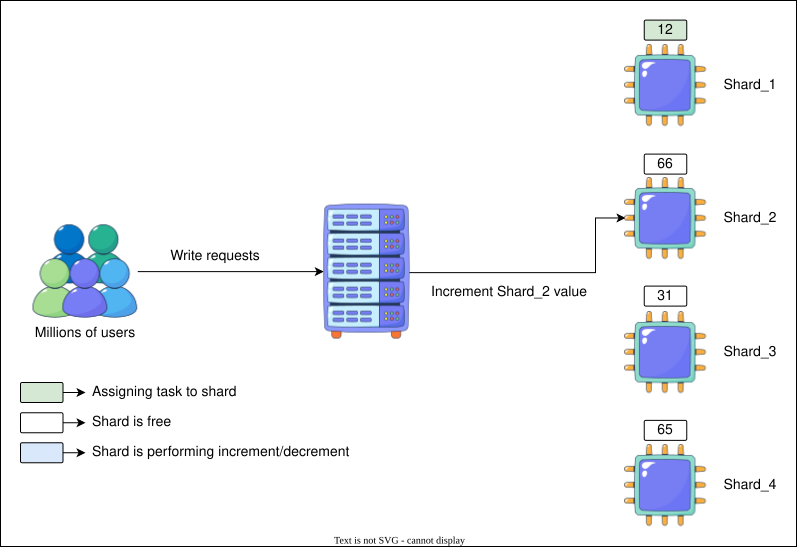

1 / 5

The server assigns a write request to the first free shard, shard\_1, with a counter value of 12, but shard\_1 has not yet fulfilled its previous request, and it will increment its counter once the request is completely processed.

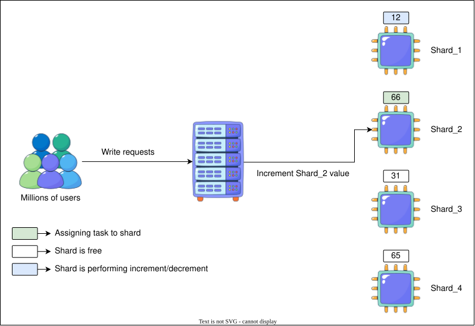

1 / 5

The server assigns another write request to the next free shard, shard\_2, with counter value 66, but shard\_2 has not yet fulfilled its previous request, and it will increment its counter once the request is completely processed.

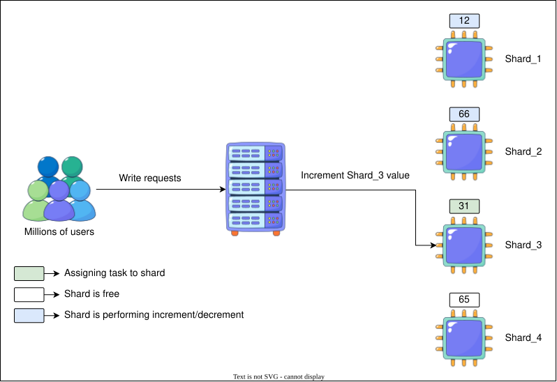

1 / 5

The server assigns another write request to the next free shard, shard\_3, with counter value 31, but shard\_3 has not yet fulfilled its previous request, and it will increment its counter once the request is completely processed.

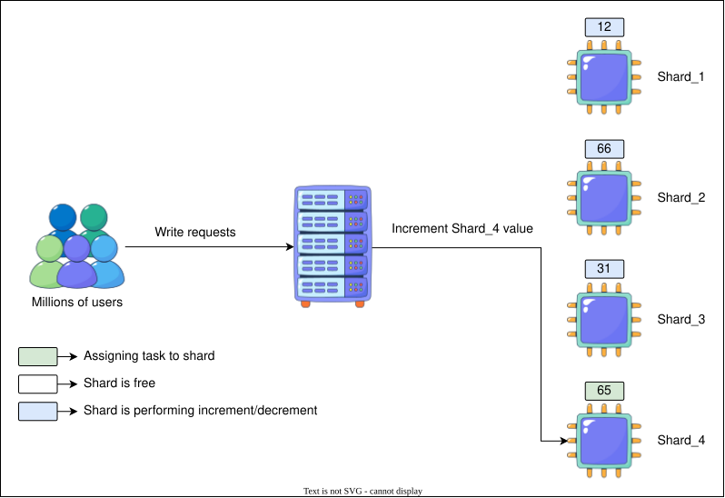

1 / 5

The server assigns another write request to the next free shard, shard\_4, with counter value 65, but shard\_4 has not yet fulfilled its previous request, and it will increment its counter once the request is completely processed.

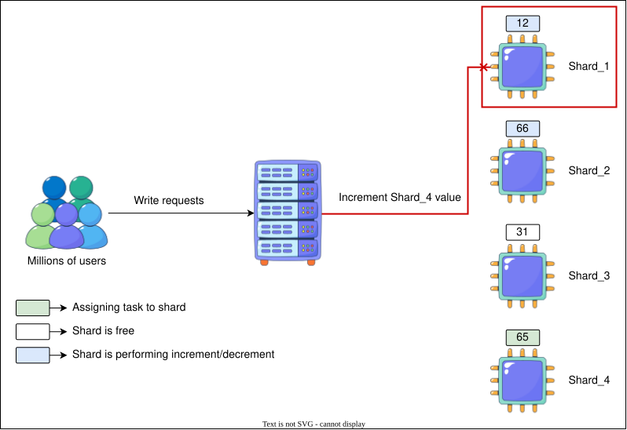

1 / 5

The server can’t perform the next write request until shard\_1 is busy; though shard\_3 is done with incrementing its counter and is free, we can’t utilize it because of the round-robin pattern that we’re following here.

#### Random selection[#](https://www.educative.io/courses/grokking-the-system-design-interview/detailed-design-of-sharded-counters#Random-selection)

Another simple approach is to select a shard uniformly at random for each write. The limitation of both round robin and random routing is that they do not account for dynamic load variation across the nodes hosting the shards. As a result, load can become unevenly distributed across shards. Load variability is common because each physical node typically runs multiple services and workloads.

#### Metrics-based selection[#](https://www.educative.io/courses/grokking-the-system-design-interview/detailed-design-of-sharded-counters#Metrics-based-selection)

The third approach is to select shards based on specific metrics. For example, a dedicated node (load balancer) manages the selection of the shards by reading the shards’ status. The slides below go over how sharded counters are created:

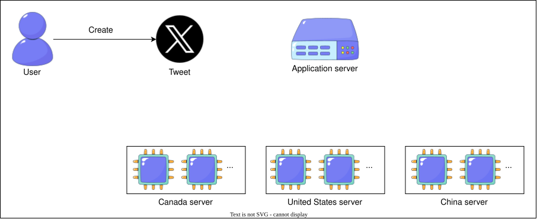

1 / 4

The user creates a tweet.

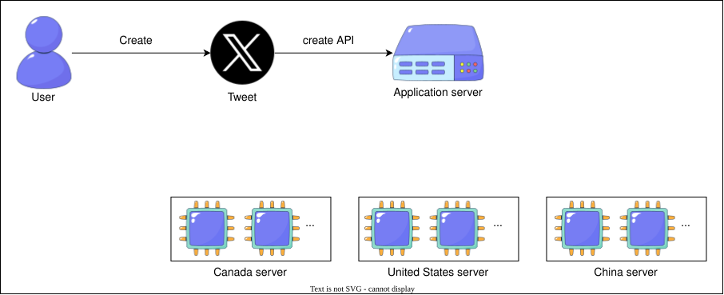

1 / 4

The user requests a counter using the create API.

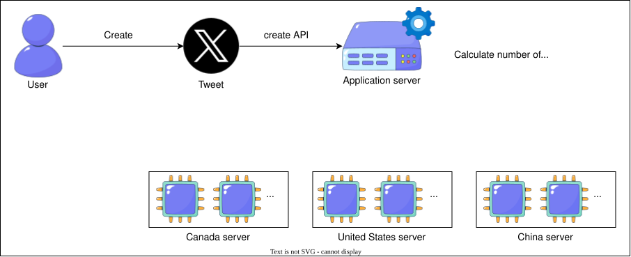

1 / 4

The application server calculates the number of shards based on some metrics.

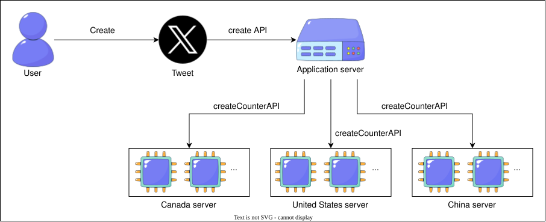

1 / 4

Requests to create shards for a specified counter using createCounter API are dispatched to geographically dispersed servers.

### Manage read requests[#](https://www.educative.io/courses/grokking-the-system-design-interview/detailed-design-of-sharded-counters#Manage-read-requests)

When a user sends a read request, the system sums the values across all shards for the requested counter (e.g., likes or replies). Doing this for every read results in high latency and low read throughput.

Deciding when to aggregate shard values is critical. With high write traffic, returning a perfectly current value is often impractical because the value may change immediately after it’s read. Instead, the system periodically aggregates shard values and caches the result. Reducing the aggregation interval increases accuracy.

1.

Can you think of a use case where sharded counters with the abovementioned consistency model might not be suitable?

Show Answer

Did you find this helpful?

## Using sharded counters for the Top K problem[#](https://www.educative.io/courses/grokking-the-system-design-interview/detailed-design-of-sharded-counters#Using-sharded-counters-for-the-Top-K-problem)

This section explains how sharded counters are used to solve the Top K problem, using Twitter trends as a real-world example. Here, **K** represents the number of top trends. Since millions of hashtags are used daily, tracking their counts and surfacing relevant trends, especially based on user location, is challenging.

Sharded counters enable high-throughput counting of hashtag usage at scale. For each hashtag, the system creates a counter and selects the shard count based on projected write volume, for example using follower counts as a proxy for expected traffic. Subsequent hashtag events update the existing sharded counter.

Trends are primarily computed based on regional popularity. To support this, Twitter maintains multiple counters per hashtag, in addition to a global counter. Key metrics include:

- **Region-wise hashtag count:** Measures how often a hashtag is used within a specific geographic area. For example, heavy use in New York City increases the likelihood that a hashtag will appear in local trends.
- **Time window:** Defines the time period over which hashtag usage is measured.

The system calculates the 24-hour count of the specified hashtag

Below is more detail on the above illustration:

- The **global hashtag counter** aggregates all location-based counters.
- **Location-based counters** track regional usage and compare it against a predefined threshold within a given time window to identify trending hashtags. For example, if the threshold is 10,000, a hashtag becomes visible in the trends timeline for users in that region once the count is reached. If similar thresholds are reached across multiple regions, the hashtag may appear globally.

Next, consider the Top K tweets in a user’s home timeline. These include tweets from followed accounts, liked tweets, and retweets from followed users. Tweets are ranked based on factors such as follower count and recency. Twitter may also surface promoted and popular tweets from non-followed accounts, based on location and overall popularity.

> **Note:** Twitter also uses other metrics to optimize Top K selection, but we’ve discussed the leading metrics here.

AI Powered

Saved

2 attempts left

Reset

Shard Selection Strategy

When millions of likes arrive for a celebrity’s tweet, which shard selection strategy (round-robin, random, metrics-based) would you use and why?

You have 2 attempts to answer.

## Placement of sharded counters[#](https://www.educative.io/courses/grokking-the-system-design-interview/detailed-design-of-sharded-counters#Placement-of-sharded-counters)

A key architectural decision is where to host sharded counters: on application servers, on dedicated cluster nodes, or at the edge (for example, within CDN infrastructure). The optimal placement depends on workload characteristics. In social feed workloads, deploying counters closer to users can reduce write latency and improve aggregation performance for heavy-hitter and Top-K queries.

1.

Should we lock all shards of a counter before accumulating their values?

Show Answer

Did you find this helpful?

Reads can rely on a scalable data store to serve counter values. For example, Cassandra can store region-specific counts (views, likes, comments, etc.) as the latest aggregated sum of a counter’s shards.

When users load a timeline, read requests are routed to nearby servers, which respond with these stored values. The same storage can support region-wise Top K trends: local Top K lists are sent to an application server, which merges them to produce a global Top K list. The application server then pushes the latest counter data to cache.

Separately, the system needs storage for shard metadata and mappings. Redis or Memcache can store:

- `tweetId` → counterId(s) (like/reply/retweet, etc.)
- `counterId` → list of shard IDs

Writes can be processed in parallel: requests map to the right counter, then pick a shard (often using randomized or load-aware selection) to apply increments/decrements. Aggregation runs periodically to sum shard values, and the result is stored back in Cassandra. The slides below help illustrate these points:

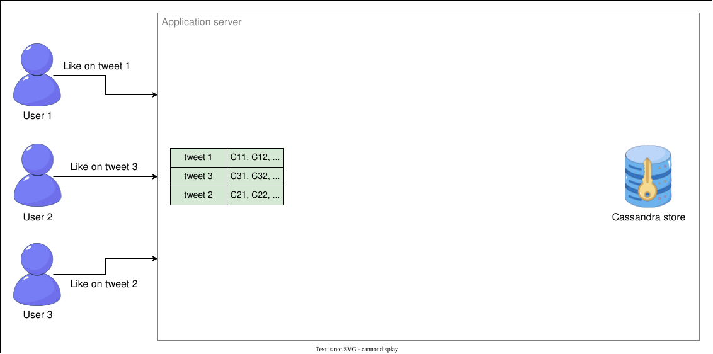

1 / 6

The users send write requests to the application server.

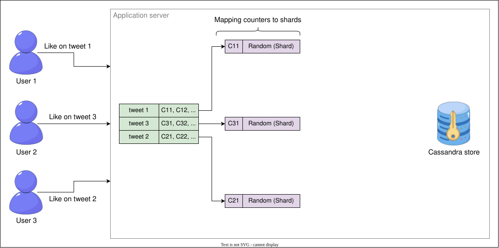

1 / 6

The application server identifies the appropriate counters against tweets in the Redis key-value store.

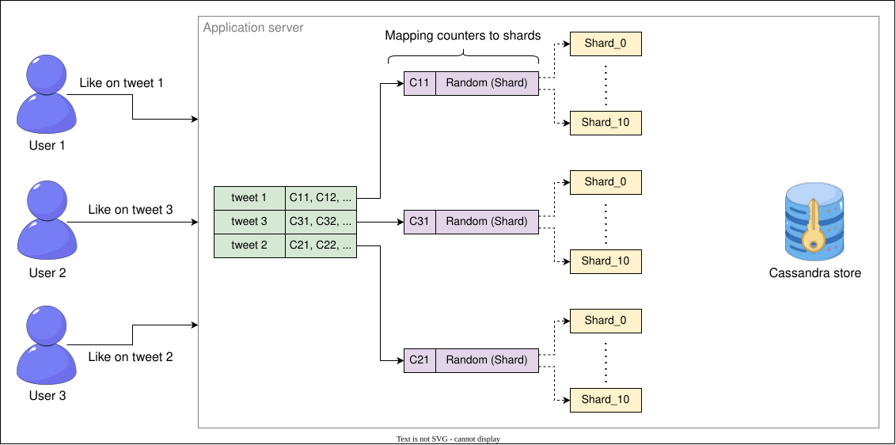

1 / 6

The application server randomly chooses the shards against counters in the Redis key-value store.

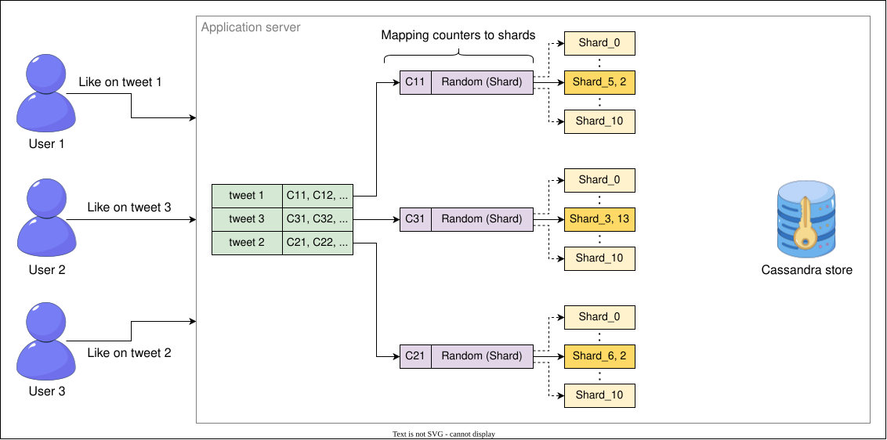

1 / 6

The selected shards are highlighted.

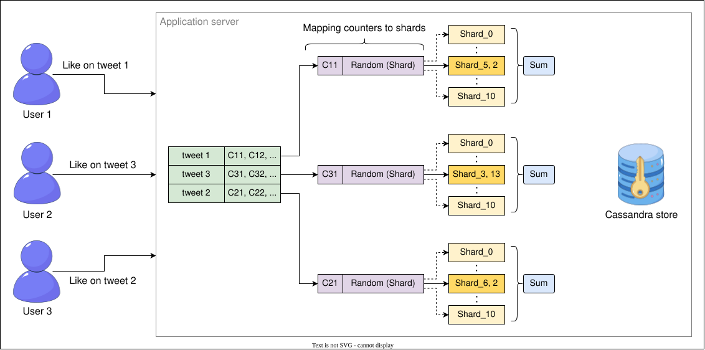

1 / 6

The sum of the values of all shards is computed.

## Requirements compliance[#](https://www.educative.io/courses/grokking-the-system-design-interview/detailed-design-of-sharded-counters#Requirements-compliance)

This section will evaluate sharded counters and explain how they increase performance by providing high availability, scalability, and reliability.

### Availability[#](https://www.educative.io/courses/grokking-the-system-design-interview/detailed-design-of-sharded-counters#Availability)

A single counter for any feature (such as likes, views, or replies) is prone to a single point of failure. Sharded counters eliminate a single point of failure by running many shards for a particular counter. The system remains available even if some shards go down or suffer a fault. This way, sharded counters provide high availability.

### Scalability[#](https://www.educative.io/courses/grokking-the-system-design-interview/detailed-design-of-sharded-counters#Scalability)

Sharded counters allow high horizontal scaling as needed. Shards running on additional nodes can be easily added to the system to scale up our operation capacity. Eventually, these additional shards also increase the system’s performance.

### Reliability[#](https://www.educative.io/courses/grokking-the-system-design-interview/detailed-design-of-sharded-counters#Reliability)

Another primary purpose of the sharded counters is to reduce the volume of write requests by mapping each write to a specific shard. Each write request is handled as it arrives, and there are no requests waiting in the queue. As a result, the hit ratio and the system’s reliability increase. Furthermore, the system periodically saves the computed counts in stable storage, such as Cassandra in this case.

## Conclusion[#](https://www.educative.io/courses/grokking-the-system-design-interview/detailed-design-of-sharded-counters#Conclusion)

Sharded counters are widely used in large-scale systems to improve performance under high write contention. They increase write scalability and reduce hot-key contention, which improves system stability under load. Sharded counters mitigate hot-key bottlenecks in heavy-hitter scenarios and serve as a building block for Top-K style analytics in large-scale systems.

High-Level Design of Sharded Counters

Quiz on the Sharded Counters' Design

Ask

[Detailed design](https://www.educative.io/courses/grokking-the-system-design-interview/detailed-design-of-sharded-counters#Detailed-design)

[Sharded counter creation](https://www.educative.io/courses/grokking-the-system-design-interview/detailed-design-of-sharded-counters#Sharded-counter-creation)

[Burst of write requests](https://www.educative.io/courses/grokking-the-system-design-interview/detailed-design-of-sharded-counters#Burst-of-write-requests)

[Round robin selection](https://www.educative.io/courses/grokking-the-system-design-interview/detailed-design-of-sharded-counters#Round-robin-selection)

[Random selection](https://www.educative.io/courses/grokking-the-system-design-interview/detailed-design-of-sharded-counters#Random-selection)

[Metrics-based selection](https://www.educative.io/courses/grokking-the-system-design-interview/detailed-design-of-sharded-counters#Metrics-based-selection)

[Manage read requests](https://www.educative.io/courses/grokking-the-system-design-interview/detailed-design-of-sharded-counters#Manage-read-requests)

[Using sharded counters for the Top K problem](https://www.educative.io/courses/grokking-the-system-design-interview/detailed-design-of-sharded-counters#Using-sharded-counters-for-the-Top-K-problem)

[Placement of sharded counters](https://www.educative.io/courses/grokking-the-system-design-interview/detailed-design-of-sharded-counters#Placement-of-sharded-counters)

[Requirements compliance](https://www.educative.io/courses/grokking-the-system-design-interview/detailed-design-of-sharded-counters#Requirements-compliance)

[Availability](https://www.educative.io/courses/grokking-the-system-design-interview/detailed-design-of-sharded-counters#Availability)

[Scalability](https://www.educative.io/courses/grokking-the-system-design-interview/detailed-design-of-sharded-counters#Scalability)

[Reliability](https://www.educative.io/courses/grokking-the-system-design-interview/detailed-design-of-sharded-counters#Reliability)

[Conclusion](https://www.educative.io/courses/grokking-the-system-design-interview/detailed-design-of-sharded-counters#Conclusion)