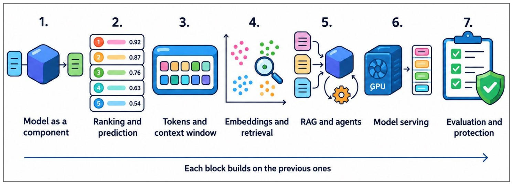

# Models_as_Components_in_a_System

Source: https://www.educative.io/courses/grokking-the-system-design-interview/models-as-components-in-a-system

---

[Home](https://www.educative.io/)

[Courses](https://www.educative.io/search?tab=courses)

[Grokking Modern System Design Interview](https://www.educative.io/courses/grokking-the-system-design-interview)

# Models as Components in a System

Learn how a model fits into a system as a component: the outputs it produces and how the application handles them, how training, inference, and orchestration differ, when to run inference synchronously, asynchronously, or ahead of time, where to host it, and how to fall back when a model is wrong or unavailable.

We'll cover the following...

- [Output types and how the system handles them](https://www.educative.io/courses/grokking-the-system-design-interview/models-as-components-in-a-system#Output-types-and-how-the-system-handles-them)
- [Training, inference, and orchestration](https://www.educative.io/courses/grokking-the-system-design-interview/models-as-components-in-a-system#Training-inference-and-orchestration)
- [Choosing an execution pattern](https://www.educative.io/courses/grokking-the-system-design-interview/models-as-components-in-a-system#Choosing-an-execution-pattern)
- [Where inference runs](https://www.educative.io/courses/grokking-the-system-design-interview/models-as-components-in-a-system#Where-inference-runs)
- [Planning for wrong and missing answers](https://www.educative.io/courses/grokking-the-system-design-interview/models-as-components-in-a-system#Planning-for-wrong-and-missing-answers)

Earlier chapters covered the building blocks of distributed systems, such as load balancers, caches, and queues. AI-enabled systems reuse all of them and add a new set of components, each with its own costs and failure modes. This chapter covers these AI building blocks, one per lesson. For each one, we look at what it does, where it sits in the architecture, what it costs, and how it fails:

- **Models as components in a system:** Where a model fits and how the system uses its output.
- **Ranking, prediction, and classification pipelines:** Scoring live requests within tight deadlines.
- **Tokens, context windows, and generation:** Budgeting what fits in one LLM request.
- **Embeddings and retrieval:** Finding relevant content by meaning, not just keywords.
- **Retrieval-augmented generation (RAG):** Grounding answers in evidence, and extending the pattern to agents.
- **Serving models within latency and cost budgets:** Running models fast and affordably at scale.
- **Evaluating and protecting AI features:** Proving a feature is good enough and safe enough to ship.

Each block builds on the ones before it, as the illustration below shows.

The seven AI building blocks for System Design

We start with the most fundamental block: the model itself. In System Design, a model is a component that turns input into an output, such as a score, a label, a ranked list, or a paragraph of text. Everything around it, from collecting inputs and applying business rules to storing results and handling failures, is ordinary application work.

Where the model sits and when it runs shape the whole feature. A fraud model on the checkout path must answer in tens of milliseconds, while a model that summarizes weekly reports can take minutes.

In this lesson, we define what the application expects from a model, separate training from inference, decide when and where inference runs, and plan for the moments when the model is wrong or unavailable.

## Output types and how the system handles them[#](https://www.educative.io/courses/grokking-the-system-design-interview/models-as-components-in-a-system#Output-types-and-how-the-system-handles-them)

A model’s role starts with the output it produces, and each output type implies different handling downstream:

- **Prediction:** A numeric estimate, such as a 35-minute delivery time or a fraud score of 0.92. Predictions usually feed business logic rather than the UI. A payment service approves low-risk transactions, blocks high-risk ones, and sends borderline cases to manual review.
- **Classification:** A discrete label, such as spam or not spam. Most classifiers output a probability, and a threshold turns it into the label. The label then drives routing, such as holding a comment for moderation.
- **Ranking:** An ordered list of items, often with scores, such as search results for “running shoes.” The system merges the ranking with product rules such as inventory, sponsored placement, and regional availability before showing it.
- **Generated content:** New text or media, such as a summary of a long support ticket. Users read it directly, so it needs the strongest validation: schema checks, content filters, and a fallback when the output is empty or off-topic.

A score is usually one input into a decision, while generated content is often the final thing a user reads. That difference sets the safety bar, the storage strategy, and the fallback design. The diagram below shows how each output type reaches a decision or the UI.

Output drives behavior

This output contract between the model and the application comes before any infrastructure choice.

## Training, inference, and orchestration[#](https://www.educative.io/courses/grokking-the-system-design-interview/models-as-components-in-a-system#Training-inference-and-orchestration)

A model’s lifecycle has three stages with different goals and constraints. Keeping them separate makes a design discussion clearer:

- **Training:** The offline process that builds or updates a model from historical labeled data, such as past transactions marked fraudulent or legitimate. It runs off the request path, can take hours or days, and is optimized for quality, reproducibility, and controlled rollout.
- **Inference:** Producing an output for new input with a trained model, either on the request path or in background jobs. It is optimized for latency, throughput, and cost.
- **Application orchestration:** The workflow around inference: fetching inputs, calling the model, validating and storing the output, triggering the next action, and capturing feedback.

**Note:** Training determines how good a model can be. Inference and orchestration determine whether the feature is fast, affordable, and reliable, which is where most System Design discussion focuses.

Orchestration does three jobs around every model call:

- **Feature retrieval:** Gather the model’s inputs from other services, such as amount, payment method, account age, and location for a fraud check. Bound the fetch latency and use sensible defaults when a value is missing.
- **Output handling:** Validate the result and map it to an action. A score becomes approve, decline, or review. Generated text is checked for length, emptiness, and policy violations before it is stored and shown.
- **Feedback capture:** Record reviewer decisions and user flags, such as false positives and unhelpful answers. These become labeled data for the next training run.

## Choosing an execution pattern[#](https://www.educative.io/courses/grokking-the-system-design-interview/models-as-components-in-a-system#Choosing-an-execution-pattern)

The execution pattern defines when inference runs relative to the user request. The choice depends on the required response time, acceptable staleness, and how well the feature tolerates a slow or unavailable model.

- **Synchronous:** Inference runs inside the request, such as scoring a payment at checkout before approving it. Use it for gating decisions the user must wait for. The cost is coupling: model latency and outages become request latency and outages.
- **Asynchronous:** The request is accepted first, and inference runs later, such as queuing a summary job for an uploaded document and showing the result when a worker finishes. The request path stays fast and resilient, at the price of a delay.
- **Precomputed:** Inference runs before anyone asks, such as nightly recommendations stored in a cache. Reads are fast and cheap at peak traffic, but results go stale when inputs change between runs.

The diagram below compares the three patterns.

When inference runs

**Practical tip:** Choose a pattern per decision point, not per product. A support assistant can stream a draft reply synchronously while it precomputes ticket tags overnight.

Streaming is a form of synchronous inference that returns generated text token by token, so users see output before generation finishes. The lesson on tokens and generation covers it in detail.

## Where inference runs[#](https://www.educative.io/courses/grokking-the-system-design-interview/models-as-components-in-a-system#Where-inference-runs)

Next, decide where inference runs. A managed endpoint is hosted by a provider, self-hosted serving runs on infrastructure your team operates, and an on-device model runs on the user’s phone or computer.

The table below compares them:

|  |  |  |  |  |
| --- | --- | --- | --- | --- |
| **Option** | **Who Manages Infrastructure** | **Strengths** | **Weaknesses** | **Best Fit Example** |
| **Managed endpoint** | Provider | Lowest operational burden; quick to launch | Less control over latency and customization; cost can rise with scale | Review summarization |
| **Self-hosted serving** | Your team | Strong latency control; scalable economics at high volume; full customization | Higher ops burden; requires infrastructure management and tuning | High-volume fraud scoring |
| **On-device execution** | Your team + end user device | Strong privacy; works offline; low server cost | Limited model size/performance; device compatibility constraints | Keyboard suggestions or photo tagging |

## Planning for wrong and missing answers[#](https://www.educative.io/courses/grokking-the-system-design-interview/models-as-components-in-a-system#Planning-for-wrong-and-missing-answers)

Serving location solves only part of reliability. A model-backed feature fails in two distinct ways, and each needs its own fallback:

- **Wrong or uncertain answers:** The model is healthy, but its output is unreliable. A confidence threshold on the output score decides when to fall back. A fraud score near the decision boundary goes to manual review, and a generated answer that fails validation is rejected before users see it.
- **Missing answers:** The model cannot respond because of a timeout, a failed deployment, or an outage. The trigger is the absence of an answer, so the fallback must not depend on the model.

A practical fallback chain covers both, and each step names the failure that triggers it:

- **Primary model:** Use the preferred model when it responds within its latency budget and passes validation.
- **Rules or human review:** For wrong or uncertain answers, route low-confidence cases to deterministic rules or a reviewer.
- **Alternate model:** For missing answers, call a smaller or older model when the main endpoint is down or slow.
- **Cached result:** For missing answers, serve the last known good result if one exists, such as yesterday’s recommendations.
- **Graceful degradation:** If nothing else works, keep the rest of the request working. A payment can require an extra verification step, and a product page can hide its AI-generated section.

The diagram below shows how each failure type leads to a different fallback.

Fallbacks by failure type

In short, a model is a component with an output contract, an execution pattern, a serving location, and fallbacks for both wrong and missing answers. Next, we look at ranking, prediction, and classification pipelines, where models must return scores, labels, and ordered lists within tight deadlines.

Quiz on the Sharded Counters' Design

Ranking, Prediction, and Classification Pipelines

Ask

[Output types and how the system handles them](https://www.educative.io/courses/grokking-the-system-design-interview/models-as-components-in-a-system#Output-types-and-how-the-system-handles-them)

[Training, inference, and orchestration](https://www.educative.io/courses/grokking-the-system-design-interview/models-as-components-in-a-system#Training-inference-and-orchestration)

[Choosing an execution pattern](https://www.educative.io/courses/grokking-the-system-design-interview/models-as-components-in-a-system#Choosing-an-execution-pattern)

[Where inference runs](https://www.educative.io/courses/grokking-the-system-design-interview/models-as-components-in-a-system#Where-inference-runs)

[Planning for wrong and missing answers](https://www.educative.io/courses/grokking-the-system-design-interview/models-as-components-in-a-system#Planning-for-wrong-and-missing-answers)