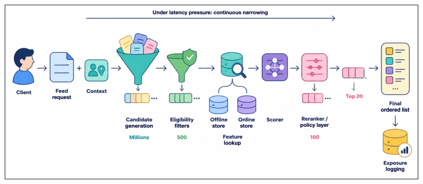

# Ranking,_Prediction,_and_Classification_Pipelines

Source: https://www.educative.io/courses/grokking-the-system-design-interview/ranking-prediction-and-classification-pipelines

---

[Home](https://www.educative.io/)

[Courses](https://www.educative.io/search?tab=courses)

[Grokking Modern System Design Interview](https://www.educative.io/courses/grokking-the-system-design-interview)

# Ranking, Prediction, and Classification Pipelines

Learn how ranking, prediction, and classification pipelines return results within tight deadlines: narrowing candidates before scoring, keeping features fresh and point-in-time correct, choosing between precomputed and online scoring, turning scores into actions with thresholds, and rolling out model changes safely.

We'll cover the following...

- [The ranking request path](https://www.educative.io/courses/grokking-the-system-design-interview/ranking-prediction-and-classification-pipelines#The-ranking-request-path)
  - [Request context and candidate generation](https://www.educative.io/courses/grokking-the-system-design-interview/ranking-prediction-and-classification-pipelines#Request-context-and-candidate-generation)
- [Feature timing and storage](https://www.educative.io/courses/grokking-the-system-design-interview/ranking-prediction-and-classification-pipelines#Feature-timing-and-storage)
  - [Offline and online feature stores](https://www.educative.io/courses/grokking-the-system-design-interview/ranking-prediction-and-classification-pipelines#Offline-and-online-feature-stores)
- [Precompute or score online](https://www.educative.io/courses/grokking-the-system-design-interview/ranking-prediction-and-classification-pipelines#Precompute-or-score-online)
- [Thresholds and decision outcomes](https://www.educative.io/courses/grokking-the-system-design-interview/ranking-prediction-and-classification-pipelines#Thresholds-and-decision-outcomes)
  - [False positives, false negatives, and multi-action outcomes](https://www.educative.io/courses/grokking-the-system-design-interview/ranking-prediction-and-classification-pipelines#False-positives-false-negatives-and-multi-action-outcomes)
- [Operating the pipeline](https://www.educative.io/courses/grokking-the-system-design-interview/ranking-prediction-and-classification-pipelines#Operating-the-pipeline)

Many AI features never generate text. They score things: which posts to show first, whether a payment looks fraudulent, or how long a delivery will take. These ranking, prediction, and classification pipelines usually run on the request path while the user waits, so they must return results within tight deadlines, often tens to a few hundred milliseconds.

A pipeline meets these deadlines by turning request context and features into a score, a class label, or an ordered list. The decision layer differs by task: a feed ranker must find candidates before ordering them, while a fraud model emits a risk score that the product maps to allow, verify, or block.

In this lesson, we trace the ranking request path, decide when features and scores are computed, turn scores into decisions with thresholds, and operate the pipeline safely as models change.

## The ranking request path[#](https://www.educative.io/courses/grokking-the-system-design-interview/ranking-prediction-and-classification-pipelines#The-ranking-request-path)

Consider a home feed that has about 150 ms to pick a few dozen posts from millions of candidates. Scoring every post with an expensive model would blow that budget, so the pipeline narrows the work in stages before expensive scoring begins.

### Request context and candidate generation[#](https://www.educative.io/courses/grokking-the-system-design-interview/ranking-prediction-and-classification-pipelines#Request-context-and-candidate-generation)

The request context identifies the user, surface, device, locale, and session state. These fields shape what the user is eligible to see and which retrieval methods are likely to find relevant items.

Candidate generation keeps scoring within the deadline. Cheap signals such as recent follows, coarse embeddings, trending pools, or past engagement shrink millions of items to a few hundred. This stage aims for high recall, because the pipeline can rank only what it retrieves.

Next, eligibility checks apply hard constraints:

- **Policy filters:** Remove blocked creators, age-restricted items, and unsafe content.
- **Availability filters:** Drop deleted, expired, or region-unavailable items.
- **Deduplication filters:** Remove duplicate items, such as the same post returned by two retrieval sources.

The remaining candidates move to feature lookup. Typical features include user history, item popularity, user-item interaction signals, and request context, fetched per user, per item, or per user-item pair.

A ranker scores each candidate, and a reranker adjusts the order with product rules such as diversity or freshness. The final list is returned to the client. If retrieval or the feature store times out, the service can fall back to cached popular items so the user still sees a useful feed.

The diagram below shows each stage.

Ranking pipeline stages

Each later stage is more expensive, so the design spends cheap computation broadly and expensive computation narrowly.

## Feature timing and storage[#](https://www.educative.io/courses/grokking-the-system-design-interview/ranking-prediction-and-classification-pipelines#Feature-timing-and-storage)

Features arrive on different schedules, so a model sees each feature only as fresh as its last update. Training data must reproduce that same timing, a requirement called point-in-time correctness.

Features can be grouped by when they become available:

- **Batch features:** Periodically computed values, such as seven-day watch history or weekly item popularity. They are cheap and stable but can be stale.
- **Streaming features:** Near-real-time updates, such as clicks in the last five minutes, recent failed payment attempts, or inventory changes. They capture recent behavior but need event pipelines with low-latency writes.
- **Request-time features:** Values known only when the request arrives, such as device, locale, timestamp, or the current query. They are the freshest but describe only the current request.

The diagram below shows how each feature type reaches the online and offline stores, and why training must respect the time of each event.

Feature freshness and point-in-time correctness

### Offline and online feature stores[#](https://www.educative.io/courses/grokking-the-system-design-interview/ranking-prediction-and-classification-pipelines#Offline-and-online-feature-stores)

An **offline feature store** keeps historical feature values for training and reproducibility. An **online feature store** serves low-latency lookups for live requests. The same logical feature often lives in both, with the online copy optimized for fast reads and the offline copy preserving history.

Strong designs state freshness requirements explicitly:

- **Acceptable staleness windows:** A seven-day preference aggregate may tolerate hourly updates, while fraud counters may need updates within seconds.
- **Missing-feature fallback:** If a recent-click counter is absent, the scorer can use a default value or a simpler model path.
- **Consistency checks:** Training and serving must use the same feature definitions to avoid training-serving skew.

**Note:** When training on an event from Tuesday at 2:00 PM, only features available by Tuesday at 2:00 PM are valid. Using Wednesday's aggregates leaks future information and overstates offline quality.

Feature timing leads directly to a common design choice: compute scores in advance or on demand.

## Precompute or score online[#](https://www.educative.io/courses/grokking-the-system-design-interview/ranking-prediction-and-classification-pipelines#Precompute-or-score-online)

The previous lesson introduced precomputed and synchronous inference as execution patterns. For scoring pipelines, the choice depends on how much the request context varies, how often features change, and how much of the latency budget remains after retrieval and feature lookup.

- **Precomputed scores** suit slow-moving tasks. A nightly churn-risk score or a coarse content prior can be stored once and served as a fast lookup. Latency is predictable and serving compute is low, though the score cannot react to the current session or fast-changing inventory, and new users or items have no score until the next batch run.
- **Online prediction** suits request-sensitive tasks because it can combine current request context and streaming features with batch features. Within a 150 ms feed budget, retrieval and feature lookup may already use most of the time, so online scoring must be efficient and have a fallback ready.
- Prediction tasks face the same choice. A delivery app usually predicts arrival time online from distance, traffic, and restaurant load, and it can fall back to a historical average for the route if the model times out.
- **Hybrid designs** often work best. Candidates or prior scores are precomputed, and a smaller set is reranked online with fresh signals.

The diagram below compares the three approaches.

Precompute, score online, or both

Ranking and classification can both produce a score. Ranking sorts candidates by it, and classification compares it to thresholds.

## Thresholds and decision outcomes[#](https://www.educative.io/courses/grokking-the-system-design-interview/ranking-prediction-and-classification-pipelines#Thresholds-and-decision-outcomes)

Consider a payment fraud model that outputs a risk score p between 0 and 1, where higher means more likely fraud. The product layer maps score bands to actions, separately from the model itself.

A simple three-band policy might look like this:

- **Low risk:** If p < 0.20, allow the transaction.
- **Medium risk:** If 0.20 ≤ p < 0.70, require extra verification.
- **High risk:** If p ≥ 0.70, block the transaction.

The score estimates risk, and the thresholds encode business policy. When a company changes its tolerance for fraud loss or customer friction, it can adjust thresholds without retraining the model. This works only while the score distribution stays stable. A retrained model usually shifts its scores, so thresholds must be re-tuned and validated for each new model version.

### False positives, false negatives, and multi-action outcomes[#](https://www.educative.io/courses/grokking-the-system-design-interview/ranking-prediction-and-classification-pipelines#False-positives-false-negatives-and-multi-action-outcomes)

In fraud detection, “positive” means the model flags a transaction as fraud. A threshold can therefore be wrong in two ways:

- **False positive:** The model flags a legitimate transaction as fraud, so a real customer is blocked or sent to extra verification.
- **False negative:** The model misses an actual fraud case and lets it through, so the business absorbs the loss.

How the threshold trades false positives for false negatives

Lowering the block threshold catches more fraud but blocks more legitimate customers, so false positives rise. Raising it reduces false blocks but lets more fraud through, so false negatives rise. Each error has a business cost, so choosing thresholds means balancing the two.

**Practical tip:** Keep the model score and the action policy separate in the design. That makes threshold changes faster, safer, and easier to audit.

Supporting more than two actions also helps. Allow, verify, and block handle uncertain cases better than a forced yes or no.

Thresholds improve over time only when the system learns which decisions were right.

## Operating the pipeline[#](https://www.educative.io/courses/grokking-the-system-design-interview/ranking-prediction-and-classification-pipelines#Operating-the-pipeline)

Both pipeline types improve only through feedback, and both can regress without raising errors. Operating them well comes down to three practices:

- **Log decisions and outcomes:** Ranking systems log impressions, clicks, hides, dwell time, and later conversions. Classification systems log each decision with its score, model version, and eventual outcome, such as a chargeback.
- **Handle delayed and biased labels:** Some outcomes arrive weeks or months later, as fraud chargebacks often do, so teams train and monitor with proxy labels such as reviewer decisions in the meantime. Labels are also biased by the current model: a blocked transaction never reveals whether it was fraud, so reviewer outcomes from the verify band are especially valuable.
- **Roll out in stages:** Run a new model in shadow mode on live traffic to compare latency and score distributions, then canary it on a small share of users, because only real exposure measures user impact. Expand only when product metrics hold, and keep the previous model ready for rollback.

**Note:** Freshness bugs and threshold mistakes often appear first as product symptoms such as stale feeds, false blocks, or missed risky cases, while serving logs show no errors.

In short, ranking narrows candidates before scoring, classification maps scores to actions through thresholds, and both depend on fresh, point-in-time-correct features and careful rollouts. Next, we move to generative models and the tokens and context windows that limit how much a model can read and write in one request.

Models as Components in a System

Tokens, Context Windows, and Generation

Ask

[The ranking request path](https://www.educative.io/courses/grokking-the-system-design-interview/ranking-prediction-and-classification-pipelines#The-ranking-request-path)

[Request context and candidate generation](https://www.educative.io/courses/grokking-the-system-design-interview/ranking-prediction-and-classification-pipelines#Request-context-and-candidate-generation)

[Feature timing and storage](https://www.educative.io/courses/grokking-the-system-design-interview/ranking-prediction-and-classification-pipelines#Feature-timing-and-storage)

[Offline and online feature stores](https://www.educative.io/courses/grokking-the-system-design-interview/ranking-prediction-and-classification-pipelines#Offline-and-online-feature-stores)

[Precompute or score online](https://www.educative.io/courses/grokking-the-system-design-interview/ranking-prediction-and-classification-pipelines#Precompute-or-score-online)

[Thresholds and decision outcomes](https://www.educative.io/courses/grokking-the-system-design-interview/ranking-prediction-and-classification-pipelines#Thresholds-and-decision-outcomes)

[False positives, false negatives, and multi-action outcomes](https://www.educative.io/courses/grokking-the-system-design-interview/ranking-prediction-and-classification-pipelines#False-positives-false-negatives-and-multi-action-outcomes)

[Operating the pipeline](https://www.educative.io/courses/grokking-the-system-design-interview/ranking-prediction-and-classification-pipelines#Operating-the-pipeline)