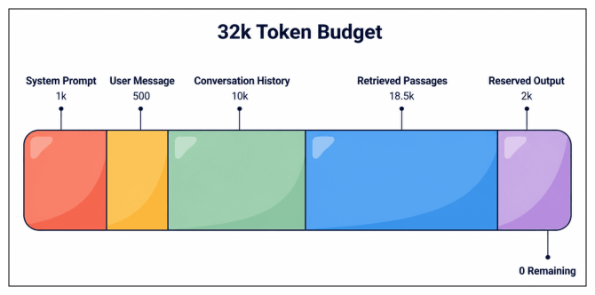

# Tokens,_Context_Windows,_and_Generation

Source: https://www.educative.io/courses/grokking-the-system-design-interview/tokens-context-windows-and-generation

---

[Home](https://www.educative.io/)

[Courses](https://www.educative.io/search?tab=courses)

[Grokking Modern System Design Interview](https://www.educative.io/courses/grokking-the-system-design-interview)

# Tokens, Context Windows, and Generation

Learn how to budget tokens in an LLM request: fitting the system prompt, history, and retrieved content within the context window while reserving room for output, separating stored history from sent context, understanding prefill and decode latency, and using truncation, summarization, prompt caching, streaming, and cancellation to control latency and cost.

We'll cover the following...

- [What fits in one request](https://www.educative.io/courses/grokking-the-system-design-interview/tokens-context-windows-and-generation#What-fits-in-one-request)
- [Stored history vs. sent context](https://www.educative.io/courses/grokking-the-system-design-interview/tokens-context-windows-and-generation#Stored-history-vs-sent-context)
- [How generation spends time](https://www.educative.io/courses/grokking-the-system-design-interview/tokens-context-windows-and-generation#How-generation-spends-time)
- [Controlling growth in a long chat](https://www.educative.io/courses/grokking-the-system-design-interview/tokens-context-windows-and-generation#Controlling-growth-in-a-long-chat)
  - [Ordering the controls](https://www.educative.io/courses/grokking-the-system-design-interview/tokens-context-windows-and-generation#Ordering-the-controls)
  - [Streaming, cancellation, and caching](https://www.educative.io/courses/grokking-the-system-design-interview/tokens-context-windows-and-generation#Streaming-cancellation-and-caching)

A token is the unit an LLM uses to measure both input and output. Tokens don’t map one-to-one to words or characters: a short string of code or JSON can use more tokens than a longer paragraph of prose. The context window is the maximum number of tokens one request can hold, and for most models it covers the full prompt plus the model’s reply.

Token counts directly affect answer quality, latency, and cost. More relevant context can improve an answer, but every extra token adds processing work and leaves less room for output.

In this lesson, we will budget the tokens in one request, separate stored history from sent context, see where generation time goes, and apply controls that keep long conversations fast and affordable. How content is retrieved and ranked comes in the next lesson; here, any selected content is simply input competing for space.

## What fits in one request[#](https://www.educative.io/courses/grokking-the-system-design-interview/tokens-context-windows-and-generation#What-fits-in-one-request)

A request is a budgeting problem where every chosen input plus the reserved output must fit within one fixed limit. In a typical chat application, the token consumers are:

- **System instructions:** Stable behavior, tone, and safety rules for the assistant.
- **Current user message:** The task the model must answer now.
- **Prior conversation turns:** Earlier exchanges that give the current turn its context.
- **Retrieved passages:** Optional external snippets the application chooses to include.
- **Reserved output tokens:** Capacity held back so the model has room to answer.

For example, with a 32k-token context window, an application might send a 1k-token system prompt, a 500-token user message, 10k tokens of history, and 18.5k tokens of retrieved content, while reserving 2k tokens for the reply. That adds up to exactly 32,000 tokens. In practice, designs keep some margin below the limit, because token estimates can be off and history grows between turns.

**Note:** Token counts depend on the tokenizer and the content type, so character counts are only a rough guide. Count tokens with the model’s own tokenizer and keep a safety margin below the window.

When a request exceeds the window, the API may reject it, the application may truncate input, or the application may shrink the allowed output. Each outcome should be a deliberate choice. The application, not the model, owns this budget and enforces it before sending the request.

The diagram below shows the whole request as one shared budget.

One shared token budget

Every additional input token reduces the room left for output in the same request, and the pressure grows with every turn of a long conversation.

## Stored history vs. sent context[#](https://www.educative.io/courses/grokking-the-system-design-interview/tokens-context-windows-and-generation#Stored-history-vs-sent-context)

Applications usually store far more conversation history than they send. The model can reason only over what is sent, not over everything in your database.

For example, after six turns of conversation, the database may keep every message for audit, analytics, and future reuse. The request for the seventh turn might include only the system prompt, the current message, the last two exchanges, and a summary of older discussion. Stored history is large and durable, while sent context is smaller and rebuilt for every request.

This distinction matters for three reasons:

- **Behavior:** The model can use only the details sent in the request.
- **Cost:** Storing history is cheap compared with sending long history on every turn.
- **Privacy scope:** What the application retains and what it exposes to a model provider are related but separate decisions.

Storage and request construction are separate responsibilities. The storage layer keeps conversation state over time, and the request builder selects what to include in each prompt within the budget. As history grows, the request builder's policy decides what gets trimmed first.

With the budget covered, the next question is where the time goes once a request is sent.

## How generation spends time[#](https://www.educative.io/courses/grokking-the-system-design-interview/tokens-context-windows-and-generation#How-generation-spends-time)

Generation happens in two stages. First, the model reads the entire tokenized input in **prefill**. Then it enters **decode** and produces the answer one token at a time.

These stages produce two latency measures that users feel. Time to first token (TTFT) covers queueing, tokenization, prefill, and network overhead. After the first token, the answer’s pace depends on decode speed, usually measured in tokens per second.

A useful approximation is:

Total latency≈ TTFT+Nout×cdecode\text{Total latency} \approx \ \text{TTFT} + N\_{\text{out}} \times c\_{\text{decode}}Total latency≈ TTFT+Nout​×cdecode​

Here, (Nout)(N\_{\text{out}})(Nout​) is the number of output tokens and (cdecode)(c\_{\text{decode}})(cdecode​) is the average decode time per token. Decode speed varies with server load and batching, so treat this as a reasoning aid rather than an exact formula.

A long prompt mainly lengthens prefill and raises TTFT, while a long answer mainly extends decode. In interactive features, users notice a slow first token more than a slightly longer stream.

The timeline below shows how prefill and decode divide one request:

Latency across one request

Controlling context growth is therefore about responsiveness as well as fitting within limits.

## Controlling growth in a long chat[#](https://www.educative.io/courses/grokking-the-system-design-interview/tokens-context-windows-and-generation#Controlling-growth-in-a-long-chat)

As a conversation grows, the request builder decides what to keep, compress, or drop. The system prompt and current message are fixed, and output tokens are reserved first, so history and retrieved content share what remains. Two selection policies are common:

- **Recency-based selection:** Keep the latest turns, which are usually the most relevant to the current question. It is simple, predictable, and fast, but an older, important fact can drop out.
- **Importance-based selection:** Keep turns by usefulness rather than age, such as earlier decisions, constraints, or user preferences. It preserves key facts better, at the cost of extra logic and occasional wrong guesses about what matters.

When selection alone isn’t enough, the request builder summarizes older turns into a shorter form. A summary keeps the main facts and drops exact wording, which lowers cost and TTFT but can occasionally lose a detail the next answer needs.

### Ordering the controls[#](https://www.educative.io/courses/grokking-the-system-design-interview/tokens-context-windows-and-generation#Ordering-the-controls)

A clear order of controls keeps requests predictable:

1. Reserve output tokens first.
2. Cap retrieval tokens.
3. Include the most useful recent turns.
4. Summarize older turns.
5. Drop low-value context if the request still does not fit.

### Streaming, cancellation, and caching[#](https://www.educative.io/courses/grokking-the-system-design-interview/tokens-context-windows-and-generation#Streaming-cancellation-and-caching)

Streaming improves how fast a response feels by showing tokens as they are decoded, but it doesn’t shorten prefill or TTFT. Cancellation and early stopping save the remaining decode work when a user navigates away, asks a new question, or has already seen enough, though prefill work already spent is not recovered.

Prompt caching lowers the cost of content that repeats across requests. Many providers and serving stacks reuse the prefill work for an identical prompt prefix, such as a long system prompt, which reduces TTFT and input cost. To benefit, keep stable content at the start of the prompt and put per-request content after it.

The table below summarizes what each control bounds.

## Comparison of Controls for a 32k Chat Assistant

|  |  |  |  |  |
| --- | --- | --- | --- | --- |
| **Control** | **What it bounds** | **Helps most with** | **Main downside** | **Example policy** |
| **Max output tokens** | Response length | Reducing total latency and cost | Can cut off useful detail | Cap replies at 800 tokens |
| **Recency truncation** | Old chat history kept in context | Fitting more recent turns | Loses older context | Keep last 12 turns only |
| **Importance-based selection** | History included by relevance | Preserving key details | May miss less obvious context | Retain top-scoring past messages |
| **History summarization** | Context from prior dialogue | Lowering context usage | Detail loss / summary drift | Summarize every 10 turns |
| **Retrieval token cap** | Retrieved document text | Reducing total cost | Omits supporting evidence | Limit retrieval to 18.5k tokens |
| **Streaming** | Wait before text appears | Perceived latency | Does not reduce TTFT or total compute | Stream tokens as generated |
| **Cancellation** | Ongoing generation time | Preventing wasted compute | Partial answer only | Stop generation on user interrupt |

Each control makes overflow behavior explicit. Set a cap for each category, as in the 32k example earlier, and enforce the caps in order, so an oversized request is visibly rejected, trimmed, or shortened instead of failing unpredictably.

In short, the context window is a fixed budget the application owns: reserve output first, send only the context that earns its tokens, and remember that long prompts delay the first token while long answers delay the rest. Next, we look at embeddings and retrieval, which decide what content earns a place in that budget.

Ranking, Prediction, and Classification Pipelines

Embeddings and Retrieval

Ask

[What fits in one request](https://www.educative.io/courses/grokking-the-system-design-interview/tokens-context-windows-and-generation#What-fits-in-one-request)

[Stored history vs. sent context](https://www.educative.io/courses/grokking-the-system-design-interview/tokens-context-windows-and-generation#Stored-history-vs-sent-context)

[How generation spends time](https://www.educative.io/courses/grokking-the-system-design-interview/tokens-context-windows-and-generation#How-generation-spends-time)

[Controlling growth in a long chat](https://www.educative.io/courses/grokking-the-system-design-interview/tokens-context-windows-and-generation#Controlling-growth-in-a-long-chat)

[Ordering the controls](https://www.educative.io/courses/grokking-the-system-design-interview/tokens-context-windows-and-generation#Ordering-the-controls)

[Streaming, cancellation, and caching](https://www.educative.io/courses/grokking-the-system-design-interview/tokens-context-windows-and-generation#Streaming-cancellation-and-caching)