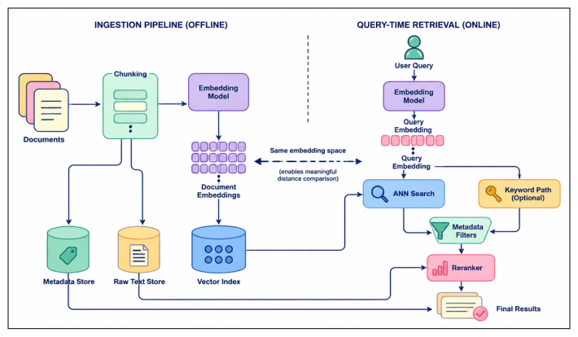

# Embeddings_and_Retrieval

Source: https://www.educative.io/courses/grokking-the-system-design-interview/embeddings-and-retrieval

---

[Home](https://www.educative.io/)

[Courses](https://www.educative.io/search?tab=courses)

[Grokking Modern System Design Interview](https://www.educative.io/courses/grokking-the-system-design-interview)

# Embeddings and Retrieval

Learn how embeddings let a system find content by meaning: the ingestion and query paths, approximate nearest-neighbor search, choosing keyword, vector, or hybrid search, placing filters and rerankers, measuring retrieval with recall@k and precision@k, and migrating embedding models safely.

We'll cover the following...

- [From query to candidates](https://www.educative.io/courses/grokking-the-system-design-interview/embeddings-and-retrieval#From-query-to-candidates)
  - [Ingestion path](https://www.educative.io/courses/grokking-the-system-design-interview/embeddings-and-retrieval#Ingestion-path)
  - [Request path](https://www.educative.io/courses/grokking-the-system-design-interview/embeddings-and-retrieval#Request-path)
- [Choosing keyword, vector, or hybrid](https://www.educative.io/courses/grokking-the-system-design-interview/embeddings-and-retrieval#Choosing-keyword-vector-or-hybrid)
- [Filtering and reranking](https://www.educative.io/courses/grokking-the-system-design-interview/embeddings-and-retrieval#Filtering-and-reranking)
- [Operating and evaluating retrieval](https://www.educative.io/courses/grokking-the-system-design-interview/embeddings-and-retrieval#Operating-and-evaluating-retrieval)

**Embeddings** are numeric representations of text that place content with similar meaning close together in a shared vector space. They let a search system match a question such as "Why did my subscription stop?" to an article titled "Renewal failures due to expired cards," even though the two share almost no words.

Similar meaning suggests relevance, not correctness. Retrieval therefore focuses on finding strong candidates, and later stages check whether a result is current, accurate, and safe to show.

In this lesson, we will explore retrieval workflows, search strategies, and ways to maintain reliable retrieval as embedding models evolve.

## From query to candidates[#](https://www.educative.io/courses/grokking-the-system-design-interview/embeddings-and-retrieval#From-query-to-candidates)

Semantic retrieval has two paths. During ingestion, documents are split into chunks and converted into document embeddings that are stored for search. At request time, the user's query is converted into a query embedding and compared against those stored vectors.

The diagram below shows both paths.

Semantic retrieval flow

Distance has meaning only when document vectors and query vectors come from the same embedding model or an explicitly compatible one.

### Ingestion path[#](https://www.educative.io/courses/grokking-the-system-design-interview/embeddings-and-retrieval#Ingestion-path)

Ingestion prepares data once so that retrieval is fast later. Documents are split into chunks, each chunk is embedded and stored in a vector index, and its original text and metadata, such as language, product line, or access tags, are stored alongside the chunk ID for display and filtering. The next lesson covers how to prepare those documents well, including extraction, cleaning, and chunking choices.

### Request path[#](https://www.educative.io/courses/grokking-the-system-design-interview/embeddings-and-retrieval#Request-path)

At request time, the system turns one query into a candidate set:

1. The query is embedded with the same embedding model.
2. The vector index finds the nearest stored chunk vectors.
3. The system returns the top *k* candidates for filtering or reranking.

Across 5 million chunks, comparing the query against every vector is too slow for interactive search. Approximate nearest-neighbor (ANN) indexes, such as HNSW graphs or IVF clusters, keep latency low by checking only a small fraction of vectors, in exchange for slightly imperfect recall. Index parameters tune that trade-off between speed and recall.

Suppose ANN returns 50 candidates and a reranker keeps the best 5. A larger *k* lets more relevant chunks survive the first stage, at the cost of more downstream compute and latency. A smaller *k* is faster and cheaper, but a relevant chunk that is missed here cannot be recovered later.

If the embedding service is unavailable, the system can fall back to keyword-only search. Relevance changes in that mode, so make the active retrieval mode visible in logs and metrics.

## Choosing keyword, vector, or hybrid[#](https://www.educative.io/courses/grokking-the-system-design-interview/embeddings-and-retrieval#Choosing-keyword-vector-or-hybrid)

The best retrieval strategy follows the queries your users actually send.

- **Keyword search:** Matches literal terms through an inverted index, typically scored with BM25. It excels when users know the exact identifier, product name, or phrase. For a query like ERR\_4021 refund failure, the error code carries most of the meaning, and exact matching finds the right page reliably.
- **Vector search:** Matches meaning rather than wording. It excels when users paraphrase or describe a problem in their own terms. For printer won’t connect after update, the best article might be titled “Wi-Fi setup after firmware changes,” and semantic matching connects the two.
- **Hybrid search:** Runs both and merges the two candidate lists, often with reciprocal rank fusion, which combines rank positions so the two scoring scales don’t need to be comparable. It suits mixed queries such as ERR\_4021 after changing card, which need both exact and semantic matching.

**Practical tip:** Choose hybrid when your query mix calls for it. It often improves recall, but it adds a second index, score-fusion logic, and some latency.

## Filtering and reranking[#](https://www.educative.io/courses/grokking-the-system-design-interview/embeddings-and-retrieval#Filtering-and-reranking)

After the first candidate set is retrieved, two jobs remain: enforce constraints, then refine the order.

Metadata filtering restricts results by properties unrelated to meaning, such as language, product line, freshness within 90 days, or access permissions. Filters answer "Is this document eligible?" rather than "Is it similar?"

Pre-filtering applies restrictions before or during ANN search, which keeps every candidate slot useful, though it needs partitioned or filter-aware indexes, and very selective filters can slow some ANN indexes. Post-filtering applies restrictions after retrieval, which is simpler to add but can spend slots on ineligible documents. For example, if 50 candidates are retrieved and only 8 pass an access check, the reranker has only 8 to choose from, and relevant eligible documents may never have been retrieved.

The diagram below compares the two pipelines:

Filter placement trade-off

Filter placement shapes both cost and relevance, so choose it based on how selective your filters are.

A **reranker** refines what retrieval found. Retrieval is broad and fast, while reranking is narrow and precise. A reranker can reorder the top 50 candidates, but it cannot recover a document that never reached them.

**Note:** High embedding similarity does not imply factual correctness, freshness, or policy equivalence. A semantically related chunk can still be obsolete, misleading, or unauthorized.

## Operating and evaluating retrieval[#](https://www.educative.io/courses/grokking-the-system-design-interview/embeddings-and-retrieval#Operating-and-evaluating-retrieval)

Judge retrieval by the quality of its candidates and the cost of producing them. Recall@k is the fraction of all relevant documents that appear in the top k results, and precision@k is the fraction of the top k results that are relevant. Raising k from 20 to 50 can improve recall, but it adds reranking cost and response time.

**Note:** If top-5 quality matters most, measure both candidate recall and final ranked quality. Good reranking cannot compensate for poor first-stage recall.

Retrieval quality also depends on keeping embeddings consistent as models change.

- **Compatibility:** Query and document vectors must share one compatible space. If documents are embedded with `embedder-v1` and queries with `embedder-v2`, distances stop being meaningful and retrieval breaks, even when both models come from the same provider.
- **Versioning:** Record the embedding model version in each chunk's metadata. This makes quality regressions traceable and supports rollback and migration.
- **Migration:** When moving from `embedder-v1` to `embedder-v2`, keep the two vector spaces separate and use a controlled pattern:

  - **Shadow index:** Build a second index with the new model and compare retrieval quality before cutover.
  - **Batch re-embedding:** Recompute embeddings offline for the full corpus and switch once validation passes.
  - **Incremental migration:** Re-embed subsets gradually into the new index, often starting with high-traffic or recently updated content, and keep serving queries from the old index until the new one is complete.

The diagram below shows a shadow-index migration.

Controlled index migration

In short, embeddings turn search into a nearest-neighbor problem, and the main design levers are top k, filter placement, reranking, the choice of keyword, vector, or hybrid search, and disciplined embedding versioning. Next, we look at retrieval-augmented generation, where retrieved content grounds a model’s answer.

Tokens, Context Windows, and Generation

Retrieval-Augmented Generation

Ask

[From query to candidates](https://www.educative.io/courses/grokking-the-system-design-interview/embeddings-and-retrieval#From-query-to-candidates)

[Ingestion path](https://www.educative.io/courses/grokking-the-system-design-interview/embeddings-and-retrieval#Ingestion-path)

[Request path](https://www.educative.io/courses/grokking-the-system-design-interview/embeddings-and-retrieval#Request-path)

[Choosing keyword, vector, or hybrid](https://www.educative.io/courses/grokking-the-system-design-interview/embeddings-and-retrieval#Choosing-keyword-vector-or-hybrid)

[Filtering and reranking](https://www.educative.io/courses/grokking-the-system-design-interview/embeddings-and-retrieval#Filtering-and-reranking)

[Operating and evaluating retrieval](https://www.educative.io/courses/grokking-the-system-design-interview/embeddings-and-retrieval#Operating-and-evaluating-retrieval)