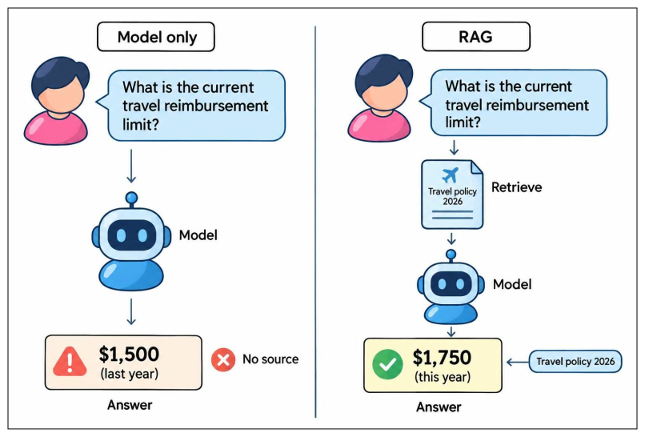

# Retrieval-Augmented_Generation

Source: https://www.educative.io/courses/grokking-the-system-design-interview/retrieval-augmented-generation

---

[Home](https://www.educative.io/)

[Courses](https://www.educative.io/search?tab=courses)

[Grokking Modern System Design Interview](https://www.educative.io/courses/grokking-the-system-design-interview)

# Retrieval-Augmented Generation

Learn how retrieval-augmented generation grounds answers in evidence: building a versioned, permission-aware knowledge base offline, retrieving and assembling context online, handling missing, stale, unauthorized, and unsupported answers, and extending the pattern to agents that call tools within strict limits.

We'll cover the following...

- [The knowledge base is built offline](https://www.educative.io/courses/grokking-the-system-design-interview/retrieval-augmented-generation#The-knowledge-base-is-built-offline)
  - [Extraction and cleaning](https://www.educative.io/courses/grokking-the-system-design-interview/retrieval-augmented-generation#Extraction-and-cleaning)
  - [Chunking, embedding, and indexing](https://www.educative.io/courses/grokking-the-system-design-interview/retrieval-augmented-generation#Chunking-embedding-and-indexing)
- [Chunking details that change answer quality](https://www.educative.io/courses/grokking-the-system-design-interview/retrieval-augmented-generation#Chunking-details-that-change-answer-quality)
- [How a query becomes a grounded answer](https://www.educative.io/courses/grokking-the-system-design-interview/retrieval-augmented-generation#How-a-query-becomes-a-grounded-answer)
  - [Authorization and retrieval](https://www.educative.io/courses/grokking-the-system-design-interview/retrieval-augmented-generation#Authorization-and-retrieval)
  - [Context assembly and generation](https://www.educative.io/courses/grokking-the-system-design-interview/retrieval-augmented-generation#Context-assembly-and-generation)
- [Failure modes and safeguards](https://www.educative.io/courses/grokking-the-system-design-interview/retrieval-augmented-generation#Failure-modes-and-safeguards)
- [Extending RAG to agents and tool use](https://www.educative.io/courses/grokking-the-system-design-interview/retrieval-augmented-generation#Extending-RAG-to-agents-and-tool-use)

**Retrieval-augmented generation (RAG)** is a design pattern in which the system retrieves supporting documents first and then asks the model to answer from that evidence rather than from memory alone. The model still writes the response, but answer quality depends mostly on whether the system found the right evidence.

A model’s built-in knowledge has three gaps that RAG addresses:

- **Freshness:** A model knows only what was in its training data, which stops at a cutoff date. Retrieval brings in documents that changed yesterday.
- **Private knowledge:** Internal wikis, tickets, and contracts were never part of the training data.
- **Access control and traceability:** Retrieved passages can be filtered by the user’s permissions and cited, so every answer can be checked against its source.

For example, when an employee asks an internal assistant about the current travel reimbursement limit, retrieving this year’s policy produces a correct, cited answer. Relying on model memory could produce last year’s figure, or an invented one.

The illustration below contrasts the two approaches.

Answering from memory vs. from evidence

RAG is not always the right tool. When the relevant content is small and already known, such as one product manual, passing it directly in the prompt is simpler. Fine-tuning changes how a model behaves, such as its tone or output format, but it is a poor way to add facts that change often.

In this lesson, we will explore knowledge base design, retrieval workflows, safeguards for generating reliable, grounded answers, and how agents extend RAG into multistep tool use.

## The knowledge base is built offline[#](https://www.educative.io/courses/grokking-the-system-design-interview/retrieval-augmented-generation#The-knowledge-base-is-built-offline)

Online answer quality depends on offline preparation. Before anyone asks a question, the system turns source documents into retrievable units with the metadata needed for freshness, traceability, and access control.

### Extraction and cleaning[#](https://www.educative.io/courses/grokking-the-system-design-interview/retrieval-augmented-generation#Extraction-and-cleaning)

**Extraction** pulls content from sources such as wikis, policy documents, ticket histories, or document stores. Each record carries text plus metadata, typically `doc_id`, source, section title, last-modified time, and version. Version matters whenever users ask about the "latest" or "current" rule.

After extraction, cleaning keeps noise out of retrieval in three ways.

- **Boilerplate removal:** Headers, footers, navigation text, and legal banners are stripped because they add tokens without adding meaning.
- **Deduplication:** Near-identical copies are merged so that repeated content does not crowd the results.
- **Filtering unusable content:** Corrupted OCR output, empty pages, and irrelevant attachments are dropped so that they never become candidates.

Cleaning shapes everything downstream. If an important document is badly extracted and then discarded, no retrieval step can bring that evidence back.

### Chunking, embedding, and indexing[#](https://www.educative.io/courses/grokking-the-system-design-interview/retrieval-augmented-generation#Chunking-embedding-and-indexing)

Cleaned documents are split into chunks, the units the retriever searches. Chunks can follow headings and paragraphs or use fixed token windows. Heading-based chunks often preserve meaning best for structured documents such as policies and manuals.

**Note:** A chunk without version metadata can still be retrieved, but it cannot reliably answer "latest" questions or be replaced safely during updates. Most designs either remove superseded versions during reingestion or keep them marked as superseded and filter to the latest version at retrieval.

Next, the system computes **embeddings** for each chunk. Finally, chunks and metadata are written to an index. The index must keep filters such as access level and version, because the online path can only use what ingestion prepared.

The diagram below shows the ingestion pipeline.

Offline ingestion flow

Ingestion decisions determine what evidence is available online, and chunking is where small changes make the biggest difference.

## Chunking details that change answer quality[#](https://www.educative.io/courses/grokking-the-system-design-interview/retrieval-augmented-generation#Chunking-details-that-change-answer-quality)

Chunking decides what the retriever can find and how much prompt space each piece of evidence uses.

- **Boundaries:** Chunks that are too small lose context. A rule such as "Refunds are available within 30 days" may depend on the next sentence, which excludes digital purchases. Chunks that are too large keep context but add noise, which wastes prompt budget and lowers retrieval precision.
- **Overlap:** Overlap protects rules whose exceptions fall across a boundary. Fixed windows could place "Refunds are available within 30 days" in one chunk and "except for digital purchases" in the next. With overlap, at least one chunk is likely to contain both.
- **Identifiers:** Identifiers should include the document and its version in addition to the filename. This lets citations distinguish version 1 from version 2 and lets reingestion replace the right chunks.

**Practical tip:** Start chunking by document structure when headings are meaningful. Fall back to token windows when the source format is messy or lacks stable section markers.

With the knowledge base ready, the online path takes over, and permissions and prompt limits matter as much as relevance.

## How a query becomes a grounded answer[#](https://www.educative.io/courses/grokking-the-system-design-interview/retrieval-augmented-generation#How-a-query-becomes-a-grounded-answer)

Each query moves through a controlled sequence from authorization to a cited answer.

### Authorization and retrieval[#](https://www.educative.io/courses/grokking-the-system-design-interview/retrieval-augmented-generation#Authorization-and-retrieval)

Authorization comes first, so the system searches only documents the user is allowed to see. This keeps restricted content, such as HR case notes, out of the candidate set for users without access.

Retrieval then runs the pipeline from the previous lesson: it selects the top *k* candidate chunks, and a reranker scores them more precisely against the query. Version metadata, applied as a filter or a boost, makes sure the current policy wins over older copies.

### Context assembly and generation[#](https://www.educative.io/courses/grokking-the-system-design-interview/retrieval-augmented-generation#Context-assembly-and-generation)

Context assembly chooses which reranked chunks fit within the token budget, orders them, and attaches source labels. Thoughtful ordering and a sensible budget keep the most important evidence in the prompt.

**Note:** Relevance is only one requirement. A highly relevant chunk can still be unusable if it is unauthorized, stale, or crowded out by the context budget.

Generation comes last. The prompt instructs the model to answer from the provided evidence, cite its sources, and say so when the evidence is insufficient. When the evidence does not answer the question, a clear "I can't answer that from the available documents" is the correct outcome. When sources conflict, the answer should prefer the current, authoritative version or state the conflict.

The diagram below shows the online flow.

Online grounded answering

## Failure modes and safeguards[#](https://www.educative.io/courses/grokking-the-system-design-interview/retrieval-augmented-generation#Failure-modes-and-safeguards)

RAG failures are predictable, and each one starts at a specific stage of the pipeline. The table below maps each failure to its root cause, visible symptom, and preferred response.

|  |  |  |  |
| --- | --- | --- | --- |
| **Failure mode** | **Root cause in the pipeline** | **Visible symptom** | **Preferred response** |
| **Missing evidence** | Content was never extracted, chunked poorly, or ranked below the top k | Answer is incomplete or hedged | Ask for more context or broaden retrieval |
| **Stale content** | Index contains outdated policy documents | Last year's reimbursement limit appears in the answer | Version-aware reingestion that replaces changed chunks and removes deleted ones |
| **Unauthorized retrieval** | Access metadata is missing or ignored during retrieval | Restricted content, such as HR case notes, shapes an answer | Filter by user permissions at retrieval and audit returned chunks |
| **Unsupported answer** | Generation exceeds retrieved evidence | Confident claim with no citation support | Constrain the answer to evidence or refuse |

**Note:** Retrieved content should be treated as untrusted input. It can be outdated, low authority, adversarial, or simply wrong, so the system should treat it as evidence, not instructions. This reduces, but does not remove, the risk of instructions injected inside documents.

## Extending RAG to agents and tool use[#](https://www.educative.io/courses/grokking-the-system-design-interview/retrieval-augmented-generation#Extending-RAG-to-agents-and-tool-use)

RAG retrieves once, then generates. Many features need more: look up an order, check the refund policy, then issue the refund. An agent generalizes the pattern by letting the model choose the next action from a set of tools, observe the result, and decide again until the task is done or a stop condition fires. Retrieval becomes one tool among several, alongside database reads, API calls, and code execution.

For example, a support agent handling “I want a refund for order 1182” might run these steps:

- Search the knowledge base for the refund policy (read-only tool).
- Look up the order to get the purchase date and item type (read-only tool).
- Check eligibility against the policy: within 30 days and not a digital purchase.
- Propose the refund, which pauses at an approval gate because it moves money.
- After approval, call the refund API with an idempotency key, so a retry cannot refund twice.

No step is hard-coded: the model chose each one based on what the previous step returned. That flexibility is what makes agents useful, and it is also why the orchestrator must constrain them.

Architecturally, an agent is a loop owned by an orchestrator, not by the model:

- **Tool registry:** Each tool has a typed schema, a timeout, and a permission scope. The model proposes calls; the orchestrator validates the arguments and executes them with the user’s permissions, never broader ones.
- **Loop control:** A step limit, a token budget, and a wall-clock deadline bound every run. Without them, one confused plan can loop until it exhausts the cost budget.
- **State and checkpoints:** The orchestrator records each step so a long task resumes after a tool failure or timeout instead of starting over.
- **Side-effect gates:** Read-only tools run freely. Writes such as refunds, emails, or deployments need idempotency keys and, above a risk threshold, human approval.

The diagram below shows this loop and the guards around it.

An agent is a loop owned by the orchestrator

**Note:** Tool results are untrusted input, just like retrieved documents. A ticket or web page that says “ignore previous instructions” must not be able to trigger a tool call the user didn’t ask for.

Each step adds an inference call, so an agent multiplies the latency and cost of a single RAG request. Prefer a fixed pipeline when the steps are known in advance, and use an agent only when the next step depends on what the previous one returned.

In short, RAG answer quality is decided mostly before generation: by versioned, permission-aware ingestion, careful retrieval and context assembly, and safeguards at each stage, while agents extend the pattern into bounded loops of tool calls. Next, we look at serving models within latency and cost budgets.

Embeddings and Retrieval

Serving Models within Latency and Cost Budgets

Ask

[The knowledge base is built offline](https://www.educative.io/courses/grokking-the-system-design-interview/retrieval-augmented-generation#The-knowledge-base-is-built-offline)

[Extraction and cleaning](https://www.educative.io/courses/grokking-the-system-design-interview/retrieval-augmented-generation#Extraction-and-cleaning)

[Chunking, embedding, and indexing](https://www.educative.io/courses/grokking-the-system-design-interview/retrieval-augmented-generation#Chunking-embedding-and-indexing)

[Chunking details that change answer quality](https://www.educative.io/courses/grokking-the-system-design-interview/retrieval-augmented-generation#Chunking-details-that-change-answer-quality)

[How a query becomes a grounded answer](https://www.educative.io/courses/grokking-the-system-design-interview/retrieval-augmented-generation#How-a-query-becomes-a-grounded-answer)

[Authorization and retrieval](https://www.educative.io/courses/grokking-the-system-design-interview/retrieval-augmented-generation#Authorization-and-retrieval)

[Context assembly and generation](https://www.educative.io/courses/grokking-the-system-design-interview/retrieval-augmented-generation#Context-assembly-and-generation)

[Failure modes and safeguards](https://www.educative.io/courses/grokking-the-system-design-interview/retrieval-augmented-generation#Failure-modes-and-safeguards)

[Extending RAG to agents and tool use](https://www.educative.io/courses/grokking-the-system-design-interview/retrieval-augmented-generation#Extending-RAG-to-agents-and-tool-use)