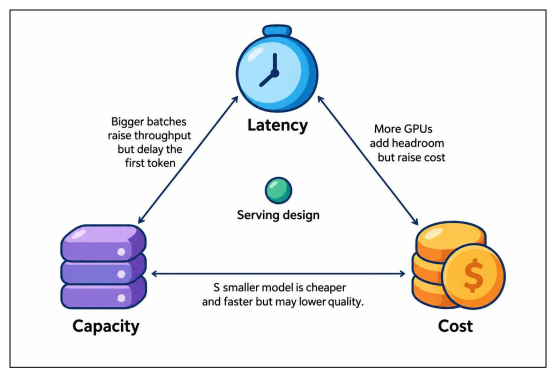

# Serving_Models_within_Latency_and_Cost_Budgets

Source: https://www.educative.io/courses/grokking-the-system-design-interview/serving-models-within-latency-and-cost-budgets

---

[Home](https://www.educative.io/)

[Courses](https://www.educative.io/search?tab=courses)

[Grokking Modern System Design Interview](https://www.educative.io/courses/grokking-the-system-design-interview)

# Serving Models within Latency and Cost Budgets

Learn how to serve generative models within latency and cost budgets: sizing capacity from prefill and decode token demand, placing routing, admission, and model-selection controls on the request path, tuning batching within GPU and KV-cache memory limits, reusing work with response and prefix caches, and degrading gracefully under overload.

We'll cover the following...

- [From demand to capacity](https://www.educative.io/courses/grokking-the-system-design-interview/serving-models-within-latency-and-cost-budgets#From-demand-to-capacity)
- [Request flow and control points](https://www.educative.io/courses/grokking-the-system-design-interview/serving-models-within-latency-and-cost-budgets#Request-flow-and-control-points)
  - [API entry](https://www.educative.io/courses/grokking-the-system-design-interview/serving-models-within-latency-and-cost-budgets#API-entry)
  - [Scheduler and workers](https://www.educative.io/courses/grokking-the-system-design-interview/serving-models-within-latency-and-cost-budgets#Scheduler-and-workers)
- [Batching and memory limits](https://www.educative.io/courses/grokking-the-system-design-interview/serving-models-within-latency-and-cost-budgets#Batching-and-memory-limits)
  - [KV-cache behavior](https://www.educative.io/courses/grokking-the-system-design-interview/serving-models-within-latency-and-cost-budgets#KV-cache-behavior)
- [Reusing work with caches](https://www.educative.io/courses/grokking-the-system-design-interview/serving-models-within-latency-and-cost-budgets#Reusing-work-with-caches)
- [Behavior under overload](https://www.educative.io/courses/grokking-the-system-design-interview/serving-models-within-latency-and-cost-budgets#Behavior-under-overload)

**Model serving** is the part of a system that exposes a trained model through an inference API and turns incoming demand into responses. Its job is to keep the API responsive and affordable as load changes. This lesson focuses on online serving for generation workloads such as chat and text completion.

Serving decisions balance three linked groups of budgets:

- **Latency:** Time to first token (TTFT), when streaming begins, and total response latency, when the full answer is complete.
- **Capacity:** Request rate coming in, throughput going out (best measured in tokens per second), and GPU memory, which limits how many requests can run at once.
- **Cost:** Cost per request or per token, which decides whether the design is affordable.

These budgets move together. Raising concurrency increases throughput but can add queueing and memory pressure, and larger batches lower cost per token but can delay the first token.

The illustration below shows how these trade-offs pull against each other.

Serving balances latency, capacity, and cost

In this lesson, we will size capacity from token demand, place control points along the request path, tune batching within memory limits, and keep the system usable during overload.

## From demand to capacity[#](https://www.educative.io/courses/grokking-the-system-design-interview/serving-models-within-latency-and-cost-budgets#From-demand-to-capacity)

Sizing starts by translating requests into token work. A generation request has two phases, in which **prefill** processes the input and builds attention state, and **decode** generates output one token at a time. Request count alone hides this difference, so capacity estimates should track both.

For example, consider a chat feature on a 7B-parameter model with this workload:

- **Traffic:** 20 requests per second, with bursts to 60.
- **Tokens per request:** 1,500 input and 200 output on average.
- **Targets:** p95 TTFT of 700 ms and p95 total latency of 4 seconds.

Steady load is therefore about 30,000 prefill tokens and 4,000 decode tokens per second.

Prefill and decode cost very different amounts per token. Prefill processes the whole prompt in parallel, so a GPU handles many prompt tokens per second. Decode produces one token per step for each active request, so its rate per GPU is far lower. Suppose that, at the latency targets, one GPU sustains about 10,000 prefill tokens per second and about 1,500 decode tokens per second across its batched requests:

- **Prefill:** 30,000 ÷ 10,000 = 3.0 GPUs’ worth of work.
- **Decode:** 4,000 ÷ 1,500 ≈ 2.7 GPUs’ worth of work.
- **Total:** About 5.7 GPUs at steady load, so at least 6. Adding 25% headroom for variance and imperfect batching brings the estimate to about 8 GPUs.

The chart below puts these numbers side by side.

Sizing capacity from token demand

Decode needs almost as much capacity as prefill while handling about one-eighth as many tokens, which is why output length drives serving cost. Serving the full 3× burst with no queueing would take about 17 GPUs, so most designs absorb short bursts with queues and admission control instead.

User-visible latency is roughly compute time plus waiting time plus network overhead. When demand briefly exceeds capacity, queues grow first, and deadlines and memory limits come into play later. That is why sizing treats sustained load and burst tolerance separately.

**Note:** These per-GPU rates are illustrative. Real throughput depends on the GPU, kernels, numeric precision, batch size, and serving framework, so state your assumptions and size with conservative margins.

With capacity estimated, the next step is deciding how requests are routed and how much work each worker accepts.

## Request flow and control points[#](https://www.educative.io/courses/grokking-the-system-design-interview/serving-models-within-latency-and-cost-budgets#Request-flow-and-control-points)

A serving path accepts a request, chooses where it runs, executes it, and reports load signals. The control points along that path keep the system within its latency and cost budgets.

### API entry[#](https://www.educative.io/courses/grokking-the-system-design-interview/serving-models-within-latency-and-cost-budgets#API-entry)

The API layer authenticates the request, applies rate limits, and can check a response cache before any GPU work begins. It also normalizes metadata such as the target model, maximum output tokens, and timeout.

Routing options range from simple to specialized. Round-robin load balancing spreads requests evenly. Least-loaded routing considers queue length or active generations. Session-aware or prefix-aware routing sends requests with the same conversation or prompt prefix to the same worker to improve cache reuse.

### Scheduler and workers[#](https://www.educative.io/courses/grokking-the-system-design-interview/serving-models-within-latency-and-cost-budgets#Scheduler-and-workers)

A scheduler then assigns the request to a worker. A **worker** is a serving process attached to a model replica, often on one GPU, with its own queue and memory budget. Admission control runs at this point or just before a request is queued.

Each worker tracks the following signals.

- **Queue length:** A proxy for waiting time before execution.
- **Active generations:** The current decode concurrency.
- **Reserved memory:** A guard against overcommitting GPU memory.
- **Expected token demand:** An estimate of how expensive the request will be.

**Practical tip:** Treat model selection as a budget control as well as a product feature. Simple requests can go to a smaller model so the larger model is reserved for requests that justify its higher cost and latency.

For example, a support chatbot can send short greetings and simple lookups to a small model and reserve the larger model for long, multi-step questions. Routing for cache locality reduces prefill work, and spreading sessions across workers prevents a few replicas from becoming hotspots.

The diagram below shows where these controls sit.

Serving control path

Autoscaling responds to sustained queue growth, while the controls inside the request path act first and much faster.

## Batching and memory limits[#](https://www.educative.io/courses/grokking-the-system-design-interview/serving-models-within-latency-and-cost-budgets#Batching-and-memory-limits)

Within a worker, throughput tuning is bounded by memory. **Static batching** groups a fixed set of requests and runs them to completion together. **Continuous batching** schedules work at each decode step, so new requests join as others finish. Both improve GPU utilization, and a scheduler can also hold requests for a short batching window to form larger batches, at the cost of some waiting before execution starts.

For interactive chat, TTFT usually matters more than raw throughput. A 10 ms batching window adds little delay, while a 100 ms window can improve utilization but push TTFT past its target. Short windows suit chat features with modest output lengths.

GPU memory has three main consumers.

- **Model weights:** The loaded model parameters.
- **Workspace or activation buffers:** Intermediate tensors used during execution.
- **KV cache:** Attention state from earlier tokens, reused during decoding.

Quantization, storing weights in 8-bit or 4-bit formats, shrinks the weights and frees memory for the KV cache and larger batches, usually at a small but measurable quality cost that should be checked with evals.

The diagram below shows how these consumers share one GPU’s memory.

What fills GPU memory

### KV-cache behavior[#](https://www.educative.io/courses/grokking-the-system-design-interview/serving-models-within-latency-and-cost-budgets#KV-cache-behavior)

The KV cache often limits concurrency more than raw compute does. Prefill creates it for the input tokens, and decode reuses it while generating output, so long prompts consume memory before any output is produced. Its size grows with sequence length, batch size, and the number of simultaneous sessions: on a 7B-class model, a single 32k-token conversation can need several gigabytes. When memory runs out, the server preempts or evicts sessions, and a request whose state was evicted pays extra latency to recompute it.

**Note:** Prefix reuse requires the same model and an identical tokenized prefix at the start of the prompt. Even small formatting differences, such as an extra space, can turn a cache hit into a miss.

## Reusing work with caches[#](https://www.educative.io/courses/grokking-the-system-design-interview/serving-models-within-latency-and-cost-budgets#Reusing-work-with-caches)

Two caching mechanisms reduce work in different ways. A **response cache** stores the final output of an earlier request and returns it instantly for a matching request. A **prefix cache** stores computation for a shared token prefix so a worker can skip part of prefill.

The table below compares the two:

|  |  |  |  |  |  |
| --- | --- | --- | --- | --- | --- |
| **Mechanism** | **What is cached** | **Match condition** | **Where it is checked** | **Main benefit** | **Main limitation** |
| **Response cache** | Final prompt-to-output results | Exact or canonicalized prompt match | At the API layer, before routing | Fast reuse of complete answers | Only helps when the same prompt repeats |
| **Prefix cache** | KV state for a shared token prefix | Token-for-token prefix match on the same model | On or near workers | Avoids recomputing shared prefix tokens | Limited to shared prefixes and model-specific reuse |

Response caching helps when requests repeat exactly or match after normalization, such as a common FAQ question. Prefix caching helps with shared system prompts, conversation history, and retrieved context that many requests reuse.

## Behavior under overload[#](https://www.educative.io/courses/grokking-the-system-design-interview/serving-models-within-latency-and-cost-budgets#Behavior-under-overload)

When a burst exceeds capacity, overload unfolds in a predictable order:

- Per-worker queues grow.
- TTFT rises as requests wait longer for prefill.
- Admission thresholds, such as maximum queue depth or memory limits, are reached, and new requests are rejected, deferred, or rerouted so none waits indefinitely.
- Timeouts fire, and clients may retry.

Three controls keep a short spike from turning into a collapse:

- **Bounded retries:** Every retried generation adds real work, so cap retries and add backoff with jitter.
- **Cancellation that reaches the worker:** A disconnected client should stop decoding and free its memory quickly.
- **Degraded modes:** Under sustained overload, route to a smaller model, lower the output token cap, or return a partial result, alongside the fallback chain from the first lesson of this chapter.

**Note:** Good thresholds come from explicit sizing assumptions such as expected tokens, queue budgets, and safe concurrency. Guesswork usually appears later as unstable latency under bursts.

In short, serving is capacity planning in tokens: size prefill and decode separately, control load with routing, admission, and batching, reuse work through caching, and make overload behavior explicit. Next, we look at evaluating and protecting AI features, which decides whether a feature built from these blocks is ready for production.

Retrieval-Augmented Generation

Evaluating and Protecting AI Features

Ask

[From demand to capacity](https://www.educative.io/courses/grokking-the-system-design-interview/serving-models-within-latency-and-cost-budgets#From-demand-to-capacity)

[Request flow and control points](https://www.educative.io/courses/grokking-the-system-design-interview/serving-models-within-latency-and-cost-budgets#Request-flow-and-control-points)

[API entry](https://www.educative.io/courses/grokking-the-system-design-interview/serving-models-within-latency-and-cost-budgets#API-entry)

[Scheduler and workers](https://www.educative.io/courses/grokking-the-system-design-interview/serving-models-within-latency-and-cost-budgets#Scheduler-and-workers)

[Batching and memory limits](https://www.educative.io/courses/grokking-the-system-design-interview/serving-models-within-latency-and-cost-budgets#Batching-and-memory-limits)

[KV-cache behavior](https://www.educative.io/courses/grokking-the-system-design-interview/serving-models-within-latency-and-cost-budgets#KV-cache-behavior)

[Reusing work with caches](https://www.educative.io/courses/grokking-the-system-design-interview/serving-models-within-latency-and-cost-budgets#Reusing-work-with-caches)

[Behavior under overload](https://www.educative.io/courses/grokking-the-system-design-interview/serving-models-within-latency-and-cost-budgets#Behavior-under-overload)