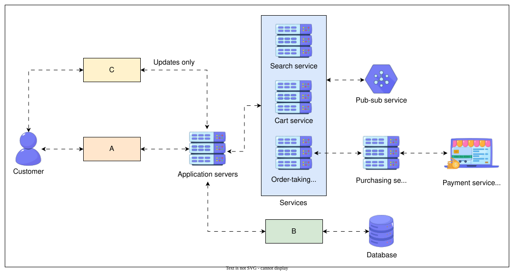

# AI_Evaluation_of_Building_Blocks_in_E-Commerce_Platform

Source: https://www.educative.io/courses/grokking-the-system-design-interview/ai-evaluation-of-building-blocks-in-e-commerce-platform

---

[Home](https://www.educative.io/)

[Courses](https://www.educative.io/search?tab=courses)

[Grokking Modern System Design Interview](https://www.educative.io/courses/grokking-the-system-design-interview)

# AI Evaluation of Building Blocks in E-Commerce Platform

Define essential System Design building blocks by analyzing a high-level e-commerce platform architecture. Identify the critical components missing for reliability and performance, such as load balancing or caching layers. Describe the function of these components to validate your readiness for complex design challenges.

We'll cover the following...

- [An e-commerce platform](https://www.educative.io/courses/grokking-the-system-design-interview/ai-evaluation-of-building-blocks-in-e-commerce-platform#An-e-commerce-platform)

This lesson assesses your understanding of System Design building blocks using an AI interactive widget.

## An e-commerce platform[#](https://www.educative.io/courses/grokking-the-system-design-interview/ai-evaluation-of-building-blocks-in-e-commerce-platform#An-e-commerce-platform)

Consider the simplified System Design for an e-commerce platform outlined below. Customers engage with services such as search, shopping carts, and order processing. While we define several core components, the design includes missing elements labeled A, B, and C.

A high-level design of the e-commerce platform

The defined components include:

1. **Application servers:** Facilitate communication between application components and forward user queries to the appropriate services.
2. **Search service:** Processes user search queries.
3. **Cart service:** Manages the shopping cart and product selection.
4. **Order-taking service:** Initiates customer orders and triggers the purchasing service.
5. **Payment service provider (PSP):** Securely manages payment transactions via external payment gateways.
6. **Database:** Persists user and product data, including prices, descriptions, metadata, and image references.

AI Powered

Saved

3 attempts left

Reset

Find the missing building blocks in the e-commerce system design.

Consider the e-commerce system design diagram shown above. The architecture includes application servers, search, cart, order-taking, purchasing, and payment-related services. Customer requests flow through component A before reaching the application servers. The application servers interact with component B, which sits in front of the database, and with component C, which serves a subset of customer requests directly.

Based on the architecture and workflow illustrated in the diagram, identify the missing components A, B, and C. Provide your answer in the correct order (A → B → C) and briefly explain the role of each component in the system.

You have 3 attempts to answer.

Evaluating and Protecting AI Features

AI Evaluation of Building Blocks in Online Education System

Ask

[An e-commerce platform](https://www.educative.io/courses/grokking-the-system-design-interview/ai-evaluation-of-building-blocks-in-e-commerce-platform#An-e-commerce-platform)