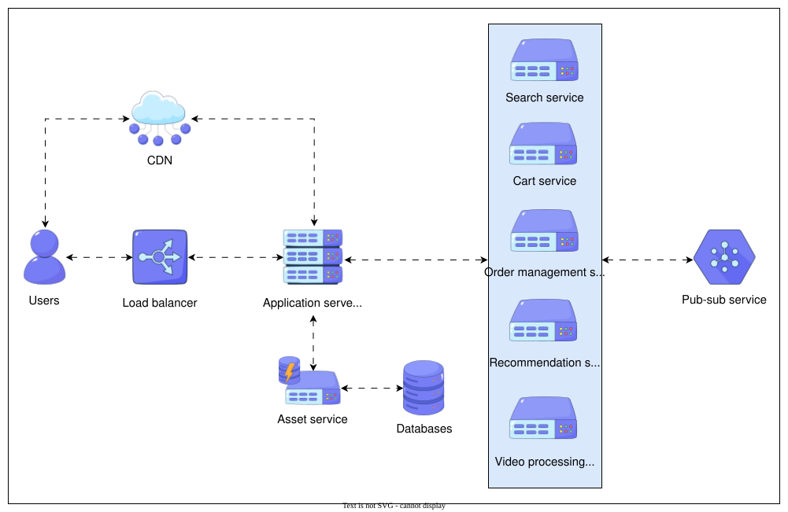

# AI_Evaluation_of_Building_Blocks_in_Online_Education_System

Source: https://www.educative.io/courses/grokking-the-system-design-interview/ai-evaluation-of-building-blocks-in-online-education-system

---

[Home](https://www.educative.io/)

[Courses](https://www.educative.io/search?tab=courses)

[Grokking Modern System Design Interview](https://www.educative.io/courses/grokking-the-system-design-interview)

# AI Evaluation of Building Blocks in Online Education System

Apply foundational System Design building blocks to diagnose and fix architectural issues within an online education system. Identify components such as rate limiters and unique ID generators required to address request surges, troubleshooting, and high-volume counting.

We'll cover the following...

- [Online education system](https://www.educative.io/courses/grokking-the-system-design-interview/ai-evaluation-of-building-blocks-in-online-education-system#Online-education-system)

## Online education system[#](https://www.educative.io/courses/grokking-the-system-design-interview/ai-evaluation-of-building-blocks-in-online-education-system#Online-education-system)

The following high-level System Design represents an online education platform where users purchase and watch video tutorials. Review the architecture and service details to answer the questions below.

An abstract system design of an online education system

This simplified design faces specific operational challenges. Identify the System Design building blocks required to resolve the following problems:

**Scenario:**

Consider the high-level design of an online learning platform that provides video-based courses across multiple domains. Users can browse, purchase, and watch courses on the platform.

The system includes the following services:

- **Search service:** Helps users discover relevant courses.
- **Cart service:** Maintains the list of courses selected for purchase.
- **Order management service:** Handles the complete order lifecycle, including order validation, payment processing, refunds, returns, and customer support.
- **Recommendation service:** Provides personalized course recommendations based on user behavior, preferences, and learning goals.
- **Video processing service:** Manages video uploads, transcoding, and on-demand streaming. This service is primarily used by administrators to upload educational content.

The platform uses a single application server that receives user requests and routes them to the appropriate services.

**Note:** Based on this architecture, answer the questions in the widget below.

AI Powered

Saved

12 attempts left

Reset

Improve the system design of an online education system.

Hi, I’m Ed. In this session, we will focus on some questions related to the system design of an online education system. Do you want to be mentored or evaluated?

You have 12 attempts to answer.

AI Evaluation of Building Blocks in E-Commerce Platform

Wrapping Up the Building Blocks Discussion

Ask

[Online education system](https://www.educative.io/courses/grokking-the-system-design-interview/ai-evaluation-of-building-blocks-in-online-education-system#Online-education-system)