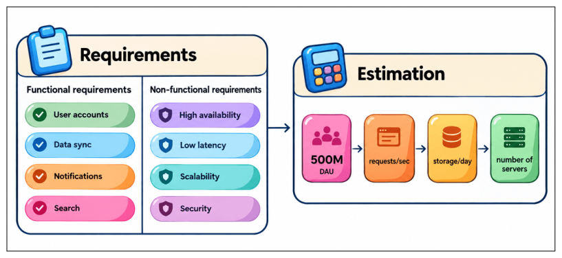

# The_RESHADED_Approach_for_System_Design

Source: https://www.educative.io/courses/grokking-the-system-design-interview/the-reshaded-approach-for-system-design

---

[Home](https://www.educative.io/)

[Courses](https://www.educative.io/search?tab=courses)

[Grokking Modern System Design Interview](https://www.educative.io/courses/grokking-the-system-design-interview)

# The RESHADED Approach for System Design

Discover the RESHADED approach, the systematic guideline for resolving complex System Design problems. Learn to define requirements, estimate resources, and structure high-level and detailed designs.

We'll cover the following...

- [Introduction](https://www.educative.io/courses/grokking-the-system-design-interview/the-reshaded-approach-for-system-design#Introduction)
- [Advantages of RESHADED](https://www.educative.io/courses/grokking-the-system-design-interview/the-reshaded-approach-for-system-design#Advantages-of-RESHADED)
- [Exploring RESHADED](https://www.educative.io/courses/grokking-the-system-design-interview/the-reshaded-approach-for-system-design#Exploring-RESHADED)

## Introduction[#](https://www.educative.io/courses/grokking-the-system-design-interview/the-reshaded-approach-for-system-design#Introduction)

System design problems are inherently open-ended and lack a single correct solution. A structured approach helps organize requirements, constraints, and trade-offs. This framework is referred to as the **RESHADED** approach. Although no framework guarantees optimal design, this guideline provides a consistent, systematic way to evaluate different system design problems.

Breakdown of each letter in the RESHADED approach

## Advantages of RESHADED[#](https://www.educative.io/courses/grokking-the-system-design-interview/the-reshaded-approach-for-system-design#Advantages-of-RESHADED)

Key advantages of this approach include:

1. **Guidance:** It provides a clear roadmap, ensuring the next step is always visible.
2. **Completeness:** It ensures the solution is systematic and includes all essential ingredients.

## Exploring RESHADED[#](https://www.educative.io/courses/grokking-the-system-design-interview/the-reshaded-approach-for-system-design#Exploring-RESHADED)

The steps of the RESHADED framework are described below:

**Requirements:** During this step, we gather all the requirements of the design problem and define its scope. Requirements include understanding what the service is, how it works, and its main features. Our goal in this step is to gather the functional and non-functional requirements of a service we are about to design.

**Estimation:** As the name suggests, this step estimates the resources required to provide the service to a defined number of users. By resources, we mean the hardware or infrastructural resources.

R and E: Define what to build, then estimate the resources it needs

Sample estimation questions include:

1. How many servers are needed to support 500 million daily active users (DAU)?
2. How much storage is required for 125 million tweets per day, assuming 20% contain media?

Estimations clarify the system’s scale and drive key decisions, such as database selection and data structure optimization.

**Storage schema (optional):** This step involves articulating our data model, that is, we define which tables we need and what type of fields are part of each table. However, this is an optional step, and we may not put in this effort for every design problem.

**High-level design:** This step involves identifying the main components and building blocks we’ll use to design our desired system. We do this by getting inspiration from our functional and non-functional requirements.

S and H: Model the data, then draft the main components

This serves as the initial architectural draft and is subject to iteration.

**API design:** The goal in this phase is to build interfaces for our service. Using these interfaces, users can call various services within our system. These interfaces are implemented as API calls and generally translate our functional requirements.

**Detailed design:** The detailed design starts by recognizing the limitations of the high-level design. We’ll capitalize on these limitations to evolve our design. During this step, we’ll finalize our design by mentioning all the components and building blocks that we’ll use.

A and D: Expose the features as APIs, then refine the design where it falls short

We also define the workflow of our design and its usage of different technologies. The detailed design aims to fulfill the functional and non-functional requirements of the problem.

**Evaluation:** This step will measure the effectiveness of our solution. In other words, we justify how our design fulfills the functional and non-functional requirements.

We discuss the trade-offs we made in our solution and identify areas for improvement.

**Distinctive component/feature:** Identify and discuss unique challenges specific to the problem. For example, fraud detection in Uber or concurrency control in Google Docs.

E and D: Verify the design meets its requirements, then address what is unique to the problem

Next, we will apply the RESHADED framework to various design problems.

Wrapping Up the Building Blocks Discussion

System Design: YouTube

Ask

[Introduction](https://www.educative.io/courses/grokking-the-system-design-interview/the-reshaded-approach-for-system-design#Introduction)

[Advantages of RESHADED](https://www.educative.io/courses/grokking-the-system-design-interview/the-reshaded-approach-for-system-design#Advantages-of-RESHADED)

[Exploring RESHADED](https://www.educative.io/courses/grokking-the-system-design-interview/the-reshaded-approach-for-system-design#Exploring-RESHADED)