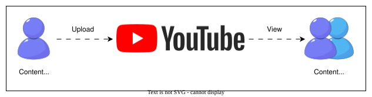

# System_Design_YouTube

Source: https://www.educative.io/courses/grokking-the-system-design-interview/system-design-youtube

---

[Home](https://www.educative.io/)

[Courses](https://www.educative.io/search?tab=courses)

[Grokking Modern System Design Interview](https://www.educative.io/courses/grokking-the-system-design-interview)

# System Design: YouTube

YouTube is a leading global video streaming platform that allows users to upload, search, and interact with content, boasting over 2.5 billion monthly active users. Its success is attributed to an intuitive interface, a vast community of content creators, continuous optimization for scalability, and monetization opportunities for creators. Launched in 2005 and acquired by Google in 2007, YouTube has become a significant player in the entertainment industry, with extensive user growth and streaming volume. The design process for YouTube involves identifying requirements, defining architecture, and addressing scaling challenges.

We'll cover the following...

- [What is YouTube?](https://www.educative.io/courses/grokking-the-system-design-interview/system-design-youtube#What-is-YouTube)
- [YouTube’s popularity](https://www.educative.io/courses/grokking-the-system-design-interview/system-design-youtube#YouTubes-popularity)
- [YouTube’s growth](https://www.educative.io/courses/grokking-the-system-design-interview/system-design-youtube#YouTubes-growth)
- [How will we design YouTube?](https://www.educative.io/courses/grokking-the-system-design-interview/system-design-youtube#How-will-we-design-YouTube)

## What is YouTube?[#](https://www.educative.io/courses/grokking-the-system-design-interview/system-design-youtube#What-is-YouTube)

**YouTube** is a global video streaming service where users upload, stream, search, and interact with content. Both individuals and businesses maintain channels to host videos. As a primary source of entertainment, it ranks second-most viewed website after Google, according to Wikipedia.

A depiction of a content creator uploading a video to YouTube that many viewers will stream

## YouTube’s popularity[#](https://www.educative.io/courses/grokking-the-system-design-interview/system-design-youtube#YouTubes-popularity)

YouTube’s massive popularity stems from several key factors:

- **Simplicity:** The interface is intuitive yet powerful.
- **Rich content:** Free hosting attracts a vast community of content creators.
- **Continuous improvement:** Engineering teams relentlessly optimize for scalability. Google’s 2007 acquisition further bolstered credibility and resources.
- **Source of income:** The partnership program allows creators to monetize viral content.

Additionally, strategic partnerships with media giants like CNN and NBC solidified YouTube’s market foothold.

## YouTube’s growth[#](https://www.educative.io/courses/grokking-the-system-design-interview/system-design-youtube#YouTubes-growth)

YouTube launched in 2005 and has seen sustained user growth. As of the latest publicly reported figures, YouTube serves over 2.5 billion monthly active users. The table below shows user growth trends over the past decade.

Increase in monthly active users of YouTube per year

YouTube trails only Netflix in streaming volume. Approximately 694,000 hours of video content is streamed on YouTube per minute!

AI Powered

Saved

1 attempt left

Reset

List three key building blocks necessary to design a system like YouTube.

Let’s evaluate your understanding of the building blocks required in the design of YouTube. Based on the functional and nonfunctional requirements given below, identify three key building blocks needed to curate the design of YouTube.

**Functional requirements:**

- Stream videos
- Upload videos
- Search videos according to titles
- Like and dislike videos
- Add comments to videos
- View thumbnails

**Nonfunctional requirements:**

- High availability
- Scalability
- Good performance

You should focus on the building blocks required for back-end storage and efficient data transmission to end users. Please also specify the reason(s) behind the selection of a building block.

This is your last attempt.

The following lessons detail the design process.

## How will we design YouTube?[#](https://www.educative.io/courses/grokking-the-system-design-interview/system-design-youtube#How-will-we-design-YouTube)

We have divided the course into six lessons:

1. [**Requirements**](https://www.educative.io/courses/grokking-the-system-design-interview/requirements-of-youtubes-design)**:** Identify functional and non-functional requirements. We will estimate resources, such as the storage needed for 500 hours of video uploaded per minute.
2. [**Design**](https://www.educative.io/courses/grokking-the-system-design-interview/design-of-youtube)**:** Define the high-level architecture, API design, database schemas, and search functionality.
3. [**Ask YouTube**](https://www.educative.io/courses/grokking-the-system-design-interview/ask-youtube-ai-powered-conversational-video-discovery)**:** Design an AI-powered conversational discovery feature that answers viewers’ questions in natural language and links to the exact moments in videos that support each answer.
4. [**Evaluation**](https://www.educative.io/courses/grokking-the-system-design-interview/evaluation-of-youtubes-design)**:** Analyze how the proposed design meets requirements and handles future scaling challenges.
5. [**Reality is more complicated**](https://www.educative.io/courses/grokking-the-system-design-interview/the-reality-is-more-complicated)**:** Explore advanced techniques for effective content delivery and network congestion avoidance.
6. [**Quiz**](https://www.educative.io/courses/grokking-the-system-design-interview/quiz-on-youtubes-design)**:** Reinforce concepts by applying them to a Netflix system design scenario.

> **Note:** Building blocks are covered in detail in the [building blocks](https://www.educative.io/courses/grokking-the-system-design-interview/introduction-to-building-blocks-for-modern-system-design) chapter.

The RESHADED Approach for System Design

Requirements of YouTube's Design

Ask

[What is YouTube?](https://www.educative.io/courses/grokking-the-system-design-interview/system-design-youtube#What-is-YouTube)

[YouTube’s popularity](https://www.educative.io/courses/grokking-the-system-design-interview/system-design-youtube#YouTubes-popularity)

[YouTube’s growth](https://www.educative.io/courses/grokking-the-system-design-interview/system-design-youtube#YouTubes-growth)

[How will we design YouTube?](https://www.educative.io/courses/grokking-the-system-design-interview/system-design-youtube#How-will-we-design-YouTube)