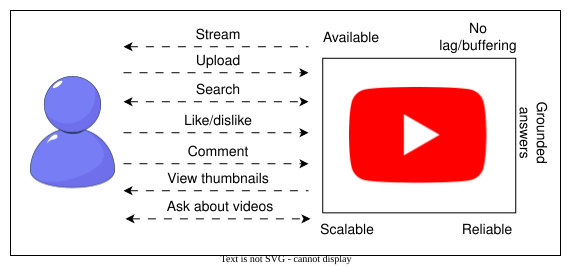

# Requirements_of_YouTube's_Design

Source: https://www.educative.io/courses/grokking-the-system-design-interview/requirements-of-youtubes-design

---

[Home](https://www.educative.io/)

[Courses](https://www.educative.io/search?tab=courses)

[Grokking Modern System Design Interview](https://www.educative.io/courses/grokking-the-system-design-interview)

# Requirements of YouTube's Design

Designing a system like YouTube involves addressing both functional and non-functional requirements, including high availability, scalability, performance, and reliability. Key functionalities include video streaming, uploading, searching, and user interaction features like comments and ratings. The system must handle massive data storage and bandwidth needs, with estimates based on user activity and video uploads. Essential components include databases, blob storage, content delivery networks, and load balancers, all working together to ensure efficient processing and delivery of video content while maintaining a smooth user experience.

We'll cover the following...

- [Requirements](https://www.educative.io/courses/grokking-the-system-design-interview/requirements-of-youtubes-design#Requirements)
  - [Functional requirements](https://www.educative.io/courses/grokking-the-system-design-interview/requirements-of-youtubes-design#Functional-requirements)
  - [Non-functional requirements](https://www.educative.io/courses/grokking-the-system-design-interview/requirements-of-youtubes-design#Non-functional-requirements)
- [Resource estimation](https://www.educative.io/courses/grokking-the-system-design-interview/requirements-of-youtubes-design#Resource-estimation)
  - [Storage estimation](https://www.educative.io/courses/grokking-the-system-design-interview/requirements-of-youtubes-design#Storage-estimation)
  - [Bandwidth estimation](https://www.educative.io/courses/grokking-the-system-design-interview/requirements-of-youtubes-design#Bandwidth-estimation)
    - [Number of servers estimation](https://www.educative.io/courses/grokking-the-system-design-interview/requirements-of-youtubes-design#Number-of-servers-estimation)
- [Building blocks we will use](https://www.educative.io/courses/grokking-the-system-design-interview/requirements-of-youtubes-design#Building-blocks-we-will-use)

## Requirements[#](https://www.educative.io/courses/grokking-the-system-design-interview/requirements-of-youtubes-design#Requirements)

Designing a system like YouTube requires handling massive scale and reliability.

### Functional requirements[#](https://www.educative.io/courses/grokking-the-system-design-interview/requirements-of-youtubes-design#Functional-requirements)

We require that our system be able to perform the following functions:

1. Stream videos
2. Upload videos
3. Search videos
4. Like and dislike videos
5. Add comments
6. View thumbnails
7. Ask about videos in natural language and receive answers linked to relevant videos and timestamps

### Non-functional requirements[#](https://www.educative.io/courses/grokking-the-system-design-interview/requirements-of-youtubes-design#Non-functional-requirements)

- **High availability:** The system should be highly available. High availability requires a high uptime percentage. Large services such as YouTube typically target 99.9% uptime or higher. At 99%, a service can still be down for more than three and a half days a year.
- **Scalability:** The system must handle increasing users, storage, and bandwidth without performance degradation.
- **Performance:** Streaming must be smooth with minimal latency.
- **Reliability:** Uploaded content must not be lost or damaged.
- **Grounded answers:** Answers from the AI assistant must be supported by the content of eligible videos and must never draw on removed, private, or region-restricted videos.

Representation of the functional and non-functional requirements

The conversational assistant has its own latency target, separate from standard search, because it retrieves evidence and generates an answer before responding. We cover its design in detail in the *Ask YouTube: AI-Powered Conversational Video Discovery* lesson.

For content distribution, YouTube does not require strict strong consistency guarantees. For example, a newly uploaded video does not need to propagate to all subscribers instantly. In this case, eventual consistency provides an acceptable trade-off between latency and consistency. Based on these requirements, we can estimate resource needs and outline the system architecture.

## Resource estimation[#](https://www.educative.io/courses/grokking-the-system-design-interview/requirements-of-youtubes-design#Resource-estimation)

Capacity estimation starts by identifying the main resource drivers for the system. YouTube receives a very large volume of video uploads per minute. In addition, the system must support high concurrent streaming traffic, which drives the following resource requirements:

- Storage resources will be needed to store uploaded and processed content.
- A large number of requests can be handled by doing concurrent processing. This means web/application servers should be in place to serve these users.
- Both upload and download bandwidth will be required to serve millions of users.

To convert the above resources into actual numbers, we assume the following:

- **Total users:** 1.5 billion
- **Daily active users (DAU):** 500 million
- **Average video length:** 5 minutes
- **Raw video size (5 minutes):** 600 MB
- **Compressed video size (5 minutes):** 30 MB

### Storage estimation[#](https://www.educative.io/courses/grokking-the-system-design-interview/requirements-of-youtubes-design#Storage-estimation)

To determine YouTube’s storage requirements, we need to estimate the total number of videos uploaded per minute and the average video length. Let’s consider that 500 hours worth of content is uploaded to YouTube in one minute. Since each video of 30 MB is 5 minutes long, we require 305=6 Mb\frac{30}{5} = \text{6 Mb}530​=6 Mbto store 1 minute of video.

Let’s put this in a formula by assuming the following:

Totalstorage\text{Total}\_\text{{storage}}Totalstorage​: Total storage requirement.

Totalupload/min\text{Total}\_\text{{upload/min}}Totalupload/min​: Total content uploaded (in minutes) per minute.

- Example: 500 hours of video are uploaded in 1 minute.

Storagemin\text{Storage}\_\text{{min}}Storagemin​: Storage required for each minute of content

Then, the following formula is used to compute the storage:

Totalstorage=Totalupload/min ×Storagemin\text{Total}\_\text{{storage}} = \text{Total}\_\text{{upload/min} } \times \text{Storage}\_\text{{min}}Totalstorage​=Totalupload/min ​×Storagemin​

Use the calculator below to estimate resource requirements. We begin with the storage needed for 500 hours of uploaded content per minute, at a cost of 6 MB\text{6 MB}6 MB per minute of video:

#### Storage Required for Storing Content per Minute on YouTube

|  |  |  |  |
| --- | --- | --- | --- |
| No. of video hours per minute | Minutes per hour | MB per minute | Storage per minute (GB) |
| 500 | 60 | 6 | f180 |

> **Note:** Adjust the *hours* and *MB per minute*fields (in yellow) to see the impact on storage requirements.

These estimates use compressed video sizes. However, the system must also store the original raw video and transcode it into multiple formats (resolutions, codecs). Actual storage needs will be significantly higher than this baseline.

> **Note:** We focus on video storage here. Storage for thumbnails, user data, and metadata is negligible by comparison.

1.

Assuming YouTube stores videos in five different qualities and the average size of a one-minute video is 6 MB, what would the estimated storage requirements per minute be?

Show Answer

Did you find this helpful?

### Bandwidth estimation[#](https://www.educative.io/courses/grokking-the-system-design-interview/requirements-of-youtubes-design#Bandwidth-estimation)

Streaming and uploading consume significant bandwidth. We assume an `upload:view` ratio of `1:300` (For each uploaded video, we have 300 video views per second).

Totalbandwidth\text{Total}\_\text{{bandwidth}}Totalbandwidth​: Total bandwidth required.

Totalcontent\text{Total}\_\text{{content}}Totalcontent​: Minutes of content uploaded per minute.

Sizeminute\text{Size}\_\text{{minute}}Sizeminute​: Transmission size (MB) per minute of content.  
  
We use the following formula:

Totalbandwidth=Totalcontent×Sizeminute\text{Total}\_\text{{bandwidth}} = \text{Total}\_\text{{content}} \times \text{Size}\_\text{{minute}}Totalbandwidth​=Totalcontent​×Sizeminute​

#### The Bandwidth Required for Uploading Videos to YouTube

|  |  |  |  |
| --- | --- | --- | --- |
| No. of video hours per minute | Minutes per hour | MB per minute | Bandwidth required (Gbps) |
| 500 | 60 | 120 | f480 |

1.

If 480 Gbps of bandwidth is required to support uploading, how much bandwidth would be required to stream videos? Assume each minute of video requires an average of 10 MB of bandwidth.

**Hint:** The `upload:view` ratio is provided.

Show Answer

Did you find this helpful?

Total bandwidth required by YouTube

#### Number of servers estimation[#](https://www.educative.io/courses/grokking-the-system-design-interview/requirements-of-youtubes-design#Number-of-servers-estimation)

We assume 500 million Daily Active Users (DAU). Using [DAU as a proxy for requests per second](https://www.educative.io/courses/grokking-the-system-design-interview/put-back-of-the-envelope-numbers-in-perspective), we estimate a peak load of 500 million requests per second. We calculate the required server count as follows:

Servers needed at peak load=Number of requests/secondRPS of server\text{Servers needed at peak load} = \frac{\text{Number of requests/second}}{\text{RPS of server}}
Servers needed at peak load=RPS of serverNumber of requests/second​

Servers needed at peak load=500 million64,000=7812.5  ≈  8K servers\text{Servers needed at peak load}
= \frac{500\,\text{million}}{64,000}
= 7812.5 \;\approx\; 8 \text{K servers}
Servers needed at peak load=64,000500million​=7812.5≈8K servers

Number of servers required for YouTube

> **Note:** Concurrent requests drive server requirements more than total daily requests. For details on refining peak load assumptions, see [back-of-the-envelope calculations](https://www.educative.io/courses/grokking-the-system-design-interview/put-back-of-the-envelope-numbers-in-perspective).

## Building blocks we will use[#](https://www.educative.io/courses/grokking-the-system-design-interview/requirements-of-youtubes-design#Building-blocks-we-will-use)

The following components are integral to the YouTube system design:

Building blocks in a high-level design

- [**Databases**](https://www.educative.io/courses/grokking-the-system-design-interview/introduction-to-databases)**:** Store metadata for videos, thumbnails, comments, and users.
- [**Blob storage**](https://www.educative.io/courses/grokking-the-system-design-interview/system-design-a-blob-store)**:** Stores the actual video files.
- [**CDN**](https://www.educative.io/courses/grokking-the-system-design-interview/system-design-the-content-delivery-network-cdn)**:** Delivers content to end users, reducing latency and server load.
- [**Load balancers**](https://www.educative.io/courses/grokking-the-system-design-interview/introduction-to-load-balancers)**:** Distribute incoming client requests across available servers.

We also require:

- **Servers:** Handle application logic and user requests.
- **Encoders:** Transcode videos into different formats and resolutions to support various devices and bandwidth conditions.
- **Embeddings and retrieval:** Transcript passages are converted into embeddings and stored in a vector index, so the assistant can find passages by meaning alongside keyword search.
- **Retrieval-augmented generation:** The assistant retrieves eligible transcript passages and generates answers grounded in them, with links to the supporting moments.
- **Serving models within latency and cost budgets:** LLM inference runs on bounded capacity, separate from playback and standard search, so answers stay fast and affordable.

Components in YouTube’s high-level design

System Design: YouTube

Design of YouTube

Ask

[Requirements](https://www.educative.io/courses/grokking-the-system-design-interview/requirements-of-youtubes-design#Requirements)

[Functional requirements](https://www.educative.io/courses/grokking-the-system-design-interview/requirements-of-youtubes-design#Functional-requirements)

[Non-functional requirements](https://www.educative.io/courses/grokking-the-system-design-interview/requirements-of-youtubes-design#Non-functional-requirements)

[Resource estimation](https://www.educative.io/courses/grokking-the-system-design-interview/requirements-of-youtubes-design#Resource-estimation)

[Storage estimation](https://www.educative.io/courses/grokking-the-system-design-interview/requirements-of-youtubes-design#Storage-estimation)

[Bandwidth estimation](https://www.educative.io/courses/grokking-the-system-design-interview/requirements-of-youtubes-design#Bandwidth-estimation)

[Number of servers estimation](https://www.educative.io/courses/grokking-the-system-design-interview/requirements-of-youtubes-design#Number-of-servers-estimation)

[Building blocks we will use](https://www.educative.io/courses/grokking-the-system-design-interview/requirements-of-youtubes-design#Building-blocks-we-will-use)