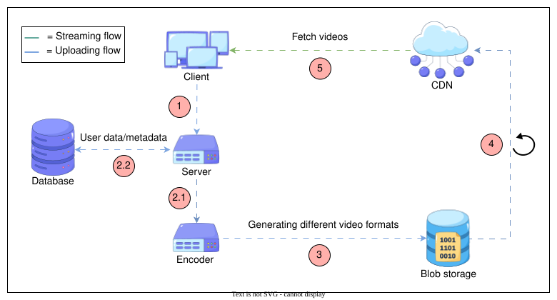

# Design_of_YouTube

Source: https://www.educative.io/courses/grokking-the-system-design-interview/design-of-youtube

---

[Home](https://www.educative.io/)

[Courses](https://www.educative.io/search?tab=courses)

[Grokking Modern System Design Interview](https://www.educative.io/courses/grokking-the-system-design-interview)

# Design of YouTube

The high-level design of YouTube encompasses a workflow where users upload videos, which are then processed by encoders and stored in blob storage. The system utilizes REST APIs for functionalities like video uploads, streaming, and searching. A detailed design addresses challenges such as component integration, thumbnail generation, and database structure, ensuring scalability and low latency. Key components include load balancers, web servers, application servers, and specialized storage solutions like Bigtable for metadata. Additionally, a robust search engine processes video data to enhance user experience through relevant results and conversational discovery features.

We'll cover the following...

- [High-level design](https://www.educative.io/courses/grokking-the-system-design-interview/design-of-youtube#High-level-design)
- [API design](https://www.educative.io/courses/grokking-the-system-design-interview/design-of-youtube#API-design)
  - [Upload video](https://www.educative.io/courses/grokking-the-system-design-interview/design-of-youtube#Upload-video)
  - [Stream video](https://www.educative.io/courses/grokking-the-system-design-interview/design-of-youtube#Stream-video)
  - [Search videos](https://www.educative.io/courses/grokking-the-system-design-interview/design-of-youtube#Search-videos)
  - [View thumbnails](https://www.educative.io/courses/grokking-the-system-design-interview/design-of-youtube#View-thumbnails)
  - [Like and dislike a video](https://www.educative.io/courses/grokking-the-system-design-interview/design-of-youtube#Like-and-dislike-a-video)
  - [Comment on a video](https://www.educative.io/courses/grokking-the-system-design-interview/design-of-youtube#Comment-on-a-video)
  - [Ask about videos](https://www.educative.io/courses/grokking-the-system-design-interview/design-of-youtube#Ask-about-videos)
- [Storage schema](https://www.educative.io/courses/grokking-the-system-design-interview/design-of-youtube#Storage-schema)
- [Detailed design](https://www.educative.io/courses/grokking-the-system-design-interview/design-of-youtube#Detailed-design)
  - [Detailed design components](https://www.educative.io/courses/grokking-the-system-design-interview/design-of-youtube#Detailed-design-components)
  - [Design flow and technology usage](https://www.educative.io/courses/grokking-the-system-design-interview/design-of-youtube#Design-flow-and-technology-usage)
- [YouTube search](https://www.educative.io/courses/grokking-the-system-design-interview/design-of-youtube#YouTube-search)

## High-level design[#](https://www.educative.io/courses/grokking-the-system-design-interview/design-of-youtube#High-level-design)

The high-level design connects the components identified in the previous lesson. This solution supports the defined functional and non-functional requirements.

The high-level design of YouTube

The abstract design workflow is as follows:

1. The user uploads a video to the server.
2. The server saves metadata and user data to the database and simultaneously sends the video to the encoder.
3. The encoder and transcoder compress the video and generate multiple resolutions (e.g., 2160p, 1440p, 1080p). Resulting files are stored in blob storage (similar to GFS or S3).
4. Popular videos are forwarded to the CDN for caching.
5. The CDN serves the video to the user with low latency. However, CDN is not the only infrastructure for serving videos to the end user, which we will see in the detailed design.

1.

Why don’t we upload the video directly to the encoder instead of to the server? Doesn’t the current strategy introduce an additional delay?

Show Answer

Did you find this helpful?

## API design[#](https://www.educative.io/courses/grokking-the-system-design-interview/design-of-youtube#API-design)

We will use REST APIs to expose the system’s functionality. The client interacts with the backend through the following endpoints:

- Upload videos
- Stream videos
- Search videos
- View thumbnails
- Like or dislike videos
- Comment on videos
- Ask about videos

API design overview

### Upload video[#](https://www.educative.io/courses/grokking-the-system-design-interview/design-of-youtube#Upload-video)

Use the POST method to upload a video via the `/uploadVideo` API:

Ace Editor

1

uploadVideo(user\_id, video\_file, category\_id, title, description, tags, default\_language, privacy\_settings)

הההההההההההההההההההההההההההההההההההההההההההההההההההההההההההההההההההההההההההההההההההההההההההההההההההההההההההההההההההההההההההההההההההההההההההההההההההההההההההההההההההההההההההההההההההההההההההההההההההההההההההההההההההההההההההההההההההההההההההההההההההההההההההההההההההההההההההההההההההההההההההההההההההההההההההההההההההההההההההההההההההההההההההההההההההההההההההההההההההההההההההההההההההההההההההההההההההההההההההההההההההההההההההההההההההההההההההההההההההההההההההההההההההההההההההההההההההההההההההההההההההההההההההההההההההההההההההההההה

XXXXXXXXXXXXXXXXXXXXXXXXXXXXXXXXXXXXXXXXXXXXXXXXXXXXXXXXXXXXXXXXXXXXXXXXXXXXXXXXXXXXXXXXXXXXXXXXXXXXXXXXXXXXXXXXXXXXXXXXXXXXXXXXXXXXXXXXXXXXXXXXXXXXXXXXXXXXXXXXXXXXXXXXXXXXXXXXXXXXXXXXXXXXXXXXXXXXXXXXXXXXXXXXXXXXXXXXXXXXXXXXXXXXXXXXXXXXXXXXXXXXXXXXXXXXXXXXXXXXXXXXXXXXXXXXXXXXXXXXXXXXXXXXXXXXXXXXXXXXXXXXXXXXXXXXXXXXXXXXXXXXXXXXXXXXXXXXXXXXXXXXXXXXXXXXXXXXXXXXXXXXXXXXXXXXXXXXXXXXXXXXXXXXXXXXXXXXXXXXXXXXXXXXXXXXXXXXXXXXXXXXXXXXXXXXXXXXXXXXXXXXXXXXXXXXXXXXXXXXXXXXXXXXXXXXXXXXXXXXXXXXXXXXXXXXXXXXXXXXXXXXXXXXXXXX

The parameters are described below:

|  |  |
| --- | --- |
| **Parameter** | **Description** |
| `user_id` | This is the user that is uploading the video. |
| `video_file` | This is the video file that the user wants to upload. |
| `category_id` | This refers to the category a video belongs to. Typical categories can be “Entertainment,” “Engineering,” “Science,” and so on. |
| `title` | This is the title of the video. |
| `description` | This is the description of the video. |
| `tags` | This refers to the specific topics the content of the video covers. The `tags` can improve search results. |
| `default_language` | This is the default language a page will show to the user when the video is streamed. |
| `privacy_settings` | This refers to the privacy of the video. Generally, videos can be a public asset or private to the uploader. |

### Stream video[#](https://www.educative.io/courses/grokking-the-system-design-interview/design-of-youtube#Stream-video)

Use the GET method for the `/streamVideo` API:

Ace Editor

1

streamVideo(user\_id, video\_id, screen\_resolution, user\_bitrate, device\_chipset)

הההההההההההההההההההההההההההההההההההההההההההההההההההההההההההההההההההההההההההההההההההההההההההההההההההההההההההההההההההההההההההההההההההההההההההההההההההההההההההההההההההההההההההההההההההההההההההההההההההההההההההההההההההההההההההההההההההההההההההההההההההההההההההההההההההההההההההההההההההההההההההההההההההההההההההההההההההההההההההההההההההההההההההההההההההההההההההההההההההההההההההההההההההההההההההההההההההההההההההההההההההההההההההההההההההההההההההההההההההההההההההההההההההההההההההההההההההההההההההההההההההההההההההההההההההההההההההההההה

XXXXXXXXXXXXXXXXXXXXXXXXXXXXXXXXXXXXXXXXXXXXXXXXXXXXXXXXXXXXXXXXXXXXXXXXXXXXXXXXXXXXXXXXXXXXXXXXXXXXXXXXXXXXXXXXXXXXXXXXXXXXXXXXXXXXXXXXXXXXXXXXXXXXXXXXXXXXXXXXXXXXXXXXXXXXXXXXXXXXXXXXXXXXXXXXXXXXXXXXXXXXXXXXXXXXXXXXXXXXXXXXXXXXXXXXXXXXXXXXXXXXXXXXXXXXXXXXXXXXXXXXXXXXXXXXXXXXXXXXXXXXXXXXXXXXXXXXXXXXXXXXXXXXXXXXXXXXXXXXXXXXXXXXXXXXXXXXXXXXXXXXXXXXXXXXXXXXXXXXXXXXXXXXXXXXXXXXXXXXXXXXXXXXXXXXXXXXXXXXXXXXXXXXXXXXXXXXXXXXXXXXXXXXXXXXXXXXXXXXXXXXXXXXXXXXXXXXXXXXXXXXXXXXXXXXXXXXXXXXXXXXXXXXXXXXXXXXXXXXXXXXXXXXXXXX

> Video files are split into smaller packets and uploaded sequentially. If a failure occurs, the server retains data temporarily to allow resumption. For details, refer to asynchronous APIs.

This API introduces the following parameters:

|  |  |
| --- | --- |
| **Parameter** | **Description** |
| `screen_resolution` | The server can best optimize the video if the user's screen resolution is known. |
| `user_bitrate` | The transmission capacity of the user is required to understand which quality of video chunks should be transferred to the client or user. |
| `device_chipset` | Many YouTube users watch content on handheld devices, which makes it important to know the handling capabilities of these devices to better serve the users. |

> The server stores multiple video qualities to serve users based on their transmission rate.

### Search videos[#](https://www.educative.io/courses/grokking-the-system-design-interview/design-of-youtube#Search-videos)

The `/searchVideo` API uses the GET method:

Ace Editor

1

searchVideo(user\_id, search\_string, length, quality, upload\_date)

הההההההההההההההההההההההההההההההההההההההההההההההההההההההההההההההההההההההההההההההההההההההההההההההההההההההההההההההההההההההההההההההההההההההההההההההההההההההההההההההההההההההההההההההההההההההההההההההההההההההההההההההההההההההההההההההההההההההההההההההההההההההההההההההההההההההההההההההההההההההההההההההההההההההההההההההההההההההההההההההההההההההההההההההההההההההההההההההההההההההההההההההההההההההההההההההההההההההההההההההההההההההההההההההההההההההההההההההההההההההההההההההההההההההההההההההההההההההההההההההההההההההההההההההההההההההההההההההה

XXXXXXXXXXXXXXXXXXXXXXXXXXXXXXXXXXXXXXXXXXXXXXXXXXXXXXXXXXXXXXXXXXXXXXXXXXXXXXXXXXXXXXXXXXXXXXXXXXXXXXXXXXXXXXXXXXXXXXXXXXXXXXXXXXXXXXXXXXXXXXXXXXXXXXXXXXXXXXXXXXXXXXXXXXXXXXXXXXXXXXXXXXXXXXXXXXXXXXXXXXXXXXXXXXXXXXXXXXXXXXXXXXXXXXXXXXXXXXXXXXXXXXXXXXXXXXXXXXXXXXXXXXXXXXXXXXXXXXXXXXXXXXXXXXXXXXXXXXXXXXXXXXXXXXXXXXXXXXXXXXXXXXXXXXXXXXXXXXXXXXXXXXXXXXXXXXXXXXXXXXXXXXXXXXXXXXXXXXXXXXXXXXXXXXXXXXXXXXXXXXXXXXXXXXXXXXXXXXXXXXXXXXXXXXXXXXXXXXXXXXXXXXXXXXXXXXXXXXXXXXXXXXXXXXXXXXXXXXXXXXXXXXXXXXXXXXXXXXXXXXXXXXXXXXXX

|  |  |
| --- | --- |
| **Parameter** | **Description** |
| `search_string` | This is the text used to search videos by title, description, and transcript content. |
| `length` (optional) | This is used to filter videos based on their length in terms of time. |
| `quality` (optional) | This is used to filter videos based on the resolution, like 2048p, 1440p, 1080p, and so on. |
| `upload_date` (optional) | This is used to filter videos based on their upload date to YouTube. |

### View thumbnails[#](https://www.educative.io/courses/grokking-the-system-design-interview/design-of-youtube#View-thumbnails)

Use the GET method for the `/viewThumbnails` API:

Ace Editor

1

viewThumbnails(user\_id, video\_id)

הההההההההההההההההההההההההההההההההההההההההההההההההההההההההההההההההההההההההההההההההההההההההההההההההההההההההההההההההההההההההההההההההההההההההההההההההההההההההההההההההההההההההההההההההההההההההההההההההההההההההההההההההההההההההההההההההההההההההההההההההההההההההההההההההההההההההההההההההההההההההההההההההההההההההההההההההההההההההההההההההההההההההההההההההההההההההההההההההההההההההההההההההההההההההההההההההההההההההההההההההההההההההההההההההההההההההההההההההההההההההההההההההההההההההההההההההההההההההההההההההההההההההההההההההההההההההההההההה

XXXXXXXXXXXXXXXXXXXXXXXXXXXXXXXXXXXXXXXXXXXXXXXXXXXXXXXXXXXXXXXXXXXXXXXXXXXXXXXXXXXXXXXXXXXXXXXXXXXXXXXXXXXXXXXXXXXXXXXXXXXXXXXXXXXXXXXXXXXXXXXXXXXXXXXXXXXXXXXXXXXXXXXXXXXXXXXXXXXXXXXXXXXXXXXXXXXXXXXXXXXXXXXXXXXXXXXXXXXXXXXXXXXXXXXXXXXXXXXXXXXXXXXXXXXXXXXXXXXXXXXXXXXXXXXXXXXXXXXXXXXXXXXXXXXXXXXXXXXXXXXXXXXXXXXXXXXXXXXXXXXXXXXXXXXXXXXXXXXXXXXXXXXXXXXXXXXXXXXXXXXXXXXXXXXXXXXXXXXXXXXXXXXXXXXXXXXXXXXXXXXXXXXXXXXXXXXXXXXXXXXXXXXXXXXXXXXXXXXXXXXXXXXXXXXXXXXXXXXXXXXXXXXXXXXXXXXXXXXXXXXXXXXXXXXXXXXXXXXXXXXXXXXXXXXX

|  |  |
| --- | --- |
| **Parameter** | **Description** |
| `video_id` | This specifies the unique ID of the video associated with the thumbnails. |

This API returns a sequence of video thumbnails.

### Like and dislike a video[#](https://www.educative.io/courses/grokking-the-system-design-interview/design-of-youtube#Like-and-dislike-a-video)

The like/dislike API uses the POST method to register user reactions.

Ace Editor

1

likeDislike(user\_id, video\_id, like)

הההההההההההההההההההההההההההההההההההההההההההההההההההההההההההההההההההההההההההההההההההההההההההההההההההההההההההההההההההההההההההההההההההההההההההההההההההההההההההההההההההההההההההההההההההההההההההההההההההההההההההההההההההההההההההההההההההההההההההההההההההההההההההההההההההההההההההההההההההההההההההההההההההההההההההההההההההההההההההההההההההההההההההההההההההההההההההההההההההההההההההההההההההההההההההההההההההההההההההההההההההההההההההההההההההההההההההההההההההההההההההההההההההההההההההההההההההההההההההההההההההההההההההההההההההההההההההההההה

XXXXXXXXXXXXXXXXXXXXXXXXXXXXXXXXXXXXXXXXXXXXXXXXXXXXXXXXXXXXXXXXXXXXXXXXXXXXXXXXXXXXXXXXXXXXXXXXXXXXXXXXXXXXXXXXXXXXXXXXXXXXXXXXXXXXXXXXXXXXXXXXXXXXXXXXXXXXXXXXXXXXXXXXXXXXXXXXXXXXXXXXXXXXXXXXXXXXXXXXXXXXXXXXXXXXXXXXXXXXXXXXXXXXXXXXXXXXXXXXXXXXXXXXXXXXXXXXXXXXXXXXXXXXXXXXXXXXXXXXXXXXXXXXXXXXXXXXXXXXXXXXXXXXXXXXXXXXXXXXXXXXXXXXXXXXXXXXXXXXXXXXXXXXXXXXXXXXXXXXXXXXXXXXXXXXXXXXXXXXXXXXXXXXXXXXXXXXXXXXXXXXXXXXXXXXXXXXXXXXXXXXXXXXXXXXXXXXXXXXXXXXXXXXXXXXXXXXXXXXXXXXXXXXXXXXXXXXXXXXXXXXXXXXXXXXXXXXXXXXXXXXXXXXXXXX

A single API handles both actions. The `like` parameter updates the database: `0` for like and `1` for dislike.

The `like` field also accepts `none` to remove a previous reaction.

### Comment on a video[#](https://www.educative.io/courses/grokking-the-system-design-interview/design-of-youtube#Comment-on-a-video)

Use the POST method to submit comments. The request body contains the comment string.

Ace Editor

1

commentVideo(user\_id, video\_id, comment\_text)

הההההההההההההההההההההההההההההההההההההההההההההההההההההההההההההההההההההההההההההההההההההההההההההההההההההההההההההההההההההההההההההההההההההההההההההההההההההההההההההההההההההההההההההההההההההההההההההההההההההההההההההההההההההההההההההההההההההההההההההההההההההההההההההההההההההההההההההההההההההההההההההההההההההההההההההההההההההההההההההההההההההההההההההההההההההההההההההההההההההההההההההההההההההההההההההההההההההההההההההההההההההההההההההההההההההההההההההההההההההההההההההההההההההההההההההההההההההההההההההההההההההההההההההההההההההההההההההההה

XXXXXXXXXXXXXXXXXXXXXXXXXXXXXXXXXXXXXXXXXXXXXXXXXXXXXXXXXXXXXXXXXXXXXXXXXXXXXXXXXXXXXXXXXXXXXXXXXXXXXXXXXXXXXXXXXXXXXXXXXXXXXXXXXXXXXXXXXXXXXXXXXXXXXXXXXXXXXXXXXXXXXXXXXXXXXXXXXXXXXXXXXXXXXXXXXXXXXXXXXXXXXXXXXXXXXXXXXXXXXXXXXXXXXXXXXXXXXXXXXXXXXXXXXXXXXXXXXXXXXXXXXXXXXXXXXXXXXXXXXXXXXXXXXXXXXXXXXXXXXXXXXXXXXXXXXXXXXXXXXXXXXXXXXXXXXXXXXXXXXXXXXXXXXXXXXXXXXXXXXXXXXXXXXXXXXXXXXXXXXXXXXXXXXXXXXXXXXXXXXXXXXXXXXXXXXXXXXXXXXXXXXXXXXXXXXXXXXXXXXXXXXXXXXXXXXXXXXXXXXXXXXXXXXXXXXXXXXXXXXXXXXXXXXXXXXXXXXXXXXXXXXXXXXXXX

|  |  |
| --- | --- |
| **Parameter** | **Description** |
| `comment_text` | This refers to the text that is typed by the user on the particular video. |

### Ask about videos[#](https://www.educative.io/courses/grokking-the-system-design-interview/design-of-youtube#Ask-about-videos)

Use the POST method to send a question via the /askVideos API. The response streams, so the viewer sees the answer as it is generated.

Ace Editor

1

askVideos(user\_id, conversation\_id, query, video\_id, language)

הההההההההההההההההההההההההההההההההההההההההההההההההההההההההההההההההההההההההההההההההההההההההההההההההההההההההההההההההההההההההההההההההההההההההההההההההההההההההההההההההההההההההההההההההההההההההההההההההההההההההההההההההההההההההההההההההההההההההההההההההההההההההההההההההההההההההההההההההההההההההההההההההההההההההההההההההההההההההההההההההההההההההההההההההההההההההההההההההההההההההההההההההההההההההההההההההההההההההההההההההההההההההההההההההההההההההההההההההההההההההההההההההההההההההההההההההההההההההההההההההההההההההההההההההההההההההההההההה

XXXXXXXXXXXXXXXXXXXXXXXXXXXXXXXXXXXXXXXXXXXXXXXXXXXXXXXXXXXXXXXXXXXXXXXXXXXXXXXXXXXXXXXXXXXXXXXXXXXXXXXXXXXXXXXXXXXXXXXXXXXXXXXXXXXXXXXXXXXXXXXXXXXXXXXXXXXXXXXXXXXXXXXXXXXXXXXXXXXXXXXXXXXXXXXXXXXXXXXXXXXXXXXXXXXXXXXXXXXXXXXXXXXXXXXXXXXXXXXXXXXXXXXXXXXXXXXXXXXXXXXXXXXXXXXXXXXXXXXXXXXXXXXXXXXXXXXXXXXXXXXXXXXXXXXXXXXXXXXXXXXXXXXXXXXXXXXXXXXXXXXXXXXXXXXXXXXXXXXXXXXXXXXXXXXXXXXXXXXXXXXXXXXXXXXXXXXXXXXXXXXXXXXXXXXXXXXXXXXXXXXXXXXXXXXXXXXXXXXXXXXXXXXXXXXXXXXXXXXXXXXXXXXXXXXXXXXXXXXXXXXXXXXXXXXXXXXXXXXXXXXXXXXXXXXX

|  |  |
| --- | --- |
| **Parameter** | **Description** |
| conversation\_id | This links a follow-up question to the earlier context. It is empty for a new conversation. |
| query | This is the viewer’s question in natural language. |
| video\_id (optional) | This restricts the answer to the video being watched. |
| language | This is the preferred language for the answer. |

The response contains a short answer, video cards, and timestamped links to the supporting moments.

## Storage schema[#](https://www.educative.io/courses/grokking-the-system-design-interview/design-of-youtube#Storage-schema)

The database schema must support the API features defined above to provide services to the API gateway.

Storage schema

Conversational discovery (Ask about video feature) also adds two records/tables:

- **Passage:** passage\_id, video\_id, start\_time, end\_time, transcript\_version, and embedding\_model\_version. Each passage is one timestamped piece of a transcript. Its text lives in a passage store, and its embedding lives in a vector index.
- **Conversation session:** conversation\_id, user\_id, recent constraints, and the selected video. It expires after a short period of inactivity.

> **Note:** Complex details, such as mapping multiple video qualities, are omitted for simplicity.

## Detailed design[#](https://www.educative.io/courses/grokking-the-system-design-interview/design-of-youtube#Detailed-design)

We will expand the high-level design to address specific challenges:

- **Component integration:** Interconnections between servers and storage components.
- **Thumbnails:** Generation and storage of video previews.
- **Database structure:** Specialized storage for videos, metadata, and thumbnails to minimize latency and handle massive scale.

The diagram below illustrates the new components and their coordination within the YouTube system.

### Detailed design components[#](https://www.educative.io/courses/grokking-the-system-design-interview/design-of-youtube#Detailed-design-components)

The detailed design incorporates the following components to ensure smooth streaming and scalability:

- **Load balancers:** Distribute user requests across web servers.
- **Web servers:** Handle user requests and interface with API servers.
- **Application server:** Executes business logic and prepares data for web servers.
- **User and metadata storage:** Decoupled storage clusters for user data and video metadata to improve scalability.
- **Bigtable****:** For each video, we’ll require multiple thumbnails. Bigtable can efficiently store metadata and references for thumbnails due to its high throughput and scalability for key-value data.
- **Upload storage:** Temporary storage for user-uploaded videos.
- **Encoders:** Compress and transcode videos into various formats and generate thumbnails.
- **CDN and colocation sites:** Cache popular content closer to users. Colocation centers are used where dedicated data centers are not feasible.

Detailed design of YouTube’s components

### Design flow and technology usage[#](https://www.educative.io/courses/grokking-the-system-design-interview/design-of-youtube#Design-flow-and-technology-usage)

The system workflow proceeds as follows:

1. The user can upload a video by connecting to the web servers. The web server can run Apache or Lighttpd. Lighttpd is preferable because it can serve static pages and videos quickly.
2. Web servers pass requests to application servers, decoupling client services from business logic. Different languages handle specific tasks (e.g., C for encryption). Application servers cache frequently requested objects, while web servers cache frequently requested pages.
3. Storage is divided into specialized units:

   1. **Upload storage:** Temporarily holds videos before encoding.
   2. **Database:** Separates user data and video metadata. MySQL handles limited concurrency, while NoSQL scales for high read/write loads.
   3. **Bigtable:** It is based on Google File System (GFS), and it provides low-latency access for structured key-value data. Thumbnail metadata and references can be stored here, while the images themselves are kept in an object store such as blob store or GCS.
4. Encoders generate thumbnails and metadata. They populate CDNs and colocation servers with popular and moderately popular content, respectively.
5. Users stream videos from the nearest available source.

> **Note:** Sharding storage services is essential for scaling write operations. Combining Bigtable and GFS caching with application-level caching significantly reduces latency.

## YouTube search[#](https://www.educative.io/courses/grokking-the-system-design-interview/design-of-youtube#YouTube-search)

YouTube requires a robust search engine to handle high traffic volumes.

New videos are processed to extract data into a JSON document containing:

- Video title
- Channel name
- Video description
- Video content (e.g., from transcripts)
- Video length
- Categories

Keywords extracted from these documents are stored in a key-value store. The *key* is the search term; the *value* contains the keyword’s frequency and location across various documents. Queries return videos with the most relevant keywords.

An abstraction of how YouTube search works

Production search systems rely on more than keyword matching. A ranking pipeline scores and orders results using signals such as view count, watch time, query context, and user history to optimize relevance.

The transcripts in each search document can support a richer experience than a list of matching titles. A conversational assistant can answer a viewer’s question directly and link to the moments in videos that support the answer. In the next lesson, we extend this search path into conversational discovery.

Requirements of YouTube's Design

Ask YouTube: AI-Powered Conversational Video Discovery

Ask

[High-level design](https://www.educative.io/courses/grokking-the-system-design-interview/design-of-youtube#High-level-design)

[API design](https://www.educative.io/courses/grokking-the-system-design-interview/design-of-youtube#API-design)

[Upload video](https://www.educative.io/courses/grokking-the-system-design-interview/design-of-youtube#Upload-video)

[Stream video](https://www.educative.io/courses/grokking-the-system-design-interview/design-of-youtube#Stream-video)

[Search videos](https://www.educative.io/courses/grokking-the-system-design-interview/design-of-youtube#Search-videos)

[View thumbnails](https://www.educative.io/courses/grokking-the-system-design-interview/design-of-youtube#View-thumbnails)

[Like and dislike a video](https://www.educative.io/courses/grokking-the-system-design-interview/design-of-youtube#Like-and-dislike-a-video)

[Comment on a video](https://www.educative.io/courses/grokking-the-system-design-interview/design-of-youtube#Comment-on-a-video)

[Ask about videos](https://www.educative.io/courses/grokking-the-system-design-interview/design-of-youtube#Ask-about-videos)

[Storage schema](https://www.educative.io/courses/grokking-the-system-design-interview/design-of-youtube#Storage-schema)

[Detailed design](https://www.educative.io/courses/grokking-the-system-design-interview/design-of-youtube#Detailed-design)

[Detailed design components](https://www.educative.io/courses/grokking-the-system-design-interview/design-of-youtube#Detailed-design-components)

[Design flow and technology usage](https://www.educative.io/courses/grokking-the-system-design-interview/design-of-youtube#Design-flow-and-technology-usage)

[YouTube search](https://www.educative.io/courses/grokking-the-system-design-interview/design-of-youtube#YouTube-search)