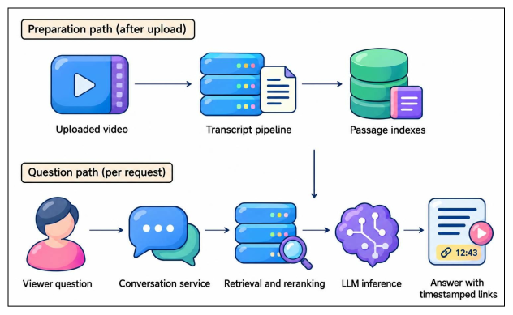

# Ask_YouTube_AI-Powered_Conversational_Video_Discovery

Source: https://www.educative.io/courses/grokking-the-system-design-interview/ask-youtube-ai-powered-conversational-video-discovery

---

[Home](https://www.educative.io/)

[Courses](https://www.educative.io/search?tab=courses)

[Grokking Modern System Design Interview](https://www.educative.io/courses/grokking-the-system-design-interview)

# Ask YouTube: AI-Powered Conversational Video Discovery

YouTube's Ask YouTube feature enhances video discovery by allowing viewers to ask questions in natural language and receive precise answers linked to specific timestamps in videos. This system utilizes a two-path approach: a preparation path that indexes video transcripts into timestamped passages, and a question path that retrieves relevant passages to generate grounded answers. Key components include a transcript pipeline, embedding workers, and a conversation service, all designed to ensure fast, accurate responses while maintaining the integrity of the existing video infrastructure. The hybrid retrieval method combines keyword and vector searches to improve the relevance of answers.

We'll cover the following...

- [How conversational discovery works](https://www.educative.io/courses/grokking-the-system-design-interview/ask-youtube-ai-powered-conversational-video-discovery#How-conversational-discovery-works)
- [Components we add](https://www.educative.io/courses/grokking-the-system-design-interview/ask-youtube-ai-powered-conversational-video-discovery#Components-we-add)
- [Preparing videos for retrieval](https://www.educative.io/courses/grokking-the-system-design-interview/ask-youtube-ai-powered-conversational-video-discovery#Preparing-videos-for-retrieval)
- [Answering a question](https://www.educative.io/courses/grokking-the-system-design-interview/ask-youtube-ai-powered-conversational-video-discovery#Answering-a-question)
- [Design decisions](https://www.educative.io/courses/grokking-the-system-design-interview/ask-youtube-ai-powered-conversational-video-discovery#Design-decisions)
- [Conclusion](https://www.educative.io/courses/grokking-the-system-design-interview/ask-youtube-ai-powered-conversational-video-discovery#Conclusion)

The YouTube design so far helps viewers find videos. Search matches keywords from titles, descriptions, and transcripts, and returns a ranked list. That works well when viewers know what to look for. It works less well when they have a question, such as “How does a load balancer decide which server gets a request?”, and the answer sits ten minutes into a forty-minute video.

**Conversational discovery** closes that gap. Viewers ask in natural language, refine the request with follow-up questions, and receive a short answer that links to the exact moments in videos that support it. YouTube offers this experience as Ask YouTube, both in search and on the watch page, where viewers can ask about the video they are watching.

In this lesson, we look at how the feature works, which components it adds to our design, and the decisions that keep it accurate, fast, and safe.

**Disclaimer:** This is a proposed architecture for learning the feature. YouTube documents the product behavior, not its internal implementation.

## How conversational discovery works[#](https://www.educative.io/courses/grokking-the-system-design-interview/ask-youtube-ai-powered-conversational-video-discovery#How-conversational-discovery-works)

The feature answers from evidence, not from a model’s memory. When a viewer asks a question, the system first finds the transcript passages that address it, then asks a language model to write an answer using only those passages. Every claim in the answer points back to a video and a timestamp.

To make this fast, the work splits into two paths:

- **Preparation path:** After a video is uploaded, its transcript is split into timestamped passages and indexed. This runs in the background, once per video.
- **Question path:** When a viewer asks something, the system retrieves matching passages, checks that the viewer may see them, and generates a grounded answer within a few seconds.

This is the retrieval-augmented generation pattern covered in the *Retrieval-augmented generation* lesson, applied to video content. The illustration below shows how the two paths connect.

The two paths behind conversational discovery

## Components we add[#](https://www.educative.io/courses/grokking-the-system-design-interview/ask-youtube-ai-powered-conversational-video-discovery#Components-we-add)

The feature builds on the existing design. Uploads, metadata storage, the keyword search index, and access rules are reused, and video streaming through the CDN is not affected. The new components are:

- **Transcript pipeline:** Reads creator captions, or runs speech recognition when captions are missing, and splits each transcript into passages at topic boundaries. Each passage keeps its video ID, start and end time, and transcript version.
- **Embedding workers and vector index:** Convert each passage into an embedding so the system can match by meaning. The existing keyword index continues to match exact terms. See the *Embeddings and retrieval* lesson.
- **Passage store:** Keeps the original passage text and timestamps used to build the model’s context and the links in the answer.
- **Conversation service:** Receives questions, keeps short-lived session context for follow-ups, and coordinates the steps of each request.
- **Retrieval and reranking service:** Searches both indexes, filters out passages the viewer cannot access, and ranks the rest by how well they answer the question.
- **LLM inference service:** Generates the answer from the selected passages. It runs on capacity separate from playback and standard search.

The following diagram shows where these components fit in YouTube’s existing design.

Conversational discovery components in YouTube’s design

## Preparing videos for retrieval[#](https://www.educative.io/courses/grokking-the-system-design-interview/ask-youtube-ai-powered-conversational-video-discovery#Preparing-videos-for-retrieval)

Transcribing a video when someone asks about it would be slow and would repeat the same work for every viewer. Instead, the transcript pipeline runs once, shortly after a video becomes available.

The pipeline splits each transcript into passages long enough to make sense on their own, usually a few sentences about one idea. Each passage is written to three places: the keyword index for exact terms such as “Amdahl’s law,” the vector index for meaning-based matches, and the passage store for the original text. When a creator corrects captions, the pipeline creates a new passage version and retires the old one, so answers never quote outdated text. The flow below shows how an uploaded video becomes searchable passages.

Preparing searchable passages after upload

## Answering a question[#](https://www.educative.io/courses/grokking-the-system-design-interview/ask-youtube-ai-powered-conversational-video-discovery#Answering-a-question)

Suppose a viewer asks, “Find a beginner-friendly explanation of horizontal scaling that shows a load balancer.” The request moves through the system as follows:

1. **Understand the request:** The conversation service combines the question with any earlier constraints in the session. A follow-up such as “only ones with a demo” narrows the previous request instead of starting over.
2. **Retrieve candidates:** The retrieval service searches the keyword and vector indexes in parallel. On the watch page, it searches only the current video.
3. **Check access and rerank:** Passages from private, removed, or region-restricted videos are dropped using current access rules. The remaining passages are ranked, favoring ones that explain the topic over ones that only mention it, and keeping a mix of videos.
4. **Generate the answer:** The LLM receives a handful of top passages and writes a short answer that cites them.
5. **Assemble the response:** The conversation service turns each citation into a video card and a timestamped link, using titles and URLs from YouTube’s own records.

The sequence below traces this request from the viewer’s question to the final answer.

How a conversational question is answered

**Note:** Transcripts are treated as data, never as instructions. Words spoken in a video cannot change how the assistant behaves. A transcript also only proves what was said, so if a video mentions a load balancer, the assistant does not claim the video shows one.

## Design decisions[#](https://www.educative.io/courses/grokking-the-system-design-interview/ask-youtube-ai-powered-conversational-video-discovery#Design-decisions)

A few choices shape how well the feature works at YouTube’s scale:

- **Hybrid retrieval:** Keyword search finds exact names and terms, and vector search finds paraphrases. Using both covers far more real questions than either alone.
- **Access checks at question time:** Index metadata can lag behind a video being removed or made private. Checking current access rules before passages reach the model keeps restricted content out of answers.
- **Bounded work per question:** Limiting how many passages are retrieved, reranked, and sent to the model keeps latency and cost predictable. These budgets are discussed in the *Serving models within latency and cost budgets* lesson.
- **Graceful fallback:** If the model is slow or overloaded, viewers still get standard search results. Because the assistant runs on separate capacity, a burst of questions never slows video playback.

## Conclusion[#](https://www.educative.io/courses/grokking-the-system-design-interview/ask-youtube-ai-powered-conversational-video-discovery#Conclusion)

Conversational discovery turns YouTube’s transcripts into answers. A preparation path indexes timestamped passages once per video, and a question path retrieves eligible passages and generates a grounded answer that links to the exact moments that support it. The feature reuses the existing upload, metadata, and search components, and it stays isolated from playback so the core experience remains dependable. Next, we evaluate how the complete design, including this feature, meets its requirements.

Design of YouTube

Evaluation of YouTube's Design

Ask

[How conversational discovery works](https://www.educative.io/courses/grokking-the-system-design-interview/ask-youtube-ai-powered-conversational-video-discovery#How-conversational-discovery-works)

[Components we add](https://www.educative.io/courses/grokking-the-system-design-interview/ask-youtube-ai-powered-conversational-video-discovery#Components-we-add)

[Preparing videos for retrieval](https://www.educative.io/courses/grokking-the-system-design-interview/ask-youtube-ai-powered-conversational-video-discovery#Preparing-videos-for-retrieval)

[Answering a question](https://www.educative.io/courses/grokking-the-system-design-interview/ask-youtube-ai-powered-conversational-video-discovery#Answering-a-question)

[Design decisions](https://www.educative.io/courses/grokking-the-system-design-interview/ask-youtube-ai-powered-conversational-video-discovery#Design-decisions)

[Conclusion](https://www.educative.io/courses/grokking-the-system-design-interview/ask-youtube-ai-powered-conversational-video-discovery#Conclusion)