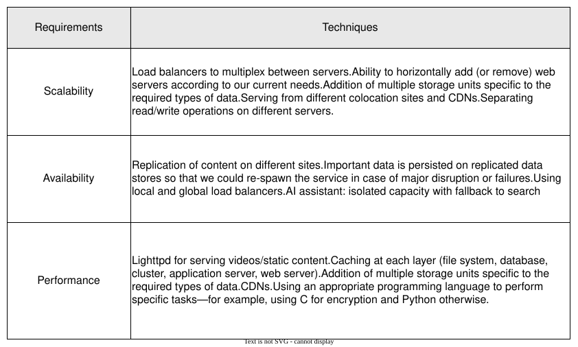

# Evaluation_of_YouTube's_Design

Source: https://www.educative.io/courses/grokking-the-system-design-interview/evaluation-of-youtubes-design

---

[Home](https://www.educative.io/)

[Courses](https://www.educative.io/search?tab=courses)

[Grokking Modern System Design Interview](https://www.educative.io/courses/grokking-the-system-design-interview)

# Evaluation of YouTube's Design

The evaluation of YouTube's design emphasizes fulfilling core requirements such as low latency, availability, and reliability. Strategies include ISP-level caching, optimized storage systems, and distributed caching to ensure smooth streaming. Scalability is achieved through horizontal scaling of web servers and sharding MySQL databases. The design prioritizes high availability and low latency over strong consistency, utilizing a distributed cache and selecting appropriate storage technologies for different data types. Future scalability challenges are addressed with solutions like Vitess for managing MySQL complexity, while custom server stacks optimize performance at scale.

We'll cover the following...

- [Requirements compliance](https://www.educative.io/courses/grokking-the-system-design-interview/evaluation-of-youtubes-design#Requirements-compliance)
- [Trade-offs](https://www.educative.io/courses/grokking-the-system-design-interview/evaluation-of-youtubes-design#Trade-offs)
  - [Consistency](https://www.educative.io/courses/grokking-the-system-design-interview/evaluation-of-youtubes-design#Consistency)
  - [Distributed cache](https://www.educative.io/courses/grokking-the-system-design-interview/evaluation-of-youtubes-design#Distributed-cache)
  - [Bigtable vs. MySQL](https://www.educative.io/courses/grokking-the-system-design-interview/evaluation-of-youtubes-design#Bigtable-vs-MySQL)
  - [Public vs. private CDN](https://www.educative.io/courses/grokking-the-system-design-interview/evaluation-of-youtubes-design#Public-vs-private-CDN)
  - [Duplicate videos](https://www.educative.io/courses/grokking-the-system-design-interview/evaluation-of-youtubes-design#Duplicate-videos)
  - [Conversational answers vs. latency and cost](https://www.educative.io/courses/grokking-the-system-design-interview/evaluation-of-youtubes-design#Conversational-answers-vs-latency-and-cost)
- [Evaluating conversational discovery](https://www.educative.io/courses/grokking-the-system-design-interview/evaluation-of-youtubes-design#Evaluating-conversational-discovery)
- [Future scaling](https://www.educative.io/courses/grokking-the-system-design-interview/evaluation-of-youtubes-design#Future-scaling)
- [Web server](https://www.educative.io/courses/grokking-the-system-design-interview/evaluation-of-youtubes-design#Web-server)

## Requirements compliance[#](https://www.educative.io/courses/grokking-the-system-design-interview/evaluation-of-youtubes-design#Requirements-compliance)

The proposed design must fulfill three core requirements: low latency, availability, and reliability.

1. **Low latency/Smooth streaming:** We achieve this through:

   1. ISP-level caching to store frequently viewed content.
   2. Optimized storage systems (e.g., Bigtable for thumbnails, blob storage for videos).
   3. Distributed caching at multiple layers.
   4. Content delivery networks (CDNs) to serve videos from memory near the end user.
2. **Scalability:** Web and application servers scale horizontally. However, MySQL has scaling limits that require restructuring, such as sharding, as the system grows.
3. **Availability:** We replicate data across servers and data centers to prevent single points of failure. Local and global load balancers reroute traffic during power or network outages.
4. **Reliability:** Data partitioning isolates failures, so the unavailability of one dataset does not affect others. We use the heartbeat protocol to monitor server health and a variant of consistent hashing to manage node additions and removals seamlessly.
5. **Grounded answers:** The assistant retrieves eligible evidence before generating, checks current video visibility before any passage reaches the model, and links each answer to timestamped sources. Its capacity is isolated from playback and standard search, so those stay available when the assistant is slow or down.

1.

Isn’t the load balancer a single point of failure (SPOF)?

Show Answer

Did you find this helpful?

How YouTube achieves scalability, availability, and good performance

## Trade-offs[#](https://www.educative.io/courses/grokking-the-system-design-interview/evaluation-of-youtubes-design#Trade-offs)

Every design decision involves trade-offs. Here’s how we balance them for YouTube:

### Consistency[#](https://www.educative.io/courses/grokking-the-system-design-interview/evaluation-of-youtubes-design#Consistency)

We prioritize high availability and low latency over strong consistency (see the [CAP theorem](https://www.educative.io/edpresso/what-is-the-cap-theorem)). Eventual consistency is acceptable for video feeds; users do not need to see new uploads simultaneously. However, we maintain strong consistency for user data by decoupling it from video metadata.

### Distributed cache[#](https://www.educative.io/courses/grokking-the-system-design-interview/evaluation-of-youtubes-design#Distributed-cache)

A distributed cache eliminates the single point of failure inherent in centralized caches. Memcached is ideal for YouTube’s static content (thumbnails and videos) and uses the Least Recently Used (LRU) algorithm to efficiently manage the long-tail access patterns of video data.

### Bigtable vs. MySQL[#](https://www.educative.io/courses/grokking-the-system-design-interview/evaluation-of-youtubes-design#Bigtable-vs-MySQL)

We select storage technologies based on data characteristics:

- **MySQL:** Used for user data and metadata. It provides the structure required for efficient searching.
- **Bigtable/NoSQL:** Used for the massive volume of videos and thumbnails. Alternatives like HDFS or Cassandra can also handle the throughput and scalability required for this unstructured data.

### Public vs. private CDN[#](https://www.educative.io/courses/grokking-the-system-design-interview/evaluation-of-youtubes-design#Public-vs-private-CDN)

YouTube can choose between private and public CDNs based on traffic volume.

Public CDNs are suitable for low-traffic regions because:

1. They avoid the high CAPEX of building infrastructure.
2. They are quick to deploy in regions with sudden viral traffic.
3. They are cost-effective when user density is too low to sustain a private node.

However, as traffic scales, public CDN costs rise. At that point, building a private CDN becomes economical and allows for internal optimization.

### Duplicate videos[#](https://www.educative.io/courses/grokking-the-system-design-interview/evaluation-of-youtubes-design#Duplicate-videos)

Duplicate uploads from users or spammers waste storage and complicate data management. If we assume 50 out of every 500 uploaded hours are duplicates, and one minute of video requires 6 MB, the wasted space accumulates rapidly.

Ace Editor

1

(50 x 60) minutes x 6 MB/min = 18 GB

הההההההההההההההההההההההההההההההההההההההההההההההההההההההההההההההההההההההההההההההההההההההההההההההההההההההההההההההההההההההההההההההההההההההההההההההההההההההההההההההההההההההההההההההההההההההההההההההההההההההההההההההההההההההההההההההההההההההההההההההההההההההההההההההההההההההההההההההההההההההההההההההההההההההההההההההההההההההההההההההההההההההההההההההההההההההההההההההההההההההההההההההההההההההההההההההההההההההההההההההההההההההההההההההההההההההההההההההההההההההההההההההההההההההההההההההההההההההההההההההההההההההההההההההההההההההההההההההה

XXXXXXXXXXXXXXXXXXXXXXXXXXXXXXXXXXXXXXXXXXXXXXXXXXXXXXXXXXXXXXXXXXXXXXXXXXXXXXXXXXXXXXXXXXXXXXXXXXXXXXXXXXXXXXXXXXXXXXXXXXXXXXXXXXXXXXXXXXXXXXXXXXXXXXXXXXXXXXXXXXXXXXXXXXXXXXXXXXXXXXXXXXXXXXXXXXXXXXXXXXXXXXXXXXXXXXXXXXXXXXXXXXXXXXXXXXXXXXXXXXXXXXXXXXXXXXXXXXXXXXXXXXXXXXXXXXXXXXXXXXXXXXXXXXXXXXXXXXXXXXXXXXXXXXXXXXXXXXXXXXXXXXXXXXXXXXXXXXXXXXXXXXXXXXXXXXXXXXXXXXXXXXXXXXXXXXXXXXXXXXXXXXXXXXXXXXXXXXXXXXXXXXXXXXXXXXXXXXXXXXXXXXXXXXXXXXXXXXXXXXXXXXXXXXXXXXXXXXXXXXXXXXXXXXXXXXXXXXXXXXXXXXXXXXXXXXXXXXXXXXXXXXXXXXXX

By eliminating duplicates, we can save approximately 9.5 petabytes of storage annually.

Ace Editor

1

18 GB/min x (60 x 24 x 365) total minutes in an year = 9.5 Peta Bytes

הההההההההההההההההההההההההההההההההההההההההההההההההההההההההההההההההההההההההההההההההההההההההההההההההההההההההההההההההההההההההההההההההההההההההההההההההההההההההההההההההההההההההההההההההההההההההההההההההההההההההההההההההההההההההההההההההההההההההההההההההההההההההההההההההההההההההההההההההההההההההההההההההההההההההההההההההההההההההההההההההההההההההההההההההההההההההההההההההההההההההההההההההההההההההההההההההההההההההההההההההההההההההההההההההההההההההההההההההההההההההההההההההההההההההההההההההההההההההההההההההההההההההההההההההההההההההההההההה

XXXXXXXXXXXXXXXXXXXXXXXXXXXXXXXXXXXXXXXXXXXXXXXXXXXXXXXXXXXXXXXXXXXXXXXXXXXXXXXXXXXXXXXXXXXXXXXXXXXXXXXXXXXXXXXXXXXXXXXXXXXXXXXXXXXXXXXXXXXXXXXXXXXXXXXXXXXXXXXXXXXXXXXXXXXXXXXXXXXXXXXXXXXXXXXXXXXXXXXXXXXXXXXXXXXXXXXXXXXXXXXXXXXXXXXXXXXXXXXXXXXXXXXXXXXXXXXXXXXXXXXXXXXXXXXXXXXXXXXXXXXXXXXXXXXXXXXXXXXXXXXXXXXXXXXXXXXXXXXXXXXXXXXXXXXXXXXXXXXXXXXXXXXXXXXXXXXXXXXXXXXXXXXXXXXXXXXXXXXXXXXXXXXXXXXXXXXXXXXXXXXXXXXXXXXXXXXXXXXXXXXXXXXXXXXXXXXXXXXXXXXXXXXXXXXXXXXXXXXXXXXXXXXXXXXXXXXXXXXXXXXXXXXXXXXXXXXXXXXXXXXXXXXXXXXX

Beyond storage costs, duplicates infringe on copyright. We must detect them using techniques such as Locality-Sensitive Hashing (LSH) for simple matches, Block Matching Algorithms (BMAs), and machine learning and AI for complex cases.

### Conversational answers vs. latency and cost[#](https://www.educative.io/courses/grokking-the-system-design-interview/evaluation-of-youtubes-design#Conversational-answers-vs-latency-and-cost)

Retrieving and reranking more passages gives the assistant better evidence, which improves its answers. It also increases latency and inference cost for every request. Our design bounds the number of retrieved candidates, reranked passages, context tokens, and output tokens, and it falls back to standard search results when demand exceeds the assistant’s capacity.

## Evaluating conversational discovery[#](https://www.educative.io/courses/grokking-the-system-design-interview/evaluation-of-youtubes-design#Evaluating-conversational-discovery)

The assistant needs its own checks, separate from standard search, because a fluent answer can still be wrong. A representative test set includes exact-term searches, paraphrased questions, follow-ups, single-video questions, removed or private videos, and questions the transcripts cannot answer. For each, we measure:

- **Answer support:** Each claim follows from the cited passages.
- **Timestamp usefulness:** Each link lands on the moment that explains the topic.
- **Access correctness:** Removed, private, or region-restricted videos never appear in answers.
- **Performance and cost:** Time to first output, fallback rate, and cost per question.

Acceptance thresholds and staged rollout follow the approach in the *Evaluating and protecting AI features* lesson.

## Future scaling[#](https://www.educative.io/courses/grokking-the-system-design-interview/evaluation-of-youtubes-design#Future-scaling)

As YouTube scales, the design must evolve to handle massive traffic loads. We must scale the following infrastructure components:

- Web and application servers
- Datastores
- Load balancers (at every layer)
- Distributed caches

Scaling MySQL is particularly challenging. As data grows, the database becomes a bottleneck. Sharding improves performance but adds complexity to the application logic and threatens ACID (Atomicity, Consistency, Isolation, Durability) properties. Managing this complexity in the client code eventually becomes unsustainable.

To solve this, YouTube developed Vitess.

Vitess system for scalability

Vitess abstracts the complexity of a sharded MySQL deployment by presenting a logical single-database interface to clients. Under the hood, it coordinates a cluster of MySQL instances. It manages sharding and query routing while maintaining MySQL compatibility and transactional (ACID) guarantees. This approach enables horizontal scalability while minimizing the need for sharding logic in the application layer.

Vitess on the scalability versus structure spectrum

Data denormalization is not a viable alternative to Vitess because it degrades write performance, which becomes critical as the system scales.

The conversational assistant can also grow over time. Natural next steps are understanding on-screen content through frame analysis and text recognition, answering questions about live streams, and enriching answers with web information.

## Web server[#](https://www.educative.io/courses/grokking-the-system-design-interview/evaluation-of-youtubes-design#Web-server)

At YouTube’s scale, default configurations of general-purpose web servers may not meet performance and optimization requirements. A custom server stack enables workload-specific optimizations that are difficult to achieve with standard off-the-shelf deployments. Run the following command to inspect the HTTP response headers and identify the server technology in use:

Ace Editor

1

lynx -head -dump http://www.youtube.com | grep ^Server

הההההההההההההההההההההההההההההההההההההההההההההההההההההההההההההההההההההההההההההההההההההההההההההההההההההההההההההההההההההההההההההההההההההההההההההההההההההההההההההההההההההההההההההההההההההההההההההההההההההההההההההההההההההההההההההההההההההההההההההההההההההההההההההההההההההההההההההההההההההההההההההההההההההההההההההההההההההההההההההההההההההההההההההההההההההההההההההההההההההההההההההההההההההההההההההההההההההההההההההההההההההההההההההההההההההההההההההההההההההההההההההההההההההההההההההההההההההההההההההההההההההההההההההההההההההההההההההההה

XXXXXXXXXXXXXXXXXXXXXXXXXXXXXXXXXXXXXXXXXXXXXXXXXXXXXXXXXXXXXXXXXXXXXXXXXXXXXXXXXXXXXXXXXXXXXXXXXXXXXXXXXXXXXXXXXXXXXXXXXXXXXXXXXXXXXXXXXXXXXXXXXXXXXXXXXXXXXXXXXXXXXXXXXXXXXXXXXXXXXXXXXXXXXXXXXXXXXXXXXXXXXXXXXXXXXXXXXXXXXXXXXXXXXXXXXXXXXXXXXXXXXXXXXXXXXXXXXXXXXXXXXXXXXXXXXXXXXXXXXXXXXXXXXXXXXXXXXXXXXXXXXXXXXXXXXXXXXXXXXXXXXXXXXXXXXXXXXXXXXXXXXXXXXXXXXXXXXXXXXXXXXXXXXXXXXXXXXXXXXXXXXXXXXXXXXXXXXXXXXXXXXXXXXXXXXXXXXXXXXXXXXXXXXXXXXXXXXXXXXXXXXXXXXXXXXXXXXXXXXXXXXXXXXXXXXXXXXXXXXXXXXXXXXXXXXXXXXXXXXXXXXXXXXXXX

Terminal 1

Terminal

Loading...

> **Note:** ESF is a custom web server developed by Google. It is widely used in the Google ecosystem because standard solutions could not meet YouTube’s performance needs.

Ask YouTube: AI-Powered Conversational Video Discovery

The Reality Is More Complicated

Ask

[Requirements compliance](https://www.educative.io/courses/grokking-the-system-design-interview/evaluation-of-youtubes-design#Requirements-compliance)

[Trade-offs](https://www.educative.io/courses/grokking-the-system-design-interview/evaluation-of-youtubes-design#Trade-offs)

[Consistency](https://www.educative.io/courses/grokking-the-system-design-interview/evaluation-of-youtubes-design#Consistency)

[Distributed cache](https://www.educative.io/courses/grokking-the-system-design-interview/evaluation-of-youtubes-design#Distributed-cache)

[Bigtable vs. MySQL](https://www.educative.io/courses/grokking-the-system-design-interview/evaluation-of-youtubes-design#Bigtable-vs-MySQL)

[Public vs. private CDN](https://www.educative.io/courses/grokking-the-system-design-interview/evaluation-of-youtubes-design#Public-vs-private-CDN)

[Duplicate videos](https://www.educative.io/courses/grokking-the-system-design-interview/evaluation-of-youtubes-design#Duplicate-videos)

[Conversational answers vs. latency and cost](https://www.educative.io/courses/grokking-the-system-design-interview/evaluation-of-youtubes-design#Conversational-answers-vs-latency-and-cost)

[Evaluating conversational discovery](https://www.educative.io/courses/grokking-the-system-design-interview/evaluation-of-youtubes-design#Evaluating-conversational-discovery)

[Future scaling](https://www.educative.io/courses/grokking-the-system-design-interview/evaluation-of-youtubes-design#Future-scaling)

[Web server](https://www.educative.io/courses/grokking-the-system-design-interview/evaluation-of-youtubes-design#Web-server)