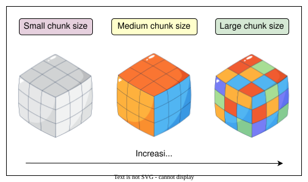
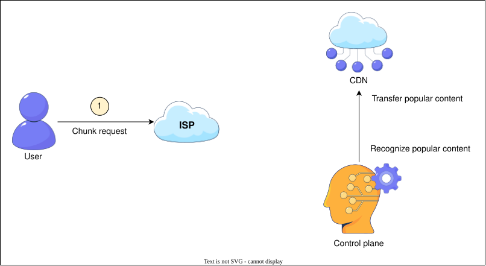
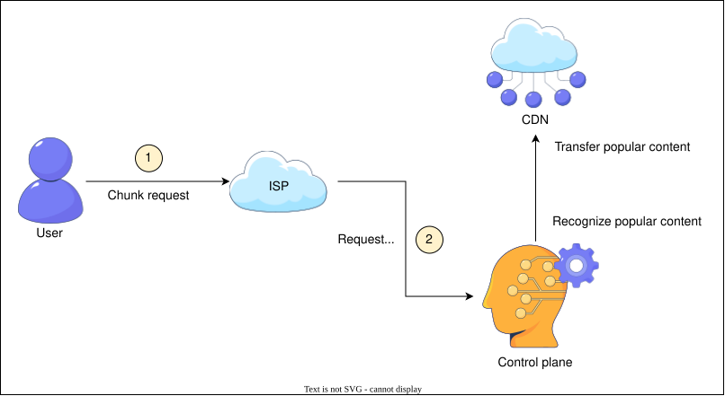
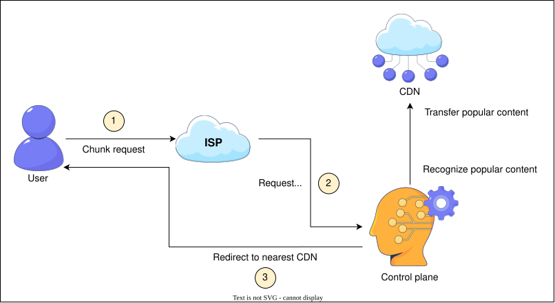
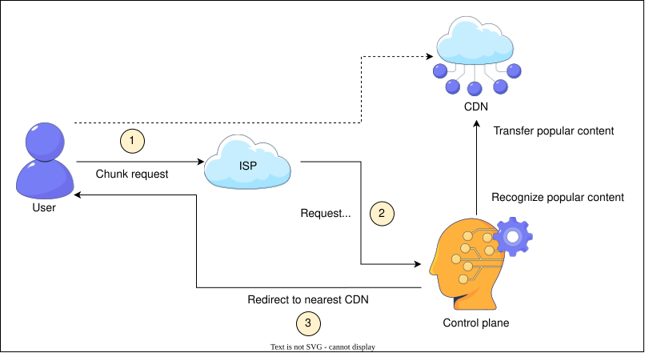

# The_Reality_Is_More_Complicated

Source: https://www.educative.io/courses/grokking-the-system-design-interview/the-reality-is-more-complicated

---

[Home](https://www.educative.io/)

[Courses](https://www.educative.io/search?tab=courses)

[Grokking Modern System Design Interview](https://www.educative.io/courses/grokking-the-system-design-interview)

# The Reality Is More Complicated

YouTube optimizes storage and network demands while enhancing user experience through a three-step process: encoding, deploying, and delivering content. Videos are encoded into segments using various schemes tailored to device capabilities, reducing storage needs and improving playback. Content is strategically deployed closer to users via CDNs to minimize latency and server strain. Delivery adapts to client conditions, utilizing adaptive streaming to adjust video quality based on available bandwidth. This comprehensive approach ensures efficient content management and user satisfaction.

We'll cover the following...

- [Introduction](https://www.educative.io/courses/grokking-the-system-design-interview/the-reality-is-more-complicated#Introduction)
- [Encode](https://www.educative.io/courses/grokking-the-system-design-interview/the-reality-is-more-complicated#Encode)
- [Deploy](https://www.educative.io/courses/grokking-the-system-design-interview/the-reality-is-more-complicated#Deploy)
  - [Recommendations](https://www.educative.io/courses/grokking-the-system-design-interview/the-reality-is-more-complicated#Recommendations)
- [Deliver](https://www.educative.io/courses/grokking-the-system-design-interview/the-reality-is-more-complicated#Deliver)
  - [Adaptive streaming](https://www.educative.io/courses/grokking-the-system-design-interview/the-reality-is-more-complicated#Adaptive-streaming)
- [Potential follow-up questions](https://www.educative.io/courses/grokking-the-system-design-interview/the-reality-is-more-complicated#Potential-follow-up-questions)

## Introduction[#](https://www.educative.io/courses/grokking-the-system-design-interview/the-reality-is-more-complicated#Introduction)

Now that we’ve understood the design well, let’s see how YouTube can optimize storage usage and network demands while maintaining a good quality of experience (QoE) for the end user.

When talking about providing effective service to end users, the following three steps are important:

- **Encode:** The raw videos uploaded to YouTube have significant storage requirements. Various encoding schemes can reduce the size of these raw video files. Apart from compression, the choice of encoding scheme will also depend on the types of end devices used to stream the video content. As multiple devices may stream the same video, we may need to encode it with different schemes, splitting a single raw video file into multiple files, each encoded differently. This strategy will result in a good user-perceived experience for two reasons: users will save bandwidth because the video file will be encoded and compressed to a limit, and the resulting file will be appropriate for the client, enabling smooth playback.
- **Deploy:** For low latency, content must be intelligently deployed so that it is closer to a large number of end users. Not only will this reduce latency, but it will also put less strain on networks and YouTube’s core servers.
- **Deliver:** Delivering to the client requires knowledge about the client or the device used for playing the video. This knowledge will help adapt to client and network conditions. Therefore, we’ll enable ourselves to serve content efficiently.

Let’s understand each phase in detail now.

## Encode[#](https://www.educative.io/courses/grokking-the-system-design-interview/the-reality-is-more-complicated#Encode)

Until now, we’ve considered encoding a single video using different encoding schemes. However, if we encode videos per-shot, we’ll divide the video into smaller time frames and encode them individually. We can divide videos into shorter time frames and refer to them as segments. Each segment will be encoded using multiple schemes, producing multiple files, or chunks. The choice of encoding scheme for a segment will be based on the details within the segment to get optimized quality with lesser storage requirements. Eventually, each shot will be encoded into multiple chunk sizes depending on the segment’s content and the encoding scheme used. As we divide the raw video into segments, we’ll see its advantages during the deployment and delivery phase.

Let’s understand how the per-segment encoding will work. For any video with dynamic colors and high depth, we’ll encode it differently from a video with fewer colors. This means that a not-so-dynamic segment will be compressed more to save additional storage space. Eventually, we’ll have to transfer smaller files and save bandwidth during deployment and streaming phases.

Higher quality requires a higher bitrate from left to right

Using the strategy above, we’ll have to encode individual shots of a video in various formats. However, the alternative to this would be storing an entire video (using no segmenting) after encoding it in various formats. If we encode on a per-shot basis, we would be able to optimally reduce the size of the entire video by doing the encoding on a granular level. We can also encode audio in various formats to optimally allow streaming for various clients like TVs, mobile phones, and desktop machines. Specifically, for services like Netflix, audio encoding is more useful because audios are offered in various languages.

A raw video file being encoded into different formats including its audio and subtitles

## Deploy[#](https://www.educative.io/courses/grokking-the-system-design-interview/the-reality-is-more-complicated#Deploy)

As discussed in our design and evaluation sections, we have to bring the content closer to the user. This has three main advantages:

1. Users will be able to stream videos quickly.
2. There will be a reduced burden on the origin servers.
3. Internet service providers (ISPs) will have spare bandwidth.

So, instead of streaming from our data centers directly, we can deploy chunks of popular videos in CDNs and point of presence (PoPs) of ISPs. In places where there is no collaboration possible with the ISPs, our content can be placed in internet exchange point (IXPs). We can put content in IXPs that will not only be closer to users, but can also be helpful in filling the cache of ISP PoPs.

Streaming from data center to users through IXP and ISPs

Caching at the ISP or IXP layer is typically limited to popular or moderately popular content due to storage constraints. Because the per-shot encoding scheme reduces storage overhead, a larger portion of the catalog can be cached at edge locations, increasing cache hit rates and reducing origin load.

Additionally, we can have two types of storage at the origin servers:

1. **Flash servers:** These servers hold popular and moderately popular content. They are optimized for low-latency delivery.
2. **Storage servers:** This type holds a large portion of videos that are not popular. These servers are optimized to hold large storage.

> **Note:** When we transfer streaming content, it can result in the congestion of networks. That is why we have to transfer the content to ISPs in off-peak hours.

### Recommendations[#](https://www.educative.io/courses/grokking-the-system-design-interview/the-reality-is-more-complicated#Recommendations)

YouTube recommends videos to users based on their profile, taking into account factors such as their interests, view and search history, subscribed channels, related topics to already viewed content, and activities on content such as comments and likes.

An approximation of the recommendation engine of YouTube is provided below. YouTube filters videos in two phases:

1. **Candidate generation:** During this phase, millions of YouTube videos are filtered down to hundreds based on the user’s history and current context.
2. **Ranking:** The ranking phase rates videos based on their features and according to the user’s interests and history. Hundreds of videos are filtered and ranked down to a few dozen videos during this phase.

YouTube employs machine learning technology in both phases to provide recommendations to users.

YouTube's recommendation engine using two neural networks to filter videos from millions to dozens

1.

Previously, we said that popular content is sent to ISPs, IXPs, and CDNs. We’ve now discussed YouTube’s recommendation feature. What is the difference between popular and recommended content on YouTube?

Show Answer

1 / 3

## Deliver[#](https://www.educative.io/courses/grokking-the-system-design-interview/the-reality-is-more-complicated#Deliver)

The following flow describes how content is delivered to the client device. Video segments are replicated at edge locations, and client requests are routed to the nearest available CDN node. For popular content, requests are resolved to the nearest CDN endpoint to minimize latency.  
  
However, in the case of non-popular content, the user is served from colocation sites or YouTube’s data center where the content is stored initially. We have already learned how YouTube can reduce latency times by having distributed caches at different design layers.

1 / 4

The user requests for chunk using the ISP.

1 / 4

The ISP forwards the request to the control plane of YouTube.

1 / 4

The control plane redirects the user to the nearest CDN.

1 / 4

The user starts streaming from the nearest CDN.

### Adaptive streaming[#](https://www.educative.io/courses/grokking-the-system-design-interview/the-reality-is-more-complicated#Adaptive-streaming)

During playback, the client continuously measures available network bandwidth. Videos are encoded into fixed-duration segments at multiple quality levels, and the client selects the appropriate segment based on current network conditions. When available bandwidth increases, the client switches to higher-bitrate segments; when bandwidth drops, it falls back to lower-bitrate segments.

Chunk size in each time frame provided to the client changes according to the bandwidth

The adaptive bitrate algorithm depends on the following four parameters:

1. End-to-end available bandwidth (from a CDN/servers to a specific client).
2. The device capabilities of the user.
3. Encoding techniques used.
4. The buffer space at the client [source].

Let’s test your understanding with the help of an AI assessment:

AI Powered

Saved

3 attempts left

Reset

State the ways we achieve low latency in the design of YouTube.

We have now discussed the detailed system design of YouTube. In the requirements of YouTube’s design, we mentioned the need for our design solution to have low latency as a primary non-functional requirement.

What were the measures taken in our design to ensure low latency?

You have 3 attempts to answer.

## Potential follow-up questions[#](https://www.educative.io/courses/grokking-the-system-design-interview/the-reality-is-more-complicated#Potential-follow-up-questions)

There can be many different aspects of the system design of YouTube as there is more depth in the subject area. Therefore, many questions can arise. Some questions and directions toward their answers are as follows:

1. **Question:** It is possible to quantify availability by adding numbers like 99.99% availability or 99.999% availability. In that case, what design changes will be required? This is a hard question. In reality, such numbers are part of a service’s SLA, and they are generated from models or long-term empirical studies. While it is good to know how the above numbers are obtained and how organizations use monitoring to keep availability high, it might be a better strategy to discuss the fault tolerance of the system, what will happen if there are software faults, server failures, full data center failures, and so on. If the system is resilient against faults, that implies the system will have good availability.
2. **Question:** We assumed some reasonable numbers to come up with broad resource requirements. For example, we said the average length of a video is five minutes. In this case, are we designing for average behavior? What will happen to users who don’t follow the average profile? A possible answer could be that the above number will likely change over time. Our system design should be horizontally scalable so that with increasing users, the system keeps functioning adequately. Practically, systems might not scale when some aspect of the system increases by an order of magnitude. When some aspects of a system increase by an order of magnitude (for example, 10x), we usually need a new, different design. Cost points of designing 10x and 100x scales are very different.
3. **Question:** Why didn’t we discuss and estimate resources for video comments and likes? Concurrent users’ comments on videos are roughly at the same complexity as designing a messaging system. We’ll discuss that problem [elsewhere](https://www.educative.io/courses/grokking-the-system-design-interview/system-design-whatsapp) in the course.
4. **Question:** How to manage unexpected spikes in system load? A possible answer is that because our design is horizontally scalable, we can shed some load on the public cloud due to its elasticity features. However, public clouds are not infinitely scalable. They often need a priori business contracts that might put a limit on maximum, concurrently allowed resource use at different data centers.
5. **Question:** How will we deploy a global network to connect data centers and CDN sites? In practice, YouTube uses Google’s network, which is built for that purpose and peers with many ISPs of the world. It is a fascinating field of study that we have left outside this course for further review.
6. **Question:** Why isn’t there more detail on audio/video encoding? There are many audio/video encoding choices, many publicly known and some proprietary. Due to excessive redundancy in multimedia content, encoding is often able to reduce a huge raw format content to a much smaller size (for example, from 600 MB to 30 MB). We have left the details of such encoding algorithms to you if you’re interested in further exploration.
7. **Question:** Cant we use specialized hardware (or accelerators like GPUs) to speed up some aspects of the YouTube computation? When we estimated the number of servers, we assumed that any server could fulfill any required functionality. In reality, with the slowing of Moore’s law, we have special-purpose hardware available (for example, hardware encoders/decoders, machine-learning accelerators like Tensor Processing Units, and many more). All such platforms need their own courses to do justice to the content. So, we avoided that discussion in this design problem.
8. **Question:** Should compression be performed at the client-side or the server-side during the content uploading stage? We might use some lossless but fast compression (for example, Google Snappy) on the client end to reduce data that needs to be uploaded. This might mean that we’ll need a rich client, or we would have to fall back to plain data if the compressor was unavailable. Both of those options add complexity to the system.
9. **Question:** Are there any other benefits to making file chunks other than in adaptive bitrates? Video segments were introduced in the context of adaptive bitrate (ABR) streaming. Segmenting video also enables parallel preprocessing tasks such as transcoding and packaging, which is critical for low-latency live streaming. Parallel processing is a broad area and is outside the scope of this discussion.

Evaluation of YouTube's Design

Quiz on YouTube's Design

Ask

[Introduction](https://www.educative.io/courses/grokking-the-system-design-interview/the-reality-is-more-complicated#Introduction)

[Encode](https://www.educative.io/courses/grokking-the-system-design-interview/the-reality-is-more-complicated#Encode)

[Deploy](https://www.educative.io/courses/grokking-the-system-design-interview/the-reality-is-more-complicated#Deploy)

[Recommendations](https://www.educative.io/courses/grokking-the-system-design-interview/the-reality-is-more-complicated#Recommendations)

[Deliver](https://www.educative.io/courses/grokking-the-system-design-interview/the-reality-is-more-complicated#Deliver)

[Adaptive streaming](https://www.educative.io/courses/grokking-the-system-design-interview/the-reality-is-more-complicated#Adaptive-streaming)

[Potential follow-up questions](https://www.educative.io/courses/grokking-the-system-design-interview/the-reality-is-more-complicated#Potential-follow-up-questions)