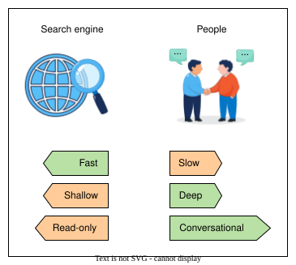

# System_Design_Quora

Source: https://www.educative.io/courses/grokking-the-system-design-interview/system-design-quora

---

[Home](https://www.educative.io/)

[Courses](https://www.educative.io/search?tab=courses)

[Grokking Modern System Design Interview](https://www.educative.io/courses/grokking-the-system-design-interview)

# System Design: Quora

Learn how Quora overcomes the limitations of traditional search engines by enabling deeper, community-driven answers to complex questions. Explore how a scalable system architecture can be designed to support Quora’s functionality and growth.

We'll cover the following...

- [Introduction](https://www.educative.io/courses/grokking-the-system-design-interview/system-design-quora#Introduction)
- [What is Quora?](https://www.educative.io/courses/grokking-the-system-design-interview/system-design-quora#What-is-Quora)
- [How will we design Quora?](https://www.educative.io/courses/grokking-the-system-design-interview/system-design-quora#How-will-we-design-Quora)

## Introduction[#](https://www.educative.io/courses/grokking-the-system-design-interview/system-design-quora#Introduction)

Retrieving precise information online can be challenging. Search engines such as Google index and rank web content efficiently, but they may struggle with queries that require deeper contextual understanding. Consulting subject-matter experts involves higher latency but often yields more nuanced, context-aware responses. The following illustration contrasts these two approaches.

Comparing information seeking through search engines vs. humans

As shown above, asking people can be more instructive than automated search, despite the time cost. Search engines may hit dead ends if content does not exist, whereas human communities can generate new answers on demand.

## What is Quora?[#](https://www.educative.io/courses/grokking-the-system-design-interview/system-design-quora#What-is-Quora)

**Quora** is a social question-and-answer platform. It solves the “shallow information” problem of search engines by connecting users with a community of peers and domain experts. While search engines prioritize speed, Quora prioritizes depth and conversation. Users can ask questions, reply to others, and share specific expertise.

The plot below displays global search trends for the term Quora:

Popularity of Quora according to Google by year

Quora serves hundreds of millions of monthly active users who generate thousands of questions per day across hundreds of thousands of topics. This chapter outlines a scalable architecture for Quora based on defined functional and non-functional requirements.

## How will we design Quora?[#](https://www.educative.io/courses/grokking-the-system-design-interview/system-design-quora#How-will-we-design-Quora)

We will break the design process into four lessons:

1. [**Requirements**](https://www.educative.io/courses/grokking-the-system-design-interview/requirements-of-quoras-design)**:** Define functional and non-functional requirements and estimate the necessary resources.
2. [**Initial design**](https://www.educative.io/courses/grokking-the-system-design-interview/initial-design-of-quora)**:** Create a baseline architecture that includes API design, building blocks, and workflows.
3. [**Final design**](https://www.educative.io/courses/grokking-the-system-design-interview/final-design-of-quora)**:** Address limitations in the initial design to meet all requirements. This includes advanced topics such as database vertical sharding and AI-powered duplicate question detection.
4. [**Evaluation**](https://www.educative.io/courses/grokking-the-system-design-interview/evaluation-of-quoras-design)**:** Assess the design against non-functional requirements, discuss trade-offs, and explore ways to improve availability.

> **Note:** This chapter draws inspiration from the Quora engineering blog.

TikTok System Design

Requirements of Quora's Design

Ask

[Introduction](https://www.educative.io/courses/grokking-the-system-design-interview/system-design-quora#Introduction)

[What is Quora?](https://www.educative.io/courses/grokking-the-system-design-interview/system-design-quora#What-is-Quora)

[How will we design Quora?](https://www.educative.io/courses/grokking-the-system-design-interview/system-design-quora#How-will-we-design-Quora)