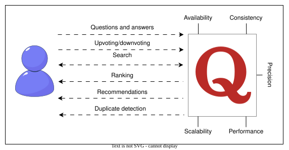

# Requirements_of_Quora's_Design

Source: https://www.educative.io/courses/grokking-the-system-design-interview/requirements-of-quoras-design

---

[Home](https://www.educative.io/)

[Courses](https://www.educative.io/search?tab=courses)

[Grokking Modern System Design Interview](https://www.educative.io/courses/grokking-the-system-design-interview)

# Requirements of Quora's Design

Explore the core functional and non-functional requirements for designing a scalable Q&A platform like Quora. Calculate detailed resource estimations for servers, storage, and bandwidth based on daily active users.

We'll cover the following...

- [Requirements](https://www.educative.io/courses/grokking-the-system-design-interview/requirements-of-quoras-design#Requirements)
  - [Functional requirements](https://www.educative.io/courses/grokking-the-system-design-interview/requirements-of-quoras-design#Functional-requirements)
  - [Non-functional requirements](https://www.educative.io/courses/grokking-the-system-design-interview/requirements-of-quoras-design#Non-functional-requirements)
- [Resource estimation](https://www.educative.io/courses/grokking-the-system-design-interview/requirements-of-quoras-design#Resource-estimation)
  - [Number of servers estimation](https://www.educative.io/courses/grokking-the-system-design-interview/requirements-of-quoras-design#Number-of-servers-estimation)
  - [Storage estimation](https://www.educative.io/courses/grokking-the-system-design-interview/requirements-of-quoras-design#Storage-estimation)
  - [Bandwidth estimation](https://www.educative.io/courses/grokking-the-system-design-interview/requirements-of-quoras-design#Bandwidth-estimation)
- [Building blocks](https://www.educative.io/courses/grokking-the-system-design-interview/requirements-of-quoras-design#Building-blocks)

## Requirements[#](https://www.educative.io/courses/grokking-the-system-design-interview/requirements-of-quoras-design#Requirements)

Let’s understand the functional and non-functional requirements below:

### Functional requirements[#](https://www.educative.io/courses/grokking-the-system-design-interview/requirements-of-quoras-design#Functional-requirements)

- **Questions and answers:** Users can post questions and answers containing text, images, and videos.
- **Interactions:** Users can upvote, downvote, and comment on answers.
- **Search:** Users can search for existing questions on the platform.
- **Feed and recommendation:** The system generates a personalized feed based on user interests to facilitate discovery.
- **Ranking:** Answers are ranked by usefulness, with the highest-quality content listed first.
- **AI-powered duplicate question detection:** The system suggests existing questions that ask the same thing as users write a new question, so answers stay in one place.

### Non-functional requirements[#](https://www.educative.io/courses/grokking-the-system-design-interview/requirements-of-quoras-design#Non-functional-requirements)

- **Scalability:** The system must handle increasing user and feature growth without performance degradation.
- **Consistency:** Content must be consistent across views. However, new posts and comments may propagate with a slight delay (eventual consistency).
- **Availability:** The system must remain available under high concurrent request loads.
- **Performance:** The system must provide low latency for a smooth user experience.
- **Precision of duplicate suggestions:** Suggestions must favor accuracy over coverage, because a wrong suggestion sends users to a question that does not answer theirs.

Functional and non-functional requirements of Quora

## Resource estimation[#](https://www.educative.io/courses/grokking-the-system-design-interview/requirements-of-quoras-design#Resource-estimation)

We will estimate the number of servers, storage, and bandwidth required to support the system.

We base our estimates on the following assumptions:

- **Total users:** 1 billion (300 million daily active users)
- **Content:** 15% of questions contain an image; 5% contain a video
- **Media size:** Images are 250 KB; videos are 5 MB

### Number of servers estimation[#](https://www.educative.io/courses/grokking-the-system-design-interview/requirements-of-quoras-design#Number-of-servers-estimation)

To estimate the servers required for peak load, we use [our assumption](https://www.educative.io/courses/grokking-the-system-design-interview/put-back-of-the-envelope-numbers-in-perspective) of 300 million requests per second (using DAU as a proxy). We calculate the server count using the following formula:

Servers needed at peak load=Number of requests/secondRPS of server\text{Servers needed at peak load} = \frac{\text{Number of requests/second}}{\text{RPS of server}}
Servers needed at peak load=RPS of serverNumber of requests/second​

Assuming a single server handles [64,000 RPS](https://www.educative.io/courses/grokking-the-system-design-interview/put-back-of-the-envelope-numbers-in-perspective), the required server count is:

Servers needed at peak load = 300 million64,000=4687.5≈4.7K servers\text{Servers needed at peak load = } \frac{300\ \text{million}}{64,000} = 4687.5 \approx 4.7\text{K servers}
Servers needed at peak load = 64,000300 million​=4687.5≈4.7K servers

The estimated number of servers required for Quora

### Storage estimation[#](https://www.educative.io/courses/grokking-the-system-design-interview/requirements-of-quoras-design#Storage-estimation)

Based on the media ratios (15% images, 5% videos), we estimate storage needs using these assumptions:

- **Activity:** Each DAU posts 1 question per day. Each question receives 2 answers, 10 upvotes, and 5 comments.
- **Text size:** The collective text content for one question (including answers and comments) is 100 KB100\ \text{KB}100 KB.

#### Storage Requirements Estimation Calculator

|  |  |  |
| --- | --- | --- |
| Questions per user | 1 | per day |
| Total questions per day | f300 | millions |
| Size of textual content per question | 100 | KB |
| Image size | 250 | KB |
| Video size | 5 | MB |
| Questions containing images | 15 | percent |
| Questions containing videos | 5 | percent |
| Storage for textual content | f30 | TB |
| Storage for image content | f11.25 | TB |
| Storage for video content | f75 | TB |

Summarizing storage requirements of Quora

> Total storage required for one day=30 TB+11.25 TB+75 TB≈116.25 TB/day\text{Total storage required for one day} = 30\ \text{TB} + 11.25\ \text{TB} + 75\ \text{TB} \approx 116.25\ \text{TB/day}Total storage required for one day=30 TB+11.25 TB+75 TB≈116.25 TB/day

While 116.25 TB/day\text{116.25 TB/day}116.25 TB/day is significant, the annual requirement of 116.25 TB×365=42.43 PB116.25\ \text{TB} \times 365 = 42.43\ \text{PB}116.25 TB×365=42.43 PB is manageable. Practical requirements will be higher due to data replication and storage for the 700 million inactive users.

### Bandwidth estimation[#](https://www.educative.io/courses/grokking-the-system-design-interview/requirements-of-quoras-design#Bandwidth-estimation)

We calculate bandwidth based on incoming and outgoing data:

- **Incoming traffic**: 116.25 TB86,400×8=10.9 Gbps≈11 Gbps\frac{116.25\ \text{TB}}{86,400} \times 8 = 10.9\ \text{Gbps} \approx 11\ \text{Gbps}86,400116.25 TB​×8=10.9 Gbps≈11 Gbps
- **Outgoing traffic**: Assuming 300 million users view 20 questions per day, the total bandwidth is calculated below:

#### Bandwidth Requirements Estimation Calculator

|  |  |  |
| --- | --- | --- |
| Total storage required per day | 116.25 | TB |
| Incoming traffic bandwidth | f11 | Gbps |
| Questions viewed per user | 20 | per day |
| Total questions viewed | f69444 | per second |
| Bandwidth for text of all questions | f55.56 | Gbps |
| Bandwidth for 15% of image content | f20.83 | Gbps |
| Bandwidth for 5% of video content | f138.89 | Gbps |
| Outgoing traffic bandwidth | f215.3 | Gbps |

Summarizing the bandwidth requirements of Quora

The total bandwidth requirement is:

> Incoming + outgoing traffic bandwidth = 11 Gbps + 215.3 Gbps = 226.3 Gbps\text{= 11 Gbps + 215.3 Gbps = 226.3 Gbps}= 11 Gbps + 215.3 Gbps = 226.3 Gbps

## Building blocks[#](https://www.educative.io/courses/grokking-the-system-design-interview/requirements-of-quoras-design#Building-blocks)

The initial design utilizes the following components:

Building blocks required for our design

- [**Load balancers**](https://www.educative.io/courses/grokking-the-system-design-interview/introduction-to-load-balancers)**:** Distribute traffic load across service hosts.
- [**Databases**](https://www.educative.io/courses/grokking-the-system-design-interview/introduction-to-databases)**:** Store questions, answers, comments, and user metadata. Different database types may be used for specific data structures.
- [**Distributed cache**](https://www.educative.io/courses/grokking-the-system-design-interview/system-design-the-distributed-cache)**:** Stores frequently accessed data (e.g., view counters) to reduce database load.
- [**Blob store**](https://www.educative.io/courses/grokking-the-system-design-interview/system-design-a-blob-store)**:** Stores large media files, such as images and videos.
- **Vector index:** Finds questions with similar meaning for duplicate detection. We cover embeddings and similarity search in the Embeddings and Retrieval lesson.

System Design: Quora

Initial Design of Quora

Ask

[Requirements](https://www.educative.io/courses/grokking-the-system-design-interview/requirements-of-quoras-design#Requirements)

[Functional requirements](https://www.educative.io/courses/grokking-the-system-design-interview/requirements-of-quoras-design#Functional-requirements)

[Non-functional requirements](https://www.educative.io/courses/grokking-the-system-design-interview/requirements-of-quoras-design#Non-functional-requirements)

[Resource estimation](https://www.educative.io/courses/grokking-the-system-design-interview/requirements-of-quoras-design#Resource-estimation)

[Number of servers estimation](https://www.educative.io/courses/grokking-the-system-design-interview/requirements-of-quoras-design#Number-of-servers-estimation)

[Storage estimation](https://www.educative.io/courses/grokking-the-system-design-interview/requirements-of-quoras-design#Storage-estimation)

[Bandwidth estimation](https://www.educative.io/courses/grokking-the-system-design-interview/requirements-of-quoras-design#Bandwidth-estimation)

[Building blocks](https://www.educative.io/courses/grokking-the-system-design-interview/requirements-of-quoras-design#Building-blocks)