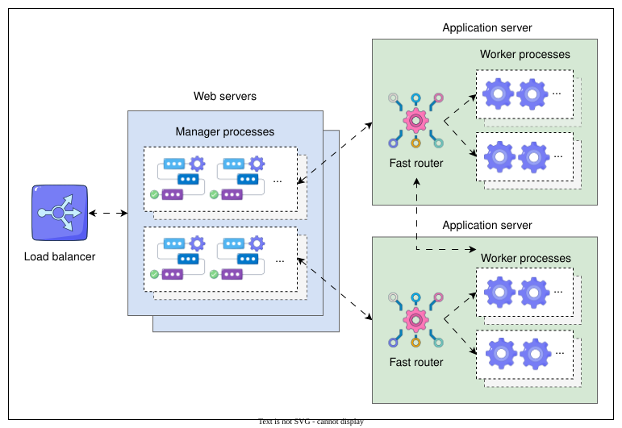

# Initial_Design_of_Quora

Source: https://www.educative.io/courses/grokking-the-system-design-interview/initial-design-of-quora

---

[Home](https://www.educative.io/)

[Courses](https://www.educative.io/search?tab=courses)

[Grokking Modern System Design Interview](https://www.educative.io/courses/grokking-the-system-design-interview)

# Initial Design of Quora

Discover how to structure the initial System Design of a complex Q&A platform like Quora. Define the high-level architecture by selecting appropriate data stores and specialized caching systems. Learn to map core workflows and design the necessary APIs for posting and searching.

We'll cover the following...

- [Initial design](https://www.educative.io/courses/grokking-the-system-design-interview/initial-design-of-quora#Initial-design)
- [Workflow](https://www.educative.io/courses/grokking-the-system-design-interview/initial-design-of-quora#Workflow)
- [API design](https://www.educative.io/courses/grokking-the-system-design-interview/initial-design-of-quora#API-design)
  - [Post a question](https://www.educative.io/courses/grokking-the-system-design-interview/initial-design-of-quora#Post-a-question)
    - [Find similar questions](https://www.educative.io/courses/grokking-the-system-design-interview/initial-design-of-quora#Find-similar-questions)
  - [Post an answer](https://www.educative.io/courses/grokking-the-system-design-interview/initial-design-of-quora#Post-an-answer)
  - [Upvote an answer](https://www.educative.io/courses/grokking-the-system-design-interview/initial-design-of-quora#Upvote-an-answer)
  - [Comment on an answer](https://www.educative.io/courses/grokking-the-system-design-interview/initial-design-of-quora#Comment-on-an-answer)
  - [Search](https://www.educative.io/courses/grokking-the-system-design-interview/initial-design-of-quora#Search)

## Initial design[#](https://www.educative.io/courses/grokking-the-system-design-interview/initial-design-of-quora#Initial-design)

The initial design of Quora consists of the following components:

- **Web and application servers:** Web servers accept incoming HTTP requests and forward them to application servers for processing. They run manager processes that delegate work to worker processes on application servers through a routing layer. This routing layer manages task queues, where managers enqueue tasks and workers dequeue them for execution. Application servers may also maintain in-memory priority queues to differentiate request classes. The following diagram shows an abstract view of this architecture:



Web and application servers at Quora

- **Data stores:** Quora uses specific storage solutions based on data requirements:

  - **Relational database (MySQL):** Stores critical data requiring high consistency, such as questions, answers, comments, and votes.
  - **NoSQL (HBase):** Stores high-throughput data like view counts, ranking scores, and extracted features for recommendations. HBase supports the high-bandwidth requirements of big data processing and avoids the expensive recomputation of features.
  - **Blob storage:** Stores media files like videos and images.

- **Distributed cache:** Quora employs two caching systems to improve performance:

  - **Memcached:** Caches frequently accessed critical data from MySQL.
  - **Redis:** Stores the online view counter for answers, leveraging its support for in-store increments. Additionally, CDNs serve static assets like videos and images.
- **Compute servers:** These servers handle computationally intensive tasks like recommendations and ranking. They use machine learning (ML) to process attributes in either online or offline mode. Due to the workload, these servers require significant RAM and processing power.

Standard components like load balancers, monitoring services, and rate limiters are also included. The high-level design is illustrated below:


The high-level design of Quora

Let’s test your understanding with the help of an AI assessment:

AI Powered

Saved

1 attempt left

Reset

Why do we use two caching systems for Quora?

Why does Quora use both Memcached and Redis in its architecture? What are the strengths of each? Can you explain the specific advantages of using both systems?

This is your last attempt.

## Workflow[#](https://www.educative.io/courses/grokking-the-system-design-interview/initial-design-of-quora#Workflow)

Quora’s design addresses numerous functional and non-functional requirements. We will examine the workflow by feature:

- **Posting questions, answers, and comments:** The web servers receive user requests through the load balancer and direct them to the application servers. Meanwhile, the web servers generate part of the web page and let the worker processes on the application servers handle the rest of the page generation. The questions-and-answers data is stored in a MySQL database, whereas any videos and images are stored in blob storage. The same asynchronous processing model is used for posting comments and handling upvote or downvote actions. Task prioritization is implemented using separate queues for different priority classes. Some tasks are latency-sensitive, such as serving a database read for a user request. Others are delay-tolerant, such as generating a weekly email digest. Worker processes continuously pull tasks from the appropriate queue and execute them.

1.

When would a service like Quora require a notifications feature?

Show Answer

1 / 2

- **Answer ranking system:** While sorting by date is simple, users prefer seeing the most relevant answers first. Quora uses ML to rank answers based on quality rather than just timestamps or upvotes (which can be skewed by jokes). Features are extracted over time and stored in HBase. An ML engine processes these features to rank answers. This ranking is best performed offline, as answer quality signals (upvotes, views) accumulate over time. Offline processing also reduces infrastructure load and allows the use of elastic cloud services for specialized ML hardware.
- **Recommendation system:** This system powers the user feed, related questions, ad targeting, and content moderation. Unlike ranking, recommendations require both online and offline processing. The system receives requests from application servers and forwards relevant features to the ML engine.
- **Search feature:** The system builds an index in HBase from questions, answers, topic labels, and usernames. User queries are matched against this index to suggest content. Frequently accessed indexes are cached for low latency. Queries are tokenized and matched against indexed terms regardless of word order, so reordered words still find the same results (see [Scaling Search and Indexing](https://www.educative.io/courses/grokking-the-system-design-interview/scaling-search-and-indexing) in the **distributed search** chapter).

AI Powered

Saved

1 attempt left

Reset

What are the benefits of this dual approach?

How does Quora use both HBase indexing and caching to optimize its search functionality? What specific roles do each play in balancing search accuracy and performance?

This is your last attempt.

## API design[#](https://www.educative.io/courses/grokking-the-system-design-interview/initial-design-of-quora#API-design)

This section defines the API calls for core features:

- Post a question
- Find similar questions
- Post an answer
- Upvote or downvote a question or answer
- Comment on an answer
- Search

> **Note:** APIs for recommendations or ranking are internal system processes, not explicit user requests.

### Post a question[#](https://www.educative.io/courses/grokking-the-system-design-interview/initial-design-of-quora#Post-a-question)

The `postQuestion` API uses an HTTP POST request:

Ace Editor

1

postQuestion(user\_id, question, description, topic\_label, video, image)

הההההההההההההההההההההההההההההההההההההההההההההההההההההההההההההההההההההההההההההההההההההההההההההההההההההההההההההההההההההההההההההההההההההההההההההההההההההההההההההההההההההההההההההההההההההההההההההההההההההההההההההההההההההההההההההההההההההההההההההההההההההההההההההההההההההההההההההההההההההההההההההההההההההההההההההההההההההההההההההההההההההההההההההההההההההההההההההההההההההההההההההההההההההההההההההההההההההההההההההההההההההההההההההההההההההההההההההההההההההההההההההההההההההההההההההההההההההההההההההההההההההההההההההההההההההההההההההההה

XXXXXXXXXXXXXXXXXXXXXXXXXXXXXXXXXXXXXXXXXXXXXXXXXXXXXXXXXXXXXXXXXXXXXXXXXXXXXXXXXXXXXXXXXXXXXXXXXXXXXXXXXXXXXXXXXXXXXXXXXXXXXXXXXXXXXXXXXXXXXXXXXXXXXXXXXXXXXXXXXXXXXXXXXXXXXXXXXXXXXXXXXXXXXXXXXXXXXXXXXXXXXXXXXXXXXXXXXXXXXXXXXXXXXXXXXXXXXXXXXXXXXXXXXXXXXXXXXXXXXXXXXXXXXXXXXXXXXXXXXXXXXXXXXXXXXXXXXXXXXXXXXXXXXXXXXXXXXXXXXXXXXXXXXXXXXXXXXXXXXXXXXXXXXXXXXXXXXXXXXXXXXXXXXXXXXXXXXXXXXXXXXXXXXXXXXXXXXXXXXXXXXXXXXXXXXXXXXXXXXXXXXXXXXXXXXXXXXXXXXXXXXXXXXXXXXXXXXXXXXXXXXXXXXXXXXXXXXXXXXXXXXXXXXXXXXXXXXXXXXXXXXXXXXXXX

The parameters are defined as follows:

|  |  |
| --- | --- |
| **Parameter** | **Description** |
| `user_id` | This is the unique identification of the user that posts the question. |
| `question` | This is the text of the question posed by the user. |
| `description` | This is the description of a question. This is an optional field. |
| `topic_label` | This represents a list of domains to which the user’s question is related. |
| `video` | This is a video file embedded in a user question. |
| `image` | This is an image that is a part of a user question. |

The `video` and `image` parameters are optional (set to `NULL` if unused). If provided, the media is uploaded with the question.

#### Find similar questions[#](https://www.educative.io/courses/grokking-the-system-design-interview/initial-design-of-quora#Find-similar-questions)

The `findSimilarQuestions` API uses an HTTP GET request. The client calls it while the user is writing a question, before `postQuestion` is submitted.

Shell

```
findSimilarQuestions(user_id, draft_question, topic_label)
```

⋯

The parameters are defined as follows:

|  |  |
| --- | --- |
| **Parameter** | **Description** |
| `user_id` | This is the user writing the question. It is used to apply visibility rules to the suggestions. |
| `draft_question` | This is the text of the question the user is writing. |
| `topic_label (optional)` | This narrows candidates to questions under the same topic. |

The response contains a short list of existing questions that likely ask the same thing, each with its top answer.

### Post an answer[#](https://www.educative.io/courses/grokking-the-system-design-interview/initial-design-of-quora#Post-an-answer)

The `postAnswer` API also uses an HTTP POST request:

Ace Editor

1

postAnswer(user\_id, question\_id, answer\_text, video, image)

הההההההההההההההההההההההההההההההההההההההההההההההההההההההההההההההההההההההההההההההההההההההההההההההההההההההההההההההההההההההההההההההההההההההההההההההההההההההההההההההההההההההההההההההההההההההההההההההההההההההההההההההההההההההההההההההההההההההההההההההההההההההההההההההההההההההההההההההההההההההההההההההההההההההההההההההההההההההההההההההההההההההההההההההההההההההההההההההההההההההההההההההההההההההההההההההההההההההההההההההההההההההההההההההההההההההההההההההההההההההההההההההההההההההההההההההההההההההההההההההההההההההההההההההההההההההההההההההה

XXXXXXXXXXXXXXXXXXXXXXXXXXXXXXXXXXXXXXXXXXXXXXXXXXXXXXXXXXXXXXXXXXXXXXXXXXXXXXXXXXXXXXXXXXXXXXXXXXXXXXXXXXXXXXXXXXXXXXXXXXXXXXXXXXXXXXXXXXXXXXXXXXXXXXXXXXXXXXXXXXXXXXXXXXXXXXXXXXXXXXXXXXXXXXXXXXXXXXXXXXXXXXXXXXXXXXXXXXXXXXXXXXXXXXXXXXXXXXXXXXXXXXXXXXXXXXXXXXXXXXXXXXXXXXXXXXXXXXXXXXXXXXXXXXXXXXXXXXXXXXXXXXXXXXXXXXXXXXXXXXXXXXXXXXXXXXXXXXXXXXXXXXXXXXXXXXXXXXXXXXXXXXXXXXXXXXXXXXXXXXXXXXXXXXXXXXXXXXXXXXXXXXXXXXXXXXXXXXXXXXXXXXXXXXXXXXXXXXXXXXXXXXXXXXXXXXXXXXXXXXXXXXXXXXXXXXXXXXXXXXXXXXXXXXXXXXXXXXXXXXXXXXXXXXXX

|  |  |
| --- | --- |
| **Parameter** | **Description** |
| `question_id` | This refers to the question the answer is posted against. |
| `answer_text` | This is the textual answer posted by the responder. |

Remaining parameters follow standard conventions.

### Upvote an answer[#](https://www.educative.io/courses/grokking-the-system-design-interview/initial-design-of-quora#Upvote-an-answer)

The `upvote` API structure:

Ace Editor

1

upvote(user\_id, question\_id, answer\_id)

הההההההההההההההההההההההההההההההההההההההההההההההההההההההההההההההההההההההההההההההההההההההההההההההההההההההההההההההההההההההההההההההההההההההההההההההההההההההההההההההההההההההההההההההההההההההההההההההההההההההההההההההההההההההההההההההההההההההההההההההההההההההההההההההההההההההההההההההההההההההההההההההההההההההההההההההההההההההההההההההההההההההההההההההההההההההההההההההההההההההההההההההההההההההההההההההההההההההההההההההההההההההההההההההההההההההההההההההההההההההההההההההההההההההההההההההההההההההההההההההההההההההההההההההההההההההההההההההה

XXXXXXXXXXXXXXXXXXXXXXXXXXXXXXXXXXXXXXXXXXXXXXXXXXXXXXXXXXXXXXXXXXXXXXXXXXXXXXXXXXXXXXXXXXXXXXXXXXXXXXXXXXXXXXXXXXXXXXXXXXXXXXXXXXXXXXXXXXXXXXXXXXXXXXXXXXXXXXXXXXXXXXXXXXXXXXXXXXXXXXXXXXXXXXXXXXXXXXXXXXXXXXXXXXXXXXXXXXXXXXXXXXXXXXXXXXXXXXXXXXXXXXXXXXXXXXXXXXXXXXXXXXXXXXXXXXXXXXXXXXXXXXXXXXXXXXXXXXXXXXXXXXXXXXXXXXXXXXXXXXXXXXXXXXXXXXXXXXXXXXXXXXXXXXXXXXXXXXXXXXXXXXXXXXXXXXXXXXXXXXXXXXXXXXXXXXXXXXXXXXXXXXXXXXXXXXXXXXXXXXXXXXXXXXXXXXXXXXXXXXXXXXXXXXXXXXXXXXXXXXXXXXXXXXXXXXXXXXXXXXXXXXXXXXXXXXXXXXXXXXXXXXXXXXXX

|  |  |
| --- | --- |
| **Parameter** | **Description** |
| `user_id` | This represents the user upvoting the answer. |
| `answer_id` | This represents the identity of the answer that is upvoted for a particular question, which is identified by the `question_id`*.* |

> **Note:** The `downvote` API functions identically to the `upvote` API.

### Comment on an answer[#](https://www.educative.io/courses/grokking-the-system-design-interview/initial-design-of-quora#Comment-on-an-answer)

The `comment` API structure:

Ace Editor

1

comment(user\_id, answer\_id, comment\_text)

הההההההההההההההההההההההההההההההההההההההההההההההההההההההההההההההההההההההההההההההההההההההההההההההההההההההההההההההההההההההההההההההההההההההההההההההההההההההההההההההההההההההההההההההההההההההההההההההההההההההההההההההההההההההההההההההההההההההההההההההההההההההההההההההההההההההההההההההההההההההההההההההההההההההההההההההההההההההההההההההההההההההההההההההההההההההההההההההההההההההההההההההההההההההההההההההההההההההההההההההההההההההההההההההההההההההההההההההההההההההההההההההההההההההההההההההההההההההההההההההההההההההההההההההההההההההההההההההה

XXXXXXXXXXXXXXXXXXXXXXXXXXXXXXXXXXXXXXXXXXXXXXXXXXXXXXXXXXXXXXXXXXXXXXXXXXXXXXXXXXXXXXXXXXXXXXXXXXXXXXXXXXXXXXXXXXXXXXXXXXXXXXXXXXXXXXXXXXXXXXXXXXXXXXXXXXXXXXXXXXXXXXXXXXXXXXXXXXXXXXXXXXXXXXXXXXXXXXXXXXXXXXXXXXXXXXXXXXXXXXXXXXXXXXXXXXXXXXXXXXXXXXXXXXXXXXXXXXXXXXXXXXXXXXXXXXXXXXXXXXXXXXXXXXXXXXXXXXXXXXXXXXXXXXXXXXXXXXXXXXXXXXXXXXXXXXXXXXXXXXXXXXXXXXXXXXXXXXXXXXXXXXXXXXXXXXXXXXXXXXXXXXXXXXXXXXXXXXXXXXXXXXXXXXXXXXXXXXXXXXXXXXXXXXXXXXXXXXXXXXXXXXXXXXXXXXXXXXXXXXXXXXXXXXXXXXXXXXXXXXXXXXXXXXXXXXXXXXXXXXXXXXXXXXXX

|  |  |
| --- | --- |
| **Parameter** | **Description** |
| `user_id` | It represents the user commenting on the answer. |
| `comment_text` | It represents the text a user posts against an answer identified by the `answer_id`. |

### Search[#](https://www.educative.io/courses/grokking-the-system-design-interview/initial-design-of-quora#Search)

The `search` API details:

Ace Editor

1

search(user\_id, search\_text)

הההההההההההההההההההההההההההההההההההההההההההההההההההההההההההההההההההההההההההההההההההההההההההההההההההההההההההההההההההההההההההההההההההההההההההההההההההההההההההההההההההההההההההההההההההההההההההההההההההההההההההההההההההההההההההההההההההההההההההההההההההההההההההההההההההההההההההההההההההההההההההההההההההההההההההההההההההההההההההההההההההההההההההההההההההההההההההההההההההההההההההההההההההההההההההההההההההההההההההההההההההההההההההההההההההההההההההההההההההההההההההההההההההההההההההההההההההההההההההההההההההההההההההההההההההההההההההההההה

XXXXXXXXXXXXXXXXXXXXXXXXXXXXXXXXXXXXXXXXXXXXXXXXXXXXXXXXXXXXXXXXXXXXXXXXXXXXXXXXXXXXXXXXXXXXXXXXXXXXXXXXXXXXXXXXXXXXXXXXXXXXXXXXXXXXXXXXXXXXXXXXXXXXXXXXXXXXXXXXXXXXXXXXXXXXXXXXXXXXXXXXXXXXXXXXXXXXXXXXXXXXXXXXXXXXXXXXXXXXXXXXXXXXXXXXXXXXXXXXXXXXXXXXXXXXXXXXXXXXXXXXXXXXXXXXXXXXXXXXXXXXXXXXXXXXXXXXXXXXXXXXXXXXXXXXXXXXXXXXXXXXXXXXXXXXXXXXXXXXXXXXXXXXXXXXXXXXXXXXXXXXXXXXXXXXXXXXXXXXXXXXXXXXXXXXXXXXXXXXXXXXXXXXXXXXXXXXXXXXXXXXXXXXXXXXXXXXXXXXXXXXXXXXXXXXXXXXXXXXXXXXXXXXXXXXXXXXXXXXXXXXXXXXXXXXXXXXXXXXXXXXXXXXXXXX

|  |  |
| --- | --- |
| **Parameter** | **Description** |
| `user_id` | This is the `user_id` performing the search query. It is optional in this case because a non-registered user can also search for questions. |
| `search_text` | This is the search query entered by a user. |

> A [sequencer](https://www.educative.io/courses/grokking-the-system-design-interview/system-design-sequencer) generates the unique IDs used in these API calls.

1.

Why is there a custom routing layer between the web and application servers instead of a load-balancing layer?

Show Answer

Did you find this helpful?

Requirements of Quora's Design

Final Design of Quora

Ask

[Initial design](https://www.educative.io/courses/grokking-the-system-design-interview/initial-design-of-quora#Initial-design)

[Workflow](https://www.educative.io/courses/grokking-the-system-design-interview/initial-design-of-quora#Workflow)

[API design](https://www.educative.io/courses/grokking-the-system-design-interview/initial-design-of-quora#API-design)

[Post a question](https://www.educative.io/courses/grokking-the-system-design-interview/initial-design-of-quora#Post-a-question)

[Find similar questions](https://www.educative.io/courses/grokking-the-system-design-interview/initial-design-of-quora#Find-similar-questions)

[Post an answer](https://www.educative.io/courses/grokking-the-system-design-interview/initial-design-of-quora#Post-an-answer)

[Upvote an answer](https://www.educative.io/courses/grokking-the-system-design-interview/initial-design-of-quora#Upvote-an-answer)

[Comment on an answer](https://www.educative.io/courses/grokking-the-system-design-interview/initial-design-of-quora#Comment-on-an-answer)

[Search](https://www.educative.io/courses/grokking-the-system-design-interview/initial-design-of-quora#Search)