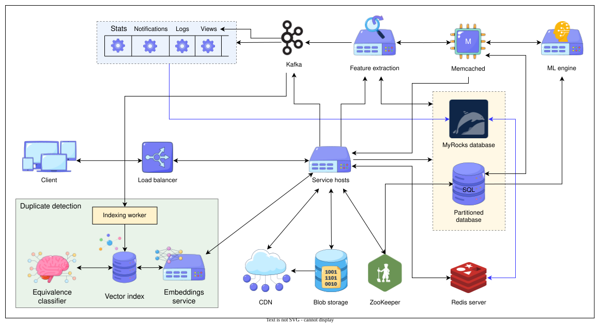

# Final_Design_of_Quora

Source: https://www.educative.io/courses/grokking-the-system-design-interview/final-design-of-quora

---

[Home](https://www.educative.io/)

[Courses](https://www.educative.io/search?tab=courses)

[Grokking Modern System Design Interview](https://www.educative.io/courses/grokking-the-system-design-interview)

# Final Design of Quora

Optimize the Quora System Design by addressing critical scaling limitations, such as network latency and database load. Implement vertical sharding for MySQL, replace high-latency HBase with MyRocks, and use Kafka for efficient asynchronous task processing. These architectural decisions ensure the platform meets high-performance and reliability standards.

We'll cover the following...

- [Limitations of the proposed design](https://www.educative.io/courses/grokking-the-system-design-interview/final-design-of-quora#Limitations-of-the-proposed-design)
- [Detailed design of Quora](https://www.educative.io/courses/grokking-the-system-design-interview/final-design-of-quora#Detailed-design-of-Quora)
  - [Service hosts](https://www.educative.io/courses/grokking-the-system-design-interview/final-design-of-quora#Service-hosts)
  - [Vertical sharding of MySQL](https://www.educative.io/courses/grokking-the-system-design-interview/final-design-of-quora#Vertical-sharding-of-MySQL)
  - [MyRocks](https://www.educative.io/courses/grokking-the-system-design-interview/final-design-of-quora#MyRocks)
  - [Kafka](https://www.educative.io/courses/grokking-the-system-design-interview/final-design-of-quora#Kafka)
  - [Technology usage](https://www.educative.io/courses/grokking-the-system-design-interview/final-design-of-quora#Technology-usage)
  - [AI-powered duplicate question detection](https://www.educative.io/courses/grokking-the-system-design-interview/final-design-of-quora#AI-powered-duplicate-question-detection)
    - [Similarity versus equivalence](https://www.educative.io/courses/grokking-the-system-design-interview/final-design-of-quora#Similarity-versus-equivalence)
    - [Suggestions while drafting](https://www.educative.io/courses/grokking-the-system-design-interview/final-design-of-quora#Suggestions-while-drafting)
    - [Index updates](https://www.educative.io/courses/grokking-the-system-design-interview/final-design-of-quora#Index-updates)
    - [Merging duplicates safely](https://www.educative.io/courses/grokking-the-system-design-interview/final-design-of-quora#Merging-duplicates-safely)
    - [Generative AI summaries of existing answers](https://www.educative.io/courses/grokking-the-system-design-interview/final-design-of-quora#Generative-AI-summaries-of-existing-answers)

## Limitations of the proposed design[#](https://www.educative.io/courses/grokking-the-system-design-interview/final-design-of-quora#Limitations-of-the-proposed-design)

While the proposed design meets functional requirements, it has significant scalability drawbacks that violate non-functional requirements:

- **Limitations of web and application servers:** To process a user request, payloads are exchanged between web and application servers, introducing additional network I/O latency. Although separating web and application tiers enables parallel processing through manager and worker processes, the extra network hop increases end-to-end response time. In addition to data transfer, coordinating traffic between the routing layer and the manager and worker processes adds further overhead.
- **In-memory queue failure:** The application server logs tasks and enqueues them into in-memory queues, from which worker processes consume them. These priority-based in-memory queues represent a single point of failure. If a queue crashes or its process terminates unexpectedly, all queued tasks may be dropped and require manual reprocessing. This impacts system reliability and can degrade availability. Replicating in-memory queues increases memory overhead. As the number of supported features grows, the volume of background tasks increases, putting additional pressure on memory. Application servers should not be saturated with low-priority background tasks. For example, tasks such as persisting view counters or recording analytics events should be offloaded from the application tier.
- **Increasing QPS on MySQL:** As the system supports more features, a small subset of MySQL tables receives a disproportionate share of user queries. This drives high query-per-second (QPS) load on specific MySQL instances, increasing contention and latency. In addition, the current design does not define a disaster recovery (DR) strategy.
- **Latency of HBase:** Although HBase supports high write throughput, its tail latency (P99) can be relatively high compared to lower-latency datastores. Several Quora features depend on an ML inference pipeline, which introduces additional processing latency. When combined with HBase tail latency, this increases end-to-end response time and impacts user-perceived performance.

We will refine the design to address these issues:

Detailed design of Quora

## Detailed design of Quora[#](https://www.educative.io/courses/grokking-the-system-design-interview/final-design-of-quora#Detailed-design-of-Quora)

We will implement the following improvements:

### Service hosts[#](https://www.educative.io/courses/grokking-the-system-design-interview/final-design-of-quora#Service-hosts)

We combine web and application servers onto a single powerful host. This eliminates network I/O and latency caused by hops between manager, worker, and routing library processes. The illustration below shows the updated architecture:

The updated design, where web and application servers are combined in the service host

### Vertical sharding of MySQL[#](https://www.educative.io/courses/grokking-the-system-design-interview/final-design-of-quora#Vertical-sharding-of-MySQL)

Tables in the MySQL server are split into separate shards, which we refer to as **partitions**. A partition has a single primary server and multiple replica servers.

The objective is to improve performance and reduce contention as query volume on a single table grows. To address this, we apply vertical partitioning in two ways:

1. We split tables of a single database into multiple partitions. The concept is depicted in Partitions 2 and 3, which embed Tables 4 and 3, respectively.
2. We combine multiple tables into a single partition, where `join` operations are anticipated. The concept is depicted in Partition 1, which embeds Tables 1 and 2.

Therefore, we can co-locate related data and reduce traffic on hot data. The illustration below depicts vertical sharding at Quora.

The architecture of vertical sharding at Quora

After we complete the partitioning, we require two types of mappings or metadata to complete our scaling process:

1. Which partitions contain which tables and columns?
2. Which hosts are primary and replicas of a particular partition?

Both of these mappings are maintained by a service like ZooKeeper.

This sharded design improves scalability by colocating related data within a single partition, reducing cross-shard queries. Read replicas can be added for hot shards, and additional partitioning can be introduced as load increases. In scenarios that require joins across partitions, the aggregation logic can be handled at the application layer.

> **Note:** Vertical sharding scales by isolating tables and reducing cross-shard joins. However, if a vertically sharded partition grows too large, horizontal sharding may eventually become necessary.

### MyRocks[#](https://www.educative.io/courses/grokking-the-system-design-interview/final-design-of-quora#MyRocks)

We replace HBase with MyRocks (RocksDB for MySQL) as the key-value store for two reasons:

1. **Lower latency:** MyRocks offers better P99 latency than HBase. Quora reduced P99 latency from 80 ms to 4 ms using MyRocks.
2. **Data transfer:** Existing tools facilitate data transfer between MyRocks and MySQL.

> **Note:** Quora’s ML engine extracts features from MySQL data. Operational tools streamline data transfer to MyRocks for this purpose.

Data previously stored in HBase, such as view counts, ranking scores, extracted ML features, and the search index, now lives in MyRocks.

### Kafka[#](https://www.educative.io/courses/grokking-the-system-design-interview/final-design-of-quora#Kafka)

To reduce load on service hosts, we offload low-priority tasks to Kafka. Kafka distributes jobs like view counting (see [Sharded Counters](https://www.educative.io/courses/grokking-the-system-design-interview/system-design-the-sharded-counters)), notifications, and analytics to various queues. These are processed via cron jobs.

### Technology usage[#](https://www.educative.io/courses/grokking-the-system-design-interview/final-design-of-quora#Technology-usage)

Rapidly scaling services use cloud infrastructure to handle traffic spikes. Language choice is also critical; Quora uses the Python Paste web framework.

Performance-critical components, like the feature extraction service, use C++. This speed enables the ML engine to provide accurate, real-time recommendations. We use Thrift to enable interoperability between Python and C++ components.

Real-time features (comments, votes) require frequent updates. Standard **polling** overburdens the server with empty checks. Quora uses **long polling**: the server holds the request open (up to 60 seconds) until an update is available, ensuring immediate response without wasted cycles.

Polling vs. long polling

Memcached uses `multiget()` to retrieve multiple keys simultaneously, reducing latency.

> **Note:** Quora uses AWS infrastructure, including S3 (see the [Blob Storage chapter](https://www.educative.io/courses/grokking-the-system-design-interview/system-design-a-blob-store)) and Redshift for data warehousing.

### AI-powered duplicate question detection[#](https://www.educative.io/courses/grokking-the-system-design-interview/final-design-of-quora#AI-powered-duplicate-question-detection)

On a question-and-answer platform, the same question is often asked many times in different words. When that happens, answers are split across several pages, and readers miss the best ones. Quora's NLP lead described using machine learning to recognize when two questions ask for the same information in a [2017 QCon San Francisco presentation](https://www.infoq.com/presentations/quora-ml/). The design below is a proposed architecture; Quora's current implementation may differ.

#### Similarity versus equivalence[#](https://www.educative.io/courses/grokking-the-system-design-interview/final-design-of-quora#Similarity-versus-equivalence)

The core challenge is telling equivalent intent apart from topical similarity. Consider these questions:

- "How does consistent hashing distribute keys?"
- "How are keys assigned to servers using consistent hashing?"
- "What are the disadvantages of consistent hashing?"

All three are about consistent hashing, but only the first two ask the same thing. Vector similarity, covered in the Embeddings and retrieval lesson, scores all three as close, so it is good for finding candidates but not for making the final call. The design therefore works in two stages: similarity search narrows millions of questions to a few candidates, and an equivalence classifier then compares the draft with each candidate and estimates the probability that both ask for the same information. The classifier is trained on question pairs that users and moderators have confirmed as duplicates or as different.

#### Suggestions while drafting[#](https://www.educative.io/courses/grokking-the-system-design-interview/final-design-of-quora#Suggestions-while-drafting)

Suggestions are most useful before a question is posted. As the user types, the application server sends the draft to an embedding service running on the compute servers that already host Quora’s ML workloads. The resulting vector is matched against a **vector index** of existing questions, while the existing keyword search index finds questions that share exact terms. Combining both catches paraphrases as well as questions with identical wording.

The classifier scores the merged candidates, and only those above a strict confidence threshold are shown, each with its top answer. A wrong suggestion sends the user to a question that does not answer theirs, so the threshold favors precision: it misses some duplicates, but the ones it shows are trustworthy. The user can open a suggestion or continue posting, and if the service is slow or unavailable, posting simply continues without suggestions.

The following diagram shows how a draft question moves through these steps.

Retrieving candidates and deciding equivalence for a new question

#### Index updates[#](https://www.educative.io/courses/grokking-the-system-design-interview/final-design-of-quora#Index-updates)

New and edited questions must become searchable quickly, or the next user asking the same thing will not see them. When a question is posted or edited, a Kafka event triggers an indexing worker that embeds the question and updates the vector index asynchronously, without slowing down the post itself.

Two users can still post the same question at nearly the same moment, before either is indexed. A periodic offline job compares recently posted questions and flags new duplicates for review, so these cases are reconciled later.

#### Merging duplicates safely[#](https://www.educative.io/courses/grokking-the-system-design-interview/final-design-of-quora#Merging-duplicates-safely)

Automated detection only suggests duplicates. A merge happens after a user or moderator confirms it, and it redirects the duplicate question and its answers to a canonical question. Because an incorrect merge hides a valid question, the system records each merge in MySQL with enough history to reverse it.

> **Note:** Duplicate detection itself generates no content. It connects users to existing questions and answers, which keeps knowledge in one place.

#### Generative AI summaries of existing answers[#](https://www.educative.io/courses/grokking-the-system-design-interview/final-design-of-quora#Generative-AI-summaries-of-existing-answers)

Duplicate detection sends users to a canonical question, but popular questions can have dozens of long answers. A large language model (LLM) can add a short summary at the top of the page that draws only on those answers. This applies the retrieval-augmented generation (RAG) pattern from the Ask YouTube lesson, with the question’s own answers as the retrieved context.

The summary needs three safeguards:

- **Grounding and attribution:** The prompt includes only the top-ranked answers, and each point in the summary links to the answer it came from. Readers can verify it, and authors keep the credit.
- **Generate once, serve many:** A popular question is read far more often than it is answered, so the summary is generated offline, stored with the question, and served from cache. A new or edited answer triggers regeneration through the same Kafka events that update the index.
- **Clear labeling and fallback:** The summary is labeled as AI-generated, and the full answers stay below it. If generation fails or a source answer is removed, the page shows the answers without a summary.

1.

What is considered a good approach for communication between different manager and worker processes within the service hosts?

Show Answer

1 / 4

Initial Design of Quora

Evaluation of Quora’s Design

Ask

[Limitations of the proposed design](https://www.educative.io/courses/grokking-the-system-design-interview/final-design-of-quora#Limitations-of-the-proposed-design)

[Detailed design of Quora](https://www.educative.io/courses/grokking-the-system-design-interview/final-design-of-quora#Detailed-design-of-Quora)

[Service hosts](https://www.educative.io/courses/grokking-the-system-design-interview/final-design-of-quora#Service-hosts)

[Vertical sharding of MySQL](https://www.educative.io/courses/grokking-the-system-design-interview/final-design-of-quora#Vertical-sharding-of-MySQL)

[MyRocks](https://www.educative.io/courses/grokking-the-system-design-interview/final-design-of-quora#MyRocks)

[Kafka](https://www.educative.io/courses/grokking-the-system-design-interview/final-design-of-quora#Kafka)

[Technology usage](https://www.educative.io/courses/grokking-the-system-design-interview/final-design-of-quora#Technology-usage)

[AI-powered duplicate question detection](https://www.educative.io/courses/grokking-the-system-design-interview/final-design-of-quora#AI-powered-duplicate-question-detection)

[Similarity versus equivalence](https://www.educative.io/courses/grokking-the-system-design-interview/final-design-of-quora#Similarity-versus-equivalence)

[Suggestions while drafting](https://www.educative.io/courses/grokking-the-system-design-interview/final-design-of-quora#Suggestions-while-drafting)

[Index updates](https://www.educative.io/courses/grokking-the-system-design-interview/final-design-of-quora#Index-updates)

[Merging duplicates safely](https://www.educative.io/courses/grokking-the-system-design-interview/final-design-of-quora#Merging-duplicates-safely)

[Generative AI summaries of existing answers](https://www.educative.io/courses/grokking-the-system-design-interview/final-design-of-quora#Generative-AI-summaries-of-existing-answers)