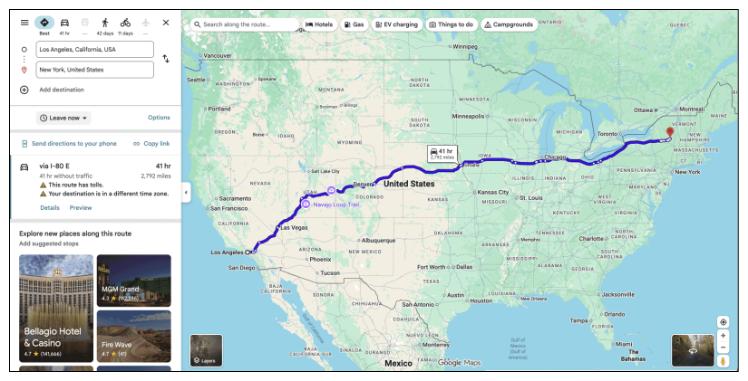

# System_Design_Google_Maps

Source: https://www.educative.io/courses/grokking-the-system-design-interview/system-design-google-maps

---

[Home](https://www.educative.io/)

[Courses](https://www.educative.io/search?tab=courses)

[Grokking Modern System Design Interview](https://www.educative.io/courses/grokking-the-system-design-interview)

# System Design: Google Maps

Explore the fundamental purpose and critical use cases of a global mapping application such as Google Maps. Learn how to scope the design problem by identifying user needs, defining the system's role in logistics and navigation, and preparing for the detailed System Design process.

We'll cover the following...

- [What is Google Maps?](https://www.educative.io/courses/grokking-the-system-design-interview/system-design-google-maps#What-is-Google-Maps)
- [When do we use a map service?](https://www.educative.io/courses/grokking-the-system-design-interview/system-design-google-maps#When-do-we-use-a-map-service)
- [How will we design Google Maps?](https://www.educative.io/courses/grokking-the-system-design-interview/system-design-google-maps#How-will-we-design-Google-Maps)

## What is Google Maps?[#](https://www.educative.io/courses/grokking-the-system-design-interview/system-design-google-maps#What-is-Google-Maps)

When traveling from one location to another, users typically need to know:

- The best routes based on the vehicle type
- The distance of each path
- The estimated travel time for each path

Map applications like Google Maps or Apple Maps answer these questions efficiently. The illustration below depicts paths calculated by Google Maps from Los Angeles to New York City.

## When do we use a map service?[#](https://www.educative.io/courses/grokking-the-system-design-interview/system-design-google-maps#When-do-we-use-a-map-service)

Individuals and organizations rely on location data for navigation. Common use cases include:

- **Finding locations and directions:** Users can quickly locate new places, saving time and fuel costs.
- **Real-time navigation:** Users check their estimated time of arrival (ETA) and find the shortest path based on current traffic.
- **Third-party application integration:** Many modern apps rely on map data. For example:

  - Waymo uses maps for efficient and safe autonomous vehicle navigation.
  - Uber uses maps to route drivers and visualize journeys for customers.
- **Logistics and delivery:** Companies use real-time and historical traffic data to optimize routes, reducing delivery times and operational costs.

Over five million businesses use the Google Maps API to integrate mapping systems into their applications.

AI Powered

Saved

1 attempt left

Reset

List four building blocks required for designing Google Maps

It’s time to showcase your understanding! Challenge yourself and see how well you can identify four different building blocks in Google Maps through our interactive assessment. Several building blocks can be considered for the system design of Google Maps. Recognize these building blocks based on the following requisite functionalities and provide your answers:

- There is a need to search various locations on the map.
- Storing metadata in the format of key-value pairs is essential for efficient data management.
- The system should be adept at generating and handling events, and notifying other services when necessary.
- To effectively represent road data, the system requires a structured graph format for storing and retrieving information.

You can challenge yourself to identify the building blocks without reading the functional and nonfunctional requirements given below as a hint.

**Remember**, you need to identify the core building blocks and justify their necessity.

This is your last attempt.

## How will we design Google Maps?[#](https://www.educative.io/courses/grokking-the-system-design-interview/system-design-google-maps#How-will-we-design-Google-Maps)

We will design the system across five lessons:

1. [**Requirements**](https://www.educative.io/courses/grokking-the-system-design-interview/requirements-of-google-maps-design)**:** Define functional and non-functional requirements, identify design challenges, and estimate necessary resources (servers, bandwidth).
2. [**Design**](https://www.educative.io/courses/grokking-the-system-design-interview/design-of-google-maps)**:** Outline the high-level architecture, API design, system services, and workflow.
3. [**Meeting the challenges**](https://www.educative.io/courses/grokking-the-system-design-interview/challenges-of-google-maps-design)**:** Discuss strategies to overcome the challenges identified in the requirements phase.
4. [**Detailed design**](https://www.educative.io/courses/grokking-the-system-design-interview/detailed-design-of-google-maps)**:** Refine the architecture, including the storage schema, specific component details, and AI features such as trip planning for electric vehicles and conversational place discovery with Ask Maps.
5. [**Evaluation**](https://www.educative.io/courses/grokking-the-system-design-interview/evaluation-of-google-maps-design)**:** Assess how the final design meets the initial requirements.

Let’s begin by defining the requirements for Google Maps.

Evaluation of Quora’s Design

Requirements of Google Maps Design

Ask

[What is Google Maps?](https://www.educative.io/courses/grokking-the-system-design-interview/system-design-google-maps#What-is-Google-Maps)

[When do we use a map service?](https://www.educative.io/courses/grokking-the-system-design-interview/system-design-google-maps#When-do-we-use-a-map-service)

[How will we design Google Maps?](https://www.educative.io/courses/grokking-the-system-design-interview/system-design-google-maps#How-will-we-design-Google-Maps)