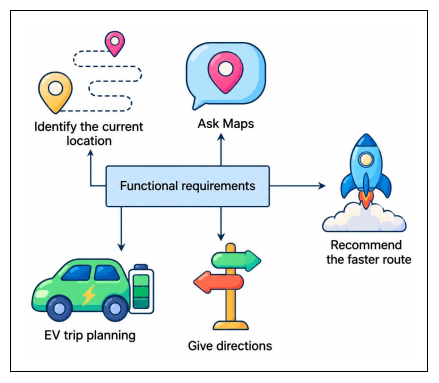
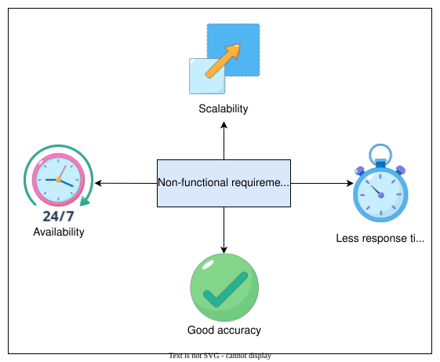

# Requirements_of_Google_Maps_Design

Source: https://www.educative.io/courses/grokking-the-system-design-interview/requirements-of-google-maps-design

---

[Home](https://www.educative.io/)

[Courses](https://www.educative.io/search?tab=courses)

[Grokking Modern System Design Interview](https://www.educative.io/courses/grokking-the-system-design-interview)

# Requirements of Google Maps Design

Define the functional and non-functional requirements for designing a highly scalable mapping system, such as Google Maps. Learn to estimate resource needs and identify the key challenges of scaling pathfinding algorithms and calculating accurate real-time ETAs under heavy load.

We'll cover the following...

- [Requirements](https://www.educative.io/courses/grokking-the-system-design-interview/requirements-of-google-maps-design#Requirements)
  - [Functional requirements](https://www.educative.io/courses/grokking-the-system-design-interview/requirements-of-google-maps-design#Functional-requirements)
  - [Non-functional requirements](https://www.educative.io/courses/grokking-the-system-design-interview/requirements-of-google-maps-design#Non-functional-requirements)
- [Challenges](https://www.educative.io/courses/grokking-the-system-design-interview/requirements-of-google-maps-design#Challenges)
- [Resource estimation](https://www.educative.io/courses/grokking-the-system-design-interview/requirements-of-google-maps-design#Resource-estimation)
  - [Number of servers estimation](https://www.educative.io/courses/grokking-the-system-design-interview/requirements-of-google-maps-design#Number-of-servers-estimation)
  - [Storage estimation](https://www.educative.io/courses/grokking-the-system-design-interview/requirements-of-google-maps-design#Storage-estimation)
  - [Bandwidth estimation](https://www.educative.io/courses/grokking-the-system-design-interview/requirements-of-google-maps-design#Bandwidth-estimation)
    - [Incoming traffic](https://www.educative.io/courses/grokking-the-system-design-interview/requirements-of-google-maps-design#Incoming-traffic)
    - [Outgoing traffic](https://www.educative.io/courses/grokking-the-system-design-interview/requirements-of-google-maps-design#Outgoing-traffic)
- [Building blocks we will use](https://www.educative.io/courses/grokking-the-system-design-interview/requirements-of-google-maps-design#Building-blocks-we-will-use)

## Requirements[#](https://www.educative.io/courses/grokking-the-system-design-interview/requirements-of-google-maps-design#Requirements)

Given the complexity of Google Maps, the design will target a simplified version that implements only the core features. The system must satisfy the following functional and non-functional requirements.

### Functional requirements[#](https://www.educative.io/courses/grokking-the-system-design-interview/requirements-of-google-maps-design#Functional-requirements)

The core functional requirements are:

- **Location identification:** Users can pinpoint their current location (latitude and longitude) on the map.
- **Route recommendation:** The system recommends the optimal route based on distance, time, and transportation mode.
- **Navigation directions:** The system provides step-by-step text directions to guide the user from source to destination.
- **AI-powered EV trip planning:** For electric vehicles, the system predicts battery usage along the route and recommends charging stops when the trip cannot be completed on the current charge.
- **Conversational place discovery with AI:** Users can describe the places they need in natural language, such as “quiet vegan restaurants open late nearby”, refine the request with follow-up questions, and see the results on the map.

Google Maps functional requirements

### Non-functional requirements[#](https://www.educative.io/courses/grokking-the-system-design-interview/requirements-of-google-maps-design#Non-functional-requirements)

The system must meet the following non-functional requirements:

- **Availability:** The system must be highly available.
- **Scalability:** The system must handle high request volumes from individual users and enterprise integrations (e.g., Uber and Lyft).
- **Low latency:** Route calculation and ETA prediction must occur within 2–3 seconds.
- **Accuracy:** The predicted ETA must closely match the actual travel time. For electric vehicles, predicted battery usage must be accurate enough that the driver arrives with at least the planned reserve.

Non-functional requirements of Google maps

> **Note:** We assume road data is provided by external sources. Road networks are modeled as a graph where intersections are vertices and roads are weighted edges.

## Challenges[#](https://www.educative.io/courses/grokking-the-system-design-interview/requirements-of-google-maps-design#Challenges)

Designing a system like Google Maps presents specific technical challenges:

- **Scalability:** The road graph contains billions of nodes and edges distributed across multiple countries. Naïve shortest-path algorithms such as Dijkstra’s are not sufficient to serve millions of concurrent queries at this scale without preprocessing or optimization. The system requires preprocessing and query-acceleration techniques to handle high query throughput while maintaining low latency.

Routing must handle a huge graph and ETAs that change with live traffic

- **ETA computation:** Travel time depends on dynamic factors like traffic density, road conditions, construction, and other such factors, not just distance and speed. Accurately quantifying these variables to predict arrival times is a significant design challenge.

Factors affecting the ETA computation

## Resource estimation[#](https://www.educative.io/courses/grokking-the-system-design-interview/requirements-of-google-maps-design#Resource-estimation)

We will estimate the necessary servers, storage, and bandwidth.

### Number of servers estimation[#](https://www.educative.io/courses/grokking-the-system-design-interview/requirements-of-google-maps-design#Number-of-servers-estimation)

To estimate the number of servers, we need to know the number of Google Maps daily active users. Let’s assume that we have 32 million daily active users of Google Maps. Given [our assumption](https://www.educative.io/courses/grokking-the-system-design-interview/put-back-of-the-envelope-numbers-in-perspective)that daily active users serve as a proxy for requests per second, we estimate 32 million requests per second. Then, we use the following formula to calculate the number of servers:

Servers needed at peak load = Number of requests/secondRPS of server\text{Servers needed at peak load = } \frac{\text{Number of requests/second}}{\text{RPS of server}}
Servers needed at peak load = RPS of serverNumber of requests/second​

Based on a server capacity of 64,000 RPS (derived in the “Back-of-the-envelope Calculations” chapter), the required server count is:

Servers needed at peak load = 32 million64,000 = 500 servers\text{Servers needed at peak load = } \frac{\text{32 million}}{\text{64,000}} \text{ = 500 servers}
Servers needed at peak load = 64,00032 million​ = 500 servers

The number of servers required for Google Maps

### Storage estimation[#](https://www.educative.io/courses/grokking-the-system-design-interview/requirements-of-google-maps-design#Storage-estimation)

Map data is largely static. While the system stores over 20 PB of road data, daily updates are negligible compared to that total. Therefore, storage requirements remain relatively stable.

### Bandwidth estimation[#](https://www.educative.io/courses/grokking-the-system-design-interview/requirements-of-google-maps-design#Bandwidth-estimation)

Bandwidth usage is driven primarily by user requests. We use the following formula to estimate requirements:

Totalbandwidth=Totalrequests\_second×Totalquery\_size\text{Total}\_{\text{bandwidth}} = \text{Total}\_{\text{requests\\_second}} \times \text{Total}\_{\text{query\\_size}}
Totalbandwidth​=Totalrequests\_second​×Totalquery\_size​

Here, Totalrequests\_second\text{Total}\_{\text{requests\\_second}}Totalrequests\_second​ is the request rate and Totalquery\_size\text{Total}\_{\text{query\\_size}}Totalquery\_size​ is the request size.

#### Incoming traffic[#](https://www.educative.io/courses/grokking-the-system-design-interview/requirements-of-google-maps-design#Incoming-traffic)

We estimate incoming bandwidth based on the following assumptions:

- Requests per user per day: 50.
- Request size (source and destination): 200 Bytes.

We calculate the total requests per second as follows:

Totalrequests\_second=Daily active users×Requestsper\_user24×60×60=18,518 requests per second\text{Total}\_{\text{requests\\_second}} = \frac{\text{Daily active users} \times \text{Requests}\_{\text{per\\_user}}}{24 \times 60 \times 60} = 18,518\ \text{requests per second}
Totalrequests\_second​=24×60×60Daily active users×Requestsper\_user​​=18,518 requests per second

We calculate the incoming bandwidth by applying the calculated RPS and request size to the formula.

#### Bandwidth Required for Incoming Query Traffic

|  |  |  |
| --- | --- | --- |
| No. of requests per second | Request size (Bytes) | Bandwidth (Mb/s) |
| 18518 | 200 | f29.63 |

#### Outgoing traffic[#](https://www.educative.io/courses/grokking-the-system-design-interview/requirements-of-google-maps-design#Outgoing-traffic)

Outgoing traffic consists of navigation responses, including map visuals, text directions, and route details. We assume:

- **Total requests per second (calculated above):** 18,518
- **Response size:** ~2 MB (2 MB visual data + 5 KB text data)

We apply the same formula to determine the outgoing bandwidth.

#### Bandwidth Required for the Outgoing Application Traffic

|  |  |  |
| --- | --- | --- |
| No. of requests per second | Response size (KB) | Bandwidth (Gb/s) |
| 18518 | 2005 | f297.03 |

Summarizing the bandwidth requirements for Google Maps

## Building blocks we will use[#](https://www.educative.io/courses/grokking-the-system-design-interview/requirements-of-google-maps-design#Building-blocks-we-will-use)

The following components are integral to the Google Maps design:

Building blocks used in the high-level and detailed design of Google Maps

- [**Load balancers**](https://www.educative.io/courses/grokking-the-system-design-interview/introduction-to-load-balancers)**:** Distribute user requests across servers.
- [**Databases**](https://www.educative.io/courses/grokking-the-system-design-interview/introduction-to-databases)**:** Store graph data and metadata.
- [**Distributed search**](https://www.educative.io/courses/grokking-the-system-design-interview/system-design-the-distributed-search)**:** Enables location searching on the map.
- [**Pub-sub system**](https://www.educative.io/courses/grokking-the-system-design-interview/system-design-the-pub-sub-abstraction)**:** Handles navigation events and service notifications.
- [**Key-value store**](https://www.educative.io/courses/grokking-the-system-design-interview/system-design-the-key-value-store)**:** Manages metadata storage.

We will discuss additional components in the detailed design lessons. We are now ready to explore the system and API design.

System Design: Google Maps

Design of Google Maps

Ask

[Requirements](https://www.educative.io/courses/grokking-the-system-design-interview/requirements-of-google-maps-design#Requirements)

[Functional requirements](https://www.educative.io/courses/grokking-the-system-design-interview/requirements-of-google-maps-design#Functional-requirements)

[Non-functional requirements](https://www.educative.io/courses/grokking-the-system-design-interview/requirements-of-google-maps-design#Non-functional-requirements)

[Challenges](https://www.educative.io/courses/grokking-the-system-design-interview/requirements-of-google-maps-design#Challenges)

[Resource estimation](https://www.educative.io/courses/grokking-the-system-design-interview/requirements-of-google-maps-design#Resource-estimation)

[Number of servers estimation](https://www.educative.io/courses/grokking-the-system-design-interview/requirements-of-google-maps-design#Number-of-servers-estimation)

[Storage estimation](https://www.educative.io/courses/grokking-the-system-design-interview/requirements-of-google-maps-design#Storage-estimation)

[Bandwidth estimation](https://www.educative.io/courses/grokking-the-system-design-interview/requirements-of-google-maps-design#Bandwidth-estimation)

[Incoming traffic](https://www.educative.io/courses/grokking-the-system-design-interview/requirements-of-google-maps-design#Incoming-traffic)

[Outgoing traffic](https://www.educative.io/courses/grokking-the-system-design-interview/requirements-of-google-maps-design#Outgoing-traffic)

[Building blocks we will use](https://www.educative.io/courses/grokking-the-system-design-interview/requirements-of-google-maps-design#Building-blocks-we-will-use)