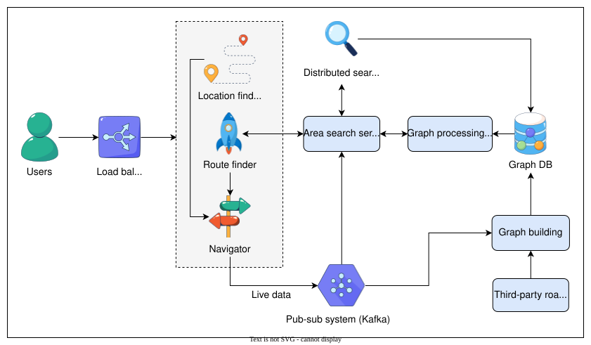

# Design_of_Google_Maps

Source: https://www.educative.io/courses/grokking-the-system-design-interview/design-of-google-maps

---

[Home](https://www.educative.io/)

[Courses](https://www.educative.io/search?tab=courses)

[Grokking Modern System Design Interview](https://www.educative.io/courses/grokking-the-system-design-interview)

# Design of Google Maps

Demystify the high-level System Design of a map application like Google Maps. Define the core services, including route finder, graph processing, and Kafka pub-sub, and analyze their workflow for calculating optimal paths and handling real-time user navigation.

We'll cover the following...

- [High-level design](https://www.educative.io/courses/grokking-the-system-design-interview/design-of-google-maps#High-level-design)
  - [Components](https://www.educative.io/courses/grokking-the-system-design-interview/design-of-google-maps#Components)
  - [Workflow](https://www.educative.io/courses/grokking-the-system-design-interview/design-of-google-maps#Workflow)
- [API design](https://www.educative.io/courses/grokking-the-system-design-interview/design-of-google-maps#API-design)
  - [Show the user’s current location on the map](https://www.educative.io/courses/grokking-the-system-design-interview/design-of-google-maps#Show-the-users-current-location-on-the-map)
  - [Find the optimal route](https://www.educative.io/courses/grokking-the-system-design-interview/design-of-google-maps#Find-the-optimal-route)
  - [Get directions](https://www.educative.io/courses/grokking-the-system-design-interview/design-of-google-maps#Get-directions)

## High-level design[#](https://www.educative.io/courses/grokking-the-system-design-interview/design-of-google-maps#High-level-design)

We divide the high-level design into two parts: the required components and the workflow connecting them.

### Components[#](https://www.educative.io/courses/grokking-the-system-design-interview/design-of-google-maps#Components)

The design utilizes the following components:

- **Location finder:** Identifies the user’s current location (latitude and longitude) to display on the map.
- **Route finder:** Calculates the path between a source and a destination for navigation.
- **Navigator:** Tracks the user’s journey in real-time. If the user deviates from the optimal path, this service sends updated directions and notifications.
- **GPS/Wi-Fi/Cellular technology:** Technologies used to determine the user’s physical position.
- **Distributed search:** Maintains an index mapping place names to coordinates. It searches user-entered keywords to locate places on the map.

**AI in practice:** Google Maps extends place search with [Ask Maps](https://blog.google/products-and-platforms/products/maps/ask-maps-immersive-navigation/), where users ask for places in natural language and refine the request with follow-up questions. It combines distributed search with business information and reviews, and checks hard constraints such as distance and opening hours against current place records before ranking results. The underlying retrieve-then-generate pattern is the same as in Ask YouTube.

- **Area search service:** Coordinates between the distributed search and graph processing services. It requests coordinates to define a map area spanning the source and destination, then limits the search scope to this subgraph to optimize performance.
- **Graph processing service:** Runs shortest-path algorithms on the subgraph defined by the area search service to determine the optimal route.
- **Database:** Stores road network data as a graph. We use a graph database like DataStax Graph.
- **Pub-sub system:** Listens for events to trigger services. For example, if a user deviates from a path, it triggers the area search service to recalculate the route. It also collects location data streams for traffic pattern analysis. We use Kafka.
- **Third-party road data:** External road network data, preprocessed into a unified format for graph construction.
- **Graph building:** Constructs the graph using data from third-party sources or user inputs.
- **User:** The person or program interacting with the map system.
- **Load balancer:** Distributes user requests across servers.

The illustration below shows how these components connect.

A high-level design of a map system

### Workflow[#](https://www.educative.io/courses/grokking-the-system-design-interview/design-of-google-maps#Workflow)

This workflow assumes a user needs to travel between two points. We also assume road network data is already collected and stored in the Graph DB.

- The user initiates a request. The location finder determines the starting point using GPS, Wi-Fi, or cellular technology.
- The user enters a destination address. A typeahead service can be used to provide suggestions to ensure accuracy.
- The user requests the optimal path. The request is forwarded to the route finder.
- The route finder queries the area search service:

  - It resolves latitude/longitude for the source and destination using distributed search.
  - It calculates the area of the map spanning these points.
- The area search service requests the graph processing service to process the subgraph within the identified area.
- The graph processing service calculates the shortest path and returns it to the route finder. The route finder displays the path, including distance, time, and navigation steps.
- The navigator tracks the user’s movement against the path. It updates the map location and provides turn-by-turn directions.
- If the user deviates from the path, the navigator publishes an event to Kafka. This triggers the area search service to recalculate the route. Simultaneously, the navigator streams live location data to the pub-sub system for future traffic analysis.

AI Powered

Saved

1 attempt left

Reset

Real-time traffic congestion

How can real-time traffic congestion data be collected and seamlessly integrated into the route-finding process of a mapping system like Google Maps?

This is your last attempt.

## API design[#](https://www.educative.io/courses/grokking-the-system-design-interview/design-of-google-maps#API-design)

The following APIs define the core functionality of the maps service.

### Show the user’s current location on the map[#](https://www.educative.io/courses/grokking-the-system-design-interview/design-of-google-maps#Show-the-users-current-location-on-the-map)

The `currLocation` function displays the user’s position on the map.

Ace Editor

1

currLocation(location)

הההההההההההההההההההההההההההההההההההההההההההההההההההההההההההההההההההההההההההההההההההההההההההההההההההההההההההההההההההההההההההההההההההההההההההההההההההההההההההההההההההההההההההההההההההההההההההההההההההההההההההההההההההההההההההההההההההההההההההההההההההההההההההההההההההההההההההההההההההההההההההההההההההההההההההההההההההההההההההההההההההההההההההההההההההההההההההההההההההההההההההההההההההההההההההההההההההההההההההההההההההההההההההההההההההההההההההההההההההההההההההההההההההההההההההההההההההההההההההההההההההההההההההההההההההההההההההההההה

XXXXXXXXXXXXXXXXXXXXXXXXXXXXXXXXXXXXXXXXXXXXXXXXXXXXXXXXXXXXXXXXXXXXXXXXXXXXXXXXXXXXXXXXXXXXXXXXXXXXXXXXXXXXXXXXXXXXXXXXXXXXXXXXXXXXXXXXXXXXXXXXXXXXXXXXXXXXXXXXXXXXXXXXXXXXXXXXXXXXXXXXXXXXXXXXXXXXXXXXXXXXXXXXXXXXXXXXXXXXXXXXXXXXXXXXXXXXXXXXXXXXXXXXXXXXXXXXXXXXXXXXXXXXXXXXXXXXXXXXXXXXXXXXXXXXXXXXXXXXXXXXXXXXXXXXXXXXXXXXXXXXXXXXXXXXXXXXXXXXXXXXXXXXXXXXXXXXXXXXXXXXXXXXXXXXXXXXXXXXXXXXXXXXXXXXXXXXXXXXXXXXXXXXXXXXXXXXXXXXXXXXXXXXXXXXXXXXXXXXXXXXXXXXXXXXXXXXXXXXXXXXXXXXXXXXXXXXXXXXXXXXXXXXXXXXXXXXXXXXXXXXXXXXXXXX

|  |  |
| --- | --- |
| **Parameter** | **Description** |
| `location` | This depicts whether the user location is on or off. This call will establish a persistent connection between the client and the server, where the client will periodically update the server about its current location. If the location is `false`, the service requests the user to turn on their location. |

### Find the optimal route[#](https://www.educative.io/courses/grokking-the-system-design-interview/design-of-google-maps#Find-the-optimal-route)

The `findRoute` function calculates the optimal path between two points.

Ace Editor

1

findRoute(source, destination, transport\_type, ev\_profile)

הההההההההההההההההההההההההההההההההההההההההההההההההההההההההההההההההההההההההההההההההההההההההההההההההההההההההההההההההההההההההההההההההההההההההההההההההההההההההההההההההההההההההההההההההההההההההההההההההההההההההההההההההההההההההההההההההההההההההההההההההההההההההההההההההההההההההההההההההההההההההההההההההההההההההההההההההההההההההההההההההההההההההההההההההההההההההההההההההההההההההההההההההההההההההההההההההההההההההההההההההההההההההההההההההההההההההההההההההההההההההההההההההההההההההההההההההההההההההההההההההההההההההההההההההההההההההההההההה

XXXXXXXXXXXXXXXXXXXXXXXXXXXXXXXXXXXXXXXXXXXXXXXXXXXXXXXXXXXXXXXXXXXXXXXXXXXXXXXXXXXXXXXXXXXXXXXXXXXXXXXXXXXXXXXXXXXXXXXXXXXXXXXXXXXXXXXXXXXXXXXXXXXXXXXXXXXXXXXXXXXXXXXXXXXXXXXXXXXXXXXXXXXXXXXXXXXXXXXXXXXXXXXXXXXXXXXXXXXXXXXXXXXXXXXXXXXXXXXXXXXXXXXXXXXXXXXXXXXXXXXXXXXXXXXXXXXXXXXXXXXXXXXXXXXXXXXXXXXXXXXXXXXXXXXXXXXXXXXXXXXXXXXXXXXXXXXXXXXXXXXXXXXXXXXXXXXXXXXXXXXXXXXXXXXXXXXXXXXXXXXXXXXXXXXXXXXXXXXXXXXXXXXXXXXXXXXXXXXXXXXXXXXXXXXXXXXXXXXXXXXXXXXXXXXXXXXXXXXXXXXXXXXXXXXXXXXXXXXXXXXXXXXXXXXXXXXXXXXXXXXXXXXXXXXX

|  |  |
| --- | --- |
| **Parameter** | **Description** |
| `source` | This is the place (in text format) where the users want to start their journey. |
| `destination` | This is the place (in text format) where the users want to end their journey. |
| `transport_type (optional)` | This can be a car, bicycle, walking, or public transit. The default transport type is set to a car if the user doesn’t provide this parameter. |
| `ev_profile (optional)` | This contains the vehicle model and current battery level. When present, the route includes predicted battery usage and any charging stops. |

### Get directions[#](https://www.educative.io/courses/grokking-the-system-design-interview/design-of-google-maps#Get-directions)

The `directions` function provides text or audio alerts indicating when and where to turn.

Ace Editor

1

directions(curr\_location)

הההההההההההההההההההההההההההההההההההההההההההההההההההההההההההההההההההההההההההההההההההההההההההההההההההההההההההההההההההההההההההההההההההההההההההההההההההההההההההההההההההההההההההההההההההההההההההההההההההההההההההההההההההההההההההההההההההההההההההההההההההההההההההההההההההההההההההההההההההההההההההההההההההההההההההההההההההההההההההההההההההההההההההההההההההההההההההההההההההההההההההההההההההההההההההההההההההההההההההההההההההההההההההההההההההההההההההההההההההההההההההההההההההההההההההההההההההההההההההההההההההההההההההההההההההההההההההההההה

XXXXXXXXXXXXXXXXXXXXXXXXXXXXXXXXXXXXXXXXXXXXXXXXXXXXXXXXXXXXXXXXXXXXXXXXXXXXXXXXXXXXXXXXXXXXXXXXXXXXXXXXXXXXXXXXXXXXXXXXXXXXXXXXXXXXXXXXXXXXXXXXXXXXXXXXXXXXXXXXXXXXXXXXXXXXXXXXXXXXXXXXXXXXXXXXXXXXXXXXXXXXXXXXXXXXXXXXXXXXXXXXXXXXXXXXXXXXXXXXXXXXXXXXXXXXXXXXXXXXXXXXXXXXXXXXXXXXXXXXXXXXXXXXXXXXXXXXXXXXXXXXXXXXXXXXXXXXXXXXXXXXXXXXXXXXXXXXXXXXXXXXXXXXXXXXXXXXXXXXXXXXXXXXXXXXXXXXXXXXXXXXXXXXXXXXXXXXXXXXXXXXXXXXXXXXXXXXXXXXXXXXXXXXXXXXXXXXXXXXXXXXXXXXXXXXXXXXXXXXXXXXXXXXXXXXXXXXXXXXXXXXXXXXXXXXXXXXXXXXXXXXXXXXXXXX

|  |  |
| --- | --- |
| **Parameter** | **Description** |
| `current_location` | This is the latitude/longitude value of the user's current location on the map. |

We have covered the high-level design, components, and API structure. Next, we will address scalability challenges through segmentation.

Requirements of Google Maps Design

Challenges of Google Maps' Design

Ask

[High-level design](https://www.educative.io/courses/grokking-the-system-design-interview/design-of-google-maps#High-level-design)

[Components](https://www.educative.io/courses/grokking-the-system-design-interview/design-of-google-maps#Components)

[Workflow](https://www.educative.io/courses/grokking-the-system-design-interview/design-of-google-maps#Workflow)

[API design](https://www.educative.io/courses/grokking-the-system-design-interview/design-of-google-maps#API-design)

[Show the user’s current location on the map](https://www.educative.io/courses/grokking-the-system-design-interview/design-of-google-maps#Show-the-users-current-location-on-the-map)

[Find the optimal route](https://www.educative.io/courses/grokking-the-system-design-interview/design-of-google-maps#Find-the-optimal-route)

[Get directions](https://www.educative.io/courses/grokking-the-system-design-interview/design-of-google-maps#Get-directions)