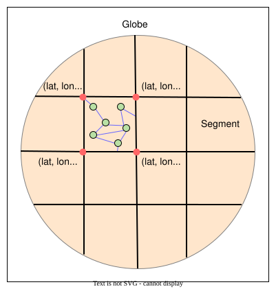
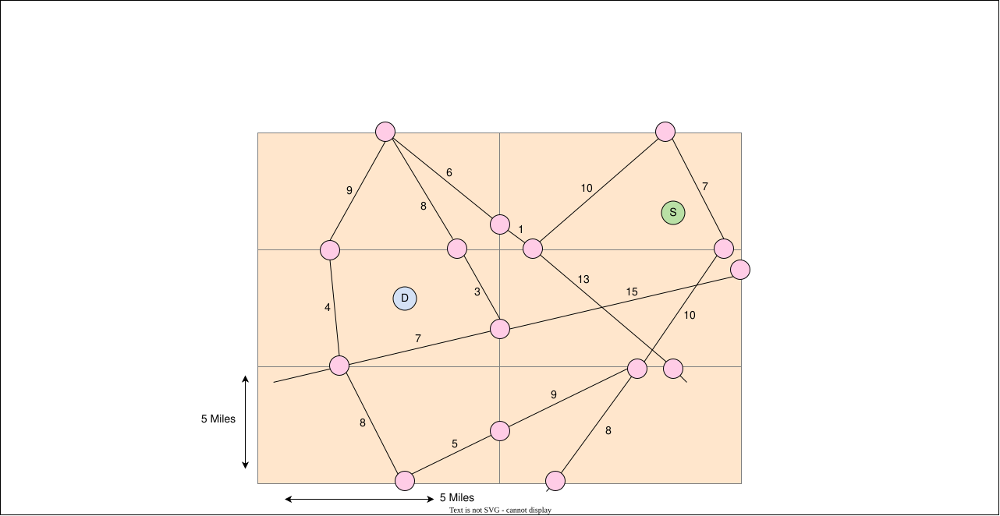
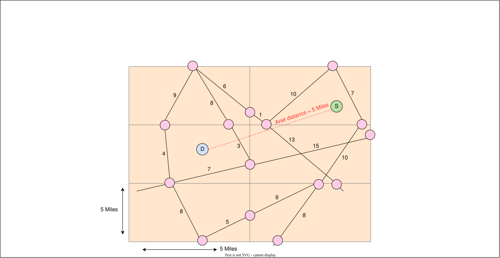
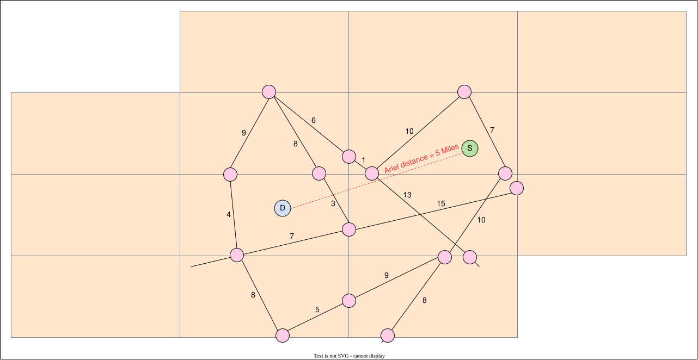
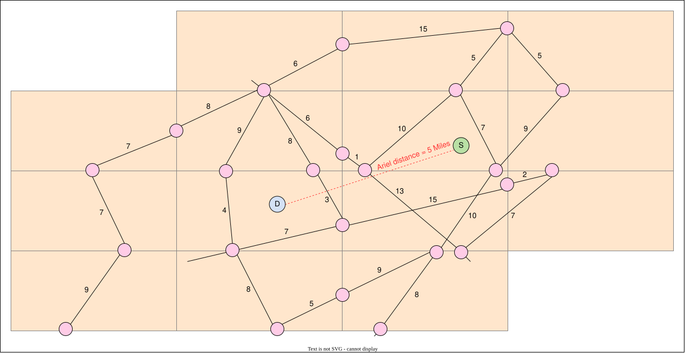

# Challenges_of_Google_Maps'_Design

Source: https://www.educative.io/courses/grokking-the-system-design-interview/challenges-of-google-maps-design

---

[Home](https://www.educative.io/)

[Courses](https://www.educative.io/search?tab=courses)

[Grokking Modern System Design Interview](https://www.educative.io/courses/grokking-the-system-design-interview)

# Challenges of Google Maps' Design

Define the System Design challenges of map services like Google Maps, focusing on scalability and ETA accuracy. Learn how graph segmentation and exit points enable efficient route calculation across vast networks. Understand the role of real-time traffic data in predicting accurate travel times.

We'll cover the following...

- [Meeting the challenges](https://www.educative.io/courses/grokking-the-system-design-interview/challenges-of-google-maps-design#Meeting-the-challenges)
  - [Scalability](https://www.educative.io/courses/grokking-the-system-design-interview/challenges-of-google-maps-design#Scalability)
    - [Segment](https://www.educative.io/courses/grokking-the-system-design-interview/challenges-of-google-maps-design#Segment)
      - [Handling non-vertex locations](https://www.educative.io/courses/grokking-the-system-design-interview/challenges-of-google-maps-design#Handling-non-vertex-locations)
    - [Connect two segments](https://www.educative.io/courses/grokking-the-system-design-interview/challenges-of-google-maps-design#Connect-two-segments)
      - [Summary of scalability](https://www.educative.io/courses/grokking-the-system-design-interview/challenges-of-google-maps-design#Summary-of-scalability)
  - [ETA computation](https://www.educative.io/courses/grokking-the-system-design-interview/challenges-of-google-maps-design#ETA-computation)

## Meeting the challenges[#](https://www.educative.io/courses/grokking-the-system-design-interview/challenges-of-google-maps-design#Meeting-the-challenges)

We previously identified two main challenges in the [Introduction](https://www.educative.io/courses/grokking-the-system-design-interview/requirements-of-google-maps-design#Challenges): scalability and ETA computation. This lesson explores solutions for both.

### Scalability[#](https://www.educative.io/courses/grokking-the-system-design-interview/challenges-of-google-maps-design#Scalability)

**Scalability** involves efficiently processing a massive road network graph with billions of vertices and edges. Naively traversing the entire graph to find a shortest path is computationally expensive and results in slow query times.

To solve this, we partition the large graph into smaller subgraphs called **segments**. This allows us to process and query subgraphs in parallel, significantly reducing graph construction and query times.

#### Segment[#](https://www.educative.io/courses/grokking-the-system-design-interview/challenges-of-google-maps-design#Segment)

A **segment** is a manageable partition of the global map. Because a segment's road network is small, it can be easily loaded into memory, updated, and traversed. For example, a city might be divided into hundreds of segments, each measuring 5×55 \times 55×5 miles.

> **Note**: While we assume square segments for simplicity, segments can be arbitrary polygons.

Each segment is defined by boundary coordinates (latitude and longitude) that help determine which segment a user is currently located in.

Partitioning the globe into small segments, and each segment has four coordinates with latitude and longitude values

To find paths within a single segment, we treat the road network as a graph, with intersections as vertices and roads as edges. Edges carry weights representing distance, time, or traffic. Since multiple paths exist between a source and a destination, we use algorithms such as **Dijkstra’s** and**A\***to identify the optimal route.

We pre-compute shortest paths within segments and store the results in a distributed storage system. This caching prevents redundant calculations for frequent queries. The stored data includes:

- The shortest distance (meters/miles).
- The estimated travel time.
- The sequence of vertices along the path.

This heavy processing occurs offline, ensuring it does not impact the user’s critical path during a live query.

Finding a path between vertices within a segment

The illustration above demonstrates finding the minimum distance (`m`) between points A and D. The optimal path A —> C —> D is 11 miles long with an ETA of 15 minutes.

##### Handling non-vertex locations[#](https://www.educative.io/courses/grokking-the-system-design-interview/challenges-of-google-maps-design#Handling-non-vertex-locations)

Users rarely start exactly at an intersection (vertex). If a user is located on a road (edge), we identify the vertices at both ends of that edge. We then calculate the distances from the user’s point to each vertex and select the connection that minimizes the total distance to the destination.

Choosing a path between points that lie on the edge

Routing becomes more complex when the source and destination lie in different segments. We must connect these segments efficiently.

#### Connect two segments[#](https://www.educative.io/courses/grokking-the-system-design-interview/challenges-of-google-maps-design#Connect-two-segments)

We use coordinates to identify the segments containing the source and destination. Segments connect via shared boundary vertices called **exit points**. In the illustration below, S4E1, S4E2, S4E3, and S4E4 serve as exit points.

> **Note:** We treat exit points as vertices. For each segment, we pre-calculate and cache the shortest paths between all its exit points, as well as paths from exit points to internal vertices.

Connecting the segments by considering exit points of a segment as vertices

Exit points act as bridges between neighboring segments. For example, S4E1 connects segment S4 to segment S1. When calculating routes across multiple segments, we ignore the internal road network of intermediate segments. Instead, we build a high-level graph using only the exit points and the pre-calculated paths between them.

A graph made up of exit points, where the lines connecting the exit points are not actually straight. There could be many vertices in between the two exit points

Running a shortest path algorithm on the entire global graph is infeasible. We limit the search scope using the aerial distance between the source and destination, calculated via the [haversine formula](https://en.wikipedia.org/wiki/Haversine_formula).

For example, if the aerial distance is 10 kilometers, we only consider segments within a 10-kilometer radius (or bounding box) of the source and destination. This drastically reduces the graph size.

Once we filter the segments, we construct a graph with the exit points of the selected segments as vertices and the pre-calculated paths between them as edges. We then run the shortest path algorithm on this simplified graph to find the optimal route.

1 / 10

Source S and Destination D lie in two different segments, and we have to find the shortest route between them

1 / 10

We assume that the aerial distance between S and D is 5 miles, calculated using the haversine formula

1 / 10

Since the aerial distance is 5 miles, we include the segments that are at a 5-mile distance from S and D in all directions

1 / 10

Let’s include the exiting points of the new segments in the graph

 to all exit points")

1 / 10

Find the possible exits for S and D from their respective segments and the shortest path (already calculated) to all exit points

##### Summary of scalability [#](https://www.educative.io/courses/grokking-the-system-design-interview/challenges-of-google-maps-design#Summary-of-scalability)

We partition the road network into segments. Local queries run on the detailed segment graph, while long-distance queries use a simplified graph of connected segments.

### ETA computation[#](https://www.educative.io/courses/grokking-the-system-design-interview/challenges-of-google-maps-design#ETA-computation)

To compute accurate ETAs, we ingest live location data `(userID, timestamp, (latitude, longitude))` from navigation services via a pub-sub system. By analyzing these data streams, we can derive:

- Current traffic density (high/medium/low) on specific roads.
- Average vehicle speeds.
- Recurring traffic patterns (e.g., congestion on Highway ABC between 8–10 a.m.).

This real-time data allows us to adjust the baseline ETA derived from static road data. For instance, if live data indicates high traffic, the system increases the ETA accordingly.

We have now addressed scalability via segmentation and accuracy via live data ingestion. In the next lesson, we will detail the system components.

Design of Google Maps

Detailed Design of Google Maps

Ask

[Meeting the challenges](https://www.educative.io/courses/grokking-the-system-design-interview/challenges-of-google-maps-design#Meeting-the-challenges)

[Scalability](https://www.educative.io/courses/grokking-the-system-design-interview/challenges-of-google-maps-design#Scalability)

[Segment](https://www.educative.io/courses/grokking-the-system-design-interview/challenges-of-google-maps-design#Segment)

[Handling non-vertex locations](https://www.educative.io/courses/grokking-the-system-design-interview/challenges-of-google-maps-design#Handling-non-vertex-locations)

[Connect two segments](https://www.educative.io/courses/grokking-the-system-design-interview/challenges-of-google-maps-design#Connect-two-segments)

[Summary of scalability](https://www.educative.io/courses/grokking-the-system-design-interview/challenges-of-google-maps-design#Summary-of-scalability)

[ETA computation](https://www.educative.io/courses/grokking-the-system-design-interview/challenges-of-google-maps-design#ETA-computation)