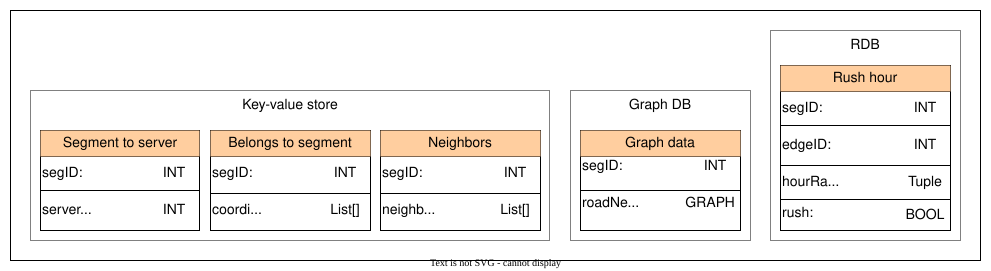

# Detailed_Design_of_Google_Maps

Source: https://www.educative.io/courses/grokking-the-system-design-interview/detailed-design-of-google-maps

---

[Home](https://www.educative.io/)

[Courses](https://www.educative.io/search?tab=courses)

[Grokking Modern System Design Interview](https://www.educative.io/courses/grokking-the-system-design-interview)

# Detailed Design of Google Maps

Demystify the detailed System Design of Google Maps by analyzing segment storage and request handling workflows. Learn how distributed databases manage road networks and how real-time data collection via WebSockets and analytics engines improves ETA accuracy.

We'll cover the following...

- [Segment setup and request handling](https://www.educative.io/courses/grokking-the-system-design-interview/detailed-design-of-google-maps#Segment-setup-and-request-handling)
  - [Storage schema](https://www.educative.io/courses/grokking-the-system-design-interview/detailed-design-of-google-maps#Storage-schema)
  - [Design](https://www.educative.io/courses/grokking-the-system-design-interview/detailed-design-of-google-maps#Design)
- [Improve estimations using live data](https://www.educative.io/courses/grokking-the-system-design-interview/detailed-design-of-google-maps#Improve-estimations-using-live-data)
  - [AI-powered trip planning for electric vehicles](https://www.educative.io/courses/grokking-the-system-design-interview/detailed-design-of-google-maps#AI-powered-trip-planning-for-electric-vehicles)
    - [Predicting energy along a route](https://www.educative.io/courses/grokking-the-system-design-interview/detailed-design-of-google-maps#Predicting-energy-along-a-route)
    - [Choosing charging stops](https://www.educative.io/courses/grokking-the-system-design-interview/detailed-design-of-google-maps#Choosing-charging-stops)
    - [Keeping the plan reliable](https://www.educative.io/courses/grokking-the-system-design-interview/detailed-design-of-google-maps#Keeping-the-plan-reliable)

This lesson details the design by addressing two key questions:

1. How do user requests benefit from segments?
2. How do we improve user experience by increasing ETA accuracy?

## Segment setup and request handling[#](https://www.educative.io/courses/grokking-the-system-design-interview/detailed-design-of-google-maps#Segment-setup-and-request-handling)

We will examine how segment data is stored and how the system processes user requests. This includes the storage schema, segment hosting, and request handling workflows.

### Storage schema[#](https://www.educative.io/courses/grokking-the-system-design-interview/detailed-design-of-google-maps#Storage-schema)

We store specific segment data in a Key-Value Store and a Graph Database:

**Key-value store**

- The segment `ID`.
- The `serverID` hosting the segment.
- Boundary `coordinates` (latitude/longitude) defining the segment polygon.
- A list of `neighbors` segment IDs.

**Graph database**

- The internal road network as a `graph`.

Storage schema

**Relational DB**

We use a relational database to track historical traffic patterns. This data helps determine whether graph weights need to be updated based on live conditions.

- `edgeID`: Identifies the edge.
- `hourRange`: The time window representing typical road conditions.
- `rush`: A boolean indicating congestion status for a specific road and time.

> **Note:** The `segID`, `serverID`, and `edgeID` are unique identifiers created by a uniqueID generator (see the [Sequencer](https://www.educative.io/courses/grokking-the-system-design-interview/system-design-sequencer) lessons for details).

### Design[#](https://www.educative.io/courses/grokking-the-system-design-interview/detailed-design-of-google-maps#Design)

The design includes two primary workflows: adding segments to the map and processing user pathfinding requests.

 Adding segments (in yellow), and workflow 2) Processing user requests (in blue)")

Workflow 1) Adding segments (in yellow), and workflow 2) Processing user requests (in blue)

**Add segment**

1. A segment contains boundary coordinates and a road network graph.
2. The segment adder processes the request and assigns a unique ID via the ID generator.
3. The segment adder forwards the segment data to the server allocator.
4. The server allocator assigns a host server, deploys the graph, and returns the `serverID`.
5. The segment adder stores the segment-to-server mapping in the key-value Store for request routing. It also saves the boundary coordinates.

**Handle the user’s request**

1. The user submits a source and a destination.
2. A distributed search determines the coordinates for these points.
3. The graph processing service identifies the segments containing the source and destination coordinates.
4. The service retrieves the hosting servers for these segments from the key-value Store.
5. The service queries the relevant servers for the shortest path. If points lie in the same segment, the query runs locally. Otherwise, it connects segments across servers.

## Improve estimations using live data[#](https://www.educative.io/courses/grokking-the-system-design-interview/detailed-design-of-google-maps#Improve-estimations-using-live-data)

We improve ETA accuracy by analyzing live location data to identify movement patterns and trip influencers. Google Maps tracks locations via GPS, Wi-Fi, and cell towers. This requires persistent connections between servers and user devices. The following components facilitate this process:

- **WebSocket**: Enables real-time, two-way communication between users and servers.
- **Load balancer**: Distributes WebSocket connections across servers to manage capacity limits.

Performing analytics on the live location data to keep the map up-to-date and also improve ETA estimations

- A **pub-sub** system aggregates location streams (device, time, location) from servers. A **data analytics engine** (e.g., Apache Spark) consumes this data. It applies machine learning to predict traffic, identify hotspots, and detect new roads, directly improving ETA calculations.

> **Note:** Traffic volume, road conditions, and hotspots impact average travel speed and ETA accuracy.

- The data analytics engine publishes results to a dedicated **pub-sub topic**.
- The **map update service** subscribes to these analytics. It updates segment graphs when new roads appear or edge weights (`average speed (traffic, road condition)`) change. The service identifies the relevant segment, locates its **routing server** via the key-value store, and applies the update.

1.

Many traffic conditions are transitory (like stopping at a signal), so updating the graph very often wouldn’t scale well because it requires excessive processing. What could be the solution to this problem?

Show Answer

Did you find this helpful?

- The **graph preprocessing service** recalculates paths on the updated graph. This ensures background path updates reflect live data.

### AI-powered trip planning for electric vehicles[#](https://www.educative.io/courses/grokking-the-system-design-interview/detailed-design-of-google-maps#AI-powered-trip-planning-for-electric-vehicles)

Electric vehicle drivers need more than the fastest route. They need to know whether the battery will last, and if not, where to charge. Google Maps [offers this for supported vehicles on Android Auto](https://blog.google/products-and-platforms/products/maps/google-maps-simplifies-battery-predictions-and-trip-planning-for-350-android-auto-ev-models/): it predicts battery usage for a trip, recommends charging stops, and includes charging time in the ETA. The design below is a proposed architecture, not a description of Google's implementation.

The key idea is a clear split of responsibilities. A machine learning model estimates energy use, and a trip planner uses those estimates to choose a journey the vehicle can complete.

#### Predicting energy along a route[#](https://www.educative.io/courses/grokking-the-system-design-interview/detailed-design-of-google-maps#Predicting-energy-along-a-route)

An electric vehicle's energy use varies a lot with conditions. Climbing a hill drains the battery, descending can recover energy, high speeds increase air resistance, and cold weather reduces battery efficiency. A single average range figure cannot capture this, so the design predicts energy use for each road segment of a route.

The energy predictor combines three kinds of input:

- Vehicle characteristics: Battery capacity, efficiency, and charging limits for the vehicle model, reported by the car.
- Route features: Elevation change and road type for each edge in the segment graph, plus expected speed from the live traffic data described above.
- Conditions: Temperature and weather along the route at the expected time of travel.

Static features such as elevation change rarely move, so they are precomputed for each edge when segments are built. Only traffic, weather, and the current battery level are combined at request time, which keeps prediction fast. The model is trained on historical driving data and returns an energy estimate with a range of uncertainty rather than a single exact number.

#### Choosing charging stops[#](https://www.educative.io/courses/grokking-the-system-design-interview/detailed-design-of-google-maps#Choosing-charging-stops)

The trip planner starts with candidate routes from the graph processing service. For each route, it adds up the predicted energy per segment and checks whether the vehicle arrives with at least the battery reserve, a safety margin such as 10% of capacity. If not, the planner looks for charging stations along the route that the vehicle can reach, that have a compatible connector, and that are likely to be available. It estimates the charging time at each and selects the itinerary with the shortest total time, which is driving time plus charging time.

This can change the answer. A shorter route through steep hills might need a 20-minute charging stop, while a slightly longer route on flat roads uses less energy and reaches the destination without stopping. The fastest drive is not always the fastest trip.

The following diagram shows how predictions and route data come together in the trip planner.

Combining energy predictions with routes to plan an EV trip

#### Keeping the plan reliable[#](https://www.educative.io/courses/grokking-the-system-design-interview/detailed-design-of-google-maps#Keeping-the-plan-reliable)

Predictions are never exact, and the plan must stay safe when they are off:

- **Battery reserve:** A larger reserve protects against prediction errors but can add a charging stop. The reserve is the main lever for trading safety against total trip time.
- **Replanning during the drive:** The navigator compares the actual battery level with the prediction. If they drift apart, or traffic changes, a pub-sub event triggers the trip planner to recalculate stops.
- **Station freshness:** Charger availability changes constantly. The planner prefers stations with recent status data and shows when information may be outdated.
- **Missing data:** If vehicle or battery data is unavailable, the system returns a normal route and explains that it cannot plan charging stops, rather than guessing.

Battery level and trip history reveal where a driver goes and when, so this data is used only for planning and protected like other location data.

**Note:** Keeping the model and the planner separate makes the system easier to test and change. The model can be retrained without touching the planning rules, and the reserve can be tuned without retraining the model.

**AI in practice:** The energy predictor is a predictive ML model. The generative AI feature in Google Maps, Ask Maps, was introduced in the high-level design and applies the retrieve-then-generate pattern from Ask YouTube to place search.

We have explored segment operations, pathfinding between locations, the role of live data in enhancing ETA accuracy, and AI-powered trip planning for electric vehicles.

Challenges of Google Maps' Design

Evaluation of Google Maps' Design

Ask

[Segment setup and request handling](https://www.educative.io/courses/grokking-the-system-design-interview/detailed-design-of-google-maps#Segment-setup-and-request-handling)

[Storage schema](https://www.educative.io/courses/grokking-the-system-design-interview/detailed-design-of-google-maps#Storage-schema)

[Design](https://www.educative.io/courses/grokking-the-system-design-interview/detailed-design-of-google-maps#Design)

[Improve estimations using live data](https://www.educative.io/courses/grokking-the-system-design-interview/detailed-design-of-google-maps#Improve-estimations-using-live-data)

[AI-powered trip planning for electric vehicles](https://www.educative.io/courses/grokking-the-system-design-interview/detailed-design-of-google-maps#AI-powered-trip-planning-for-electric-vehicles)

[Predicting energy along a route](https://www.educative.io/courses/grokking-the-system-design-interview/detailed-design-of-google-maps#Predicting-energy-along-a-route)

[Choosing charging stops](https://www.educative.io/courses/grokking-the-system-design-interview/detailed-design-of-google-maps#Choosing-charging-stops)

[Keeping the plan reliable](https://www.educative.io/courses/grokking-the-system-design-interview/detailed-design-of-google-maps#Keeping-the-plan-reliable)