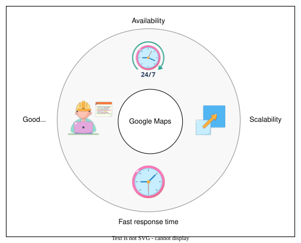

# Evaluation_of_Google_Maps'_Design

Source: https://www.educative.io/courses/grokking-the-system-design-interview/evaluation-of-google-maps-design

---

[Home](https://www.educative.io/)

[Courses](https://www.educative.io/search?tab=courses)

[Grokking Modern System Design Interview](https://www.educative.io/courses/grokking-the-system-design-interview)

# Evaluation of Google Maps' Design

Evaluate the Google Maps System Design by analyzing how segmenting the global road network ensures high availability and scalability. Learn how sharding the graph improves response times and how live data analytics enhance path accuracy and ETA calculations.

We'll cover the following...

- [Requirements compliance](https://www.educative.io/courses/grokking-the-system-design-interview/evaluation-of-google-maps-design#Requirements-compliance)
  - [Availability](https://www.educative.io/courses/grokking-the-system-design-interview/evaluation-of-google-maps-design#Availability)
  - [Scalability](https://www.educative.io/courses/grokking-the-system-design-interview/evaluation-of-google-maps-design#Scalability)
  - [Smaller response times](https://www.educative.io/courses/grokking-the-system-design-interview/evaluation-of-google-maps-design#Smaller-response-times)
  - [Accuracy](https://www.educative.io/courses/grokking-the-system-design-interview/evaluation-of-google-maps-design#Accuracy)
- [Conclusion](https://www.educative.io/courses/grokking-the-system-design-interview/evaluation-of-google-maps-design#Conclusion)

## Requirements compliance[#](https://www.educative.io/courses/grokking-the-system-design-interview/evaluation-of-google-maps-design#Requirements-compliance)

Let’s evaluate how the system handles millions of queries per second while ensuring fast response times.

### Availability[#](https://www.educative.io/courses/grokking-the-system-design-interview/evaluation-of-google-maps-design#Availability)

Hosting a massive road network graph on a single server caused critical issues:

- **Memory limits:** The graph was too large to fit in memory, rendering query processing impossible.
- **Connection limits:** A single server could not maintain persistent connections for millions of concurrent users.
- **Single point of failure:** If the server failed, the entire system became unavailable.

We resolved these issues by dividing the world into small segments, where each segment is a graph small enough to fit in a server’s memory. This approach achieved the following:

- **Distributed hosting:** Segments are hosted on separate servers, eliminating the global graph memory bottleneck.
- **Load balancing:** Requests are distributed across segment servers based on the user’s search area, preventing overload on any single node.
- **Replication:** Replicating segments (though not detailed earlier) handles failover and distributes read load, ensuring high availability.

> **Note:** Google Maps uses lazy loading of data, putting less burden on the system, which improves availability.

Non-functional requirements fulfilled by our maps system

### Scalability[#](https://www.educative.io/courses/grokking-the-system-design-interview/evaluation-of-google-maps-design#Scalability)

We scaled the system to handle large road networks. Scalability addresses two main challenges:

- Handling increasing query volumes.
- Managing growing data sets (more segments).

By hosting segments on different servers, we distribute the workload. Requests for different routes are routed to the appropriate segment servers, allowing the system to serve millions of users concurrently.

> **Note:** A single large graph spanning the whole road network would cause memory bottlenecks, making it impossible to serve millions of requests.

New segments can be added incrementally without rebuilding the entire graph. Scalability can be improved by using non-uniform segment sizes, with smaller partitions in dense urban regions and larger partitions in rural areas.

### Smaller response times[#](https://www.educative.io/courses/grokking-the-system-design-interview/evaluation-of-google-maps-design#Smaller-response-times)

Processing a subgraph with hundreds of vertices is significantly faster than traversing a graph with millions. We cache processed subgraphs in memory to respond to requests almost instantly.

Additionally, a key-value store minimizes latency by providing quick access to segment metadata:

- **Graph processing:** The service queries the store for `segmentID` values based on source and destination coordinates.
- **Load balancing:** The store provides the `serverID` hosting the required segment, ensuring requests are routed correctly.

### Accuracy[#](https://www.educative.io/courses/grokking-the-system-design-interview/evaluation-of-google-maps-design#Accuracy)

Beyond static road data, we ingest live user location data. By applying data science analytics to traffic patterns, the system dynamically updates maps, refines routes, and improves Estimated Time of Arrival (ETA) accuracy.

For electric vehicles, accuracy also covers battery predictions. The energy predictor uses vehicle data, elevation, live traffic, and weather for each road segment, and the trip planner keeps a battery reserve so that small prediction errors do not leave a driver short of charge. If conditions change during the drive, the plan is recalculated.

## Non-functional Requirements Compliance

|  |  |
| --- | --- |
| Requirements | Techniques |
| Availability | - Process user queries on small graphs (segments). - Load balance requests across different segment servers. - Replicate segment servers. |
| Scalability | - Partition the large graphs into small graphs to ease segment addition. - Host the segments on different servers to enable serving more queries per second. |
| Less response time | - Cache the processed graphs. - Use a key-value store to quickly get the required information. |
| Accuracy | - Collect live data. - Perform data analytics. - Predict EV energy per segment and plan charging stops with a battery reserve. |

## Conclusion[#](https://www.educative.io/courses/grokking-the-system-design-interview/evaluation-of-google-maps-design#Conclusion)

Google Maps relies on graph data structures to model road networks and shortest-path algorithms to find routes. We addressed scalability and availability challenges by partitioning the global graph into manageable segments hosted across distributed servers. This segmentation, combined with in-memory caching and live traffic analytics, ensures the system delivers fast, accurate navigation for millions of users. For electric vehicles, an ML energy predictor and a trip planner extend routing to choose charging stops that make the journey feasible, and Ask Maps extends place search to natural-language questions.

Detailed Design of Google Maps

System Design: Yelp

Ask

[Requirements compliance](https://www.educative.io/courses/grokking-the-system-design-interview/evaluation-of-google-maps-design#Requirements-compliance)

[Availability](https://www.educative.io/courses/grokking-the-system-design-interview/evaluation-of-google-maps-design#Availability)

[Scalability](https://www.educative.io/courses/grokking-the-system-design-interview/evaluation-of-google-maps-design#Scalability)

[Smaller response times](https://www.educative.io/courses/grokking-the-system-design-interview/evaluation-of-google-maps-design#Smaller-response-times)

[Accuracy](https://www.educative.io/courses/grokking-the-system-design-interview/evaluation-of-google-maps-design#Accuracy)

[Conclusion](https://www.educative.io/courses/grokking-the-system-design-interview/evaluation-of-google-maps-design#Conclusion)