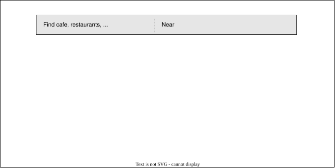
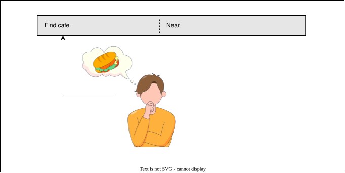
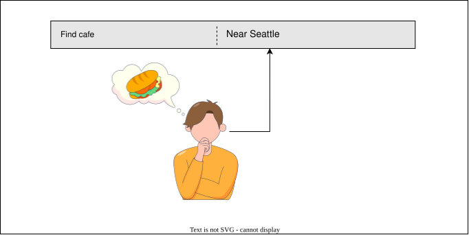

# System_Design_Yelp

Source: https://www.educative.io/courses/grokking-the-system-design-interview/system-design-yelp

---

[Home](https://www.educative.io/)

[Courses](https://www.educative.io/search?tab=courses)

[Grokking Modern System Design Interview](https://www.educative.io/courses/grokking-the-system-design-interview)

# System Design: Yelp

Explore the fundamental requirements of designing a high-scale proximity service such as Yelp. Learn how to define system scope, estimate resource needs (storage, servers, bandwidth), and address the challenge of low latency, location-based searching across massive datasets.

We'll cover the following...

- [What is Yelp?](https://www.educative.io/courses/grokking-the-system-design-interview/system-design-yelp#What-is-Yelp)
- [How will we design Yelp?](https://www.educative.io/courses/grokking-the-system-design-interview/system-design-yelp#How-will-we-design-Yelp)

## What is Yelp?[#](https://www.educative.io/courses/grokking-the-system-design-interview/system-design-yelp#What-is-Yelp)

**Yelp** connects consumers with local businesses. Users can discover places, make reservations, and view business information, such as photos and reviews. Similar location-based services include Foursquare and Google Nearby.

Users submit a search query or GPS coordinates, and the system returns nearby points of interest. Users can also contribute content such as reviews, ratings, and images. The core functionality depends on a **proximity server** that resolves nearby locations. Designing this system is challenging because the architecture must efficiently query massive datasets to return locations within a given radius. This requires spatial indexing techniques such as *quadtrees* or *geohashes* to minimize latency when filtering millions of locations.

1 / 6

The user can search for a specific place near them

1 / 6

A user enters “cafe” as their input

1 / 6

A user wants to search for cafes around Seattle

1 / 6

The proximity server will search for the places in a given radius, keeping user's location as the centre point

1 / 6

The proximity server will identify possible places that fit the user’s input

## How will we design Yelp?[#](https://www.educative.io/courses/grokking-the-system-design-interview/system-design-yelp#How-will-we-design-Yelp)

We will break down the design process into the following sections:

1. [**Requirements**](https://www.educative.io/courses/grokking-the-system-design-interview/requirements-of-yelps-design)**:** Define functional and non-functional requirements, and estimate capacity for servers, storage, and bandwidth.
2. [**Design**](https://www.educative.io/courses/grokking-the-system-design-interview/design-of-yelp)**:** Construct the API, database schema, system components, and workflow.
3. [**Design considerations**](https://www.educative.io/courses/grokking-the-system-design-interview/design-considerations-of-yelp)**:** Analyze specific engineering challenges and trade-offs within the architecture.
4. [**Quiz**](https://www.educative.io/courses/grokking-the-system-design-interview/quiz-on-yelps-design)**:** Test your understanding of the design concepts.

Let’s begin by defining the requirements.

Evaluation of Google Maps' Design

Requirements of Yelp’s Design

Ask

[What is Yelp?](https://www.educative.io/courses/grokking-the-system-design-interview/system-design-yelp#What-is-Yelp)

[How will we design Yelp?](https://www.educative.io/courses/grokking-the-system-design-interview/system-design-yelp#How-will-we-design-Yelp)