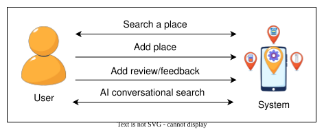

# Requirements_of_Yelp’s_Design

Source: https://www.educative.io/courses/grokking-the-system-design-interview/requirements-of-yelps-design

---

[Home](https://www.educative.io/)

[Courses](https://www.educative.io/search?tab=courses)

[Grokking Modern System Design Interview](https://www.educative.io/courses/grokking-the-system-design-interview)

# Requirements of Yelp’s Design

Define the functional and non-functional requirements for a proximity service like Yelp, focusing on scalability and consistency. Calculate resource needs by estimating required servers, storage, and bandwidth.

We'll cover the following...

- [Requirements](https://www.educative.io/courses/grokking-the-system-design-interview/requirements-of-yelps-design#Requirements)
  - [Functional requirements](https://www.educative.io/courses/grokking-the-system-design-interview/requirements-of-yelps-design#Functional-requirements)
  - [Non-functional requirements](https://www.educative.io/courses/grokking-the-system-design-interview/requirements-of-yelps-design#Non-functional-requirements)
- [Resource estimation](https://www.educative.io/courses/grokking-the-system-design-interview/requirements-of-yelps-design#Resource-estimation)
  - [Number of servers estimation](https://www.educative.io/courses/grokking-the-system-design-interview/requirements-of-yelps-design#Number-of-servers-estimation)
  - [Storage estimation](https://www.educative.io/courses/grokking-the-system-design-interview/requirements-of-yelps-design#Storage-estimation)
  - [Bandwidth estimation](https://www.educative.io/courses/grokking-the-system-design-interview/requirements-of-yelps-design#Bandwidth-estimation)
    - [Incoming traffic assumptions:](https://www.educative.io/courses/grokking-the-system-design-interview/requirements-of-yelps-design#Incoming-traffic-assumptions)
    - [Outgoing traffic assumptions:](https://www.educative.io/courses/grokking-the-system-design-interview/requirements-of-yelps-design#Outgoing-traffic-assumptions)
- [Building blocks](https://www.educative.io/courses/grokking-the-system-design-interview/requirements-of-yelps-design#Building-blocks)

## Requirements[#](https://www.educative.io/courses/grokking-the-system-design-interview/requirements-of-yelps-design#Requirements)

Let’s identify the system requirements.

### Functional requirements[#](https://www.educative.io/courses/grokking-the-system-design-interview/requirements-of-yelps-design#Functional-requirements)

- **User accounts:** Users can log in, log out, and manage places’ information.

> **Note:** There can be two types of users: business owners who can add their places on the platform and other users who can search, view, and give a rating to a place.

- **Search:** Users can search for places by name or location (GPS).
- **AI-powered conversational search:** Users can ask for places in natural language, such as “a quiet café nearby with good Wi-Fi for working”, and receive recommendations grounded in business details and reviews.
- **Feedback:** Users can review places using text, images, and ratings.

Functional requirements

### Non-functional requirements[#](https://www.educative.io/courses/grokking-the-system-design-interview/requirements-of-yelps-design#Non-functional-requirements)

- **High availability:** The system must remain accessible to users.
- **Scalability:** The system must handle fluctuating traffic, including spikes during lunch hours or during tourist seasons.
- **Consistency:** Users must see a consistent view of place data, reviews, and images.
- **Performance:** Search results must load with minimal latency.

## Resource estimation[#](https://www.educative.io/courses/grokking-the-system-design-interview/requirements-of-yelps-design#Resource-estimation)

**Assumptions:**

- 178 million unique users
- 60 million daily active users (DAU)
- 500 million places

### Number of servers estimation[#](https://www.educative.io/courses/grokking-the-system-design-interview/requirements-of-yelps-design#Number-of-servers-estimation)

Considering our assumption (from [back-of-the-envelope calculations)](https://www.educative.io/courses/grokking-the-system-design-interview/put-back-of-the-envelope-numbers-in-perspective)of using daily active users as a proxy for the number of requests per second, we get 60 million requests per second. Then, we use the following formula to calculate the number of servers:

Servers needed at peak load = Number of requests/secondRPS of server\text{Servers needed at peak load = } \frac{\text{Number of requests/second}}{\text{RPS of server}}
Servers needed at peak load = RPS of serverNumber of requests/second​

Assuming a single server can handle 64,000 RPS, we estimate the required server count for peak times as follows:

Servers needed at peak load=60 million64,000=937.5≈1K servers\text{Servers needed at peak load} = \frac{60\ \text{million}}{64,000} = 937.5 \approx 1\text{K}\ \text{servers}
Servers needed at peak load=64,00060 million​=937.5≈1K servers

The number of servers required for Yelp

### Storage estimation[#](https://www.educative.io/courses/grokking-the-system-design-interview/requirements-of-yelps-design#Storage-estimation)

We estimate storage needs based on the following assumptions:

- **Places:** 500 million (1,296 bytes each)
- **Photos:** 500 million (280 bytes each for metadata/links to blob storage)
- **Reviews:** 1 million new reviews daily (537 bytes each)
- **Users:** 178 million (264 bytes each)

> **Note:** Byte sizes reflect the database schema discussed in the next lesson.

The calculator below computes the total storage required:

#### Estimating Storage Requirements

|  |  |  |  |
| --- | --- | --- | --- |
| Type of information | Size Required by an Entity (in Bytes) | Count (in Millions) | Total Size (in GBs) |
| Place | 1296 | 500 | f648 |
| Photo | 280 | 500 | f140 |
| Review | 537 | 1 | f0.54 |
| User | 264 | 178 | f46.99 |
| Total Storage Required |  |  | f835.53 |

The total amount of storage required by Yelp

> **Note:** The 0.54 GB estimate covers only one day of reviews. For 10-year storage, this increases to approximately 2 TB (0.54 GB × 365 × 10), bringing the total requirement to ~2.8 TB.

### Bandwidth estimation[#](https://www.educative.io/courses/grokking-the-system-design-interview/requirements-of-yelps-design#Bandwidth-estimation)

We categorize bandwidth into incoming and outgoing traffic.

#### Incoming traffic assumptions:[#](https://www.educative.io/courses/grokking-the-system-design-interview/requirements-of-yelps-design#Incoming-traffic-assumptions)

- **New places:** On average, 5 are added per day (1,296 bytes)
- **Photos:** 3 MB attached to each place
- **New reviews:** 1 million per day (537 bytes each)

We divide daily totals by 86,400 to determine per-second bandwidth.

#### Estimating Incoming Bandwidth Requirements

|  |  |
| --- | --- |
| Average Number of Places Added Daily | 5 |
| Storage Needed for Each Place (Bytes) | 1296 |
| Size of Photo (in MBs) | 3 |
| Total Size of Place Information (Bytes) | f15006480 |
| Average Number of Reviews Added Daily (in Millions) | 1 |
| Storage Needed for Each Review (Bytes) | 537 |
| Total Size of Reviews (Bytes) | f537000000 |
| Total Incoming Bandwidth (KBps) | f6.39 |
| Total Incoming Bandwidth (Kbps) | f51.12 |

#### Outgoing traffic assumptions:[#](https://www.educative.io/courses/grokking-the-system-design-interview/requirements-of-yelps-design#Outgoing-traffic-assumptions)

- **Search results:** A single search returns 20 places on average
- **Payload:** Each place has a single photo attached, averaging 3 MB.

Considering that there are 60 million active daily users, we come to the following estimations:

#### Estimating Outgoing Bandwidth Requirements

|  |  |
| --- | --- |
| Average Number of Places Returned on Each Search Request | 20 |
| Size of Place (in Bytes) | 1296 |
| Size of Photo (in MB) | 3 |
| Total Size of Place Information (Bytes) | f60025920 |
| Outgoing Bandwidth Required for a Single Request (KBps) | f0.69 |
| Outgoing Bandwidth Required for a Single Request (Kbps) | f5.52 |
| Daily Active Users (in Millions) | 60 |
| Total Outgoing Bandwidth Required (Kbps) | f331200000 |
| Total Outgoing Bandwidth Required (Gbps) | f331.2 |

We need a total of approximately 51 Kbps51\ \text{Kbps}51 Kbps of incoming traffic and approximately 331 Gbps331\ \text{Gbps}331 Gbps of outgoing, assuming that the uploaded content is not compressed.  
  
Total bandwidth: 51 Kbps+331 Gbps≈331 Gbps51\ \text{Kbps} + 331\ \text{Gbps} \approx 331\ \text{Gbps}51 Kbps+331 Gbps≈331 Gbps

The total bandwidth required by Yelp

## Building blocks[#](https://www.educative.io/courses/grokking-the-system-design-interview/requirements-of-yelps-design#Building-blocks)

We will design Yelp using the following components:

Building blocks in the high-level design of Yelp

- [**Caching**](https://www.educative.io/courses/grokking-the-system-design-interview/system-design-the-distributed-cache)**:** Stores popular places to reduce latency.
- [**Load balancer**](https://www.educative.io/courses/grokking-the-system-design-interview/introduction-to-load-balancers)**:** Distributes incoming requests.
- [**Blob storage**](https://www.educative.io/courses/grokking-the-system-design-interview/system-design-a-blob-store)**:** Stores images.
- [**Database**](https://www.educative.io/courses/grokking-the-system-design-interview/introduction-to-databases)**:** Stores place and user metadata.

We also reference [Google Maps](https://www.educative.io/courses/grokking-the-system-design-interview/system-design-google-maps) for location-based search functionality.

System Design: Yelp

Design of Yelp

Ask

[Requirements](https://www.educative.io/courses/grokking-the-system-design-interview/requirements-of-yelps-design#Requirements)

[Functional requirements](https://www.educative.io/courses/grokking-the-system-design-interview/requirements-of-yelps-design#Functional-requirements)

[Non-functional requirements](https://www.educative.io/courses/grokking-the-system-design-interview/requirements-of-yelps-design#Non-functional-requirements)

[Resource estimation](https://www.educative.io/courses/grokking-the-system-design-interview/requirements-of-yelps-design#Resource-estimation)

[Number of servers estimation](https://www.educative.io/courses/grokking-the-system-design-interview/requirements-of-yelps-design#Number-of-servers-estimation)

[Storage estimation](https://www.educative.io/courses/grokking-the-system-design-interview/requirements-of-yelps-design#Storage-estimation)

[Bandwidth estimation](https://www.educative.io/courses/grokking-the-system-design-interview/requirements-of-yelps-design#Bandwidth-estimation)

[Incoming traffic assumptions:](https://www.educative.io/courses/grokking-the-system-design-interview/requirements-of-yelps-design#Incoming-traffic-assumptions)

[Outgoing traffic assumptions:](https://www.educative.io/courses/grokking-the-system-design-interview/requirements-of-yelps-design#Outgoing-traffic-assumptions)

[Building blocks](https://www.educative.io/courses/grokking-the-system-design-interview/requirements-of-yelps-design#Building-blocks)