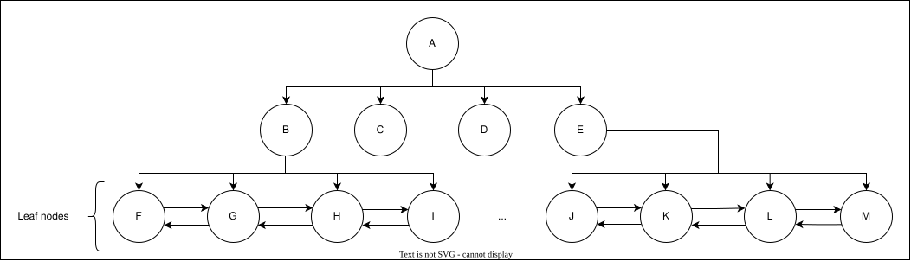
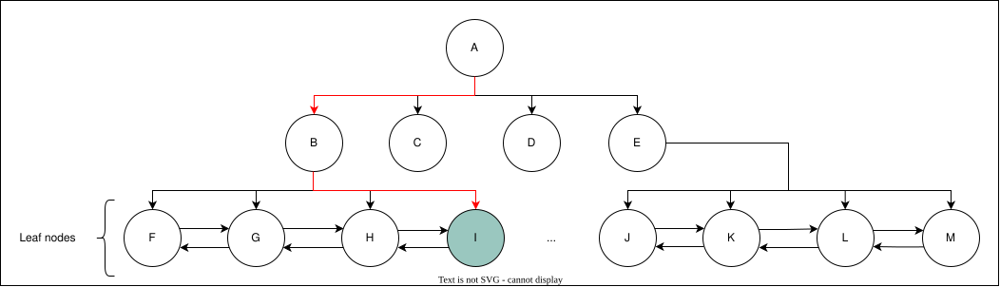
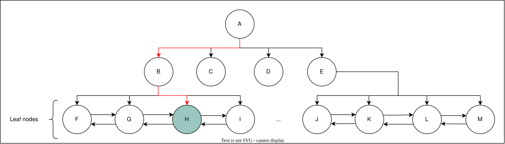
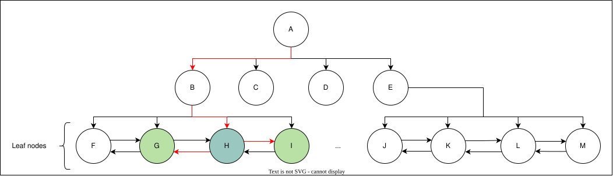

# Design_Considerations_of_Yelp

Source: https://www.educative.io/courses/grokking-the-system-design-interview/design-considerations-of-yelp

---

[Home](https://www.educative.io/)

[Courses](https://www.educative.io/search?tab=courses)

[Grokking Modern System Design Interview](https://www.educative.io/courses/grokking-the-system-design-interview)

# Design Considerations of Yelp

Discover how to design a highly scalable proximity service like Yelp by addressing core challenges such as searching and data partitioning. Implement dynamic segmentation and QuadTrees for efficient spatial indexing. Evaluate the final System Design against non-functional requirements like availability and performance.

We'll cover the following...

- [Introduction](https://www.educative.io/courses/grokking-the-system-design-interview/design-considerations-of-yelp#Introduction)
- [Searching](https://www.educative.io/courses/grokking-the-system-design-interview/design-considerations-of-yelp#Searching)
  - [Improve data fetching](https://www.educative.io/courses/grokking-the-system-design-interview/design-considerations-of-yelp#Improve-data-fetching)
  - [Search using segments](https://www.educative.io/courses/grokking-the-system-design-interview/design-considerations-of-yelp#Search-using-segments)
- [Dynamic segments](https://www.educative.io/courses/grokking-the-system-design-interview/design-considerations-of-yelp#Dynamic-segments)
  - [Search using a QuadTree](https://www.educative.io/courses/grokking-the-system-design-interview/design-considerations-of-yelp#Search-using-a-QuadTree)
  - [Storage space estimation for QuadTrees](https://www.educative.io/courses/grokking-the-system-design-interview/design-considerations-of-yelp#Storage-space-estimation-for-QuadTrees)
  - [Data partitioning](https://www.educative.io/courses/grokking-the-system-design-interview/design-considerations-of-yelp#Data-partitioning)
  - [Ensure availability](https://www.educative.io/courses/grokking-the-system-design-interview/design-considerations-of-yelp#Ensure-availability)
  - [Insert a new place](https://www.educative.io/courses/grokking-the-system-design-interview/design-considerations-of-yelp#Insert-a-new-place)
  - [Rank popular places](https://www.educative.io/courses/grokking-the-system-design-interview/design-considerations-of-yelp#Rank-popular-places)
    - [AI-powered conversational recommendations](https://www.educative.io/courses/grokking-the-system-design-interview/design-considerations-of-yelp#AI-powered-conversational-recommendations)
- [Finalized design](https://www.educative.io/courses/grokking-the-system-design-interview/design-considerations-of-yelp#Finalized-design)
- [Evaluation](https://www.educative.io/courses/grokking-the-system-design-interview/design-considerations-of-yelp#Evaluation)
  - [Requirements compliance](https://www.educative.io/courses/grokking-the-system-design-interview/design-considerations-of-yelp#Requirements-compliance)
- [Summary](https://www.educative.io/courses/grokking-the-system-design-interview/design-considerations-of-yelp#Summary)

## Introduction[#](https://www.educative.io/courses/grokking-the-system-design-interview/design-considerations-of-yelp#Introduction)

The previous lesson covered the system architecture, core components, and overall workflow, which raised several open design questions. For example, how should the system retrieve nearby places, and how should it rank them by popularity? This lesson addresses these design concerns. The following table summarizes the objectives of this lesson.

## Summary of the Lesson

|  |  |
| --- | --- |
| **Section/Sub-section** | **Purpose** |
| **Searching** | This process divides the world into segments to optimize the search, so that all nearby sites in a given location and radius can be identified. |
| Storing Indexes | We index the places to improve query performance and estimate the storage required for all of the indexes. |
| Searching Using Segments | We search all the desired places by combining the segments. |
| **Dynamic Segments** | We solve the static segment limitations using dynamic segments. |
| Searching Using a QuadTree | We explore the searching functionality using a QuadTree. |
| Space Estimations for a QuadTree | We estimate the storage required for a QuadTree. |
| Data Partitioning | We look into the options we can use to partition data. |
| Ensuring Availability | We look into how we’ll ensure the availability of the system. |
| Inserting a New Place | We look into how we’ll insert the place in a QuadTree. |
| Ranking Popular Places | We rank the places of the system. |
| **Evaluation** | We evaluate how our system fulfills the non-functional requirements. |

## Searching[#](https://www.educative.io/courses/grokking-the-system-design-interview/design-considerations-of-yelp#Searching)

Using Google Maps, we were able to connect segments and overcome the scalability challenge to efficiently process a large graph. The graph of the world had numerous nodes and vertices, and traversing them was time-consuming. Therefore, we divided the whole world into smaller segments/subgraphs to process and query them simultaneously. The segmentation helps improve the system’s scalability.  
  
Each segment will be of the size 5×5 miles5 \times 5 \ \text{miles}5×5 miles and will contain a list of places that exist within it. We only search a few segments to find nearby destinations. We can use a given location and a defined radius to find all nearby segments and identify nearby sites.

 and all segments hold the coordinates of different places")

Partitioning the globe into small segments, where each segment has four coordinates (lat, long) and all segments hold the coordinates of different places

1.

How will we find nearby places if we create a table for storing all places?

Show Answer

1 / 2

We can store all the places in a table and uniquely identify a segment by having a `segment_ID`. We can index each segment in the database. Now, we have limited the number of segments we need to search, so the query will be optimized and return results quickly.

### Improve data fetching[#](https://www.educative.io/courses/grokking-the-system-design-interview/design-considerations-of-yelp#Improve-data-fetching)

We use a key-value store for quick access to places in the segments. The key is the `segment_ID`, while the `value` contains the list of places in that segment. Let’s estimate how much space we need to store the indexes.

We can usually store a few MBs in the value of the key-value store. If we assume that each segment has 500 places then it will take up 500×1296 Bytes = 0.648MB500 \times 1296 \ \text{Bytes = 0.648MB}500×1296 Bytes = 0.648MB, and we can easily store it as a value.

The total area of the Earth is around 200 million square miles, and the land surface area is about 60 million square miles. If we assume our radius is 10 miles, we’ll have 6 million segments. An 8-byte identifier will identify each segment.

Let’s calculate how much memory we need.

#### 

|  |  |
| --- | --- |
| Total Area of the Earth (Million Square Miles) | 60 |
| Search Radius (Miles) | 10 |
| Number of Segments (Millions) | f6 |
| Segment\_ID (Bytes) | 8 |
| Place\_ID (Bytes) | 8 |
| Number of Places (Millions) | 500 |
| Total Space (GB) | f4.048 |

### Search using segments[#](https://www.educative.io/courses/grokking-the-system-design-interview/design-considerations-of-yelp#Search-using-segments)

A user may select a radius to search for places that aren’t in a single segment. So, we need to combine multiple segments by [connecting the segments](https://www.educative.io/courses/grokking-the-system-design-interview/challenges-of-google-maps-design#Connect-two-segments) to find locations within the specified radius—say, 5 miles.

First, we constrain the number of segments. This reduces the graph size and enables the search process to be optimized. Then, we identify all relevant locations, compute the distance to the search point, and display it to the user.

Searching for locations using segments

1.

Can you identify a problem with the current approach?

Show Answer

Did you find this helpful?

## Dynamic segments[#](https://www.educative.io/courses/grokking-the-system-design-interview/design-considerations-of-yelp#Dynamic-segments)

We solve the problem of uneven distribution of places in a segment by dynamically sizing the segments. We do this by focusing on the number of places. We split a segment into four more segments if the number of places reaches a certain limit. We assume 500 places as our limit. While using this approach, we need to decide on the following questions:

1. How will we map the segments?
2. How will we connect to other segments?

We use a **QuadTree** to manage our segments. Each node contains the information of a segment. If the number of places exceeds 500, we split the segment into four additional child nodes and divide the places among them. In this way, the leaf nodes will be those segments that can’t be broken down any further. Each leaf node will have a list of places in it, too.

### Search using a QuadTree[#](https://www.educative.io/courses/grokking-the-system-design-interview/design-considerations-of-yelp#Search-using-a-QuadTree)

We start at the root node and continue visiting nodes to find the desired segment. We check every node to see if it has more child nodes. If a node has no more children, then we stop our search because that node is the required one. We also connect each child node to its neighbors using a doubly linked list. All child nodes of all parent nodes are connected via a doubly linked list. This list allows us to find the neighboring segments when we need to move forward or backward, as per our requirements. After identifying the segments, we have the required `PlaceID` values of the places, and we can search our database to find more details on them.

1.

Is there an alternative approach to find the neighboring segments?

Show Answer

Did you find this helpful?

The following slides illustrate the process of searching for a place. If a node has the places we need, we stop there. Otherwise, we explore more nodes until we reach our search radius. After finding the node, we query the database for information related to the places and return the desired ones.

1 / 4

All the leaf nodes in the QuadTree are linked, just like in a doubly-linked list

1 / 4

We searched for a cafe and found the required number cafes—say, 20—in the same leaf node, so do not need to iterate any other nodes

1 / 4

We searched for a cafe but only found, say, six cafes in a leaf node

1 / 4

The leaf node will explore its neighboring nodes to find more cafes

### Storage space estimation for QuadTrees[#](https://www.educative.io/courses/grokking-the-system-design-interview/design-considerations-of-yelp#Storage-space-estimation-for-QuadTrees)

Let’s calculate the storage we need for keeping QuadTrees:

- We store the `PlaceID`, `Latitude`, and `Longitude` for each place in the node. Each of these values is of the size 8 Bytes. For 500 million places, we need the following amount of storage for all places:

  - (8+8+8)×106×500=12 GB(8+8+8)\times10^6 \times 500 = 12 \text{ GB}(8+8+8)×106×500=12 GB
- We’ll have 500 places in a single node. So, for 500 million places, we’ll need 500M500=1 M\frac{500M}{500} = 1 \text{ M}500500M​=1 M leaf nodes.
- The QuadTree with 1 million leaf nodes has approximately 1/3rd of the leaf nodes of the internal nodes (all the nodes up to the leaf level), and each internal node has four pointers to its child nodes. If we assume 8 Bytes for each pointer, then we’ll need 1 M×1/3×4×8=10.67 MB1\text{ M} \times 1/3 \times 4 \times 8 = 10.67 \text{ MB}1 M×1/3×4×8=10.67 MB space for the internal nodes.
- We can get the total space needed to store all the internal nodes by adding 12 GB12\text{ GB}12 GB and 10.67 MB10.67\text{ MB}10.67 MB, that is, 12.01 GB12.01\text{ GB}12.01 GB approximately.

We can easily store a QuadTree on a server.

Let’s try the following calculator to calculate the storage needed for a QuadTree:

#### 

|  |  |
| --- | --- |
| PlaceID, Latitude, and Longitude (Bytes) | 24 |
| Total Number of Places (Millions) | 500 |
| Total Space Needed to Store All Places (GB) | f12 |
| Limit of Places for Each Segment | 500 |
| Number of Segments (Millions) | f1 |
| Number of Pointers to Hold Children Pointers | 4 |
| Size of Each Pointer (Bytes) | 8 |
| Total Space to Store All Internal Nodes (MB) | f10.67 |
| Total Space to Store QuadTrees (GB) | f12.01 |

### Data partitioning[#](https://www.educative.io/courses/grokking-the-system-design-interview/design-considerations-of-yelp#Data-partitioning)

With 20% annual growth in mind, the number of places will increase. We can partition data on the following basis:

1. **Regions**: We can split our locations into regions based on zip codes. This way, all the locations belonging to a specific region are stored on a single node. We store information about the region along with the place, so we can query based on regions as well. We can use the user’s region to find the places in that specific region. This data partitioning comes with a few challenges. For example, if a region becomes popular during tourist season, it can affect our system’s performance. We might have numerous queries on the server, which could result in slow response times for user queries.
2. **`PlaceID`**: We can partition data on the basis of `PlaceID` instead of the region to avoid the query overload in popular seasons or rush hours. We can use a key-value store to store the places. In this case, the key is the `PlaceID` and the value contains the server in which that place is stored. This will make the process of fetching places more efficient.

So, we’ll opt for partitioning based on places. Moreover, we’ll also use caches for popular places. The cache will have information about that particular place.

### Ensure availability[#](https://www.educative.io/courses/grokking-the-system-design-interview/design-considerations-of-yelp#Ensure-availability)

Consider a scenario in which multiple people within the same radius submit a search request. If we have a single QuadTree, it’ll affect user availability. So, we can’t rely on a single QuadTree. To address this problem, we replicate our QuadTrees across multiple servers to ensure availability. This allows us to distribute read traffic and reduce response time. QuadTrees are built on a server, so we can use the server ID as a key to identify the server on which the QuadTree is present. The value is the list of places that the QuadTree holds. The key-value store makes it easier to rebuild the QuadTree if we lose it.

1.

How will the leader-follower approach help us in replication?

Show Answer

Did you find this helpful?

### Insert a new place[#](https://www.educative.io/courses/grokking-the-system-design-interview/design-considerations-of-yelp#Insert-a-new-place)

We insert a new place into the database as well as into our QuadTree. We find the segment of the new place if the QuadTree is distributed on different servers, and then we add it to that segment. We split the segment if required and update the QuadTree accordingly.

### Rank popular places[#](https://www.educative.io/courses/grokking-the-system-design-interview/design-considerations-of-yelp#Rank-popular-places)

We need a service **rating calculator** that calculates the overall rating of a service. We can store a place’s rating in the database and in the QuadTree, along with its ID, latitude, and longitude. The QuadTree returns the top 50 or 100 popular places within the given radius. The **aggregator service** determines the actual top places and returns them to the user.

Note: We don’t expect the rating to be updated within hours, as such frequent changes in QuadTrees or databases can be expensive. We update them once a day, when the load is minimal.

#### AI-powered conversational recommendations[#](https://www.educative.io/courses/grokking-the-system-design-interview/design-considerations-of-yelp#AI-powered-conversational-recommendations)

[Yelp Assistant](https://www.yelp-ir.com/news/press-releases/news-release-details/2026/Yelp-Launches-the-New-Yelp-Assistant-Transforming-Local-Discovery-from-Search-to-Answers-and-Actions/default.aspx) lets users describe what they are looking for in conversation and returns recommended businesses. A design for this reuses the retrieve-then-generate pattern from the Ask YouTube lesson, with business records and review passages as the evidence instead of video transcripts.

Two details are specific to places. First, location is a hard constraint: the QuadTree search above narrows candidates to the requested area before any semantic matching, and the assistant should ask before widening that area. Second, reviews are subjective. “Quiet” or “good for working” comes from what reviewers experienced, not from a verified attribute such as opening hours or wheelchair access. The generated answer should present these as what reviewers report, for example “several reviewers describe it as quiet”, and should note when reviews conflict or when business hours may be outdated.

Beyond recommendations, Yelp Assistant can [complete tasks in the chat](https://www.yelp.com/article/yelp-assistant-your-new-favorite-way-to-find-it-book-it-and-fix-it). It can reserve a table through Yelp Reservations or OpenTable, add the user to the Yelp Waitlist, and order takeout through DoorDash or Grubhub. Yelp has also [announced Check for Me](https://blog.yelp.com/news/fall-product-release-2026/), an AI phone agent that calls a restaurant to ask about the current wait time and texts the answer to the user.

Taking actions turns the assistant into an agent, as described in the Retrieval-Augmented Generation lesson. This changes the design in four ways:

- **The LLM proposes, services execute:** The model chooses the action and fills in details such as date, time, and party size. A reservation or ordering service then calls Yelp’s own system or the partner’s API.

  - (8+8+8)×106×500=12 GB(8+8+8)\times10^6 \times 500 = 12 \text{ GB}(8+8+8)×106×500=12 GB
- **Confirm before committing:** The user reviews the details before anything is booked or ordered. For OpenTable bookings, the final confirmation happens on OpenTable.

  - (8+8+8)×106×500=12 GB(8+8+8)\times10^6 \times 500 = 12 \text{ GB}(8+8+8)×106×500=12 GB
- **Idempotent requests:** Each action carries an idempotency key, so a retry after a timeout cannot create a second booking or order.

  - (8+8+8)×106×500=12 GB(8+8+8)\times10^6 \times 500 = 12 \text{ GB}(8+8+8)×106×500=12 GB
- **Asynchronous tasks:** A phone call or a waitlist can take minutes, so these run as background jobs. The assistant tracks their status and notifies the user, instead of holding the chat request open.

  - (8+8+8)×106×500=12 GB(8+8+8)\times10^6 \times 500 = 12 \text{ GB}(8+8+8)×106×500=12 GB

## Finalized design[#](https://www.educative.io/courses/grokking-the-system-design-interview/design-considerations-of-yelp#Finalized-design)

We added a few new components to our design. We introduced caches to store popular places. This allows us to fetch the places much faster. Moreover, we added a rating calculator that sorts places by rating. This will enhance user experience, since the places with a good rating will be displayed first.

The updated design of our system is shown below:

The updated detailed design of Yelp, with conversational recommendations and actions

The “Conversational AI feature” group at the bottom is the AI extension. Yelp Assistant uses the QuadTree server to filter by location and the relational database for business details and reviews. After the user confirms, the action service sends bookings and orders to partner APIs and runs longer tasks through the task queue.

## Evaluation[#](https://www.educative.io/courses/grokking-the-system-design-interview/design-considerations-of-yelp#Evaluation)

Let’s see how our system design fulfills the non-functional requirements we identified in the initial lessons.

### Requirements compliance[#](https://www.educative.io/courses/grokking-the-system-design-interview/design-considerations-of-yelp#Requirements-compliance)

- **Availability**: We partitioned the data into smaller segments rather than dealing with a huge dataset covering all places on the world map. This made our system highly available. We also replicated the QuadTrees data using key-value stores to ensure availability.
- **Scalability**: We split the whole world into smaller dynamic segments. This allows us to search for a place within a specific radius, thereby narrowing our search area. We then used QuadTrees in which each child node holds a single segment. Upon adding or removing a place, we can restructure our QuadTrees. So, we were able to make our system scalable.
- **Performance**: We reduced the latency by using caches. We cached all the famous and popular places, minimizing request time.
- **Consistency**: Users have a consistent view of data for places, reviews, and photos because we use reliable, fault-tolerant databases such as key-value stores and relational databases.

AI Powered

Saved

1 attempt left

Reset

How does replacing SQL with NoSQL impact the design?

In the previous lesson, we chose a SQL database and a key-value store to design Yelp. How does replacing SQL with NoSQL impact the design? Discuss its impact on nonfunctional requirements like scalability and consistency. Also, discuss schema flexibility and the impact on the performance of complex queries.

This is your last attempt.

## Summary[#](https://www.educative.io/courses/grokking-the-system-design-interview/design-considerations-of-yelp#Summary)

Proximity-based servers allow the user to search for a specific place or nearby places. The world’s map data is huge, and dividing it into segments and finding the specific segment was a challenge in itself. So, we used QuadTrees to optimize our search and provided the user with a list of places with minimum latency.

Design of Yelp

Quiz on Yelp's Design

Ask

[Introduction](https://www.educative.io/courses/grokking-the-system-design-interview/design-considerations-of-yelp#Introduction)

[Searching](https://www.educative.io/courses/grokking-the-system-design-interview/design-considerations-of-yelp#Searching)

[Improve data fetching](https://www.educative.io/courses/grokking-the-system-design-interview/design-considerations-of-yelp#Improve-data-fetching)

[Search using segments](https://www.educative.io/courses/grokking-the-system-design-interview/design-considerations-of-yelp#Search-using-segments)

[Dynamic segments](https://www.educative.io/courses/grokking-the-system-design-interview/design-considerations-of-yelp#Dynamic-segments)

[Search using a QuadTree](https://www.educative.io/courses/grokking-the-system-design-interview/design-considerations-of-yelp#Search-using-a-QuadTree)

[Storage space estimation for QuadTrees](https://www.educative.io/courses/grokking-the-system-design-interview/design-considerations-of-yelp#Storage-space-estimation-for-QuadTrees)

[Data partitioning](https://www.educative.io/courses/grokking-the-system-design-interview/design-considerations-of-yelp#Data-partitioning)

[Ensure availability](https://www.educative.io/courses/grokking-the-system-design-interview/design-considerations-of-yelp#Ensure-availability)

[Insert a new place](https://www.educative.io/courses/grokking-the-system-design-interview/design-considerations-of-yelp#Insert-a-new-place)

[Rank popular places](https://www.educative.io/courses/grokking-the-system-design-interview/design-considerations-of-yelp#Rank-popular-places)

[AI-powered conversational recommendations](https://www.educative.io/courses/grokking-the-system-design-interview/design-considerations-of-yelp#AI-powered-conversational-recommendations)

[Finalized design](https://www.educative.io/courses/grokking-the-system-design-interview/design-considerations-of-yelp#Finalized-design)

[Evaluation](https://www.educative.io/courses/grokking-the-system-design-interview/design-considerations-of-yelp#Evaluation)

[Requirements compliance](https://www.educative.io/courses/grokking-the-system-design-interview/design-considerations-of-yelp#Requirements-compliance)

[Summary](https://www.educative.io/courses/grokking-the-system-design-interview/design-considerations-of-yelp#Summary)