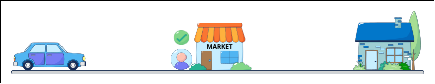
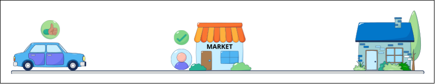
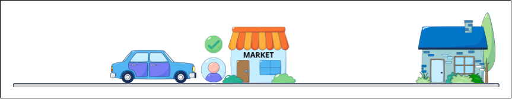
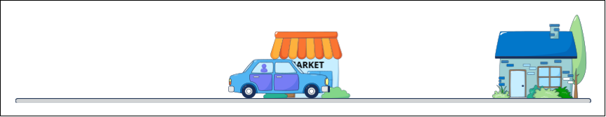
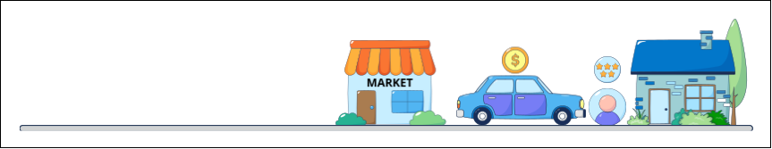

# System_Design_Uber

Source: https://www.educative.io/courses/grokking-the-system-design-interview/system-design-uber

---

[Home](https://www.educative.io/)

[Courses](https://www.educative.io/search?tab=courses)

[Grokking Modern System Design Interview](https://www.educative.io/courses/grokking-the-system-design-interview)

# System Design: Uber

Define the core functionality and user roles within a large-scale ride-hailing service like Uber. Identify and articulate the key functional and non-functional requirements via an assessment.

We'll cover the following...

- [What is Uber?](https://www.educative.io/courses/grokking-the-system-design-interview/system-design-uber#What-is-Uber)
- [How will we design Uber?](https://www.educative.io/courses/grokking-the-system-design-interview/system-design-uber#How-will-we-design-Uber)

## What is Uber?[#](https://www.educative.io/courses/grokking-the-system-design-interview/system-design-uber#What-is-Uber)

**Uber** is a ride-hailing application that connects riders with drivers. Riders register to book vehicles for travel, while drivers register to fulfill these requests. The app facilitates real-time communication and coordination between parties via their smartphones.

1 / 5

A user requests a ride

1 / 5

Nearby drivers receive the request; one of them accepts it

1 / 5

The selected driver picks up the user from the specified location

1 / 5

The driver moves toward the desired destination

1 / 5

The driver drops off the user, ends the ride, and receives payment

The illustration below displays the growth of active Uber users from 2017 to 2020 (Source: Statista):

Monthly number of Uber's active users worldwide from 2017 to 2020(by quarter)

AI Powered

Saved

3 attempts left

Reset

Identify the functional and nonfunctional requirements for Uber.

Let’s evaluate your understanding of the functional and nonfunctional requirements for Uber. Identify three functional and three nonfunctional requirements for Uber. Provide the need for each requirement in a single line.

You have 3 attempts to answer.

## How will we design Uber?[#](https://www.educative.io/courses/grokking-the-system-design-interview/system-design-uber#How-will-we-design-Uber)

Designing a system like Uber involves answering critical questions about how drivers connect with riders and how the platform scales. This chapter provides a comprehensive design solution.

We divide the design process into six sections:

1. [**Requirements**](https://www.educative.io/courses/grokking-the-system-design-interview/requirements-of-ubers-design)**:** Define functional and non-functional requirements, including estimates for storage, bandwidth, and compute resources.
2. [**High-level design**](https://www.educative.io/courses/grokking-the-system-design-interview/high-level-design-of-uber)**:** Outline the system architecture and API design.
3. [**Detailed design**](https://www.educative.io/courses/grokking-the-system-design-interview/detailed-design-of-uber)**:** Explore the internal workings of specific components and their interactions.
4. [**Payment service and fraud detection**](https://www.educative.io/courses/grokking-the-system-design-interview/payment-service-and-fraud-detection-in-uber-design)**:** Analyze payment workflows and fraud prevention mechanisms.
5. [**Evaluation**](https://www.educative.io/courses/grokking-the-system-design-interview/evaluation-of-ubers-design)**:** Assess how the proposed design satisfies the non-functional requirements.
6. [**Quiz**](https://www.educative.io/courses/grokking-the-system-design-interview/quiz-on-ubers-design)**:** Test your knowledge of the design concepts.

Let’s start by defining the requirements in the next lesson.

Quiz on Yelp's Design

Requirements of Uber’s Design

Ask

[What is Uber?](https://www.educative.io/courses/grokking-the-system-design-interview/system-design-uber#What-is-Uber)

[How will we design Uber?](https://www.educative.io/courses/grokking-the-system-design-interview/system-design-uber#How-will-we-design-Uber)