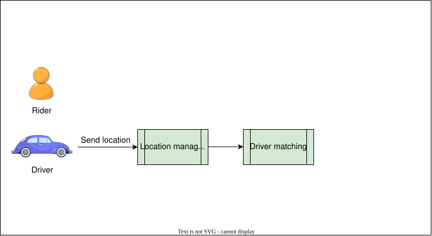
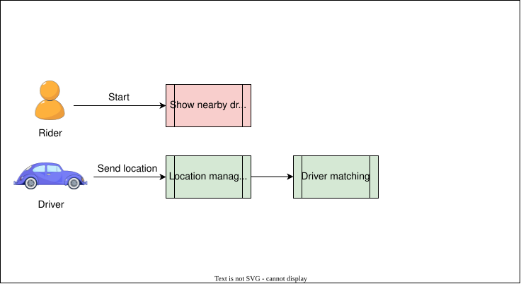
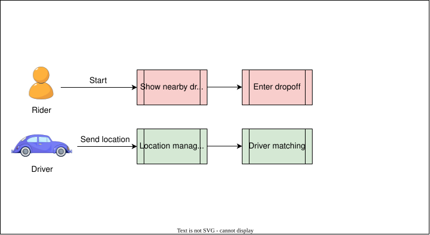
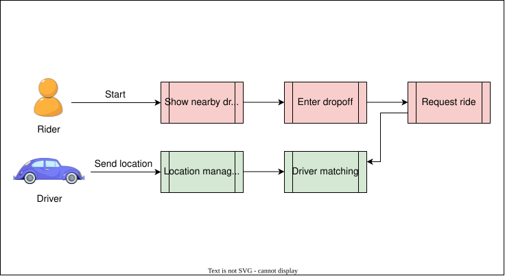
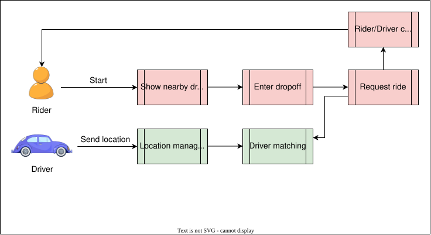
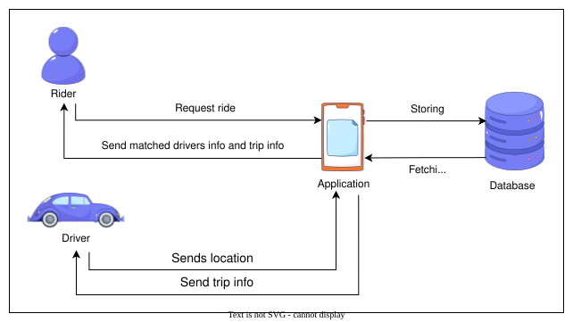

# High-level_Design_of_Uber

Source: https://www.educative.io/courses/grokking-the-system-design-interview/high-level-design-of-uber

---

[Home](https://www.educative.io/)

[Courses](https://www.educative.io/search?tab=courses)

[Grokking Modern System Design Interview](https://www.educative.io/courses/grokking-the-system-design-interview)

# High-level Design of Uber

Learn the core workflow of a complex ride sharing application like Uber, detailing the steps from rider request to driver matching. Define the essential APIs required for real-time driver location updates, trip management, and successful high-level System Design.

We'll cover the following...

- [Workflow of our application](https://www.educative.io/courses/grokking-the-system-design-interview/high-level-design-of-uber#Workflow-of-our-application)
- [High-level design of Uber](https://www.educative.io/courses/grokking-the-system-design-interview/high-level-design-of-uber#High-level-design-of-Uber)
- [API design](https://www.educative.io/courses/grokking-the-system-design-interview/high-level-design-of-uber#API-design)
  - [Update driver location](https://www.educative.io/courses/grokking-the-system-design-interview/high-level-design-of-uber#Update-driver-location)
  - [Find nearby drivers](https://www.educative.io/courses/grokking-the-system-design-interview/high-level-design-of-uber#Find-nearby-drivers)
  - [Request a ride](https://www.educative.io/courses/grokking-the-system-design-interview/high-level-design-of-uber#Request-a-ride)
  - [Show driver ETA](https://www.educative.io/courses/grokking-the-system-design-interview/high-level-design-of-uber#Show-driver-ETA)
  - [Confirm pickup](https://www.educative.io/courses/grokking-the-system-design-interview/high-level-design-of-uber#Confirm-pickup)
  - [Show trip updates](https://www.educative.io/courses/grokking-the-system-design-interview/high-level-design-of-uber#Show-trip-updates)
  - [End the trip](https://www.educative.io/courses/grokking-the-system-design-interview/high-level-design-of-uber#End-the-trip)

## Workflow of our application[#](https://www.educative.io/courses/grokking-the-system-design-interview/high-level-design-of-uber#Workflow-of-our-application)

Before designing the architecture, let’s outline the application workflow:

1. When the rider opens the application, they see all nearby available drivers.
2. The rider enters a destination and requests a ride.
3. The system receives the request and searches for a suitable driver.
4. The rider’s status remains “Waiting for driver” until a match is confirmed.
5. Drivers transmit their location every four seconds. The system uses this data to track availability and the progress of routes.
6. The matched driver accepts or rejects the request:

   1. **Accept:** The system updates the status for both parties. The rider receives the driver’s details and confirmation.
   2. **Reject:** The system automatically searches for the next available driver.

1 / 7

The rider is yet to open the application. The driver constantly updates their location

1 / 7

The rider can see the nearby drivers when they open the application

1 / 7

The rider enters the drop-off location

1 / 7

The rider requests the ride

1 / 7

The driver receives the request. The rider or driver can cancel the request here

## High-level design of Uber[#](https://www.educative.io/courses/grokking-the-system-design-interview/high-level-design-of-uber#High-level-design-of-Uber)

At a high level, the system must handle three core functions: receiving ride requests, tracking driver locations, and managing active trips. It matches riders with drivers, provides real-time updates, and facilitates the ride life cycle.

High-level design of Uber

## API design[#](https://www.educative.io/courses/grokking-the-system-design-interview/high-level-design-of-uber#API-design)

We will define the API endpoints required to support these features. These definitions translate our feature set into technical specifications.

> **Note:** Common parameters are omitted for brevity.

### Update driver location[#](https://www.educative.io/courses/grokking-the-system-design-interview/high-level-design-of-uber#Update-driver-location)

Ace Editor

1

updateDriverLocation(driverID, oldlat, oldlong, newlat, newlong )

הההההההההההההההההההההההההההההההההההההההההההההההההההההההההההההההההההההההההההההההההההההההההההההההההההההההההההההההההההההההההההההההההההההההההההההההההההההההההההההההההההההההההההההההההההההההההההההההההההההההההההההההההההההההההההההההההההההההההההההההההההההההההההההההההההההההההההההההההההההההההההההההההההההההההההההההההההההההההההההההההההההההההההההההההההההההההההההההההההההההההההההההההההההההההההההההההההההההההההההההההההההההההההההההההההההההההההההההההההההההההההההההההההההההההההההההההההההההההההההההההההההההההההההההההההההההההההההההה

XXXXXXXXXXXXXXXXXXXXXXXXXXXXXXXXXXXXXXXXXXXXXXXXXXXXXXXXXXXXXXXXXXXXXXXXXXXXXXXXXXXXXXXXXXXXXXXXXXXXXXXXXXXXXXXXXXXXXXXXXXXXXXXXXXXXXXXXXXXXXXXXXXXXXXXXXXXXXXXXXXXXXXXXXXXXXXXXXXXXXXXXXXXXXXXXXXXXXXXXXXXXXXXXXXXXXXXXXXXXXXXXXXXXXXXXXXXXXXXXXXXXXXXXXXXXXXXXXXXXXXXXXXXXXXXXXXXXXXXXXXXXXXXXXXXXXXXXXXXXXXXXXXXXXXXXXXXXXXXXXXXXXXXXXXXXXXXXXXXXXXXXXXXXXXXXXXXXXXXXXXXXXXXXXXXXXXXXXXXXXXXXXXXXXXXXXXXXXXXXXXXXXXXXXXXXXXXXXXXXXXXXXXXXXXXXXXXXXXXXXXXXXXXXXXXXXXXXXXXXXXXXXXXXXXXXXXXXXXXXXXXXXXXXXXXXXXXXXXXXXXXXXXXXXXXX

|  |  |
| --- | --- |
| **Parameter** | **Description** |
| `driverID` | The ID of the driver. |
| `oldlat` | The previous latitude of the driver. |
| `oldlong` | The previous longitude of the driver. |
| `newlat` | The new latitude of the driver. |
| `newlong` | The new longitude of the driver. |

The `updateDriverLocation` API sends the driver’s coordinates to the location server. Including `oldlat` and `oldlong` simplifies server-side trajectory calculations and enables the service to reconstruct the route even if data packets were queued locally due to network issues. Low-bandwidth clients may omit these fields.

### Find nearby drivers[#](https://www.educative.io/courses/grokking-the-system-design-interview/high-level-design-of-uber#Find-nearby-drivers)

Ace Editor

1

findNearbyDrivers(riderID, lat, long)

הההההההההההההההההההההההההההההההההההההההההההההההההההההההההההההההההההההההההההההההההההההההההההההההההההההההההההההההההההההההההההההההההההההההההההההההההההההההההההההההההההההההההההההההההההההההההההההההההההההההההההההההההההההההההההההההההההההההההההההההההההההההההההההההההההההההההההההההההההההההההההההההההההההההההההההההההההההההההההההההההההההההההההההההההההההההההההההההההההההההההההההההההההההההההההההההההההההההההההההההההההההההההההההההההההההההההההההההההההההההההההההההההההההההההההההההההההההההההההההההההההההההההההההההההההההההההההההההה

XXXXXXXXXXXXXXXXXXXXXXXXXXXXXXXXXXXXXXXXXXXXXXXXXXXXXXXXXXXXXXXXXXXXXXXXXXXXXXXXXXXXXXXXXXXXXXXXXXXXXXXXXXXXXXXXXXXXXXXXXXXXXXXXXXXXXXXXXXXXXXXXXXXXXXXXXXXXXXXXXXXXXXXXXXXXXXXXXXXXXXXXXXXXXXXXXXXXXXXXXXXXXXXXXXXXXXXXXXXXXXXXXXXXXXXXXXXXXXXXXXXXXXXXXXXXXXXXXXXXXXXXXXXXXXXXXXXXXXXXXXXXXXXXXXXXXXXXXXXXXXXXXXXXXXXXXXXXXXXXXXXXXXXXXXXXXXXXXXXXXXXXXXXXXXXXXXXXXXXXXXXXXXXXXXXXXXXXXXXXXXXXXXXXXXXXXXXXXXXXXXXXXXXXXXXXXXXXXXXXXXXXXXXXXXXXXXXXXXXXXXXXXXXXXXXXXXXXXXXXXXXXXXXXXXXXXXXXXXXXXXXXXXXXXXXXXXXXXXXXXXXXXXXXXXXX

|  |  |
| --- | --- |
| **Parameter** | **Description** |
| `riderID` | The ID of the rider. |
| `lat` | The latitude of the rider. |
| `long` | The longitude of the rider. |

The `findNearbyDrivers` API identifies available drivers within a specific radius of the rider's location.

### Request a ride[#](https://www.educative.io/courses/grokking-the-system-design-interview/high-level-design-of-uber#Request-a-ride)

Ace Editor

1

requestRide(riderID, lat, long, dropOfflat, dropOfflong, typeOfVehicle)

הההההההההההההההההההההההההההההההההההההההההההההההההההההההההההההההההההההההההההההההההההההההההההההההההההההההההההההההההההההההההההההההההההההההההההההההההההההההההההההההההההההההההההההההההההההההההההההההההההההההההההההההההההההההההההההההההההההההההההההההההההההההההההההההההההההההההההההההההההההההההההההההההההההההההההההההההההההההההההההההההההההההההההההההההההההההההההההההההההההההההההההההההההההההההההההההההההההההההההההההההההההההההההההההההההההההההההההההההההההההההההההההההההההההההההההההההההההההההההההההההההההההההההההההההההההההההההההההה

XXXXXXXXXXXXXXXXXXXXXXXXXXXXXXXXXXXXXXXXXXXXXXXXXXXXXXXXXXXXXXXXXXXXXXXXXXXXXXXXXXXXXXXXXXXXXXXXXXXXXXXXXXXXXXXXXXXXXXXXXXXXXXXXXXXXXXXXXXXXXXXXXXXXXXXXXXXXXXXXXXXXXXXXXXXXXXXXXXXXXXXXXXXXXXXXXXXXXXXXXXXXXXXXXXXXXXXXXXXXXXXXXXXXXXXXXXXXXXXXXXXXXXXXXXXXXXXXXXXXXXXXXXXXXXXXXXXXXXXXXXXXXXXXXXXXXXXXXXXXXXXXXXXXXXXXXXXXXXXXXXXXXXXXXXXXXXXXXXXXXXXXXXXXXXXXXXXXXXXXXXXXXXXXXXXXXXXXXXXXXXXXXXXXXXXXXXXXXXXXXXXXXXXXXXXXXXXXXXXXXXXXXXXXXXXXXXXXXXXXXXXXXXXXXXXXXXXXXXXXXXXXXXXXXXXXXXXXXXXXXXXXXXXXXXXXXXXXXXXXXXXXXXXXXXXX

|  |  |
| --- | --- |
| **Parameter** | **Description** |
| `lat` | The current latitude of the rider. |
| `long` | The current longitude of the rider. |
| `dropOfflat` | The latitude of the rider’s drop-off location. |
| `dropOfflong` | The longitude of the rider’s drop-off location. |
| `typeOfVehicle` | The type of vehicle required by the rider, for example, business, economy, and so on. |

The `requestRide` API initiates a ride request, specifying the rider’s pickup location and preferred vehicle type.

### Show driver ETA[#](https://www.educative.io/courses/grokking-the-system-design-interview/high-level-design-of-uber#Show-driver-ETA)

Ace Editor

1

showETA(rider\_lat, rider\_lng, destination\_lat, destination\_lng, ride\_type)

הההההההההההההההההההההההההההההההההההההההההההההההההההההההההההההההההההההההההההההההההההההההההההההההההההההההההההההההההההההההההההההההההההההההההההההההההההההההההההההההההההההההההההההההההההההההההההההההההההההההההההההההההההההההההההההההההההההההההההההההההההההההההההההההההההההההההההההההההההההההההההההההההההההההההההההההההההההההההההההההההההההההההההההההההההההההההההההההההההההההההההההההההההההההההההההההההההההההההההההההההההההההההההההההההההההההההההההההההההההההההההההההההההההההההההההההההההההההההההההההההההההההההההההההההההההההההההההההה

XXXXXXXXXXXXXXXXXXXXXXXXXXXXXXXXXXXXXXXXXXXXXXXXXXXXXXXXXXXXXXXXXXXXXXXXXXXXXXXXXXXXXXXXXXXXXXXXXXXXXXXXXXXXXXXXXXXXXXXXXXXXXXXXXXXXXXXXXXXXXXXXXXXXXXXXXXXXXXXXXXXXXXXXXXXXXXXXXXXXXXXXXXXXXXXXXXXXXXXXXXXXXXXXXXXXXXXXXXXXXXXXXXXXXXXXXXXXXXXXXXXXXXXXXXXXXXXXXXXXXXXXXXXXXXXXXXXXXXXXXXXXXXXXXXXXXXXXXXXXXXXXXXXXXXXXXXXXXXXXXXXXXXXXXXXXXXXXXXXXXXXXXXXXXXXXXXXXXXXXXXXXXXXXXXXXXXXXXXXXXXXXXXXXXXXXXXXXXXXXXXXXXXXXXXXXXXXXXXXXXXXXXXXXXXXXXXXXXXXXXXXXXXXXXXXXXXXXXXXXXXXXXXXXXXXXXXXXXXXXXXXXXXXXXXXXXXXXXXXXXXXXXXXXXXXX

|  |  |
| --- | --- |
| **Parameter** | **Description** |
| `rider_lat` | The latitude of the rider's current location. |
| `rider_lng` | The longitude of the rider's current location. |
| `destination_lat` | The latitude of the destination (optional, for trip ETA). |
| `destination_lng` | The longitude of the destination (optional, for trip ETA). |
| `ride_type` | The type of ride requested (e.g., "economy", "premium", "bike"). |

The `showEta` API calculates and displays the driver’s estimated time of arrival (ETA) to the pickup point.

### Confirm pickup[#](https://www.educative.io/courses/grokking-the-system-design-interview/high-level-design-of-uber#Confirm-pickup)

Ace Editor

1

confirmPickup(driverID, riderID, timestamp)

הההההההההההההההההההההההההההההההההההההההההההההההההההההההההההההההההההההההההההההההההההההההההההההההההההההההההההההההההההההההההההההההההההההההההההההההההההההההההההההההההההההההההההההההההההההההההההההההההההההההההההההההההההההההההההההההההההההההההההההההההההההההההההההההההההההההההההההההההההההההההההההההההההההההההההההההההההההההההההההההההההההההההההההההההההההההההההההההההההההההההההההההההההההההההההההההההההההההההההההההההההההההההההההההההההההההההההההההההההההההההההההההההההההההההההההההההההההההההההההההההההההההההההההההההההההההההההההההה

XXXXXXXXXXXXXXXXXXXXXXXXXXXXXXXXXXXXXXXXXXXXXXXXXXXXXXXXXXXXXXXXXXXXXXXXXXXXXXXXXXXXXXXXXXXXXXXXXXXXXXXXXXXXXXXXXXXXXXXXXXXXXXXXXXXXXXXXXXXXXXXXXXXXXXXXXXXXXXXXXXXXXXXXXXXXXXXXXXXXXXXXXXXXXXXXXXXXXXXXXXXXXXXXXXXXXXXXXXXXXXXXXXXXXXXXXXXXXXXXXXXXXXXXXXXXXXXXXXXXXXXXXXXXXXXXXXXXXXXXXXXXXXXXXXXXXXXXXXXXXXXXXXXXXXXXXXXXXXXXXXXXXXXXXXXXXXXXXXXXXXXXXXXXXXXXXXXXXXXXXXXXXXXXXXXXXXXXXXXXXXXXXXXXXXXXXXXXXXXXXXXXXXXXXXXXXXXXXXXXXXXXXXXXXXXXXXXXXXXXXXXXXXXXXXXXXXXXXXXXXXXXXXXXXXXXXXXXXXXXXXXXXXXXXXXXXXXXXXXXXXXXXXXXXXXX

|  |  |
| --- | --- |
| **Parameter** | **Description** |
| `timestamp` | The time at which the driver picked up the rider. |

The `confirmPickup` API signals that the driver has successfully picked up the rider and the trip has started.

### Show trip updates[#](https://www.educative.io/courses/grokking-the-system-design-interview/high-level-design-of-uber#Show-trip-updates)

Ace Editor

1

showTripUpdates(tripID, riderID, driverID, driverlat, driverlong, time\_elapsed, time\_remaining)

הההההההההההההההההההההההההההההההההההההההההההההההההההההההההההההההההההההההההההההההההההההההההההההההההההההההההההההההההההההההההההההההההההההההההההההההההההההההההההההההההההההההההההההההההההההההההההההההההההההההההההההההההההההההההההההההההההההההההההההההההההההההההההההההההההההההההההההההההההההההההההההההההההההההההההההההההההההההההההההההההההההההההההההההההההההההההההההההההההההההההההההההההההההההההההההההההההההההההההההההההההההההההההההההההההההההההההההההההההההההההההההההההההההההההההההההההההההההההההההההההההההההההההההההההההההההההההההההה

XXXXXXXXXXXXXXXXXXXXXXXXXXXXXXXXXXXXXXXXXXXXXXXXXXXXXXXXXXXXXXXXXXXXXXXXXXXXXXXXXXXXXXXXXXXXXXXXXXXXXXXXXXXXXXXXXXXXXXXXXXXXXXXXXXXXXXXXXXXXXXXXXXXXXXXXXXXXXXXXXXXXXXXXXXXXXXXXXXXXXXXXXXXXXXXXXXXXXXXXXXXXXXXXXXXXXXXXXXXXXXXXXXXXXXXXXXXXXXXXXXXXXXXXXXXXXXXXXXXXXXXXXXXXXXXXXXXXXXXXXXXXXXXXXXXXXXXXXXXXXXXXXXXXXXXXXXXXXXXXXXXXXXXXXXXXXXXXXXXXXXXXXXXXXXXXXXXXXXXXXXXXXXXXXXXXXXXXXXXXXXXXXXXXXXXXXXXXXXXXXXXXXXXXXXXXXXXXXXXXXXXXXXXXXXXXXXXXXXXXXXXXXXXXXXXXXXXXXXXXXXXXXXXXXXXXXXXXXXXXXXXXXXXXXXXXXXXXXXXXXXXXXXXXXXXX

|  |  |
| --- | --- |
| **Parameter** | **Description** |
| `tripID` | The ID of the trip. |
| `driverlat` | The latitude of the driver. |
| `driverlong` | The longitude of the driver. |
| `time_elapsed` | The total time of the trip. |
| `time_remaining` | The time remaining (extract the current time from the ETA) to reach the destination. |

The `showTripUpdates` API streams real-time trip data, including the driver’s current position and remaining time to the destination.

### End the trip[#](https://www.educative.io/courses/grokking-the-system-design-interview/high-level-design-of-uber#End-the-trip)

Ace Editor

1

endTrip(tripID, riderID, driverID, time\_elapsed, lat, long)

הההההההההההההההההההההההההההההההההההההההההההההההההההההההההההההההההההההההההההההההההההההההההההההההההההההההההההההההההההההההההההההההההההההההההההההההההההההההההההההההההההההההההההההההההההההההההההההההההההההההההההההההההההההההההההההההההההההההההההההההההההההההההההההההההההההההההההההההההההההההההההההההההההההההההההההההההההההההההההההההההההההההההההההההההההההההההההההההההההההההההההההההההההההההההההההההההההההההההההההההההההההההההההההההההההההההההההההההההההההההההההההההההההההההההההההההההההההההההההההההההההההההההההההההההההההההההההההההה

XXXXXXXXXXXXXXXXXXXXXXXXXXXXXXXXXXXXXXXXXXXXXXXXXXXXXXXXXXXXXXXXXXXXXXXXXXXXXXXXXXXXXXXXXXXXXXXXXXXXXXXXXXXXXXXXXXXXXXXXXXXXXXXXXXXXXXXXXXXXXXXXXXXXXXXXXXXXXXXXXXXXXXXXXXXXXXXXXXXXXXXXXXXXXXXXXXXXXXXXXXXXXXXXXXXXXXXXXXXXXXXXXXXXXXXXXXXXXXXXXXXXXXXXXXXXXXXXXXXXXXXXXXXXXXXXXXXXXXXXXXXXXXXXXXXXXXXXXXXXXXXXXXXXXXXXXXXXXXXXXXXXXXXXXXXXXXXXXXXXXXXXXXXXXXXXXXXXXXXXXXXXXXXXXXXXXXXXXXXXXXXXXXXXXXXXXXXXXXXXXXXXXXXXXXXXXXXXXXXXXXXXXXXXXXXXXXXXXXXXXXXXXXXXXXXXXXXXXXXXXXXXXXXXXXXXXXXXXXXXXXXXXXXXXXXXXXXXXXXXXXXXXXXXXXXX

The `endTrip` API marks the trip as completed.

Requirements of Uber’s Design

Detailed Design of Uber

Ask

[Workflow of our application](https://www.educative.io/courses/grokking-the-system-design-interview/high-level-design-of-uber#Workflow-of-our-application)

[High-level design of Uber](https://www.educative.io/courses/grokking-the-system-design-interview/high-level-design-of-uber#High-level-design-of-Uber)

[API design](https://www.educative.io/courses/grokking-the-system-design-interview/high-level-design-of-uber#API-design)

[Update driver location](https://www.educative.io/courses/grokking-the-system-design-interview/high-level-design-of-uber#Update-driver-location)

[Find nearby drivers](https://www.educative.io/courses/grokking-the-system-design-interview/high-level-design-of-uber#Find-nearby-drivers)

[Request a ride](https://www.educative.io/courses/grokking-the-system-design-interview/high-level-design-of-uber#Request-a-ride)

[Show driver ETA](https://www.educative.io/courses/grokking-the-system-design-interview/high-level-design-of-uber#Show-driver-ETA)

[Confirm pickup](https://www.educative.io/courses/grokking-the-system-design-interview/high-level-design-of-uber#Confirm-pickup)

[Show trip updates](https://www.educative.io/courses/grokking-the-system-design-interview/high-level-design-of-uber#Show-trip-updates)

[End the trip](https://www.educative.io/courses/grokking-the-system-design-interview/high-level-design-of-uber#End-the-trip)