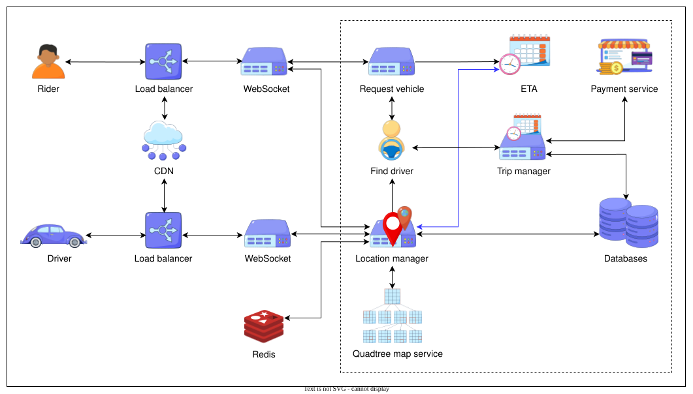

# Detailed_Design_of_Uber

Source: https://www.educative.io/courses/grokking-the-system-design-interview/detailed-design-of-uber

---

[Home](https://www.educative.io/)

[Courses](https://www.educative.io/search?tab=courses)

[Grokking Modern System Design Interview](https://www.educative.io/courses/grokking-the-system-design-interview)

# Detailed Design of Uber

Define the detailed architecture required for a scalable ride-hailing service like Uber. Analyze how real-time location tracking using quadtrees and caching (Redis) is implemented. Learn to select appropriate databases (MySQL and Cassandra) and to design for fault tolerance to achieve high availability.

We'll cover the following...

- [Components](https://www.educative.io/courses/grokking-the-system-design-interview/detailed-design-of-uber#Components)
  - [Location manager](https://www.educative.io/courses/grokking-the-system-design-interview/detailed-design-of-uber#Location-manager)
  - [Quadtree map service](https://www.educative.io/courses/grokking-the-system-design-interview/detailed-design-of-uber#Quadtree-map-service)
  - [Request vehicle](https://www.educative.io/courses/grokking-the-system-design-interview/detailed-design-of-uber#Request-vehicle)
  - [Find driver](https://www.educative.io/courses/grokking-the-system-design-interview/detailed-design-of-uber#Find-driver)
  - [Trip manager](https://www.educative.io/courses/grokking-the-system-design-interview/detailed-design-of-uber#Trip-manager)
  - [ETA service](https://www.educative.io/courses/grokking-the-system-design-interview/detailed-design-of-uber#ETA-service)
    - [AI-powered ETA prediction](https://www.educative.io/courses/grokking-the-system-design-interview/detailed-design-of-uber#AI-powered-ETA-prediction)
  - [Database](https://www.educative.io/courses/grokking-the-system-design-interview/detailed-design-of-uber#Database)
    - [Storage schema](https://www.educative.io/courses/grokking-the-system-design-interview/detailed-design-of-uber#Storage-schema)
  - [Fault tolerance](https://www.educative.io/courses/grokking-the-system-design-interview/detailed-design-of-uber#Fault-tolerance)
  - [Load balancers](https://www.educative.io/courses/grokking-the-system-design-interview/detailed-design-of-uber#Load-balancers)
  - [Content delivery network (CDN)](https://www.educative.io/courses/grokking-the-system-design-interview/detailed-design-of-uber#Content-delivery-network-CDN)
  - [Cache](https://www.educative.io/courses/grokking-the-system-design-interview/detailed-design-of-uber#Cache)

Let’s look at the detailed design of our Uber system and learn how the various components work together to offer a functioning service:

The detailed design of Uber

## Components[#](https://www.educative.io/courses/grokking-the-system-design-interview/detailed-design-of-uber#Components)

Let’s discuss the components of our Uber system design in detail.

### Location manager[#](https://www.educative.io/courses/grokking-the-system-design-interview/detailed-design-of-uber#Location-manager)

Riders and drivers connect to the **location manager** service. It shows nearby drivers when a rider opens the app, independent of requesting a ride, and receives driver location updates every ~4 seconds. The service forwards driver locations to the quadtree map service to determine the driver’s current map segment. It also stores each driver’s latest location and, during trips, records the route taken.

### Quadtree map service[#](https://www.educative.io/courses/grokking-the-system-design-interview/detailed-design-of-uber#Quadtree-map-service)

The **quadtree map service** updates the driver locations. The main problem is how we efficiently find nearby drivers.

We’ll modify the solution discussed in the [Yelp](https://www.educative.io/courses/grokking-the-system-design-interview/system-design-yelp) chapter according to our requirements. We used quadtrees on Yelp to find the location. Quadtrees partition the map into hierarchical spatial regions. When the number of drivers in a region exceeds a predefined threshold, the node is subdivided into four child regions, and the drivers are redistributed accordingly.

Each leaf node in quadtrees contains segments that can’t be divided further. We can use the same quadtrees for finding the drivers. The most significant difference we have now is that our quadtree wasn’t designed with regular upgrades in consideration. So, we have the following issues with our dynamic segment solution.

The data structures must handle location updates from active drivers approximately every 4 seconds. Each location update may require modifying the quadtree, which adds update overhead. To process an update, the system determines the driver’s current region based on the previous position. If the driver crosses region boundaries, the system removes the entry from the previous region and inserts it into the new region. If the updated region exceeds the configured driver threshold, it is subdivided further. In addition, the system must stream real-time location updates to both the driver and the rider during the trip.

To overcome the above problem, we can use a hash table to store each driver's latest position and update our quadtree every 10–15 seconds. We can update the driver’s location in the quadtree every 15 seconds instead of every 4 seconds, and we use a hash table that updates every 4 seconds and reflects the driver’s latest location. By doing this, we use fewer resources and time.

Updating driver’s location

### Request vehicle[#](https://www.educative.io/courses/grokking-the-system-design-interview/detailed-design-of-uber#Request-vehicle)

The rider contacts the **request vehicle** service to request a ride. The rider adds the drop-off location here. The request vehicle service then communicates with the find driver service to book a vehicle and retrieve its details using the location manager service.

### Find driver[#](https://www.educative.io/courses/grokking-the-system-design-interview/detailed-design-of-uber#Find-driver)

The **find driver** service finds the driver who can complete the trip. It sends the selected driver's information and trip details back to the request vehicle service to communicate them to the rider. The find driver service also contacts the trip manager to manage the trip information.

### Trip manager[#](https://www.educative.io/courses/grokking-the-system-design-interview/detailed-design-of-uber#Trip-manager)

The **trip manager** service manages all the trip-related tasks. It creates a trip record in the database and stores all the trip information.

### ETA service[#](https://www.educative.io/courses/grokking-the-system-design-interview/detailed-design-of-uber#ETA-service)

The **ETA service** deals with the estimated time of arrival. It shows riders the pickup ETA when their trip is scheduled. This service considers factors such as route and traffic. The two basic components of predicting an ETA given an origin and destination on a road network are the following:

- Calculate the shortest route from the origin to the destination.
- Compute the time required to travel the route.

The whole road network is represented as a graph. Intersections are represented by nodes, while edges represent road segments. The graph also depicts one-way streets, turn limitations, and speed limits.

Graph representation

To identify the shortest path between source and destination, we can utilize routing algorithms such as Dijkstra’s algorithm. However, Dijkstra, or any other algorithm that operates on top of an unprocessed graph, is quite slow for such a system. Therefore, this method is impractical at the scale at which these ride-hailing platforms operate.

To resolve these issues, we can split the whole graph into partitions. We preprocess the optimal path within partitions using **contraction hierarchies** and handle only the partition boundaries. This strategy reduces query latency by partitioning the graph into smaller, mostly independent cells. The preprocessing stage can be executed in parallel across partitions to accelerate computation. In this model, partitions compute candidate routes in parallel. For example, if each partition requires approximately one second to compute its segment, the overall response time approaches one second, assuming balanced workloads and minimal coordination overhead.

Partitioning the graph

Once we determine the best route, we calculate the expected travel time along the road segment, accounting for traffic. The traffic data will be the edge weights between the nodes.

#### AI-powered ETA prediction[#](https://www.educative.io/courses/grokking-the-system-design-interview/detailed-design-of-uber#AI-powered-ETA-prediction)

The routing engine estimates travel time from the road graph and current traffic. However, real trips are affected by things the graph doesn’t capture, such as pickup delays at airports or how traffic changes during the trip. To handle this, Uber adds machine learning in two places.

The first is traffic forecasting. A model called [**DeepETT**](https://www.uber.com/us/en/blog/scaling-real-time-traffic/) predicts how long each road segment will take to traverse in the near future, and the routing engine uses these forecasts to choose the fastest route. The second is ETA correction. A model called [**DeepETA**](https://www.uber.com/us/en/blog/deepeta-how-uber-predicts-arrival-times/) takes the routing engine’s estimate and predicts the correction needed to match the actual travel time, using features such as the origin, destination, request time, and real-time traffic. The final ETA is the routing estimate plus this correction. DeepETA must respond within a few milliseconds, so we keep it small and fast.

This is similar to the Google Maps design, where a prediction feeds the routing decision. At Uber’s scale, two things need extra care:

- **Fresh traffic data:** Driver phones report GPS locations every few seconds. A streaming pipeline maps these points to road segments and turns them into travel-time measurements, which update the traffic forecasts. Fresher data improves accuracy but costs more compute, so we aggregate measurements over short windows and ignore data that is too old.
- **Model dependencies:** DeepETA learns to correct the routing engine as it behaved during training. If DeepETT improves and the routing engine’s estimates shift, DeepETA’s corrections may no longer fit, and the final ETA can get worse even though an upstream model got better. To catch this, we log each predicted ETA with the model versions used and compare it with the actual arrival time. We then measure accuracy by region and time of day, use the results to recalibrate DeepETA, and check them before rolling out upstream model changes.

If the prediction service is slow or unavailable, the ETA service returns the routing engine’s estimate on its own, so riders always see an ETA.

The following diagram shows how location data, forecasts, and outcomes connect.

Predicting ETAs with DeepETT and DeepETA

### Database[#](https://www.educative.io/courses/grokking-the-system-design-interview/detailed-design-of-uber#Database)

Let’s select the database according to our requirements:

- The database must scale horizontally. There are new customers and drivers on a regular basis, so we should be able to add more storage without any problems.
- The database should handle a large number of reads and writes, as driver locations are updated every 4 seconds.
- Our system should never be down.

We’ve already discussed the various database types and their specifications in the [Database](https://www.educative.io/courses/grokking-the-system-design-interview/introduction-to-databases) chapter. Based on our understanding and requirements (high availability, high scalability, and fault tolerance), we can use Cassandra to store the driver’s last known location and trip information after the trip is complete, with no further updates. We use Cassandra because the data we store is enormous and continues to grow.

We can use a MySQL database to store trip information while it’s in progress. We use MySQL for in-progress trips to support frequent updates, since the trip information is relational and must be consistent across tables.

> **Note:** Recently, Uber migrated their data storage to Google Cloud Spanner. It provides global transactions, strongly consistent reads, and automatic multisite replication and failover features.

AI Powered

Saved

1 attempt left

Reset

Why can't we use only MySQL or only a Cassandra database?

We’re using both MySQL and Cassandra databases in Uber’s design. Why can’t we use only MySQL or only a Cassandra database? In other words, what is the need for using both databases?

This is your last attempt.

#### Storage schema[#](https://www.educative.io/courses/grokking-the-system-design-interview/detailed-design-of-uber#Storage-schema)

On a basic level, in the Uber application, we need the following tables:

- **Riders:** We store riders’ information, including ID, name, email, photo, phone number, and more.
- **Drivers:** We store driver-related information, such as ID, name, email, photo, phone number, vehicle name, vehicle type, and so on.
- **Driver\_location:** We store the driver’s last known location.
- **Trips:** We store trip-related information, such as trip ID, rider ID, driver ID, status, ETA, vehicle location, and so on.

The following illustration visualizes the data model:

The storage schema

### Fault tolerance[#](https://www.educative.io/courses/grokking-the-system-design-interview/detailed-design-of-uber#Fault-tolerance)

For availability, we need database replicas. We use the primary-secondary replication model. We have one primary database and a few secondary databases. We synchronously replicate data from primary to secondary databases. Whenever our primary database is down, we can use a secondary database as the primary one.

1.

How will we handle a driver’s slow and disconnected network?

Show Answer

Did you find this helpful?

### Load balancers[#](https://www.educative.io/courses/grokking-the-system-design-interview/detailed-design-of-uber#Load-balancers)

We use load balancers between clients (drivers and riders) and the application servers to evenly distribute load across servers. The requests are routed to the specified server that provides the requested service.

### Content delivery network (CDN)[#](https://www.educative.io/courses/grokking-the-system-design-interview/detailed-design-of-uber#Content-delivery-network-CDN)

We use a CDN to cache and serve static content, such as app assets, images, and other UI resources, from edge locations closer to the user. Because this content is the same for everyone and rarely changes, serving it from a nearby edge reduces latency and offloads traffic from our application servers. This is separate from the real-time WebSocket connection, which carries live, per-user data such as driver locations and trip updates that can't be cached.

### Cache[#](https://www.educative.io/courses/grokking-the-system-design-interview/detailed-design-of-uber#Cache)

One million drivers may push location updates approximately every four seconds. This generates sustained write pressure on the quadtree service and can degrade its performance. To absorb this load, location updates are first written to a Redis hash for fast, in-memory ingestion. The updates are then flushed to persistent storage in batches every 10 to 15 seconds.

We’ve discussed the detailed design of Uber and how different components work together to fulfill the requirements. In the next lesson, we’ll learn how the payment service works to move the money from riders to drivers and detect fraud.

High-level Design of Uber

Payment Service and Fraud Detection in Uber Design

Ask

[Components](https://www.educative.io/courses/grokking-the-system-design-interview/detailed-design-of-uber#Components)

[Location manager](https://www.educative.io/courses/grokking-the-system-design-interview/detailed-design-of-uber#Location-manager)

[Quadtree map service](https://www.educative.io/courses/grokking-the-system-design-interview/detailed-design-of-uber#Quadtree-map-service)

[Request vehicle](https://www.educative.io/courses/grokking-the-system-design-interview/detailed-design-of-uber#Request-vehicle)

[Find driver](https://www.educative.io/courses/grokking-the-system-design-interview/detailed-design-of-uber#Find-driver)

[Trip manager](https://www.educative.io/courses/grokking-the-system-design-interview/detailed-design-of-uber#Trip-manager)

[ETA service](https://www.educative.io/courses/grokking-the-system-design-interview/detailed-design-of-uber#ETA-service)

[AI-powered ETA prediction](https://www.educative.io/courses/grokking-the-system-design-interview/detailed-design-of-uber#AI-powered-ETA-prediction)

[Database](https://www.educative.io/courses/grokking-the-system-design-interview/detailed-design-of-uber#Database)

[Storage schema](https://www.educative.io/courses/grokking-the-system-design-interview/detailed-design-of-uber#Storage-schema)

[Fault tolerance](https://www.educative.io/courses/grokking-the-system-design-interview/detailed-design-of-uber#Fault-tolerance)

[Load balancers](https://www.educative.io/courses/grokking-the-system-design-interview/detailed-design-of-uber#Load-balancers)

[Content delivery network (CDN)](https://www.educative.io/courses/grokking-the-system-design-interview/detailed-design-of-uber#Content-delivery-network-CDN)

[Cache](https://www.educative.io/courses/grokking-the-system-design-interview/detailed-design-of-uber#Cache)