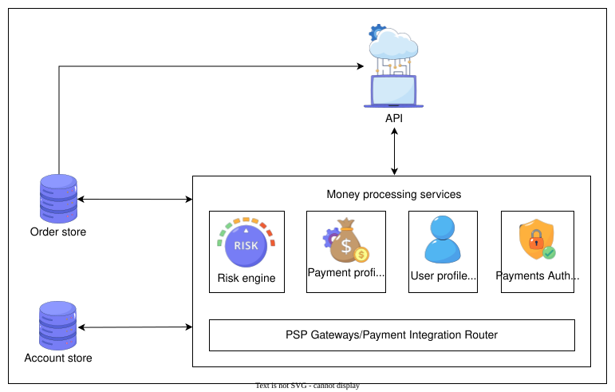

# Payment_Service_and_Fraud_Detection_in_Uber_Design

Source: https://www.educative.io/courses/grokking-the-system-design-interview/payment-service-and-fraud-detection-in-uber-design

---

[Home](https://www.educative.io/)

[Courses](https://www.educative.io/search?tab=courses)

[Grokking Modern System Design Interview](https://www.educative.io/courses/grokking-the-system-design-interview)

# Payment Service and Fraud Detection in Uber Design

Discover how to design Uber’s payment service using double-entry bookkeeping and asynchronous Kafka processing. Understand the necessity of real-time fraud detection and explore how the human-assisted RADAR system mitigates financial risk across transactions.

We'll cover the following...

- [Major functionality](https://www.educative.io/courses/grokking-the-system-design-interview/payment-service-and-fraud-detection-in-uber-design#Major-functionality)
- [What to prevent](https://www.educative.io/courses/grokking-the-system-design-interview/payment-service-and-fraud-detection-in-uber-design#What-to-prevent)
- [Design](https://www.educative.io/courses/grokking-the-system-design-interview/payment-service-and-fraud-detection-in-uber-design#Design)
  - [Workflow](https://www.educative.io/courses/grokking-the-system-design-interview/payment-service-and-fraud-detection-in-uber-design#Workflow)
  - [Apache Kafka](https://www.educative.io/courses/grokking-the-system-design-interview/payment-service-and-fraud-detection-in-uber-design#Apache-Kafka)
- [Fraud detection](https://www.educative.io/courses/grokking-the-system-design-interview/payment-service-and-fraud-detection-in-uber-design#Fraud-detection)
  - [RADAR](https://www.educative.io/courses/grokking-the-system-design-interview/payment-service-and-fraud-detection-in-uber-design#RADAR)

This lesson focuses on securing the system against abuse and fraudulent activity. It analyzes the payment workflow and outlines mechanisms to mitigate payment fraud. The payment service handles financial transactions, including charging riders and disbursing earnings to drivers. After a trip is completed, the service aggregates trip data, computes the fare, and initiates the payment transaction.

## Major functionality[#](https://www.educative.io/courses/grokking-the-system-design-interview/payment-service-and-fraud-detection-in-uber-design#Major-functionality)

The Uber payments platform includes the following functionality:

- **New payment options:** Integrates new payment methods for users.
- **Authorization:** Authorizes payments to verify transaction validity.
- **Refund:** Returns previously authorized payments.
- **Charging:** Transfers funds from a user account to Uber.

## What to prevent[#](https://www.educative.io/courses/grokking-the-system-design-interview/payment-service-and-fraud-detection-in-uber-design#What-to-prevent)

To ensure the success of the payment system, we must prevent the following scenarios:

- Lack of payment
- Duplicate payments
- Incorrect payment amounts
- Incorrect currency conversion
- Dangling authorizations

The platform utilizes the double-entry bookkeeping method to maintain financial accuracy.

## Design[#](https://www.educative.io/courses/grokking-the-system-design-interview/payment-service-and-fraud-detection-in-uber-design#Design)

Let’s examine the design of the payment platform and how its components collaborate to complete transactions:

The payment platform in Uber

The key components of the payment service are:

- **API:** The entry point for accessing the payment service.
- **Order store:** Persists order details and tracks money flow between riders and drivers.
- **Account store:** Manages rider and driver accounts.
- **Risk engine:** Analyzes transaction risks by checking rider history, ratings, fund availability, pending dues, and cancellation frequency.
- **Payment profile service:** Manages payment method details, such as credit and debit cards.
- **User profile service:** Provides user-specific payment information.
- **Payment authorization service:** Handles payment authentication.
- **PSP gateways:** Interfaces with external payment service providers (PSPs).

### Workflow[#](https://www.educative.io/courses/grokking-the-system-design-interview/payment-service-and-fraud-detection-in-uber-design#Workflow)

The payment service workflow proceeds as follows:

1. When a rider requests a ride, the Uber API queries the risk engine to assess potential risks.
2. The risk engine retrieves user data from the user profile service and evaluates the request.
3. If risks are high, the request is rejected.
4. If the risk is low, the risk engine generates an authorization token. The payment profile service records this token and forwards it to the payment authorization service.
5. The payment authorization service sends the request to the PSP gateway, which contacts the provider for authorization.
6. Upon approval, the PSP gateway returns the token to the payment authorization service, which confirms the trip request to the Uber application.
7. After the trip is completed, the application sends a payment request with authorization data to the PSP gateway via the API.
8. The PSP gateway processes the payment with the provider and returns the status to the application.

The Uber payment service uses a microservices architecture organized into stream-processing groups.

### Apache Kafka[#](https://www.educative.io/courses/grokking-the-system-design-interview/payment-service-and-fraud-detection-in-uber-design#Apache-Kafka)

**Kafka** is an open-source stream-processing platform and the primary technology used in the payment service.

Payment service with Kafka

Kafka facilitates order processing through the following sequence:

1. The **order creator** receives a business event (e.g., trip completion), generates money movement metadata, and publishes it to Kafka.
2. The **order processor** consumes the event, processes it, and publishes an intent back to Kafka.
3. The order processor executes the intent by contacting the PSP.
4. The PSP response is published to Kafka as a result.
5. The **order writer** persists result.

The payment service leverages the following Kafka capabilities:

- Pub-sub message queuing
- Fault-tolerant record storage
- Asynchronous payment record processing

## Fraud detection[#](https://www.educative.io/courses/grokking-the-system-design-interview/payment-service-and-fraud-detection-in-uber-design#Fraud-detection)

Fraud detection is a critical component of the payment and trust infrastructure. Although fraud represents a small fraction of gross bookings, it can result in disproportionate revenue loss. If not detected and mitigated early, fraudulent behavior can scale rapidly and increase systemic risk. The risk engine performs pre-trip screening, whereas this section addresses fraud detection during and after trip completion.

Detecting fraud is challenging because methods evolve, as with zero-day security exploits. Our system requires intelligence to detect anomalies and human-led audits to ensure accountability for automated decisions.

Uber considers the following activities to be fraudulent:

- Deliberately increasing trip time or distance (e.g., taking inefficient routes).
- Manipulating GPS data or using fake location apps.
- Confirming trips without intent to complete them, forcing rider cancellations.
- Creating fake driver or rider accounts.
- Providing false personal information during account creation.
- Driving an unapproved vehicle.
- Claiming unwarranted fees, such as cleaning fees.
- Willfully confirming or completing fraudulent trips.

**Note:** The general pattern of scoring payments for fraud, turning scores into actions with explicit policies, and learning from delayed chargebacks is covered later, in the Payment System chapter. This section focuses on how Uber applies it.

### RADAR[#](https://www.educative.io/courses/grokking-the-system-design-interview/payment-service-and-fraud-detection-in-uber-design#RADAR)

Uber introduced **RADAR**, a human-assisted AI solution, to mitigate these fraud scenarios. RADAR analyzes activity time series to generate blocking rules, proactively stopping unseen fraud in real time. The model incorporates human knowledge for continuous improvement.

The RADAR fraud detection solution

RADAR identifies potential fraud attempts and generates prevention rules. A fraud analyst then reviews these rules to approve or reject them. This feedback is sent to the protection system to enforce decisions and back to the detection model to improve future accuracy.

The system examines data across two time dimensions:

- **Trip time:** Real-time monitoring of trip completion. For example, the system checks if driver and rider locations match, or analyzes traffic data to distinguish between intentional slowing and actual congestion.
- **Payment settlement time:** Analysis of payment processing data, which may take days or weeks to settle.

Mitigating malicious activity at scale is essential for maintaining platform integrity and financial stability. Although the proposed model incorporates human review, which limits horizontal scalability, this oversight improves decision quality and reduces false positives. Ongoing research focuses on improving model transparency, bias mitigation, and auditability to ensure fair decision-making.

Detailed Design of Uber

Evaluation of Uber’s Design

Ask

[Major functionality](https://www.educative.io/courses/grokking-the-system-design-interview/payment-service-and-fraud-detection-in-uber-design#Major-functionality)

[What to prevent](https://www.educative.io/courses/grokking-the-system-design-interview/payment-service-and-fraud-detection-in-uber-design#What-to-prevent)

[Design](https://www.educative.io/courses/grokking-the-system-design-interview/payment-service-and-fraud-detection-in-uber-design#Design)

[Workflow](https://www.educative.io/courses/grokking-the-system-design-interview/payment-service-and-fraud-detection-in-uber-design#Workflow)

[Apache Kafka](https://www.educative.io/courses/grokking-the-system-design-interview/payment-service-and-fraud-detection-in-uber-design#Apache-Kafka)

[Fraud detection](https://www.educative.io/courses/grokking-the-system-design-interview/payment-service-and-fraud-detection-in-uber-design#Fraud-detection)

[RADAR](https://www.educative.io/courses/grokking-the-system-design-interview/payment-service-and-fraud-detection-in-uber-design#RADAR)