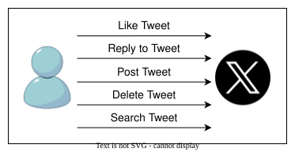
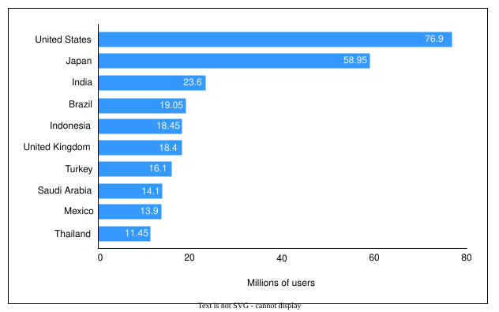

# System_Design_Twitter

Source: https://www.educative.io/courses/grokking-the-system-design-interview/system-design-twitter

---

[Home](https://www.educative.io/)

[Courses](https://www.educative.io/search?tab=courses)

[Grokking Modern System Design Interview](https://www.educative.io/courses/grokking-the-system-design-interview)

# System Design: Twitter

Explore the foundational aspects of the X (previously Twitter) platform, including its core features and scale. Define the structured approach used for this System Design case study, focusing on requirements, high-level architecture, and specialized client-side load balancing.

We'll cover the following...

- [Twitter](https://www.educative.io/courses/grokking-the-system-design-interview/system-design-twitter#Twitter)
- [How will we design Twitter?](https://www.educative.io/courses/grokking-the-system-design-interview/system-design-twitter#How-will-we-design-Twitter)

## Twitter[#](https://www.educative.io/courses/grokking-the-system-design-interview/system-design-twitter#Twitter)

**Twitter** is a microblogging platform where users publish short posts referred to as **tweets**. Users engage with posts through likes, replies, and reposts. The platform serves hundreds of millions of monthly active users. The architecture must support rapid information propagation, especially during high-traffic events such as breaking news.

A user performs various operations on Twitter

The illustration below shows Twitter’s user base by country as of January 2022 (source: Statista), with the US accounting for the largest segment. Geographic distribution statistics are vital for infrastructure design. They guide capacity planning and help us reduce latency by serving traffic from regions closer to users.

Country wise userbase on Twitter

## How will we design Twitter?[#](https://www.educative.io/courses/grokking-the-system-design-interview/system-design-twitter#How-will-we-design-Twitter)

We will divide the design process into four sections:

1. [**Requirements**](https://www.educative.io/courses/grokking-the-system-design-interview/requirements-of-twitters-design)**:** Define the functional and non-functional requirements. We also estimate storage, bandwidth, and computational resource needs.
2. [**Design**](https://www.educative.io/courses/grokking-the-system-design-interview/high-level-design-of-twitter)**:** Cover the high-level design, API structure, and major architectural components. We also discuss managing the Top-k problem for viral content, such as tweets with millions of views.
3. [**Client-side load balancers**](https://www.educative.io/courses/grokking-the-system-design-interview/client-side-load-balancer-for-twitter)**:** Explain how Twitter balances billions of requests across its microservices. We analyze why Twitter uses a customized load-balancing approach rather than standard techniques.
4. [**Quiz**](https://www.educative.io/courses/grokking-the-system-design-interview/quiz-on-twitters-design)**:** Reinforce the core design concepts with a quiz.

Let’s begin by defining the requirements.

Uber Eats System Design

Requirements of Twitter’s Design

Ask

[Twitter](https://www.educative.io/courses/grokking-the-system-design-interview/system-design-twitter#Twitter)

[How will we design Twitter?](https://www.educative.io/courses/grokking-the-system-design-interview/system-design-twitter#How-will-we-design-Twitter)