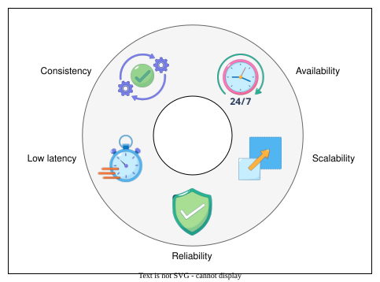

# Requirements_of_Twitter’s_Design

Source: https://www.educative.io/courses/grokking-the-system-design-interview/requirements-of-twitters-design

---

[Home](https://www.educative.io/)

[Courses](https://www.educative.io/search?tab=courses)

[Grokking Modern System Design Interview](https://www.educative.io/courses/grokking-the-system-design-interview)

# Requirements of Twitter’s Design

Explore the critical functional and non-functional requirements that define the scope of the Twitter System Design. Analyze constraints like scalability, consistency, and latency to inform architectural decisions for a massive, read-heavy platform.

We'll cover the following...

- [Requirements](https://www.educative.io/courses/grokking-the-system-design-interview/requirements-of-twitters-design#Requirements)
  - [Functional requirements](https://www.educative.io/courses/grokking-the-system-design-interview/requirements-of-twitters-design#Functional-requirements)
  - [Non-functional requirements](https://www.educative.io/courses/grokking-the-system-design-interview/requirements-of-twitters-design#Non-functional-requirements)

## Requirements[#](https://www.educative.io/courses/grokking-the-system-design-interview/requirements-of-twitters-design#Requirements)

We will outline the system’s functional and non-functional requirements below.

### Functional requirements[#](https://www.educative.io/courses/grokking-the-system-design-interview/requirements-of-twitters-design#Functional-requirements)

The system must support the following core features:

- **Post tweets:** Users can publish messages containing text and media.
- **Delete tweets:** Users can remove their own content.
- **Like or dislike:** Users can engage with tweets by liking or disliking them.
- **Reply:** Users can reply to public tweets.
- **Search:** Users can search for content using keywords, hashtags, or usernames.
- **View timelines:** Users can view the home timeline and the user timeline (their own tweet history). The home timeline is ranked: it mixes tweets from followed accounts with recommended tweets and orders them by predicted interest, while respecting blocks, mutes, and visibility rules.
- **Follow or unfollow:** Users can follow or unfollow other accounts.
- **Retweet:** Users can share other users’ public tweets.

### Non-functional requirements[#](https://www.educative.io/courses/grokking-the-system-design-interview/requirements-of-twitters-design#Non-functional-requirements)

- **Availability:** The service must be highly available. As Twitter is often used for time-sensitive communication during emergencies, uptime is critical.
- **Latency:** The system must deliver feeds quickly to ensure a smooth user experience. While complex feed generation can run asynchronously, the read path must remain fast. Ranking must stay within the timeline’s latency budget, with a simpler ordering strategy available if ranking models become unavailable.
- **Scalability:** The workload is read-heavy, with an estimated 1:1000 write-to-read ratio. The system must scale computationally to handle high traffic and provide massive media storage capacity.
- **Reliability:** Data durability is essential. The system must ensure that uploaded content is never lost or corrupted.
- **Consistency:** We can accept `eventual consistency` for the system’s global view. For example, a user in the US East region might see a tweet slightly before a user in the US West. However, the system must provide immediate feedback to the user acting (e.g., a user must see their own like or reply instantly).

Non-functional requirements of Twitter

We previously used Twitter as a case study in the [back-of-the-envelope](https://www.educative.io/courses/grokking-the-system-design-interview/put-back-of-the-envelope-numbers-in-perspective) chapter. We will not repeat the resource estimation exercise here; instead, we will focus directly on the system components.

Building blocks used in Twitter design

- [**DNS**](https://www.educative.io/courses/grokking-the-system-design-interview/introduction-to-domain-name-system-dns)**:** Maps human-readable domain names to IP addresses.
- [**Load balancers**](https://www.educative.io/courses/grokking-the-system-design-interview/introduction-to-load-balancers)**:** Distribute read and write requests across services to ensure balanced utilization.
- [**Sequencers**](https://www.educative.io/courses/grokking-the-system-design-interview/system-design-sequencer)**:** Generate unique, time-sortable IDs for tweets.
- [**Databases**](https://www.educative.io/courses/grokking-the-system-design-interview/introduction-to-databases)**:** Store metadata for tweets and user profiles.
- [**Blob stores**](https://www.educative.io/courses/grokking-the-system-design-interview/system-design-a-blob-store)**:** Store large media files, such as images and videos.
- [**Key-value stores**](https://www.educative.io/courses/grokking-the-system-design-interview/system-design-the-key-value-store)**:** Handle high-speed lookups for indexes, caches, and user-specific data.
- [**Pub-sub**](https://www.educative.io/courses/grokking-the-system-design-interview/system-design-the-pub-sub-abstraction)**:** Facilitates asynchronous processing and real-time updates.
- [**Sharded counters**](https://www.educative.io/courses/grokking-the-system-design-interview/system-design-the-sharded-counters)**:** Manage high-volume counts (e.g., likes, retweets) for popular accounts to prevent write contention.
- [**Cache**](https://www.educative.io/courses/grokking-the-system-design-interview/system-design-the-distributed-cache)**:** Stores frequently accessed data in RAM to minimize latency.
- [**CDN**](https://www.educative.io/courses/grokking-the-system-design-interview/system-design-the-content-delivery-network-cdn)**:** Caches and delivers static content closer to end-users.
- [**Monitoring**](https://www.educative.io/courses/grokking-the-system-design-interview/system-design-distributed-monitoring)**:** Tracks traffic, identifies failures, and analyzes system health.

In the next lesson, we will discuss the detailed design of the Twitter system.

System Design: Twitter

High-level Design of Twitter

Ask

[Requirements](https://www.educative.io/courses/grokking-the-system-design-interview/requirements-of-twitters-design#Requirements)

[Functional requirements](https://www.educative.io/courses/grokking-the-system-design-interview/requirements-of-twitters-design#Functional-requirements)

[Non-functional requirements](https://www.educative.io/courses/grokking-the-system-design-interview/requirements-of-twitters-design#Non-functional-requirements)