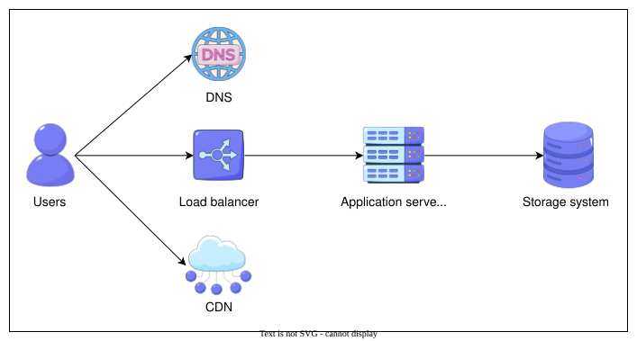

# High-level_Design_of_Twitter

Source: https://www.educative.io/courses/grokking-the-system-design-interview/high-level-design-of-twitter

---

[Home](https://www.educative.io/)

[Courses](https://www.educative.io/search?tab=courses)

[Grokking Modern System Design Interview](https://www.educative.io/courses/grokking-the-system-design-interview)

# High-level Design of Twitter

Define the initial high-level System Design for Twitter by mapping user interactions to core building blocks. Learn to specify precise API endpoints for all major features, including posting, searching, and viewing timelines.

We'll cover the following...

- [User-system interaction](https://www.educative.io/courses/grokking-the-system-design-interview/high-level-design-of-twitter#User-system-interaction)
- [API design](https://www.educative.io/courses/grokking-the-system-design-interview/high-level-design-of-twitter#API-design)
  - [Post tweet](https://www.educative.io/courses/grokking-the-system-design-interview/high-level-design-of-twitter#Post-tweet)
  - [Like or dislike tweet](https://www.educative.io/courses/grokking-the-system-design-interview/high-level-design-of-twitter#Like-or-dislike-tweet)
  - [Search tweet](https://www.educative.io/courses/grokking-the-system-design-interview/high-level-design-of-twitter#Search-tweet)
    - [Response](https://www.educative.io/courses/grokking-the-system-design-interview/high-level-design-of-twitter#Response)
  - [View home\_timeline](https://www.educative.io/courses/grokking-the-system-design-interview/high-level-design-of-twitter#View-hometimeline)
  - [Follow the account](https://www.educative.io/courses/grokking-the-system-design-interview/high-level-design-of-twitter#Follow-the-account)
  - [Retweet a tweet](https://www.educative.io/courses/grokking-the-system-design-interview/high-level-design-of-twitter#Retweet-a-tweet)

## User-system interaction[#](https://www.educative.io/courses/grokking-the-system-design-interview/high-level-design-of-twitter#User-system-interaction)

We begin with the high-level design of the Twitter system, identifying key building blocks and components. We will explore specific components in detail later in this chapter.

Twitter components

- **Users** post tweets via the load balancer to application servers for persistent storage.
- **DNS** resolves domain names to IP addresses for communication between services.
- **CDN** serves frequently requested content from edge servers to reduce latency.
- A **load balancer** distributes requests to application servers based on traffic and availability.
- The **storage system** includes SQL and NoSQL databases to store different types of data. We will discuss specific storage systems later.
- **Application servers** execute business logic and orchestrate component interactions.

Detailed discussions on [DNS](https://www.educative.io/courses/grokking-the-system-design-interview/introduction-to-domain-name-system-dns), [CDN](https://www.educative.io/courses/grokking-the-system-design-interview/system-design-the-content-delivery-network-cdn), storage systems ([Databases](https://www.educative.io/courses/grokking-the-system-design-interview/introduction-to-databases), [Key-value store](https://www.educative.io/courses/grokking-the-system-design-interview/system-design-the-key-value-store), [blob store](https://www.educative.io/courses/grokking-the-system-design-interview/system-design-a-blob-store)), and [load balancers](https://www.educative.io/courses/grokking-the-system-design-interview/introduction-to-load-balancers) are available in the building blocks section. This lesson focuses on Twitter-specific details, starting with the API design.

## API design[#](https://www.educative.io/courses/grokking-the-system-design-interview/high-level-design-of-twitter#API-design)

This section defines the APIs through which users access system services. Only the parameters relevant to the system design are included. In practice, the frontend may orchestrate multiple downstream APIs or augment requests with additional parameters. For simplicity, each use case here is represented as a single consolidated API call. The following APIs cover the primary functional requirements of the system:

### Post tweet[#](https://www.educative.io/courses/grokking-the-system-design-interview/high-level-design-of-twitter#Post-tweet)

The POST method is used to send the tweet to the server from the user through the `/postTweet` API.

Ace Editor

1

postTweet(user\_id, access\_type, tweet\_type, content, tweet\_length, media\_field, post\_time, tweet\_location, list\_of\_used\_hashtags, list\_of\_tagged\_people)

הההההההההההההההההההההההההההההההההההההההההההההההההההההההההההההההההההההההההההההההההההההההההההההההההההההההההההההההההההההההההההההההההההההההההההההההההההההההההההההההההההההההההההההההההההההההההההההההההההההההההההההההההההההההההההההההההההההההההההההההההההההההההההההההההההההההההההההההההההההההההההההההההההההההההההההההההההההההההההההההההההההההההההההההההההההההההההההההההההההההההההההההההההההההההההההההההההההההההההההההההההההההההההההההההההההההההההההההההההההההההההההההההההההההההההההההההההההההההההההההההההההההההההההההההההההההההההההההה

XXXXXXXXXXXXXXXXXXXXXXXXXXXXXXXXXXXXXXXXXXXXXXXXXXXXXXXXXXXXXXXXXXXXXXXXXXXXXXXXXXXXXXXXXXXXXXXXXXXXXXXXXXXXXXXXXXXXXXXXXXXXXXXXXXXXXXXXXXXXXXXXXXXXXXXXXXXXXXXXXXXXXXXXXXXXXXXXXXXXXXXXXXXXXXXXXXXXXXXXXXXXXXXXXXXXXXXXXXXXXXXXXXXXXXXXXXXXXXXXXXXXXXXXXXXXXXXXXXXXXXXXXXXXXXXXXXXXXXXXXXXXXXXXXXXXXXXXXXXXXXXXXXXXXXXXXXXXXXXXXXXXXXXXXXXXXXXXXXXXXXXXXXXXXXXXXXXXXXXXXXXXXXXXXXXXXXXXXXXXXXXXXXXXXXXXXXXXXXXXXXXXXXXXXXXXXXXXXXXXXXXXXXXXXXXXXXXXXXXXXXXXXXXXXXXXXXXXXXXXXXXXXXXXXXXXXXXXXXXXXXXXXXXXXXXXXXXXXXXXXXXXXXXXXXXX

Key parameters include:

|  |  |
| --- | --- |
| **Parameter** | **Description** |
| `user_id` | It indicates the unique ID of the user who posted the tweet. |
| `access_type` | It tells us whether the tweet is protected (that is, only visible to followers) or public. |
| `tweet_type` | It indicates whether the tweet is text-based, video-clip-based, image(s)-based, or consists of different types. |
| `content` | It specifies the tweet’s actual content (text). |
| `tweet_length` | It represents the text length in the tweet. In the case of video, it tells us the duration and size of a video. |
| `media_field` | It specifies the type of media (image, video, GIF, and so on) delivered in each tweet. |

Other parameters are self-explanatory.

> **Note:** Twitter uses the **Snowflake** service to generate unique IDs for Tweets. The [Sequencer](https://www.educative.io/courses/grokking-the-system-design-interview/system-design-sequencer) chapter explains this service.

1.

At most, how many hashtags can a tweet have?

Show Answer

1 / 2

### Like or dislike tweet[#](https://www.educative.io/courses/grokking-the-system-design-interview/high-level-design-of-twitter#Like-or-dislike-tweet)

Users like tweets via the `/likeTweet` API.

Ace Editor

1

likeTweet(user\_id, tweet\_id, tweeted\_user\_id, user\_location)

הההההההההההההההההההההההההההההההההההההההההההההההההההההההההההההההההההההההההההההההההההההההההההההההההההההההההההההההההההההההההההההההההההההההההההההההההההההההההההההההההההההההההההההההההההההההההההההההההההההההההההההההההההההההההההההההההההההההההההההההההההההההההההההההההההההההההההההההההההההההההההההההההההההההההההההההההההההההההההההההההההההההההההההההההההההההההההההההההההההההההההההההההההההההההההההההההההההההההההההההההההההההההההההההההההההההההההההההההההההההההההההההההההההההההההההההההההההההההההההההההההההההההההההההההההההההההההההההה

XXXXXXXXXXXXXXXXXXXXXXXXXXXXXXXXXXXXXXXXXXXXXXXXXXXXXXXXXXXXXXXXXXXXXXXXXXXXXXXXXXXXXXXXXXXXXXXXXXXXXXXXXXXXXXXXXXXXXXXXXXXXXXXXXXXXXXXXXXXXXXXXXXXXXXXXXXXXXXXXXXXXXXXXXXXXXXXXXXXXXXXXXXXXXXXXXXXXXXXXXXXXXXXXXXXXXXXXXXXXXXXXXXXXXXXXXXXXXXXXXXXXXXXXXXXXXXXXXXXXXXXXXXXXXXXXXXXXXXXXXXXXXXXXXXXXXXXXXXXXXXXXXXXXXXXXXXXXXXXXXXXXXXXXXXXXXXXXXXXXXXXXXXXXXXXXXXXXXXXXXXXXXXXXXXXXXXXXXXXXXXXXXXXXXXXXXXXXXXXXXXXXXXXXXXXXXXXXXXXXXXXXXXXXXXXXXXXXXXXXXXXXXXXXXXXXXXXXXXXXXXXXXXXXXXXXXXXXXXXXXXXXXXXXXXXXXXXXXXXXXXXXXXXXXXXX

|  |  |
| --- | --- |
| **Parameter** | **Description** |
| `user_id` | It indicates the unique ID of the user who liked the tweet. |
| `tweet_id` | It indicates the tweet's unique ID. |
| `tweeted_user_id` | This is the unique ID of the user who posted the tweet. |
| `user_location` | It denotes the location of the user who liked the tweet. |

The `/dislikeTweet` API uses the same parameters.

Ace Editor

1

replyTweet(user\_id, tweet\_id, tweeted\_user\_id, reply\_type, reply\_content, reply\_length)

הההההההההההההההההההההההההההההההההההההההההההההההההההההההההההההההההההההההההההההההההההההההההההההההההההההההההההההההההההההההההההההההההההההההההההההההההההההההההההההההההההההההההההההההההההההההההההההההההההההההההההההההההההההההההההההההההההההההההההההההההההההההההההההההההההההההההההההההההההההההההההההההההההההההההההההההההההההההההההההההההההההההההההההההההההההההההההההההההההההההההההההההההההההההההההההההההההההההההההההההההההההההההההההההההההההההההההההההההההההההההההההההההההההההההההההההההההההההההההההההההההההההההההההההההההההההההההההההה

XXXXXXXXXXXXXXXXXXXXXXXXXXXXXXXXXXXXXXXXXXXXXXXXXXXXXXXXXXXXXXXXXXXXXXXXXXXXXXXXXXXXXXXXXXXXXXXXXXXXXXXXXXXXXXXXXXXXXXXXXXXXXXXXXXXXXXXXXXXXXXXXXXXXXXXXXXXXXXXXXXXXXXXXXXXXXXXXXXXXXXXXXXXXXXXXXXXXXXXXXXXXXXXXXXXXXXXXXXXXXXXXXXXXXXXXXXXXXXXXXXXXXXXXXXXXXXXXXXXXXXXXXXXXXXXXXXXXXXXXXXXXXXXXXXXXXXXXXXXXXXXXXXXXXXXXXXXXXXXXXXXXXXXXXXXXXXXXXXXXXXXXXXXXXXXXXXXXXXXXXXXXXXXXXXXXXXXXXXXXXXXXXXXXXXXXXXXXXXXXXXXXXXXXXXXXXXXXXXXXXXXXXXXXXXXXXXXXXXXXXXXXXXXXXXXXXXXXXXXXXXXXXXXXXXXXXXXXXXXXXXXXXXXXXXXXXXXXXXXXXXXXXXXXXXXX

Parameters `reply_type`, `reply_content`, and `reply_length` correspond to `tweet_type`, `content`, and `tweet_length`.

### Search tweet[#](https://www.educative.io/courses/grokking-the-system-design-interview/high-level-design-of-twitter#Search-tweet)

When the user searches for any keyword in the home timeline, the `/searchTweet` API is used as follows:

Ace Editor

1

searchTweet(user\_id, search\_term, max\_result, exclude, media\_field, expansions, sort\_order, next\_token, user\_location)

הההההההההההההההההההההההההההההההההההההההההההההההההההההההההההההההההההההההההההההההההההההההההההההההההההההההההההההההההההההההההההההההההההההההההההההההההההההההההההההההההההההההההההההההההההההההההההההההההההההההההההההההההההההההההההההההההההההההההההההההההההההההההההההההההההההההההההההההההההההההההההההההההההההההההההההההההההההההההההההההההההההההההההההההההההההההההההההההההההההההההההההההההההההההההההההההההההההההההההההההההההההההההההההההההההההההההההההההההההההההההההההההההההההההההההההההההההההההההההההההההההההההההההההההההההההההההההההההה

XXXXXXXXXXXXXXXXXXXXXXXXXXXXXXXXXXXXXXXXXXXXXXXXXXXXXXXXXXXXXXXXXXXXXXXXXXXXXXXXXXXXXXXXXXXXXXXXXXXXXXXXXXXXXXXXXXXXXXXXXXXXXXXXXXXXXXXXXXXXXXXXXXXXXXXXXXXXXXXXXXXXXXXXXXXXXXXXXXXXXXXXXXXXXXXXXXXXXXXXXXXXXXXXXXXXXXXXXXXXXXXXXXXXXXXXXXXXXXXXXXXXXXXXXXXXXXXXXXXXXXXXXXXXXXXXXXXXXXXXXXXXXXXXXXXXXXXXXXXXXXXXXXXXXXXXXXXXXXXXXXXXXXXXXXXXXXXXXXXXXXXXXXXXXXXXXXXXXXXXXXXXXXXXXXXXXXXXXXXXXXXXXXXXXXXXXXXXXXXXXXXXXXXXXXXXXXXXXXXXXXXXXXXXXXXXXXXXXXXXXXXXXXXXXXXXXXXXXXXXXXXXXXXXXXXXXXXXXXXXXXXXXXXXXXXXXXXXXXXXXXXXXXXXXXXX

New parameters include:

|  |  |
| --- | --- |
| **Parameter** | **Description** |
| `search_term` | It is a string containing the search keyword or phrase. |
| `max_result` | It is the number of tweets returned per response page. By default, the tweets per response is 10. |
| `exclude` | It specifies what to exclude from the returned tweets, that is, replies and retweets. The maximum limit on returned Tweets is 3200, but when we exclude replies, the maximum limit is reduced to 800 Tweets. |
| `media_field` | It specifies the media (image, video, GIF) delivered in each returned tweet. |
| `expansions` | It enables us to request additional data objects in the returned tweets, such as any mentioned user, referenced tweet, attached media, attached places objects, and so on. |
| `sort_order` | It specifies the order in which tweets are returned. By default, it will return the most recent tweets first. |
| `next_token` | It is used to get the next page of results. For instance, if `max_result` is set to 100 tweets, and the result set contains 200 tweets, then the value of `next_token` is directly pulled from the response to request the next page containing the following 100 Tweets. The last result (page) will not have a `next_token`. |

#### Response[#](https://www.educative.io/courses/grokking-the-system-design-interview/high-level-design-of-twitter#Response)

Below is a sample JSON response. `id` represents the posting user, and `text` contains the tweet content. `result_count` reflects the number of returned tweets, limited by `max_result` in the request. Only default fields are shown.

> **Note:** Twitter performs various types of searches. The following are two of them:
>
> - One search type returns the result of the last seven days, which all registered users usually use.
> - The second query type searches the full historical corpus of tweets, including archived content. Results may include content dating back to the earliest tweets. This type of query is typically used for research and analytical workloads.

### View home\_timeline[#](https://www.educative.io/courses/grokking-the-system-design-interview/high-level-design-of-twitter#View-hometimeline)

Users view their home timelines via a GET request to the `/viewHome_timeline` API.

Ace Editor

1

viewHome\_timeline(user\_id, tweets\_count, max\_result, exclude, next\_token, user\_location)

הההההההההההההההההההההההההההההההההההההההההההההההההההההההההההההההההההההההההההההההההההההההההההההההההההההההההההההההההההההההההההההההההההההההההההההההההההההההההההההההההההההההההההההההההההההההההההההההההההההההההההההההההההההההההההההההההההההההההההההההההההההההההההההההההההההההההההההההההההההההההההההההההההההההההההההההההההההההההההההההההההההההההההההההההההההההההההההההההההההההההההההההההההההההההההההההההההההההההההההההההההההההההההההההההההההההההההההההההההההההההההההההההההההההההההההההההההההההההההההההההההההההההההההההההההההההההההההההה

XXXXXXXXXXXXXXXXXXXXXXXXXXXXXXXXXXXXXXXXXXXXXXXXXXXXXXXXXXXXXXXXXXXXXXXXXXXXXXXXXXXXXXXXXXXXXXXXXXXXXXXXXXXXXXXXXXXXXXXXXXXXXXXXXXXXXXXXXXXXXXXXXXXXXXXXXXXXXXXXXXXXXXXXXXXXXXXXXXXXXXXXXXXXXXXXXXXXXXXXXXXXXXXXXXXXXXXXXXXXXXXXXXXXXXXXXXXXXXXXXXXXXXXXXXXXXXXXXXXXXXXXXXXXXXXXXXXXXXXXXXXXXXXXXXXXXXXXXXXXXXXXXXXXXXXXXXXXXXXXXXXXXXXXXXXXXXXXXXXXXXXXXXXXXXXXXXXXXXXXXXXXXXXXXXXXXXXXXXXXXXXXXXXXXXXXXXXXXXXXXXXXXXXXXXXXXXXXXXXXXXXXXXXXXXXXXXXXXXXXXXXXXXXXXXXXXXXXXXXXXXXXXXXXXXXXXXXXXXXXXXXXXXXXXXXXXXXXXXXXXXXXXXXXXXXX

We exclude `user_location` to retrieve the user timeline.

The `max_result` parameter limits the number of tweets returned. The server also sends a paginated `list_of_followers` to reduce client latency.

1.

Which parameter in the `viewHome_timeline` method is the most relevant when deciding which promoted ads (tweets) to return in response?

Show Answer

Did you find this helpful?

### Follow the account[#](https://www.educative.io/courses/grokking-the-system-design-interview/high-level-design-of-twitter#Follow-the-account)

Users follow accounts via the `/followAccount` API.

Ace Editor

1

followAccount(account\_id, followed\_account\_id)

הההההההההההההההההההההההההההההההההההההההההההההההההההההההההההההההההההההההההההההההההההההההההההההההההההההההההההההההההההההההההההההההההההההההההההההההההההההההההההההההההההההההההההההההההההההההההההההההההההההההההההההההההההההההההההההההההההההההההההההההההההההההההההההההההההההההההההההההההההההההההההההההההההההההההההההההההההההההההההההההההההההההההההההההההההההההההההההההההההההההההההההההההההההההההההההההההההההההההההההההההההההההההההההההההההההההההההההההההההההההההההההההההההההההההההההההההההההההההההההההההההההההההההההההההההההההההההההההה

XXXXXXXXXXXXXXXXXXXXXXXXXXXXXXXXXXXXXXXXXXXXXXXXXXXXXXXXXXXXXXXXXXXXXXXXXXXXXXXXXXXXXXXXXXXXXXXXXXXXXXXXXXXXXXXXXXXXXXXXXXXXXXXXXXXXXXXXXXXXXXXXXXXXXXXXXXXXXXXXXXXXXXXXXXXXXXXXXXXXXXXXXXXXXXXXXXXXXXXXXXXXXXXXXXXXXXXXXXXXXXXXXXXXXXXXXXXXXXXXXXXXXXXXXXXXXXXXXXXXXXXXXXXXXXXXXXXXXXXXXXXXXXXXXXXXXXXXXXXXXXXXXXXXXXXXXXXXXXXXXXXXXXXXXXXXXXXXXXXXXXXXXXXXXXXXXXXXXXXXXXXXXXXXXXXXXXXXXXXXXXXXXXXXXXXXXXXXXXXXXXXXXXXXXXXXXXXXXXXXXXXXXXXXXXXXXXXXXXXXXXXXXXXXXXXXXXXXXXXXXXXXXXXXXXXXXXXXXXXXXXXXXXXXXXXXXXXXXXXXXXXXXXXXXXXX

|  |  |
| --- | --- |
| **Parameter** | **Description** |
| `account_id` | It specifies the unique ID of a user who follows that account on Twitter. |
| `followed_account_id` | It indicates the unique ID of the account that the user follows. |

The `/unfollowAccount` API uses the same parameters.

### Retweet a tweet[#](https://www.educative.io/courses/grokking-the-system-design-interview/high-level-design-of-twitter#Retweet-a-tweet)

When a registered user re-tweets (re-posts), the following `/retweet` API is called:

Ace Editor

1

retweet(user\_id, tweet\_id, retweet\_user\_id)

הההההההההההההההההההההההההההההההההההההההההההההההההההההההההההההההההההההההההההההההההההההההההההההההההההההההההההההההההההההההההההההההההההההההההההההההההההההההההההההההההההההההההההההההההההההההההההההההההההההההההההההההההההההההההההההההההההההההההההההההההההההההההההההההההההההההההההההההההההההההההההההההההההההההההההההההההההההההההההההההההההההההההההההההההההההההההההההההההההההההההההההההההההההההההההההההההההההההההההההההההההההההההההההההההההההההההההההההההההההההההההההההההההההההההההההההההההההההההההההההההההההההההההההההההההההההההההההההה

XXXXXXXXXXXXXXXXXXXXXXXXXXXXXXXXXXXXXXXXXXXXXXXXXXXXXXXXXXXXXXXXXXXXXXXXXXXXXXXXXXXXXXXXXXXXXXXXXXXXXXXXXXXXXXXXXXXXXXXXXXXXXXXXXXXXXXXXXXXXXXXXXXXXXXXXXXXXXXXXXXXXXXXXXXXXXXXXXXXXXXXXXXXXXXXXXXXXXXXXXXXXXXXXXXXXXXXXXXXXXXXXXXXXXXXXXXXXXXXXXXXXXXXXXXXXXXXXXXXXXXXXXXXXXXXXXXXXXXXXXXXXXXXXXXXXXXXXXXXXXXXXXXXXXXXXXXXXXXXXXXXXXXXXXXXXXXXXXXXXXXXXXXXXXXXXXXXXXXXXXXXXXXXXXXXXXXXXXXXXXXXXXXXXXXXXXXXXXXXXXXXXXXXXXXXXXXXXXXXXXXXXXXXXXXXXXXXXXXXXXXXXXXXXXXXXXXXXXXXXXXXXXXXXXXXXXXXXXXXXXXXXXXXXXXXXXXXXXXXXXXXXXXXXXXXX

The `/undoRetweet` API requires the same parameters.

AI Powered

Saved

7 attempts left

Reset

Additional enhancements in high-level design of Twitter

Hi, I’m Ed. In this session, we will focus on some questions related to the high-level design of twitter. Do you want to be mentored or evaluated?

You have 7 attempts to answer.

Requirements of Twitter’s Design

Detailed Design of Twitter

Ask

[User-system interaction](https://www.educative.io/courses/grokking-the-system-design-interview/high-level-design-of-twitter#User-system-interaction)

[API design](https://www.educative.io/courses/grokking-the-system-design-interview/high-level-design-of-twitter#API-design)

[Post tweet](https://www.educative.io/courses/grokking-the-system-design-interview/high-level-design-of-twitter#Post-tweet)

[Like or dislike tweet](https://www.educative.io/courses/grokking-the-system-design-interview/high-level-design-of-twitter#Like-or-dislike-tweet)

[Search tweet](https://www.educative.io/courses/grokking-the-system-design-interview/high-level-design-of-twitter#Search-tweet)

[Response](https://www.educative.io/courses/grokking-the-system-design-interview/high-level-design-of-twitter#Response)

[View home\_timeline](https://www.educative.io/courses/grokking-the-system-design-interview/high-level-design-of-twitter#View-hometimeline)

[Follow the account](https://www.educative.io/courses/grokking-the-system-design-interview/high-level-design-of-twitter#Follow-the-account)

[Retweet a tweet](https://www.educative.io/courses/grokking-the-system-design-interview/high-level-design-of-twitter#Retweet-a-tweet)