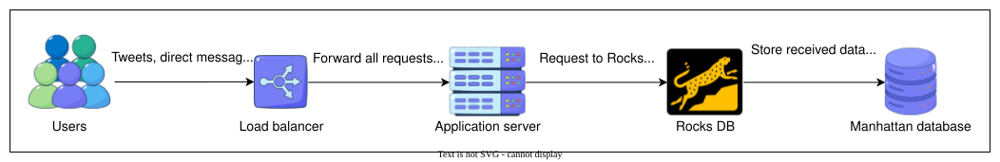
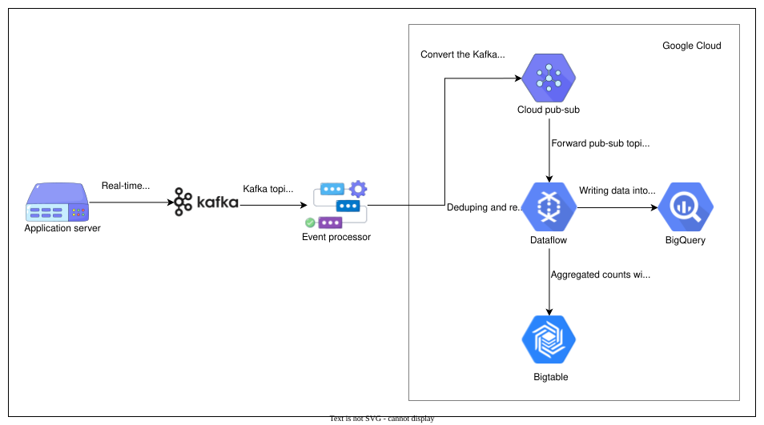
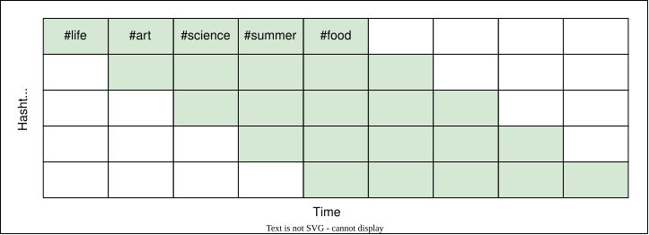
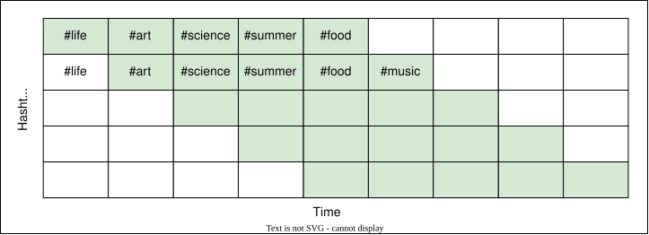
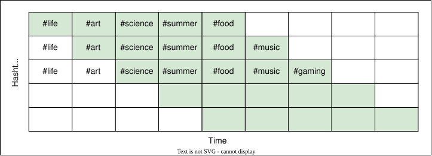
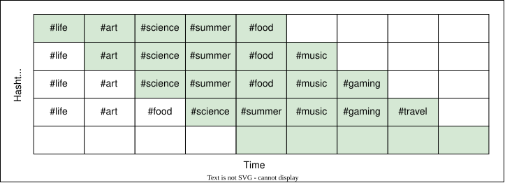
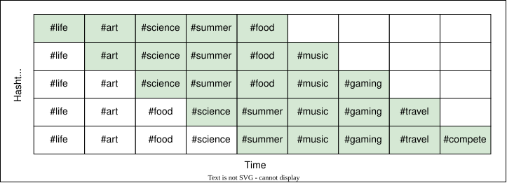

# Detailed_Design_of_Twitter

Source: https://www.educative.io/courses/grokking-the-system-design-interview/detailed-design-of-twitter

---

[Home](https://www.educative.io/)

[Courses](https://www.educative.io/search?tab=courses)

[Grokking Modern System Design Interview](https://www.educative.io/courses/grokking-the-system-design-interview)

# Detailed Design of Twitter

Learn the complex storage strategy behind Twitter’s real-time platform. Analyze how specialized systems like Manhattan, Blobstore, and FlockDB are deployed alongside advanced caching and sharded counters to solve challenges like heavy hitters and ensure high availability in a web-scale System Design.

We'll cover the following...

- [Storage system](https://www.educative.io/courses/grokking-the-system-design-interview/detailed-design-of-twitter#Storage-system)
- [Cache](https://www.educative.io/courses/grokking-the-system-design-interview/detailed-design-of-twitter#Cache)
- [Observability](https://www.educative.io/courses/grokking-the-system-design-interview/detailed-design-of-twitter#Observability)
- [Real-world complex problems](https://www.educative.io/courses/grokking-the-system-design-interview/detailed-design-of-twitter#Real-world-complex-problems)
- [AI-powered home timeline ranking](https://www.educative.io/courses/grokking-the-system-design-interview/detailed-design-of-twitter#AI-powered-home-timeline-ranking)
  - [Finding candidates](https://www.educative.io/courses/grokking-the-system-design-interview/detailed-design-of-twitter#Finding-candidates)
  - [Predicting engagement](https://www.educative.io/courses/grokking-the-system-design-interview/detailed-design-of-twitter#Predicting-engagement)
  - [Assembling the timeline](https://www.educative.io/courses/grokking-the-system-design-interview/detailed-design-of-twitter#Assembling-the-timeline)
  - [Generative AI summaries of trending topics](https://www.educative.io/courses/grokking-the-system-design-interview/detailed-design-of-twitter#Generative-AI-summaries-of-trending-topics)
- [The complete design overview](https://www.educative.io/courses/grokking-the-system-design-interview/detailed-design-of-twitter#The-complete-design-overview)

## Storage system[#](https://www.educative.io/courses/grokking-the-system-design-interview/detailed-design-of-twitter#Storage-system)

**Storage** is a core component of any real-time system. Twitter employs a polyglot persistence architecture, selecting specific storage models to optimize performance for different services. This section explores how Twitter evolved its storage strategy, moving between various databases and platforms to meet scaling demands.

> **Note:** This lesson draws on insights from Twitter’s technical blogs.

- **Google Cloud:** Twitter uses HDFS (Hadoop Distributed File System) across tens of thousands of servers to host over 300 PB300\ PB300 PB of data. This includes logs (client, Tweet, and timeline events), database backups, and analytics data. Data in HDFS is compressed using LZO for efficiency. In 2018, Twitter adopted a partly cloudy strategy, migrating data from on-premise Hadoop clusters to *Google Cloud*. Initially, they moved Ad-hoc clusters and cold storage, while keeping real-time production clusters on-premise. Big data is stored in BigQuery and accessed via Presto, a distributed SQL query engine.
- **Manhattan:** To handle rapid user growth, Twitter initially attempted to replace MySQL with Cassandra. However, due to specific limitations, they deprecated Cassandra in 2014 and launched Manhattan, a proprietary, real-time, distributed key-value store. Manhattan serves as the backend for tweets, accounts, and direct messages. It runs clusters of varying sizes, handling millions of QPS for heavy read/write traffic. Manhattan uses RocksDB as its storage engine for node-level data retrieval. While it originally handled time-series counters, that functionality has since moved to MetricsDB.

Twitter's data move to the Manhattan database

- **Blob store:** Twitter built blob store to store large objects, including photos, videos, and binary files. It also serves as durable storage for in-memory data checkpoints. See the [blob store](https://www.educative.io/courses/grokking-the-system-design-interview/system-design-a-blob-store) chapter for implementation details.
- **SQL-based databases:** Twitter uses MySQL and PostgreSQL for services requiring strong consistency, such as ad exchanges and campaign management. Vertica is used to query aggregated datasets and power Tableau dashboards. To scale MySQL, Twitter built the Gizzard framework, which handles sharding through partitioning and replication. Refer to the [Databases](https://www.educative.io/courses/grokking-the-system-design-interview/introduction-to-databases) chapter for more on relational stores.
- **Kafka and Cloud Dataflow:** Twitter processes approximately 400 billion real-time events daily. Events are processed on-premise using Kafka, then moved to Google Cloud via an event processor that converts Kafka topics to Cloud pub-sub topics. Google Dataflow jobs handle deduplication and real-time aggregation. Final results are stored in BigQuery for analysis and Bigtable for serving. See the [pub-sub](https://www.educative.io/courses/grokking-the-system-design-interview/system-design-the-pub-sub-abstraction) chapter for a deep dive.

Real-time processing of billions of requests

- **FlockDB:** Twitter models relationships (followers, following, block lists) as a graph. These are stored in FlockDB, a graph database optimized for large adjacency lists and rapid traversal. The [Databases](https://www.educative.io/courses/grokking-the-system-design-interview/introduction-to-databases) and [Newsfeed](https://www.educative.io/courses/grokking-the-system-design-interview/system-design-newsfeed-system) chapters discuss graph storage in detail.
- **Apache Lucene:** The search service indexes roughly a trillion records to serve requests within 100 milliseconds. Twitter uses Apache Lucene for real-time search, utilizing an inverted index. To ensure low latency, a real-time index of recent Tweets (from the past week) is stored in RAM. A full index, which is significantly larger, handles historical data via batch processing. See the [Distributed Search](https://www.educative.io/courses/grokking-the-system-design-interview/system-design-the-distributed-search) chapter for more on indexing.

Processing the search request

Effective real-time applications avoid “one size fits all” solutions and instead select the right tool for specific use cases to balance trade-offs.

## Cache[#](https://www.educative.io/courses/grokking-the-system-design-interview/detailed-design-of-twitter#Cache)

Caches reduce latency and increase throughput for storage (heavy reads), computation (stream processing), and transient data (rate limiters). Twitter historically used multi-tenant clusters of Twemcache and Redis (Nighthawk). To address operational overhead and performance inconsistency, Twitter migrated to *Pelikan*.

**Pelikan** is a unified caching framework that provides high throughput and low latency using modular backends:

- **`pelikan_twemcache`****:** Replaces the Twemcache server.
- **`pelikan_slimcache`****:** Replaces Memcached/Redis servers.

For a deeper understanding, refer to the [in-memory cache](https://www.educative.io/courses/grokking-the-system-design-interview/system-design-the-distributed-cache) chapter.

Distributed Pelikan cache

> **Note:** Pelikan introduced a backend cache implementation called **Segcache**, designed for high scalability and memory efficiency when storing small objects. In large-scale caching workloads, small objects often have median sizes in the 200 to 300-byte range. In typical configurations, systems such as Memcached and Redis can incur metadata overheads of roughly 50 to 60 bytes per object. For small values, this overhead can account for more than one-third of the total memory per entry. Segcache reduces per-object metadata to approximately 38 bytes. Segcache received the NSDI Community Award and has been deployed in experimental production environments since 2021.

## Observability[#](https://www.educative.io/courses/grokking-the-system-design-interview/detailed-design-of-twitter#Observability)

Managing thousands of servers requires robust observability tools for:

- **Monitoring and alerting:** Systems track service health metrics and trigger alerts when metrics degrade or fail.
- **Dynamic configuration:** A library backed by ZooKeeper updates service configurations in real-time without requiring restarts.
- **Logging:** Splunk Enterprise serves as the central system for visualizing and analyzing service logs (replacing the legacy Loglens service).

Tracing billions of requests is critical for performance tuning. Twitter uses **Zipkin**, a distributed tracing system, to track request paths and latency across microservices. To reduce overhead, Zipkin samples a percentage of requests rather than tracing every event. Data is aggregated via the **Scribe** server and stored in key-value stores.

Observability

Many distributed systems use ZooKeeper to manage coordination metadata rather than application data. It provides coordination primitives such as distributed locking and leader election. At Twitter, ZooKeeper has been used to store service registries, Manhattan cluster topology information, and related system metadata. It is also used for leader election across distributed services.

## Real-world complex problems[#](https://www.educative.io/courses/grokking-the-system-design-interview/detailed-design-of-twitter#Real-world-complex-problems)

Public figures with millions of followers generate massive traffic spikes when they tweet. This is known as the heavy-hitter problem. A single counter cannot handle the write throughput required for millions of simultaneous likes or views.

To address this, Twitter uses sharded counters. The system splits the counter for a specific Tweet into multiple shards across distributed nodes. This allows the system to handle burst write requests in parallel. Sharded counters also support the Top-k problem, which is used to calculate trends.

Twitter displays Top-k trends (hashtags) based on frequency:

- **Local trends:** Hashtags are popular within the user’s specific geographic location.
- **Global trends:** Hashtags are popular worldwide.

The system uses a sliding window to identify hashtags with the highest frequency over time.

1 / 5

Top-k trends in a specified time frame

1 / 5

Dropped #life hashtag and showing next top-k trends in a specified time frame

1 / 5

Dropped #life and #art hashtags and showing next top-k trends in a specified time frame

1 / 5

Dropped #life, #art, and #food hashtags and showing next top-k trends in a specified time frame

1 / 5

Dropped #life, #art, #food, and #science hashtags and showing next top-k trends in a specified time frame

The home timeline displays a stream of Tweets from followed accounts, along with Retweets and likes. The system aggregates interaction counts from sharded counters to determine which content to display.

Sharded counters improve performance by placing counter shards close to users, similar to a **CDN**. This reduces latency for interactions like views or likes. However, to balance load, the total count displayed on a Tweet may update with a slight delay (eventual consistency) as the application server aggregates data from various regional shards. The [Sharded Counters](https://www.educative.io/courses/grokking-the-system-design-interview/system-design-the-sharded-counters) chapter explains this mechanism in detail.

AI Powered

Saved

1 attempt left

Reset

Multiple storage models

Why does Twitter still keep relational databases like MySQL or PostgreSQL when it has several other specialized storage systems?

This is your last attempt.

## AI-powered home timeline ranking[#](https://www.educative.io/courses/grokking-the-system-design-interview/detailed-design-of-twitter#AI-powered-home-timeline-ranking)

A chronological timeline shows only accounts a user follows, in the order they posted. Most users follow more accounts than they can keep up with, so the most interesting tweets are easily missed. Twitter, now X, ranks the home timeline instead, and has published the architecture of its recommendation algorithm in an [open-source repository](https://github.com/twitter/the-algorithm). The pipeline below follows the stages described there; details of the current production system may differ.

Ranking happens each time a user opens or refreshes the timeline. X reported that this pipeline runs about 5 billion times a day and completes in under 1.5 seconds on average. It stays within that budget by narrowing the work at each stage, the same multi-stage pattern covered in the `Ranking, Prediction, and Classification Pipelines` lesson.

### Finding candidates[#](https://www.educative.io/courses/grokking-the-system-design-interview/detailed-design-of-twitter#Finding-candidates)

The pipeline first gathers roughly 1,500 candidate tweets from several sources. **In-network** candidates are recent tweets from accounts the user follows. **Out-of-network** candidates are tweets from accounts the user does not follow, found through the follow graph (what similar users engage with) and through embeddings that place users and tweets with similar interests close together. Mixing sources keeps the timeline fresh beyond the user's existing network.

Candidates then pass through filters that remove tweets the user has already seen, duplicates, and tweets from blocked or muted accounts.

### Predicting engagement[#](https://www.educative.io/courses/grokking-the-system-design-interview/detailed-design-of-twitter#Predicting-engagement)

For each remaining candidate, the system looks up features about the user, the tweet, and the author, such as past interactions between the user and the author, the tweet's age, and its early engagement. A ranking model then predicts the probability of several outcomes: a like, a reply, a retweet, a click, and also negative feedback such as “show less often” or a report.

These predictions are combined into one score using weights. Positive outcomes add to the score, and negative feedback subtracts from it. This matters because a tweet that attracts many clicks can also attract many reports. Predicting both, and weighing them explicitly, lets the product decide what “interesting” means instead of leaving it to a single model output.

### Assembling the timeline[#](https://www.educative.io/courses/grokking-the-system-design-interview/detailed-design-of-twitter#Assembling-the-timeline)

The top-scored tweets are reranked for variety, for example limiting consecutive tweets from the same author and balancing in-network with out-of-network content. A final **visibility check**, run by a separate service, applies policy such as content restrictions. Keeping this check outside the ranking model means policy can change without retraining, and a model error cannot surface content that should be hidden.

The result is paginated and cached briefly so that scrolling does not rerun the full pipeline. If the ranking models are slow or unavailable, the service falls back to a reverse-chronological timeline of in-network tweets, which is always eligible and cheap to build.

The following diagram shows the stages from candidate sources to the delivered timeline:

Ranking candidates from multiple sources into the home timeline

Every like, reply, and “show less” becomes a new training signal. Interactions flow through the real-time event processing pipeline into feature stores, so the next timeline request reflects what the user just did.

**Note:** Retrieving more candidates or using a larger model can improve relevance, but both increase latency and compute for every timeline request. Most of the cost is controlled by how many candidates reach the ranking model.

### Generative AI summaries of trending topics[#](https://www.educative.io/courses/grokking-the-system-design-interview/detailed-design-of-twitter#Generative-AI-summaries-of-trending-topics)

Ranking decides which posts a user sees. Generative AI adds a different layer on top: X uses its Grok model to write short summaries of trending topics in the Explore tab, so users can follow a trend without reading hundreds of posts. The design differs from ranking in three ways:

- **Generate once, serve many:** A summary is written per trending topic, not per user. A background job calls the LLM when a trend is detected and caches the result for everyone, which keeps inference cost and latency off the timeline path.
- **Ground the summary in posts:** The job retrieves the top posts for the trend and asks the model to summarize only those, with links back to them, so readers can check each claim. This is retrieval-augmented generation from the AI building blocks chapter.
- **Treat the output as high risk:** Trends often involve breaking news and misinformation, so summaries are labeled as AI-generated, pass the same visibility checks as posts, and are regenerated as the trend changes.

## The complete design overview[#](https://www.educative.io/courses/grokking-the-system-design-interview/detailed-design-of-twitter#The-complete-design-overview)

The following steps outline the backend flow when users interact with Twitter:

- **Routing:** The local DNS resolves the user’s request to the nearest load balancer.
- **Service handling:** The load balancer routes the request to the appropriate service:

  - **Tweet service (Write path):** Handles operations like posting (`/postTweet`). Attachments are stored in Blobstore. Text and metadata are stored in databases (Manhattan, MySQL, Vertica). Kafka pipelines process real-time data for deduplication and aggregation using Cloud Dataflow, then store the results in BigQuery and Bigtable.
  - **Timeline service (Read path):** Handles requests like `/viewHome_timeline`. The request first checks the CDN for static data. If not found, the timeline service fetches Top-k Tweets from storage and aggregates interaction counts from sharded counters.
  - **Search service:** Handles queries like `/searchTweet`. The service queries Apache Lucene. It checks the RAM-based index for real-time results and the disk-based index for historical data, ranking results by time, location, and relevance.
- **Infrastructure support:** Zipkin traces requests for performance monitoring, while ZooKeeper maintains configuration, synchronization, and naming registries.

Twitter design overview

The AI-based timeline ranking group in the diagram is the extension from the AI-powered home timeline ranking section. For each home timeline request, the timeline service calls the timeline ranking service, which reads user and tweet features from the feature store, scores the candidates, and passes the top-ranked tweets through the visibility service before returning them.

Because ranking sits behind the timeline service as a separate group, it can scale and fail independently. If the ranking service is slow or unavailable, the timeline service returns a reverse-chronological timeline instead, and the rest of the design keeps working.

High-level Design of Twitter

Client-side Load Balancer for Twitter

Ask

[Storage system](https://www.educative.io/courses/grokking-the-system-design-interview/detailed-design-of-twitter#Storage-system)

[Cache](https://www.educative.io/courses/grokking-the-system-design-interview/detailed-design-of-twitter#Cache)

[Observability](https://www.educative.io/courses/grokking-the-system-design-interview/detailed-design-of-twitter#Observability)

[Real-world complex problems](https://www.educative.io/courses/grokking-the-system-design-interview/detailed-design-of-twitter#Real-world-complex-problems)

[AI-powered home timeline ranking](https://www.educative.io/courses/grokking-the-system-design-interview/detailed-design-of-twitter#AI-powered-home-timeline-ranking)

[Finding candidates](https://www.educative.io/courses/grokking-the-system-design-interview/detailed-design-of-twitter#Finding-candidates)

[Predicting engagement](https://www.educative.io/courses/grokking-the-system-design-interview/detailed-design-of-twitter#Predicting-engagement)

[Assembling the timeline](https://www.educative.io/courses/grokking-the-system-design-interview/detailed-design-of-twitter#Assembling-the-timeline)

[Generative AI summaries of trending topics](https://www.educative.io/courses/grokking-the-system-design-interview/detailed-design-of-twitter#Generative-AI-summaries-of-trending-topics)

[The complete design overview](https://www.educative.io/courses/grokking-the-system-design-interview/detailed-design-of-twitter#The-complete-design-overview)