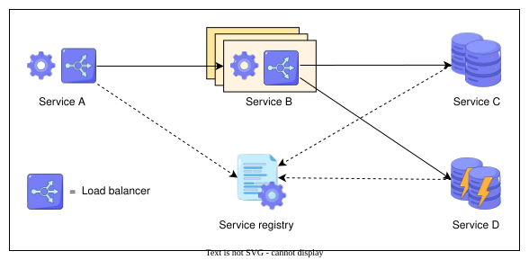

# Client-side_Load_Balancer_for_Twitter

Source: https://www.educative.io/courses/grokking-the-system-design-interview/client-side-load-balancer-for-twitter

---

[Home](https://www.educative.io/)

[Courses](https://www.educative.io/search?tab=courses)

[Grokking Modern System Design Interview](https://www.educative.io/courses/grokking-the-system-design-interview)

# Client-side Load Balancer for Twitter

Learn why Twitter’s microservices often use client-side load balancing instead of relying only on centralized load balancers. Uncover techniques used at Twitter, including the Power of Two Choices (P2C) algorithm for request distribution. Understand deterministic aperture and ring-based coordination, which improve fairness, scalability, and routing stability under high traffic.

We'll cover the following...

- [Introduction](https://www.educative.io/courses/grokking-the-system-design-interview/client-side-load-balancer-for-twitter#Introduction)
  - [Twitter’s design history](https://www.educative.io/courses/grokking-the-system-design-interview/client-side-load-balancer-for-twitter#Twitters-design-history)
  - [Client-side load balancing](https://www.educative.io/courses/grokking-the-system-design-interview/client-side-load-balancer-for-twitter#Client-side-load-balancing)
- [Client-side load balancing in Twitter](https://www.educative.io/courses/grokking-the-system-design-interview/client-side-load-balancer-for-twitter#Client-side-load-balancing-in-Twitter)
  - [Request distribution using P2C](https://www.educative.io/courses/grokking-the-system-design-interview/client-side-load-balancer-for-twitter#Request-distribution-using-P2C)
  - [Session distribution](https://www.educative.io/courses/grokking-the-system-design-interview/client-side-load-balancer-for-twitter#Session-distribution)
- [Conclusion](https://www.educative.io/courses/grokking-the-system-design-interview/client-side-load-balancer-for-twitter#Conclusion)

## Introduction[#](https://www.educative.io/courses/grokking-the-system-design-interview/client-side-load-balancer-for-twitter#Introduction)

The previous lesson modeled Twitter with a centralized load balancer. Although functional, this design does not scale efficiently for Twitter’s traffic patterns. Twitter operates many heterogeneous services across large instance fleets, which can overwhelm centralized load balancers and create throughput bottlenecks. Understanding the solution requires examining the evolution of Twitter’s architecture.

### Twitter’s design history[#](https://www.educative.io/courses/grokking-the-system-design-interview/client-side-load-balancer-for-twitter#Twitters-design-history)

Twitter began as a monolithic Ruby on Rails application with a MySQL database. As the platform scaled, the database was sharded, but the monolithic application remained problematic:

- **Codebase contention:** A large number of developers working on the same codebase made it difficult to update individual services.
- **Cascading failures:** An upgrade in one service could break others.
- **High costs:** Single machines performing numerous services led to inefficient hardware usage.
- **Complex recovery:** Recovering from failures was slow and difficult.

Twitter eventually migrated to microservices, where each service runs on hundreds or thousands of instances.

### Client-side load balancing[#](https://www.educative.io/courses/grokking-the-system-design-interview/client-side-load-balancer-for-twitter#Client-side-load-balancing)

In client-side load balancing, request routing does not rely on a centralized load balancer. The client embeds load-balancing logic and selects an appropriate backend instance directly. Backend instances register with a service registry so clients can discover available endpoints.

How client-side load balancing works

In the diagram above, Service A acts as the client for Service B. It uses an internal load balancer to select the best instance. Service B subsequently acts as a client for Services C and D. This removes the central load-balancing entity; every node manages its own traffic routing.

**Advantages:** Client-side load balancing offers the following benefits.

- **Reduced infrastructure:** Fewer hardware layers are required.
- **Lower latency:** Removing the intermediate hop reduces network latency.
- **No bandwidth bottlenecks:** Traffic does not funnel through a single machine.
- **Resilience:** There are fewer points of failure in the system.
- **Improved quality of experience (QoE):** Removing the central queue prevents users from waiting on a single resource.

Real-world applications such as Twitter, Yelp, and Netflix use this pattern. The next section details Twitter’s specific implementation.

## Client-side load balancing in Twitter[#](https://www.educative.io/courses/grokking-the-system-design-interview/client-side-load-balancer-for-twitter#Client-side-load-balancing-in-Twitter)

Twitter uses a client-side load balancer called **deterministic** **aperture**. This is part of **Finagle**, an open-source, protocol-agnostic, asynchronous RPC library.

> **Note:** Consider the following question: What parameters does Twitter's client-side load balancer use to fairly distribute load across servers?

Twitter optimizes two distributions to measure load balancer effectiveness:

1. Request distribution (OSI Layer 7)
2. Session distribution (OSI Layer 5)

While requests are the primary metric, fair session distribution is crucial. We will start by distributing requests using the Power of Two Random Choices (P2C) technique.

### Request distribution using P2C[#](https://www.educative.io/courses/grokking-the-system-design-interview/client-side-load-balancer-for-twitter#Request-distribution-using-P2C)

The **P2C technique** ensures uniform request distribution provided that sessions are also uniformly distributed. For each request, the system randomly selects two unique server instances and routes the request to the one with the lower load.

Power of two random choices

P2C relies on the simple idea that comparing two random nodes yields exponentially better load distribution than selecting one at random.

Now that we have established how to distribute requests, let’s explore session distribution techniques.

### Session distribution[#](https://www.educative.io/courses/grokking-the-system-design-interview/client-side-load-balancer-for-twitter#Session-distribution)

**Solution 1 (Mesh topology):** In this approach, each client (load balancer) establishes a session with each instance of the service, as illustrated below:

Mesh topology

While this method guarantees fair session distribution, it is expensive at scale. Maintaining connections and health checks for thousands of servers creates significant overhead and potential failure points.

**Solution 2 (Random aperture):** To improve scalability, Twitter introduced **random aperture**. In this technique, clients select a random subset of servers for session establishment.

Random aperture

Random selection reduces the number of sessions, but determining the optimal subset size is difficult. Twitter uses a **feedback controller** to dynamically size the subset based on client load. While scalable, this solution is not fair. As shown in the diagram, random selection can leave some servers idle (Server 4) while others are overloaded (Server 0).

This imbalance causes inefficient resource usage. We need a solution that is both fair and scalable.

**Solution 3 (Deterministic aperture):** To resolve the imbalance, Twitter developed a **deterministic aperture**. This approach offers two key benefits:

- Little coordination is required between clients and servers.
- Minimal disruption occurs when the number of clients or servers changes.

In this model, clients and servers are mapped to a ring with discrete coordinates.

Ring coordinates

We define an aperture size (e.g., 3). Each client establishes sessions with the next three servers on the ring, in clockwise order. This resembles consistent hashing but guarantees an equal distribution of servers.

Merge client and server ring coordinates

In the diagram above, Client 0 connects to Servers 4, 5, and 0. Client 1 connects to Servers 0, 1, and 2. As the aperture rotates, sessions are distributed evenly across the available servers.

Number of sessions established per server

The histogram shows that this achieves fair distribution for a single service. However, when multiple different services (clients) access the same backend servers, unfairness returns. Overlaps between different client rings can cause “hot spots” on specific servers.

Two different clients creating session with backend servers

The problem compounds as the number of client services increases. The solution is **continuous ring coordinates**. We derive relationships using overlapping ring slices rather than discrete points. This allows for partial overlapping when servers cannot be divided equally among clients.

Overlapping among clients' services and servers

In the illustration, Clients 0 and 1 share Server 1. This fractional overlapping allows P2C to balance the load effectively. For example, Servers 1 and 3 might receive half the load of Server 2, depending on the slice size.

The client selection process for creating sessions is as follows:

1. Pick two coordinates (offset, offset + width) within the range and map them to discrete server instances.
2. Select the instance with the least load using P2C, weighted by the degree of intersection.

> **Note:** Continuous aperture balances scalability and fairness. It requires minimal coordination and disruption, though it may add an additional session over boundary nodes due to partial overlapping.

The table below summarizes these approaches.

## Summary of Solutions for Session Distribution

|  |  |  |  |
| --- | --- | --- | --- |
| **Approach** | **Scalability** | **Fair distribution** | **Cost effectiveness** |
| **Mesh topology** | ✖️ | ✔️ | ✖️ |
| **Random aperture** | ✔️ | ✖️ | ✔️ |
| **Deterministic aperture**  **(discrete ring)** | ✔️ | weak | ✔️ |
| **Deterministic aperture**  **(continuous ring)** | ✔️ | ✔️ | ✔️ |

AI Powered

Saved

5 attempts left

Reset

Client-side load balancing

Can you describe a real-world scenario where a client-side load-balancing approach would offer significant advantages over other load-balancing methods? Justify your answer with reasoning.

You have 5 attempts to answer.

## Conclusion[#](https://www.educative.io/courses/grokking-the-system-design-interview/client-side-load-balancer-for-twitter#Conclusion)

Real-world services require tuning standard building blocks to meet specific performance needs. Twitter’s evolution demonstrates how combining data stores with custom algorithms, like deterministic aperture, solves unique scale challenges. The design choice depends heavily on the service's specific constraints.

Detailed Design of Twitter

Quiz on Twitter's Design

Ask

[Introduction](https://www.educative.io/courses/grokking-the-system-design-interview/client-side-load-balancer-for-twitter#Introduction)

[Twitter’s design history](https://www.educative.io/courses/grokking-the-system-design-interview/client-side-load-balancer-for-twitter#Twitters-design-history)

[Client-side load balancing](https://www.educative.io/courses/grokking-the-system-design-interview/client-side-load-balancer-for-twitter#Client-side-load-balancing)

[Client-side load balancing in Twitter](https://www.educative.io/courses/grokking-the-system-design-interview/client-side-load-balancer-for-twitter#Client-side-load-balancing-in-Twitter)

[Request distribution using P2C](https://www.educative.io/courses/grokking-the-system-design-interview/client-side-load-balancer-for-twitter#Request-distribution-using-P2C)

[Session distribution](https://www.educative.io/courses/grokking-the-system-design-interview/client-side-load-balancer-for-twitter#Session-distribution)

[Conclusion](https://www.educative.io/courses/grokking-the-system-design-interview/client-side-load-balancer-for-twitter#Conclusion)