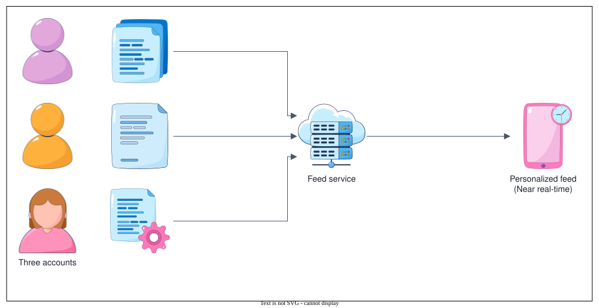

# System_Design_Newsfeed_System

Source: https://www.educative.io/courses/grokking-the-system-design-interview/system-design-newsfeed-system

---

[Home](https://www.educative.io/)

[Courses](https://www.educative.io/search?tab=courses)

[Grokking Modern System Design Interview](https://www.educative.io/courses/grokking-the-system-design-interview)

# System Design: Newsfeed System

Design a scalable newsfeed system by defining requirements and performing resource estimation for billions of users. Architect the core components, including feed generation, publishing, and ranking services. Analyze the final System Design to ensure compliance with low latency, high availability, and scalability requirements.

We'll cover the following...

- [What is a newsfeed?](https://www.educative.io/courses/grokking-the-system-design-interview/system-design-newsfeed-system#What-is-a-newsfeed)
- [Requirements](https://www.educative.io/courses/grokking-the-system-design-interview/system-design-newsfeed-system#Requirements)
  - [Functional requirements](https://www.educative.io/courses/grokking-the-system-design-interview/system-design-newsfeed-system#Functional-requirements)
  - [Non-functional requirements](https://www.educative.io/courses/grokking-the-system-design-interview/system-design-newsfeed-system#Non-functional-requirements)
- [Resource estimation](https://www.educative.io/courses/grokking-the-system-design-interview/system-design-newsfeed-system#Resource-estimation)
  - [Traffic estimation](https://www.educative.io/courses/grokking-the-system-design-interview/system-design-newsfeed-system#Traffic-estimation)
  - [Storage estimation](https://www.educative.io/courses/grokking-the-system-design-interview/system-design-newsfeed-system#Storage-estimation)
  - [Number of servers estimation](https://www.educative.io/courses/grokking-the-system-design-interview/system-design-newsfeed-system#Number-of-servers-estimation)
- [Building blocks we will use](https://www.educative.io/courses/grokking-the-system-design-interview/system-design-newsfeed-system#Building-blocks-we-will-use)
- [High-level design of a newsfeed system](https://www.educative.io/courses/grokking-the-system-design-interview/system-design-newsfeed-system#High-level-design-of-a-newsfeed-system)
- [API design](https://www.educative.io/courses/grokking-the-system-design-interview/system-design-newsfeed-system#API-design)
  - [Generate the user’s newsfeed](https://www.educative.io/courses/grokking-the-system-design-interview/system-design-newsfeed-system#Generate-the-users-newsfeed)
  - [Get the user’s newsfeed](https://www.educative.io/courses/grokking-the-system-design-interview/system-design-newsfeed-system#Get-the-users-newsfeed)
- [Storage schema](https://www.educative.io/courses/grokking-the-system-design-interview/system-design-newsfeed-system#Storage-schema)
- [Detailed design](https://www.educative.io/courses/grokking-the-system-design-interview/system-design-newsfeed-system#Detailed-design)
  - [The newsfeed generation service](https://www.educative.io/courses/grokking-the-system-design-interview/system-design-newsfeed-system#The-newsfeed-generation-service)
  - [The newsfeed publishing service](https://www.educative.io/courses/grokking-the-system-design-interview/system-design-newsfeed-system#The-newsfeed-publishing-service)
  - [The newsfeed ranking service](https://www.educative.io/courses/grokking-the-system-design-interview/system-design-newsfeed-system#The-newsfeed-ranking-service)
  - [Post ranking and newsfeed construction](https://www.educative.io/courses/grokking-the-system-design-interview/system-design-newsfeed-system#Post-ranking-and-newsfeed-construction)
  - [When to run AI ranking in the feed](https://www.educative.io/courses/grokking-the-system-design-interview/system-design-newsfeed-system#When-to-run-AI-ranking-in-the-feed)
  - [Using LLMs to understand posts](https://www.educative.io/courses/grokking-the-system-design-interview/system-design-newsfeed-system#Using-LLMs-to-understand-posts)
- [Putting everything together](https://www.educative.io/courses/grokking-the-system-design-interview/system-design-newsfeed-system#Putting-everything-together)
- [Requirements compliance](https://www.educative.io/courses/grokking-the-system-design-interview/system-design-newsfeed-system#Requirements-compliance)
- [Quiz on the newsfeed system’s design](https://www.educative.io/courses/grokking-the-system-design-interview/system-design-newsfeed-system#Quiz-on-the-newsfeed-systems-design)
- [Summary](https://www.educative.io/courses/grokking-the-system-design-interview/system-design-newsfeed-system#Summary)

## What is a newsfeed?[#](https://www.educative.io/courses/grokking-the-system-design-interview/system-design-newsfeed-system#What-is-a-newsfeed)

A **newsfeed** of any social media platform (Twitter, Facebook, Instagram) is a list of stories generated by entities that a user follows. It contains text, images, videos, and other activities such as likes, comments, shares, advertisements, and many more. This list is continuously updated and presented to relevant users on their home page. Similarly, a newsfeed system displays news to users from friends, followers, groups, and other pages, including a user’s own posts.

A newsfeed is a core feature of social platforms, aggregating recent posts and updates relevant to each user. It drives user engagement and repeat visits. These platforms operate at massive scale, serving billions of users. The engineering challenge is to deliver a personalized newsfeed in near real-time while maintaining scalability and high availability.  
  
This lesson will discuss the high-level and detailed design of a newsfeed system for a social platform such as Facebook, Twitter, or Instagram.

A newsfeed gathers posts from followed accounts and ranks them in near real time

Now that we understand what a newsfeed is and the challenges it presents, we will begin by defining the system’s requirements.

## Requirements[#](https://www.educative.io/courses/grokking-the-system-design-interview/system-design-newsfeed-system#Requirements)

To limit the scope of the problem, we’ll focus on the following functional and non-functional requirements:

### Functional requirements[#](https://www.educative.io/courses/grokking-the-system-design-interview/system-design-newsfeed-system#Functional-requirements)

- **Newsfeed generation:** The system will generate newsfeeds based on pages, groups, and followers that a user follows. A single user may follow or be connected to a large number of accounts. The system must aggregate candidate posts from all relevant connections. The primary challenge is the volume of candidate content. The system must filter and rank this content to determine which items are surfaced first.
- **Newsfeed contents:** The newsfeed may contain text, images, and videos.
- **Newsfeed display:** The system should affix new incoming posts to the newsfeed for all active users based on some ranking mechanism. Once ranked, we show content to a user with higher-ranked first.

### Non-functional requirements[#](https://www.educative.io/courses/grokking-the-system-design-interview/system-design-newsfeed-system#Non-functional-requirements)

- **Scalability:** Our proposed system should be highly scalable to support the ever-increasing number of users on any platform, such as Twitter, Facebook, and Instagram.
- **Fault tolerance:** As the system should be handling a large amount of data, therefore, partition tolerance (system availability in the event of network failure between the system’s components) is necessary.
- **Availability:** The service must be highly available to keep the users engaged with the platform. The system can compromise strong consistency for availability and fault tolerance, according to the PACELC theorem.
- **Low latency:** The system should provide newsfeeds in real-time. Hence, the maximum latency should not be greater than 2 seconds.
- **Graceful ranking fallback:** If the ranking service is unavailable, users still receive a usable feed, such as recent posts from their connections in reverse-chronological order.

These requirements, especially scalability, must be translated into concrete capacity targets. Capacity planning allows us to estimate expected traffic volume, storage footprint, and compute requirements.

## Resource estimation[#](https://www.educative.io/courses/grokking-the-system-design-interview/system-design-newsfeed-system#Resource-estimation)

Assume the platform has 1 billion registered users, with an average of 500 million daily active users (DAU). Assume an average user has 300 friends and follows 250 pages. Using these assumptions, we can estimate traffic volume, storage footprint, and compute capacity.

### Traffic estimation[#](https://www.educative.io/courses/grokking-the-system-design-interview/system-design-newsfeed-system#Traffic-estimation)

Let’s assume that each daily active user opens the application (or social media page) 10 times a day. The total number of requests per day would be:  
  
500 M×10=5500 \text{ M} \times 10 = 5500 M×10=5 billions of requests per day ≈58 K\approx 58 \text{ K}≈58 Krequests per second.

Traffic estimation for the newsfeed system

### Storage estimation[#](https://www.educative.io/courses/grokking-the-system-design-interview/system-design-newsfeed-system#Storage-estimation)

Let’s assume the feed will be generated offline and rendered on demand. Also, we’ll precompute the top 200 posts for each user. Let’s calculate storage estimates for users’ metadata, text posts, and media content.

1. **Users’ metadata storage estimation:** Suppose the storage required for one user’s metadata is 50 KB50 \text{ KB}50 KB. For 1 billion users, we would need1 B×50 KB=50 TB\text{1 B}\times \text{50 KB} = \text{50 TB}1 B×50 KB=50 TB.  
   We can tweak the estimated numbers and calculate the storage for our desired numbers in the following calculator:

#### Storage Estimation for the Users' Metadata.

|  |  |
| --- | --- |
| Number of users (in billion) | 1 |
| Required storage for one users' metadata (in KBs) | 50 |
| Total storage required for all users (in TBs) | f50 |

2. **Textual post storage estimate:** All posts may contain text; we assume 5 KB5\text{ KB}5 KB on average. The storage estimation for the top 200 posts for 500 million users would be:  
   200×500M×5 KB=0.5 PB\text{200} \times \text{500M} \times \text{5 KB} = \text{0.5 PB}200×500M×5 KB=0.5 PB
3. **Media content storage estimate:** A post can include media content, in addition to text. Therefore, we assume that 1/5th\text{1/5th}1/5th posts have videos and 4/5th\text{4/5th}4/5th include images. The assumed average image size is 200 KB200\text{ KB}200 KB and the video size is 2 MB\text{2 MB}2 MB.  
   Storage estimate for 200 posts of one user:   
   (200×2 MB×15)+(200×200 KB×45)=80 MB+32 MB=112 MB\left( \text{200} \times \text{2 MB} \times \frac{1}{5} \right) + \left( \text{200} \times \text{200 KB} \times \frac{4}{5} \right) = \text{80 MB} + \text{32 MB} = \text{112 MB}(200×2 MB×51​)+(200×200 KB×54​)=80 MB+32 MB=112 MB  
   Total storage required for 500 million users’ posts: 112 MB×500M=56 PB\text{112 MB} \times \text{500M} = \text{56 PB}112 MB×500M=56 PB  
   So we’ll need at least 56PB of blob storage to store the media content.

 by newsfeed system")

Storage required for 500 million active users per day (each with approx. 200 posts) by newsfeed system

#### Storage Estimation of Posts Containing Text and Media Content.

|  |  |
| --- | --- |
| Number of active users (in million) | 500 |
| Maximum allowed text storage per post (in KBs) | 5 |
| Number of precomputed posts per user (top N) | 200 |
| Storage required for textual posts (in PBs) | f0.5 |
| Total required media content storage for active users (in PBs) | f56 |

### Number of servers estimation[#](https://www.educative.io/courses/grokking-the-system-design-interview/system-design-newsfeed-system#Number-of-servers-estimation)

Using the estimated peak traffic, we can size the server fleet required to handle peak load. As a simplifying assumption, use a per-server capacity of 64,000 requests per second (RPS). Based on [our assumption](https://www.educative.io/courses/grokking-the-system-design-interview/put-back-of-the-envelope-numbers-in-perspective) that daily active users serve as a proxy for requests per second during peak load, we estimate 500 million requests per second. Then, we use the following formula to calculate the number of servers:

Servers needed at peak load=Number of requests/secondRPS of server\text{Servers needed at peak load} = \frac{\text{Number of requests/second}}{\text{RPS of server}}
Servers needed at peak load=RPS of serverNumber of requests/second​

Servers needed at peak load=500 million64,000=7812.5≈8 K servers\text{Servers needed at peak load} = \frac{\text{500 million}}{\text{64,000}} = \text{7812.5} \approx \text{8 K servers}Servers needed at peak load=64,000500 million​=7812.5≈8 K servers

The number of servers required for the newsfeed system

Let’s review the essential building blocks for designing the newsfeed system.

## Building blocks we will use[#](https://www.educative.io/courses/grokking-the-system-design-interview/system-design-newsfeed-system#Building-blocks-we-will-use)

The design of newsfeed system utilizes the following building blocks:

The building blocks to design a newsfeed system

- [**Database**](https://www.educative.io/courses/grokking-the-system-design-interview/introduction-to-databases) is required to store the posts from different entities and the generated personalized newsfeed. It is also used to store users’ metadata and their relationships with other entities, such as friends and followers.
- [**Cache**](https://www.educative.io/courses/grokking-the-system-design-interview/system-design-the-distributed-cache) is an important building block for storing frequently accessed data, whether posts and newsfeeds or users’ metadata.
- [**Blob storage**](https://www.educative.io/courses/grokking-the-system-design-interview/system-design-a-blob-store) is essential for storing media content, such as images and videos.
- [**CDN**](https://www.educative.io/courses/grokking-the-system-design-interview/system-design-the-content-delivery-network-cdn) effectively delivers content to end users, reducing delays and the burden on back-end servers.
- [**Load balancers**](https://www.educative.io/courses/grokking-the-system-design-interview/introduction-to-load-balancers) are necessary to distribute millions of incoming client requests for the newsfeed across the available servers.

Having identified the requirements and important building blocks, let’s discuss the high-level and detailed design of a newsfeed system.

## High-level design of a newsfeed system[#](https://www.educative.io/courses/grokking-the-system-design-interview/system-design-newsfeed-system#High-level-design-of-a-newsfeed-system)

Primarily, the newsfeed system is responsible for the following two tasks:

1. **Feed generation:** The newsfeed is generated by aggregating friends’ and followers’ posts (or feed items) based on some ranking mechanism.
2. **Feed publishing:** When a feed is published, the relevant data is written into the cache and database. This data could be textual or any media content. A post containing the data from friends and followers is populated in a user’s newsfeed.

Let’s move to the high-level design of our newsfeed system. It consists of the above two essential parts, shown in the following figure:

High-level design of the Newsfeed system

Let’s discuss the main components shown in the high-level design:

1. **User(s):** Users can make a post with some content or request their newsfeed.
2. **Load balancer:** It redirects traffic to one of the web servers.
3. **Web servers:** The web servers encapsulate the back-end services and work as an intermediate layer between users and various services. In addition to enforcing authentication and rate limiting, web servers are responsible for redirecting traffic to other back-end services.
4. **Notification service:** It informs the newsfeed generation service whenever a new post is available from one’s friends or followers, and sends a push notification.
5. **Newsfeed generation service:** This service generates newsfeeds from the posts of followers/friends of a user and keeps them in the newsfeed cache.
6. **Newsfeed publishing service:** This service is responsible for publishing newsfeeds to a user’s timeline from the newsfeed cache. It also appends a thumbnail of the media content from the blob storage and its link to the newsfeed intended for a user.
7. **Post-service:** Whenever a user requests to create a post, the post-service is called, and the created post is stored on the post database and the corresponding cache. The media content in the post is stored in blob storage.

AI Powered

Saved

1 attempt left

Reset

Design strategies to combat misinformation in a newsfeed

Newsfeeds often grapple with the issue of misinformation spread. What are two design-level interventions you could implement to help mitigate this problem?

This is your last attempt.

To translate this high-level diagram into a working system, we must define the contracts between its services. This brings us to the API design.

## API design[#](https://www.educative.io/courses/grokking-the-system-design-interview/system-design-newsfeed-system#API-design)

APIs are the primary way clients communicate with servers. Usually, newsfeed APIs are HTTP-based, allowing clients to perform actions such as posting a status, retrieving newsfeeds, adding friends, and so on. We aim to generate and get a user’s newsfeed; therefore, the following APIs are essential:

### Generate the user’s newsfeed[#](https://www.educative.io/courses/grokking-the-system-design-interview/system-design-newsfeed-system#Generate-the-users-newsfeed)

The following API is used to generate a user’s newsfeed:

Ace Editor

1

generateNewsfeed(user\_id)

הההההההההההההההההההההההההההההההההההההההההההההההההההההההההההההההההההההההההההההההההההההההההההההההההההההההההההההההההההההההההההההההההההההההההההההההההההההההההההההההההההההההההההההההההההההההההההההההההההההההההההההההההההההההההההההההההההההההההההההההההההההההההההההההההההההההההההההההההההההההההההההההההההההההההההההההההההההההההההההההההההההההההההההההההההההההההההההההההההההההההההההההההההההההההההההההההההההההההההההההההההההההההההההההההההההההההההההההההההההההההההההההההההההההההההההההההההההההההההההההההההההההההההההההההההההההההההההההה

XXXXXXXXXXXXXXXXXXXXXXXXXXXXXXXXXXXXXXXXXXXXXXXXXXXXXXXXXXXXXXXXXXXXXXXXXXXXXXXXXXXXXXXXXXXXXXXXXXXXXXXXXXXXXXXXXXXXXXXXXXXXXXXXXXXXXXXXXXXXXXXXXXXXXXXXXXXXXXXXXXXXXXXXXXXXXXXXXXXXXXXXXXXXXXXXXXXXXXXXXXXXXXXXXXXXXXXXXXXXXXXXXXXXXXXXXXXXXXXXXXXXXXXXXXXXXXXXXXXXXXXXXXXXXXXXXXXXXXXXXXXXXXXXXXXXXXXXXXXXXXXXXXXXXXXXXXXXXXXXXXXXXXXXXXXXXXXXXXXXXXXXXXXXXXXXXXXXXXXXXXXXXXXXXXXXXXXXXXXXXXXXXXXXXXXXXXXXXXXXXXXXXXXXXXXXXXXXXXXXXXXXXXXXXXXXXXXXXXXXXXXXXXXXXXXXXXXXXXXXXXXXXXXXXXXXXXXXXXXXXXXXXXXXXXXXXXXXXXXXXXXXXXXXXXXX

This API accepts a user ID and retrieves the user’s friends and followers. It then composes a newsfeed containing ranked candidate posts. Because this API is invoked by internal components, it can be executed asynchronously to precompute user feeds. The precomputed feeds are stored in persistent storage and cached for fast retrieval.

The following parameter is used in this API call:

|  |  |
| --- | --- |
| **Parameter** | **Description** |
| `user_id` | A unique identification of the user for whom the newsfeed is generated. |

### Get the user’s newsfeed[#](https://www.educative.io/courses/grokking-the-system-design-interview/system-design-newsfeed-system#Get-the-users-newsfeed)

The following API is used to get a user’s newsfeed:

Ace Editor

1

getNewsfeed(user\_id, count)

הההההההההההההההההההההההההההההההההההההההההההההההההההההההההההההההההההההההההההההההההההההההההההההההההההההההההההההההההההההההההההההההההההההההההההההההההההההההההההההההההההההההההההההההההההההההההההההההההההההההההההההההההההההההההההההההההההההההההההההההההההההההההההההההההההההההההההההההההההההההההההההההההההההההההההההההההההההההההההההההההההההההההההההההההההההההההההההההההההההההההההההההההההההההההההההההההההההההההההההההההההההההההההההההההההההההההההההההההההההההההההההההההההההההההההההההההההההההההההההההההההההההההההההההההההההההההההההההה

XXXXXXXXXXXXXXXXXXXXXXXXXXXXXXXXXXXXXXXXXXXXXXXXXXXXXXXXXXXXXXXXXXXXXXXXXXXXXXXXXXXXXXXXXXXXXXXXXXXXXXXXXXXXXXXXXXXXXXXXXXXXXXXXXXXXXXXXXXXXXXXXXXXXXXXXXXXXXXXXXXXXXXXXXXXXXXXXXXXXXXXXXXXXXXXXXXXXXXXXXXXXXXXXXXXXXXXXXXXXXXXXXXXXXXXXXXXXXXXXXXXXXXXXXXXXXXXXXXXXXXXXXXXXXXXXXXXXXXXXXXXXXXXXXXXXXXXXXXXXXXXXXXXXXXXXXXXXXXXXXXXXXXXXXXXXXXXXXXXXXXXXXXXXXXXXXXXXXXXXXXXXXXXXXXXXXXXXXXXXXXXXXXXXXXXXXXXXXXXXXXXXXXXXXXXXXXXXXXXXXXXXXXXXXXXXXXXXXXXXXXXXXXXXXXXXXXXXXXXXXXXXXXXXXXXXXXXXXXXXXXXXXXXXXXXXXXXXXXXXXXXXXXXXXXXX

The `getNewsfeed(.)` API call returns a JSON object containing a list of posts.

The following parameters are used for this API:

|  |  |
| --- | --- |
| **Parameter** | **Description** |
| `user_id` | A unique identification of the user for whom the system will fetch the newsfeed. |
| `count` | The number of feed items (posts) that will be retrieved per request. |

## Storage schema[#](https://www.educative.io/courses/grokking-the-system-design-interview/system-design-newsfeed-system#Storage-schema)

The database relations for the newsfeed system are as follows:

- **User:** This relation contains data about a user. A user can also be a follower or friend of other users.
- **Entity:** This relation stores data about entities, such as pages, groups, and so on.
- **Feed\_item:** The data about posts created by users is stored in this relation.
- **Media:** The information about the media content is stored in this relation.

The database schema for the newsfeed system

User and post data are structured and are stored in a relational database. A graph database is used to model relationships such as friendships and follower connections. For this purpose, we follow the property graph model. We can think of a graph database consisting of two relational tables:

1. For vertices that represent users
2. For edges that denote relationships among them

Therefore, we use a relational schema for the graph store, as shown in the figure below. The schema uses the PostgreSQL JSON data type to store the properties of each vertex (user) or edge (relationship).

An alternative representation of a **user** can be shown in the graph database below. Where the `Users_ID` remains the same, and attributes are stored in a JSON file format.

Schema of the graph database to hold relationships between users

The following figure demonstrates how a graph can be represented using the relational schema:

A graph between two users consisting of two vertices and an edge

With the foundational pieces of architecture and data structure in place, we can now zoom in. The section below explores the inner workings and logic of the core services in our detailed design.

## Detailed design[#](https://www.educative.io/courses/grokking-the-system-design-interview/system-design-newsfeed-system#Detailed-design)

As discussed earlier, there are two parts of the newsfeed system: newsfeed publishing and newsfeed generation. Therefore, we’ll discuss both parts, starting with the newsfeed generation service.

### The newsfeed generation service[#](https://www.educative.io/courses/grokking-the-system-design-interview/system-design-newsfeed-system#The-newsfeed-generation-service)

Newsfeed is generated by aggregated posts (or feed items) from the user’s friends, followers, and other entities (pages and groups).

In our proposed design, the **newsfeed generation service** is responsible for generating the newsfeed. When a request from a user (say Alice) to retrieve a newsfeed is received at the web server, the web server either:

- Call the newsfeed generation service to generate feeds because some users don’t often visit the platform, so their feeds are generated on their request.
- It fetches the pre-generated newsfeed for active users who frequently visit the platform.

The following steps are performed in sequence to generate a newsfeed for Alice:

1. The newsfeed generation service retrieves IDs of all users and entities that Alice follows from the graph database.
2. When the IDs are retrieved from the graph database, the next step is to get their friends’ (followers and entities) information from the user cache, which is regularly updated whenever the **users’ database** gets updated/modified.
3. In this step, the service retrieves the latest, most popular, and relevant posts for those IDs from the post cache. These are the posts that we might be able to display on Alice’s newsfeed.
4. The **ranking service** ranks posts based on their relevance to Alice. This represents Alice’s current newsfeed.
5. The newsfeed is stored in the newsfeed cache from which the top NNN posts are published to Alice’s timeline. (The publishing process is discussed in detail in the following section.)
6. In the end, whenever Alice reaches the end of her timeline, the next top NNN posts are fetched to her screen from the newsfeed cache.

The process is illustrated in the following figure:

Working of the newsfeed generation service

1.

The creation and storage of newsfeeds for each user in the cache requires an enormous amount of memory (step 5 in the above section). Is there any way to reduce this memory consumption?

Show Answer

Did you find this helpful?

### The newsfeed publishing service[#](https://www.educative.io/courses/grokking-the-system-design-interview/system-design-newsfeed-system#The-newsfeed-publishing-service)

At this stage, the newsfeeds are generated for users from their respective friends, followers, and entities, and are stored in the form of `<Post_ID, User_ID>` in the news feed cache.

Now the question is how the newsfeeds generated for Alice will be published to her timeline?

The **newsfeed publishing service** fetches a list of post IDs from the newsfeed cache. The data fetched from the newsfeed cache is a tuple of post and user IDs, that is, `<Post_ID, User_ID>`. Therefore, the complete data about posts and users is retrieved from the users and posts cache to create an entirely constructed newsfeed.

In the last step, the fully constructed newsfeed is sent to the client (Alice) using one of the fan-out approaches. The popular newsfeed and media content are also stored in CDN for fast retrieval.

The newsfeed publishing service in action

1.

How is the newsfeed of the friends and followers updated when a user creates a new post?

Show Answer

Did you find this helpful?

### The newsfeed ranking service[#](https://www.educative.io/courses/grokking-the-system-design-interview/system-design-newsfeed-system#The-newsfeed-ranking-service)

Often, we see the relevant and important posts at the top of our newsfeeds whenever we log in to our social media accounts. This ranking involves multiple advanced ranking and recommendation algorithms.

In our design, the **newsfeed ranking service** consists of these algorithms working on various features, such as a user’s past history, likes, dislikes, comments, clicks, and many more. These algorithms also perform the following functions:

- Select “candidates” posts to show in a newsfeed.
- Eliminate posts including misinformation or clickbait from the candidate posts.
- Create a list of friends a user frequently interacts with.
- Choose topics on which a user spent more time.

The ranking system considers all the above points to predict relevant and important posts for a user.

The ranked newsfeed are stored in the cache servers

### Post ranking and newsfeed construction[#](https://www.educative.io/courses/grokking-the-system-design-interview/system-design-newsfeed-system#Post-ranking-and-newsfeed-construction)

The Twitter chapter covered how a ranking pipeline orders a timeline: it gathers candidate posts, uses ML models to predict how likely the user is to interact with each one, and combines those predictions into a single score. The newsfeed uses the same scoring approach, so here we focus on the next phase: turning those scores into the feed a user sees, and deciding where that work happens in our fan-out design.

The post database contains posts published by different users. Assume that there are 10 posts in the database published by 5 different users. We aim to rank only 4 posts out of 10 for a user (say Bob) who follows those five different users. We perform the following to rank each post and create a newsfeed for Bob:

1. Various features such as likes, comments, shares, category, duration, etc, and so on, are extracted from each post.
2. Using Bob’s history from the user database, ML models predict how likely Bob is to interact with each post, for example to like, comment on, or share it. These predictions are combined into a single relevance score for each post.
3. The top 4 posts are selected out of 10 based on the assigned scores.
4. The top 4 posts are combined and presented on Bob’s timeline in decreasing order of the score assigned.

The following figure shows the top 4 posts published on Bob’s timeline:

A newsfeed consisting of top 4 posts based on the relevance scores

Newsfeed ranking with various machine learning and ranking algorithms is a computationally intensive task. In our design, the **ranking service** ranks posts and constructs newsfeeds. This service consists of big data processing systems that might utilize specialized hardware like graphics processing units (GPUs) and tensor processing units (TPUs).

**Note: According to Facebook**“For each person on Facebook, we need to evaluate thousands of features to determine what that person might find most relevant to predict what each of those people wants to see in their feed.”

This implies that we need enormous computational power and sophisticated learning algorithms to incorporate all the features to get good-quality feed in a reasonably short time.

### When to run AI ranking in the feed[#](https://www.educative.io/courses/grokking-the-system-design-interview/system-design-newsfeed-system#When-to-run-AI-ranking-in-the-feed)

Scoring decides the order of posts; the remaining question is when to compute it. Our design already fans out new posts to followers’ feeds when they are published, so ranking can sit at two points in that flow, and each has a cost.

Ranking during **fan-out** computes each follower’s order when a post is published and stores the ranked feed in the cache. Reads are fast and cheap, because the feed is ready. However, the order goes stale as new likes and comments arrive, and every new post or interaction may require re-ranking feeds that nobody opens.

Ranking at **read time** stores only candidate posts during fan-out and orders them when the user opens the feed. The order reflects the latest interactions, but every feed request pays the ranking cost, which adds latency.

Most large systems combine the two. Fan-out prepares the candidate list, a lightweight score is precomputed, and a final ranking pass runs when the user opens the feed. The cached ranked feed has a short lifetime and is invalidated when the user returns after a long gap or when a high-priority post arrives. If ranking is unavailable, the service returns the cached candidates in reverse-chronological order.

Three more concerns keep a ranked feed healthy in production:

- **Evaluation and rollout:** Test a new ranking model offline on logged interactions first, then in an online A/B test. Track engagement alongside guardrail metrics such as hides, reports, and “show less,” so a model cannot win on clicks while making the feed worse. The Evaluating and Protecting AI Features lesson covers this process.
- **Cold start:** New users and new posts have no interaction history, so the system relies on recency and popularity signals, plus a small amount of exploration, until it collects enough data.
- **Latency budget:** The final ranking pass runs on every feed request, so cap the number of candidates it scores to keep feed loads within the latency target.

**Note:** The scoring model, multi-outcome predictions, and feedback loop follow the same design as the home timeline ranking in the Twitter chapter. Facebook, whose News Feed this design is modeled on, [publicly describes](https://engineering.fb.com/2021/01/26/ml-applications/news-feed-ranking/) ranking posts by the predicted probability of interactions such as likes, comments, and shares.

### Using LLMs to understand posts[#](https://www.educative.io/courses/grokking-the-system-design-interview/system-design-newsfeed-system#Using-LLMs-to-understand-posts)

A ranking model is only as good as its features. Large language models and vision-language models can read a post’s text and images and turn them into signals that hand-built features miss, such as the post’s topic, whether it asks a question, or whether it looks like engagement bait.

These models are too slow and expensive to call on every feed request, so they run once per post, asynchronously at publish time. Their outputs, such as topic labels and embeddings, are stored with the post and become features for the ranking model. The feed path still uses only the fast ranker, and if the LLM pipeline falls behind, new posts are ranked with their basic features until the enriched ones arrive.

Now it is time to synthesize this knowledge and see how all the components fit together in a single, comprehensive architecture.

## Putting everything together[#](https://www.educative.io/courses/grokking-the-system-design-interview/system-design-newsfeed-system#Putting-everything-together)

The following figure combines all the services related to the detailed design of the newsfeed system:

The detailed design of newsfeed system

With the full design established, the final step is validation. Let’s analyze the system to confirm its compliance with our requirements for scalability, availability, and low latency.

## Requirements compliance[#](https://www.educative.io/courses/grokking-the-system-design-interview/system-design-newsfeed-system#Requirements-compliance)

Our non-functional requirements for the proposed newsfeed System Design are scalability, fault tolerance, availability, and low latency. Let’s discuss how the proposed system fulfills these requirements:

1. **Scalability:** The proposed system is scalable to handle an ever-increasing number of users. The required resources, including load balancers, web servers, and other relevant servers, are added/removed on demand.
2. **Fault tolerance**: The replication of data consisting of users’ metadata, posts, and newsfeed makes the system fault-tolerant. Moreover, the redundant resources are always there to handle the failure of a server or its component. Monitoring service is used to enhance reliability by continuously observing system health, detecting issues early, providing insights for optimization, and assisting in timely incident response.
3. **Availability:** The system is highly available by providing redundant servers and replicating data on them. When a user gets disconnected due to some fault in the server, the session is re-created via a load balancer with a different server. Moreover, the data (users' metadata, posts, and newsfeeds) is stored on different and redundant database clusters, which provides high availability and durability.
4. **Low latency:** We can minimize the system’s latency at various levels by:

   1. Geographically distributed servers and the cache associated with them. This way, we bring the service close to users.
   2. Using CDNs for frequently accessed newsfeeds and media content.

AI Powered

Saved

1 attempt left

Reset

Strategy for scaling the newsfeed design

Imagine you’re the tech lead responsible for running a social media platform smoothly. We currently have 500 million daily active users, and this number is expected to double next year! To handle this surge, we need to improve the scalability of our Newsfeed system. Which approach would you prioritize to handle this increased user load? Also, state the reason behind your choice.

1. Add even more powerful servers to our infrastructure.
2. Shard the data across multiple database instances.

This is your last attempt.

## Quiz on the newsfeed system’s design[#](https://www.educative.io/courses/grokking-the-system-design-interview/system-design-newsfeed-system#Quiz-on-the-newsfeed-systems-design)

Test your understanding of the concepts related to the design of the newsfeed system with a quiz.

Technical Quiz

1.

Which component is responsible for storing relationships between users, their friends, and followers?

A.

The users database

B.

The graph database

C.

The posts database

D.

None of the above

---

1 / 4

## Summary[#](https://www.educative.io/courses/grokking-the-system-design-interview/system-design-newsfeed-system#Summary)

This section presented a scalable newsfeed architecture. The design processes large volumes of user activity and content signals to rank and surface relevant posts. This architecture generalizes to other feed-based systems, including social timelines, content recommendation pipelines, and news aggregation platforms.

Quiz on Twitter's Design

System Design: Instagram

Ask

[What is a newsfeed?](https://www.educative.io/courses/grokking-the-system-design-interview/system-design-newsfeed-system#What-is-a-newsfeed)

[Requirements](https://www.educative.io/courses/grokking-the-system-design-interview/system-design-newsfeed-system#Requirements)

[Functional requirements](https://www.educative.io/courses/grokking-the-system-design-interview/system-design-newsfeed-system#Functional-requirements)

[Non-functional requirements](https://www.educative.io/courses/grokking-the-system-design-interview/system-design-newsfeed-system#Non-functional-requirements)

[Resource estimation](https://www.educative.io/courses/grokking-the-system-design-interview/system-design-newsfeed-system#Resource-estimation)

[Traffic estimation](https://www.educative.io/courses/grokking-the-system-design-interview/system-design-newsfeed-system#Traffic-estimation)

[Storage estimation](https://www.educative.io/courses/grokking-the-system-design-interview/system-design-newsfeed-system#Storage-estimation)

[Number of servers estimation](https://www.educative.io/courses/grokking-the-system-design-interview/system-design-newsfeed-system#Number-of-servers-estimation)

[Building blocks we will use](https://www.educative.io/courses/grokking-the-system-design-interview/system-design-newsfeed-system#Building-blocks-we-will-use)

[High-level design of a newsfeed system](https://www.educative.io/courses/grokking-the-system-design-interview/system-design-newsfeed-system#High-level-design-of-a-newsfeed-system)

[API design](https://www.educative.io/courses/grokking-the-system-design-interview/system-design-newsfeed-system#API-design)

[Generate the user’s newsfeed](https://www.educative.io/courses/grokking-the-system-design-interview/system-design-newsfeed-system#Generate-the-users-newsfeed)

[Get the user’s newsfeed](https://www.educative.io/courses/grokking-the-system-design-interview/system-design-newsfeed-system#Get-the-users-newsfeed)

[Storage schema](https://www.educative.io/courses/grokking-the-system-design-interview/system-design-newsfeed-system#Storage-schema)

[Detailed design](https://www.educative.io/courses/grokking-the-system-design-interview/system-design-newsfeed-system#Detailed-design)

[The newsfeed generation service](https://www.educative.io/courses/grokking-the-system-design-interview/system-design-newsfeed-system#The-newsfeed-generation-service)

[The newsfeed publishing service](https://www.educative.io/courses/grokking-the-system-design-interview/system-design-newsfeed-system#The-newsfeed-publishing-service)

[The newsfeed ranking service](https://www.educative.io/courses/grokking-the-system-design-interview/system-design-newsfeed-system#The-newsfeed-ranking-service)

[Post ranking and newsfeed construction](https://www.educative.io/courses/grokking-the-system-design-interview/system-design-newsfeed-system#Post-ranking-and-newsfeed-construction)

[When to run AI ranking in the feed](https://www.educative.io/courses/grokking-the-system-design-interview/system-design-newsfeed-system#When-to-run-AI-ranking-in-the-feed)

[Using LLMs to understand posts](https://www.educative.io/courses/grokking-the-system-design-interview/system-design-newsfeed-system#Using-LLMs-to-understand-posts)

[Putting everything together](https://www.educative.io/courses/grokking-the-system-design-interview/system-design-newsfeed-system#Putting-everything-together)

[Requirements compliance](https://www.educative.io/courses/grokking-the-system-design-interview/system-design-newsfeed-system#Requirements-compliance)

[Quiz on the newsfeed system’s design](https://www.educative.io/courses/grokking-the-system-design-interview/system-design-newsfeed-system#Quiz-on-the-newsfeed-systems-design)

[Summary](https://www.educative.io/courses/grokking-the-system-design-interview/system-design-newsfeed-system#Summary)