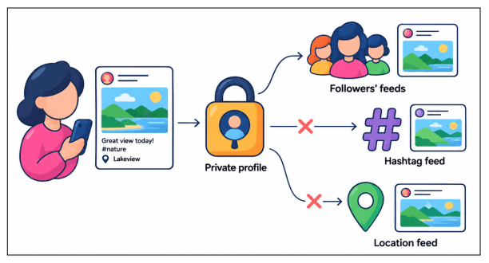
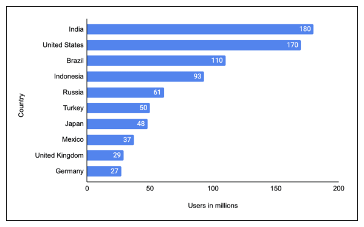

# System_Design_Instagram

Source: https://www.educative.io/courses/grokking-the-system-design-interview/system-design-instagram

---

[Home](https://www.educative.io/)

[Courses](https://www.educative.io/search?tab=courses)

[Grokking Modern System Design Interview](https://www.educative.io/courses/grokking-the-system-design-interview)

# System Design: Instagram

Explore the core features and massive scale of the Instagram photo-sharing platform. Begin the System Design process by defining functional and non-functional requirements. Learn how to estimate the necessary resources to support millions of daily active users.

We'll cover the following...

- [What is Instagram?](https://www.educative.io/courses/grokking-the-system-design-interview/system-design-instagram#What-is-Instagram)
- [How will we design Instagram?](https://www.educative.io/courses/grokking-the-system-design-interview/system-design-instagram#How-will-we-design-Instagram)

## What is Instagram?[#](https://www.educative.io/courses/grokking-the-system-design-interview/system-design-instagram#What-is-Instagram)

**Instagram** is a social networking service for sharing photos and short videos. Users upload media with captions, hashtags, and geotags that improve discoverability in search and tag feeds. Posts are delivered to followers’ feeds. Public posts can be discovered through hashtags and location feeds, while private profiles limit visibility to approved followers.

How a post reaches followers, hashtag feeds, and location feeds, and how privacy limits it

> **Note:** As the user base grows, Instagram must continuously optimize its backend to handle millions of daily active users. Efficiently managing growth and predicting resource requirements are essential for scalability.

Expanding user counts require increased server, database, and CDN capacity. Analyzing growth rates helps us predict these needs. The following illustration shows the Instagram user base by country as of January 2022 (source: Statista).

Countries with the most Instagram users

**Did you know?**

Instagram relies on technologies like Redis, Cassandra, and distributed file storage to maintain high availability and low latency for millions of users.

## How will we design Instagram?[#](https://www.educative.io/courses/grokking-the-system-design-interview/system-design-instagram#How-will-we-design-Instagram)

We have divided the design of Instagram into four lessons:

1. [**Requirements**](https://www.educative.io/courses/grokking-the-system-design-interview/requirements-of-instagrams-design)**:** Defines functional and non-functional requirements, along with resource estimation.
2. [**Design**](https://www.educative.io/courses/grokking-the-system-design-interview/design-of-instagram)**:** Covers the high-level architecture, component workflow, API design, and database schema.
3. [**Detailed design**](https://www.educative.io/courses/grokking-the-system-design-interview/detailed-design-of-instagram)**:** Explores components in depth, discusses timeline generation strategies, and evaluates design trade-offs.
4. [**Quiz**](https://www.educative.io/courses/grokking-the-system-design-interview/quiz-on-instagrams-design)**:** Tests your understanding of the system design.

- How does the system handle feed generation, messaging, and reliable data retrieval?
- How do load balancers, rate limiters, and Kafka ensure low latency during peak traffic?
- Why is the choice between NoSQL and relational databases critical for managing high-volume user data?
- How do sharding and replication strategies impact large-scale object storage?

Let’s start by defining the requirements for the system. In the next lesson, we will cover resource estimation.

System Design: Newsfeed System

Requirements of Instagram’s Design

Ask

[What is Instagram?](https://www.educative.io/courses/grokking-the-system-design-interview/system-design-instagram#What-is-Instagram)

[How will we design Instagram?](https://www.educative.io/courses/grokking-the-system-design-interview/system-design-instagram#How-will-we-design-Instagram)