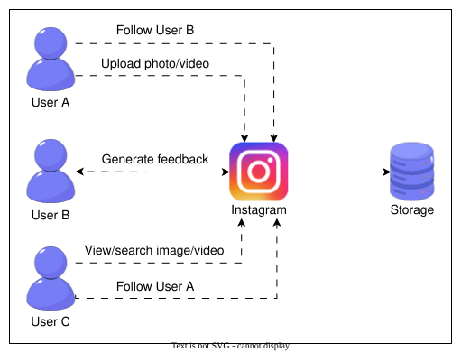

# Design_of_Instagram

Source: https://www.educative.io/courses/grokking-the-system-design-interview/design-of-instagram

---

[Home](https://www.educative.io/)

[Courses](https://www.educative.io/search?tab=courses)

[Grokking Modern System Design Interview](https://www.educative.io/courses/grokking-the-system-design-interview)

# Design of Instagram

Explore the foundational architecture of Instagram, starting with the high-level design. Define the necessary REST APIs for user actions like posting and following. Learn how to establish a robust storage schema and justify the database choice based on relational data needs.

We'll cover the following...

- [High-level design](https://www.educative.io/courses/grokking-the-system-design-interview/design-of-instagram#High-level-design)
- [API design](https://www.educative.io/courses/grokking-the-system-design-interview/design-of-instagram#API-design)
  - [Post photos or videos](https://www.educative.io/courses/grokking-the-system-design-interview/design-of-instagram#Post-photos-or-videos)
  - [Follow and unfollow users](https://www.educative.io/courses/grokking-the-system-design-interview/design-of-instagram#Follow-and-unfollow-users)
  - [Like or unlike posts](https://www.educative.io/courses/grokking-the-system-design-interview/design-of-instagram#Like-or-unlike-posts)
  - [Search photos or videos](https://www.educative.io/courses/grokking-the-system-design-interview/design-of-instagram#Search-photos-or-videos)
  - [Generate news feed](https://www.educative.io/courses/grokking-the-system-design-interview/design-of-instagram#Generate-news-feed)
- [Storage schema](https://www.educative.io/courses/grokking-the-system-design-interview/design-of-instagram#Storage-schema)
  - [Relational or non-relational database?](https://www.educative.io/courses/grokking-the-system-design-interview/design-of-instagram#Relational-or-non-relational-database)
  - [Define tables](https://www.educative.io/courses/grokking-the-system-design-interview/design-of-instagram#Define-tables)
  - [Data estimation](https://www.educative.io/courses/grokking-the-system-design-interview/design-of-instagram#Data-estimation)

## High-level design[#](https://www.educative.io/courses/grokking-the-system-design-interview/design-of-instagram#High-level-design)

The system must support uploading, viewing, and searching media. Additionally, users can follow one another. This requires a robust storage layer to persist media and a retrieval mechanism to fetch data on demand.

The high-level design of Instagram

## API design[#](https://www.educative.io/courses/grokking-the-system-design-interview/design-of-instagram#API-design)

We will implement REST APIs for the following features:

- Post photos and videos
- Follow and unfollow users
- Like or unlike posts
- Search photos and videos
- Generate a news feed

All calls require a `userID` to identify the requester. We will focus on unique parameters for each endpoint below.

### Post photos or videos[#](https://www.educative.io/courses/grokking-the-system-design-interview/design-of-instagram#Post-photos-or-videos)

The `/postMedia` API allows users to upload content via a POST request:

Ace Editor

1

postMedia(userID, media\_type, media\_file, list\_of\_hashtags, caption)

הההההההההההההההההההההההההההההההההההההההההההההההההההההההההההההההההההההההההההההההההההההההההההההההההההההההההההההההההההההההההההההההההההההההההההההההההההההההההההההההההההההההההההההההההההההההההההההההההההההההההההההההההההההההההההההההההההההההההההההההההההההההההההההההההההההההההההההההההההההההההההההההההההההההההההההההההההההההההההההההההההההההההההההההההההההההההההההההההההההההההההההההההההההההההההההההההההההההההההההההההההההההההההההההההההההההההההההההההההההההההההההההההההההההההההההההההההההההההההההההההההההההההההההההההההההההההההההההה

XXXXXXXXXXXXXXXXXXXXXXXXXXXXXXXXXXXXXXXXXXXXXXXXXXXXXXXXXXXXXXXXXXXXXXXXXXXXXXXXXXXXXXXXXXXXXXXXXXXXXXXXXXXXXXXXXXXXXXXXXXXXXXXXXXXXXXXXXXXXXXXXXXXXXXXXXXXXXXXXXXXXXXXXXXXXXXXXXXXXXXXXXXXXXXXXXXXXXXXXXXXXXXXXXXXXXXXXXXXXXXXXXXXXXXXXXXXXXXXXXXXXXXXXXXXXXXXXXXXXXXXXXXXXXXXXXXXXXXXXXXXXXXXXXXXXXXXXXXXXXXXXXXXXXXXXXXXXXXXXXXXXXXXXXXXXXXXXXXXXXXXXXXXXXXXXXXXXXXXXXXXXXXXXXXXXXXXXXXXXXXXXXXXXXXXXXXXXXXXXXXXXXXXXXXXXXXXXXXXXXXXXXXXXXXXXXXXXXXXXXXXXXXXXXXXXXXXXXXXXXXXXXXXXXXXXXXXXXXXXXXXXXXXXXXXXXXXXXXXXXXXXXXXXXXXX

|  |  |
| --- | --- |
| **Parameter** | **Description** |
| `media_type` | It indicates the type of media (photo or video) in a post. |
| `media_file` | It holds media file (photo or video) of a post. |
| `list_of_hashtags` | It represents all hashtags (maximum limit 30 hashtags) in a post. |
| `caption` | It is a text (maximum limit is 2,200 characters) in a user’s post. |

### Follow and unfollow users[#](https://www.educative.io/courses/grokking-the-system-design-interview/design-of-instagram#Follow-and-unfollow-users)

Users follow others via the `/followUser` API:

Ace Editor

1

followUser(userID, target\_userID)

הההההההההההההההההההההההההההההההההההההההההההההההההההההההההההההההההההההההההההההההההההההההההההההההההההההההההההההההההההההההההההההההההההההההההההההההההההההההההההההההההההההההההההההההההההההההההההההההההההההההההההההההההההההההההההההההההההההההההההההההההההההההההההההההההההההההההההההההההההההההההההההההההההההההההההההההההההההההההההההההההההההההההההההההההההההההההההההההההההההההההההההההההההההההההההההההההההההההההההההההההההההההההההההההההההההההההההההההההההההההההההההההההההההההההההההההההההההההההההההההההההההההההההההההההההההההההההההההה

XXXXXXXXXXXXXXXXXXXXXXXXXXXXXXXXXXXXXXXXXXXXXXXXXXXXXXXXXXXXXXXXXXXXXXXXXXXXXXXXXXXXXXXXXXXXXXXXXXXXXXXXXXXXXXXXXXXXXXXXXXXXXXXXXXXXXXXXXXXXXXXXXXXXXXXXXXXXXXXXXXXXXXXXXXXXXXXXXXXXXXXXXXXXXXXXXXXXXXXXXXXXXXXXXXXXXXXXXXXXXXXXXXXXXXXXXXXXXXXXXXXXXXXXXXXXXXXXXXXXXXXXXXXXXXXXXXXXXXXXXXXXXXXXXXXXXXXXXXXXXXXXXXXXXXXXXXXXXXXXXXXXXXXXXXXXXXXXXXXXXXXXXXXXXXXXXXXXXXXXXXXXXXXXXXXXXXXXXXXXXXXXXXXXXXXXXXXXXXXXXXXXXXXXXXXXXXXXXXXXXXXXXXXXXXXXXXXXXXXXXXXXXXXXXXXXXXXXXXXXXXXXXXXXXXXXXXXXXXXXXXXXXXXXXXXXXXXXXXXXXXXXXXXXXXXX

|  |  |
| --- | --- |
| **Parameter** | **Description** |
| `target_userID` | It indicates the user to be followed. |

The `/unfollowUser` API accepts the same parameters.

### Like or unlike posts[#](https://www.educative.io/courses/grokking-the-system-design-interview/design-of-instagram#Like-or-unlike-posts)

The `/likePost` API registers a like on a post.

Ace Editor

1

likePost(userID, post\_id)

הההההההההההההההההההההההההההההההההההההההההההההההההההההההההההההההההההההההההההההההההההההההההההההההההההההההההההההההההההההההההההההההההההההההההההההההההההההההההההההההההההההההההההההההההההההההההההההההההההההההההההההההההההההההההההההההההההההההההההההההההההההההההההההההההההההההההההההההההההההההההההההההההההההההההההההההההההההההההההההההההההההההההההההההההההההההההההההההההההההההההההההההההההההההההההההההההההההההההההההההההההההההההההההההההההההההההההההההההההההההההההההההההההההההההההההההההההההההההההההההההההההההההההההההההההההההההההההההה

XXXXXXXXXXXXXXXXXXXXXXXXXXXXXXXXXXXXXXXXXXXXXXXXXXXXXXXXXXXXXXXXXXXXXXXXXXXXXXXXXXXXXXXXXXXXXXXXXXXXXXXXXXXXXXXXXXXXXXXXXXXXXXXXXXXXXXXXXXXXXXXXXXXXXXXXXXXXXXXXXXXXXXXXXXXXXXXXXXXXXXXXXXXXXXXXXXXXXXXXXXXXXXXXXXXXXXXXXXXXXXXXXXXXXXXXXXXXXXXXXXXXXXXXXXXXXXXXXXXXXXXXXXXXXXXXXXXXXXXXXXXXXXXXXXXXXXXXXXXXXXXXXXXXXXXXXXXXXXXXXXXXXXXXXXXXXXXXXXXXXXXXXXXXXXXXXXXXXXXXXXXXXXXXXXXXXXXXXXXXXXXXXXXXXXXXXXXXXXXXXXXXXXXXXXXXXXXXXXXXXXXXXXXXXXXXXXXXXXXXXXXXXXXXXXXXXXXXXXXXXXXXXXXXXXXXXXXXXXXXXXXXXXXXXXXXXXXXXXXXXXXXXXXXXXXX

|  |  |
| --- | --- |
| **Parameter** | **Description** |
| `post_id` | It specifies the post's unique ID. |

Similarly, the `/unlikePost` API removes a like.

### Search photos or videos[#](https://www.educative.io/courses/grokking-the-system-design-interview/design-of-instagram#Search-photos-or-videos)

The `/searchPhotos` GET method retrieves media based on keywords or hashtags:

Ace Editor

1

searchPhotos(userID, keyword)

הההההההההההההההההההההההההההההההההההההההההההההההההההההההההההההההההההההההההההההההההההההההההההההההההההההההההההההההההההההההההההההההההההההההההההההההההההההההההההההההההההההההההההההההההההההההההההההההההההההההההההההההההההההההההההההההההההההההההההההההההההההההההההההההההההההההההההההההההההההההההההההההההההההההההההההההההההההההההההההההההההההההההההההההההההההההההההההההההההההההההההההההההההההההההההההההההההההההההההההההההההההההההההההההההההההההההההההההההההההההההההההההההההההההההההההההההההההההההההההההההההההההההההההההההההההההההההההההה

XXXXXXXXXXXXXXXXXXXXXXXXXXXXXXXXXXXXXXXXXXXXXXXXXXXXXXXXXXXXXXXXXXXXXXXXXXXXXXXXXXXXXXXXXXXXXXXXXXXXXXXXXXXXXXXXXXXXXXXXXXXXXXXXXXXXXXXXXXXXXXXXXXXXXXXXXXXXXXXXXXXXXXXXXXXXXXXXXXXXXXXXXXXXXXXXXXXXXXXXXXXXXXXXXXXXXXXXXXXXXXXXXXXXXXXXXXXXXXXXXXXXXXXXXXXXXXXXXXXXXXXXXXXXXXXXXXXXXXXXXXXXXXXXXXXXXXXXXXXXXXXXXXXXXXXXXXXXXXXXXXXXXXXXXXXXXXXXXXXXXXXXXXXXXXXXXXXXXXXXXXXXXXXXXXXXXXXXXXXXXXXXXXXXXXXXXXXXXXXXXXXXXXXXXXXXXXXXXXXXXXXXXXXXXXXXXXXXXXXXXXXXXXXXXXXXXXXXXXXXXXXXXXXXXXXXXXXXXXXXXXXXXXXXXXXXXXXXXXXXXXXXXXXXXXXX

|  |  |
| --- | --- |
| **Parameter** | **Description** |
| `keyword` | It indicates the string (username, hashtag, and places) typed by the user in the search bar. |

> **Note:** Instagram ranks search results by reach (likes and views). For example, a search for "London" displays posts in descending order of popularity. Results are paginated to support infinite scrolling.

### Generate news feed[#](https://www.educative.io/courses/grokking-the-system-design-interview/design-of-instagram#Generate-news-feed)

The GET method is used when users view their news feed through the `/viewNewsfeed` API. The `/viewNewsfeed` API is as follows:

Ace Editor

1

viewNewsfeed(userID, generate\_timeline)

הההההההההההההההההההההההההההההההההההההההההההההההההההההההההההההההההההההההההההההההההההההההההההההההההההההההההההההההההההההההההההההההההההההההההההההההההההההההההההההההההההההההההההההההההההההההההההההההההההההההההההההההההההההההההההההההההההההההההההההההההההההההההההההההההההההההההההההההההההההההההההההההההההההההההההההההההההההההההההההההההההההההההההההההההההההההההההההההההההההההההההההההההההההההההההההההההההההההההההההההההההההההההההההההההההההההההההההההההההההההההההההההההההההההההההההההההההההההההההההההההההההההההההההההההההההההההההההההה

XXXXXXXXXXXXXXXXXXXXXXXXXXXXXXXXXXXXXXXXXXXXXXXXXXXXXXXXXXXXXXXXXXXXXXXXXXXXXXXXXXXXXXXXXXXXXXXXXXXXXXXXXXXXXXXXXXXXXXXXXXXXXXXXXXXXXXXXXXXXXXXXXXXXXXXXXXXXXXXXXXXXXXXXXXXXXXXXXXXXXXXXXXXXXXXXXXXXXXXXXXXXXXXXXXXXXXXXXXXXXXXXXXXXXXXXXXXXXXXXXXXXXXXXXXXXXXXXXXXXXXXXXXXXXXXXXXXXXXXXXXXXXXXXXXXXXXXXXXXXXXXXXXXXXXXXXXXXXXXXXXXXXXXXXXXXXXXXXXXXXXXXXXXXXXXXXXXXXXXXXXXXXXXXXXXXXXXXXXXXXXXXXXXXXXXXXXXXXXXXXXXXXXXXXXXXXXXXXXXXXXXXXXXXXXXXXXXXXXXXXXXXXXXXXXXXXXXXXXXXXXXXXXXXXXXXXXXXXXXXXXXXXXXXXXXXXXXXXXXXXXXXXXXXXXXX

|  |  |
| --- | --- |
| **Parameter** | **Description** |
| `generate_timeline` | It indicates the time when a user requests news feed generation. Instagram shows the posts that are not seen by the user between the last news feed request and the current news feed request. |

## Storage schema[#](https://www.educative.io/courses/grokking-the-system-design-interview/design-of-instagram#Storage-schema)

We must define a data model that supports our requirements.

### Relational or non-relational database?[#](https://www.educative.io/courses/grokking-the-system-design-interview/design-of-instagram#Relational-or-non-relational-database)

Choosing the right database is critical. Our data is inherently relational, requiring strict order (chronological posts) and durability. SQL databases are ideal for these requirements, allowing us to efficiently query relationships, such as fetching followers or retrieving images by user ID.

Therefore, we will use a relational database for metadata storage.

### Define tables[#](https://www.educative.io/courses/grokking-the-system-design-interview/design-of-instagram#Define-tables)

The schema requires the following tables:

- **Users:** Stores metadata including ID, name, email, bio, location, creation date, and login timestamps.
- **Followers:** Maps user relationships. Instagram uses a unidirectional model: if User A follows User B, User B does not automatically follow User A.
- **Photos:** This stores all photo-related information such as ID, location, caption, time of creation, and so on. We also need to keep the user ID to determine which photo belongs to which user. The user ID is a foreign key from the users table.
- **Videos:** Stores video metadata (ID, location, caption, creation time). Includes a user ID as a foreign key.

1.

Where should we store the photos and videos?

Show Answer

Did you find this helpful?

The following illustration visualizes the data model:

The data model of Instagram

### Data estimation[#](https://www.educative.io/courses/grokking-the-system-design-interview/design-of-instagram#Data-estimation)

Let’s estimate the amount of data stored in each table. The calculator below shows the estimated row size (in bytes) for each table based on its column definitions. It also estimates the total storage required for the projected record counts. For example, storing 500 million users requires about 111,000 MB of storage. The follower table requires about 2,000 MB when storing 250 followers per user. Photo metadata for 60 million photos requires about 23,640 MB, and video metadata for 35 million videos requires about 13,790 MB.

Adjust the values in the calculator to model data growth and observe the impact on storage needs.

#### 

|  |  |  |  |
| --- | --- | --- | --- |
| Table Name | Per row size (in bytes) | Count in Millions | Storage Needed (in MBs) |
| Users | 222 | 500 | f111000 |
| Followers | 8 | 125000 | f1000000 |
| Photos | 394 | 60 | f23640 |
| Videos | 394 | 35 | f13790 |

> **Note:** Most modern services use both SQL and NoSQL stores. Instagram officially uses a combination of SQL (PostgreSQL) and No-SQL (Cassandra) databases. The loosely structured data, like timeline generation, is usually stored in NoSQL, while relational data is saved in SQL-based storage.

In the next lesson, we’ll identify more components to tweak our design.

Requirements of Instagram’s Design

Detailed Design of Instagram

Ask

[High-level design](https://www.educative.io/courses/grokking-the-system-design-interview/design-of-instagram#High-level-design)

[API design](https://www.educative.io/courses/grokking-the-system-design-interview/design-of-instagram#API-design)

[Post photos or videos](https://www.educative.io/courses/grokking-the-system-design-interview/design-of-instagram#Post-photos-or-videos)

[Follow and unfollow users](https://www.educative.io/courses/grokking-the-system-design-interview/design-of-instagram#Follow-and-unfollow-users)

[Like or unlike posts](https://www.educative.io/courses/grokking-the-system-design-interview/design-of-instagram#Like-or-unlike-posts)

[Search photos or videos](https://www.educative.io/courses/grokking-the-system-design-interview/design-of-instagram#Search-photos-or-videos)

[Generate news feed](https://www.educative.io/courses/grokking-the-system-design-interview/design-of-instagram#Generate-news-feed)

[Storage schema](https://www.educative.io/courses/grokking-the-system-design-interview/design-of-instagram#Storage-schema)

[Relational or non-relational database?](https://www.educative.io/courses/grokking-the-system-design-interview/design-of-instagram#Relational-or-non-relational-database)

[Define tables](https://www.educative.io/courses/grokking-the-system-design-interview/design-of-instagram#Define-tables)

[Data estimation](https://www.educative.io/courses/grokking-the-system-design-interview/design-of-instagram#Data-estimation)