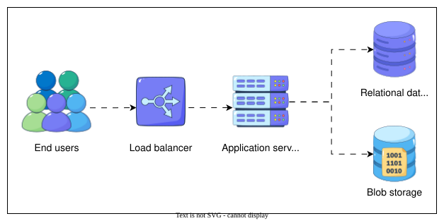
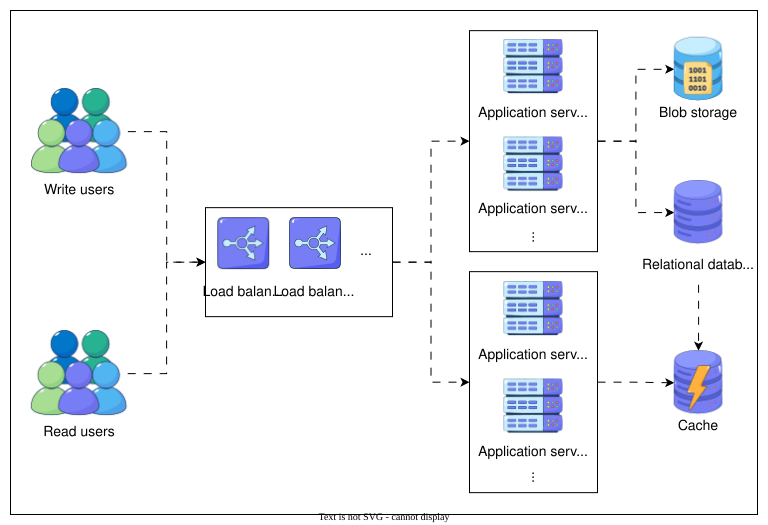
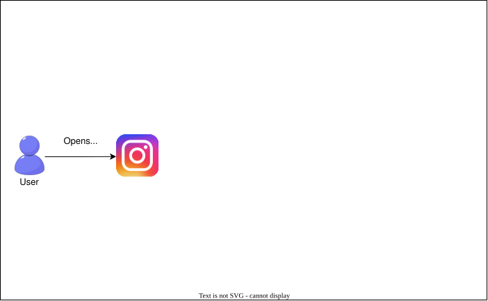
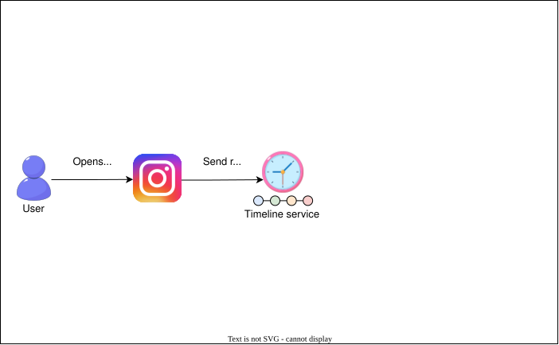
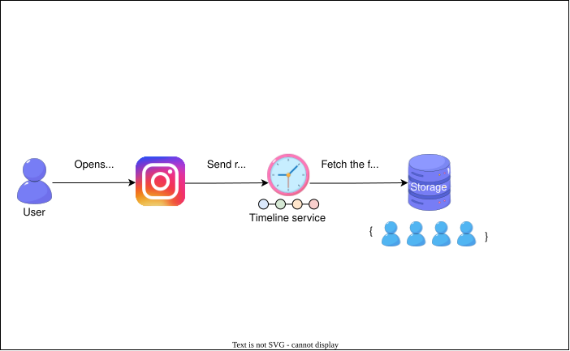
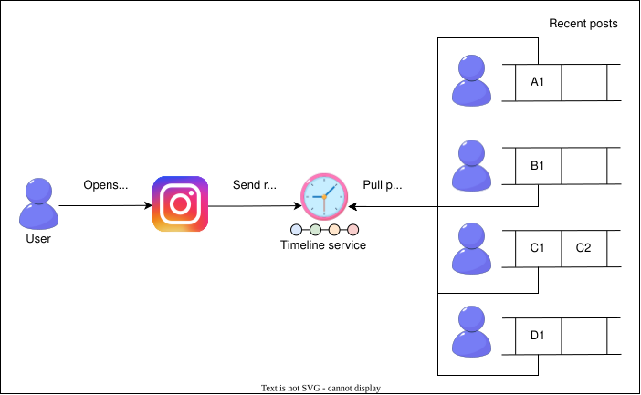
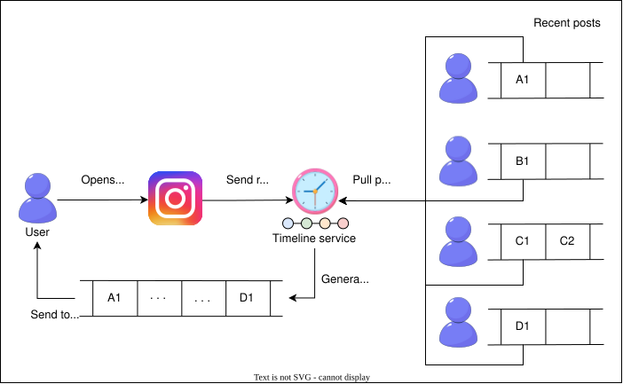

# Detailed_Design_of_Instagram

Source: https://www.educative.io/courses/grokking-the-system-design-interview/detailed-design-of-instagram

---

[Home](https://www.educative.io/)

[Courses](https://www.educative.io/search?tab=courses)

[Grokking Modern System Design Interview](https://www.educative.io/courses/grokking-the-system-design-interview)

# Detailed Design of Instagram

Analyze the detailed System Design of Instagram, focusing on component integration like CDNs, caching, and read/write separation. Explore the trade-offs between pull, push, and hybrid approaches for efficient timeline generation. Learn how to meet non-functional requirements like scalability and low latency for a web-scale application.

We'll cover the following...

- [Add more components](https://www.educative.io/courses/grokking-the-system-design-interview/detailed-design-of-instagram#Add-more-components)
- [Upload, view, and search a photo](https://www.educative.io/courses/grokking-the-system-design-interview/detailed-design-of-instagram#Upload-view-and-search-a-photo)
- [Generate a timeline](https://www.educative.io/courses/grokking-the-system-design-interview/detailed-design-of-instagram#Generate-a-timeline)
  - [The pull approach](https://www.educative.io/courses/grokking-the-system-design-interview/detailed-design-of-instagram#The-pull-approach)
  - [The push approach](https://www.educative.io/courses/grokking-the-system-design-interview/detailed-design-of-instagram#The-push-approach)
  - [Hybrid approach](https://www.educative.io/courses/grokking-the-system-design-interview/detailed-design-of-instagram#Hybrid-approach)
    - [Timeline storage](https://www.educative.io/courses/grokking-the-system-design-interview/detailed-design-of-instagram#Timeline-storage)
    - [Stories](https://www.educative.io/courses/grokking-the-system-design-interview/detailed-design-of-instagram#Stories)
  - [AI-powered Explore recommendations](https://www.educative.io/courses/grokking-the-system-design-interview/detailed-design-of-instagram#AI-powered-Explore-recommendations)
  - [Generating alt text with vision-language models](https://www.educative.io/courses/grokking-the-system-design-interview/detailed-design-of-instagram#Generating-alt-text-with-vision-language-models)
- [Finalized design](https://www.educative.io/courses/grokking-the-system-design-interview/detailed-design-of-instagram#Finalized-design)
- [Requirements compliance](https://www.educative.io/courses/grokking-the-system-design-interview/detailed-design-of-instagram#Requirements-compliance)
- [Conclusion](https://www.educative.io/courses/grokking-the-system-design-interview/detailed-design-of-instagram#Conclusion)

## Add more components[#](https://www.educative.io/courses/grokking-the-system-design-interview/detailed-design-of-instagram#Add-more-components)

We expand the design with the following components:

- [**Load balancer**](https://www.educative.io/courses/grokking-the-system-design-interview/introduction-to-load-balancers)**:** Distributes incoming user requests.
- **Application servers:** Host the service logic for end users.
- [**Relational database**](https://www.educative.io/courses/grokking-the-system-design-interview/introduction-to-databases)**:** Stores metadata and user information.
- [**Blob storage**](https://www.educative.io/courses/grokking-the-system-design-interview/system-design-a-blob-store)**:** Stores media files (photos and videos).

Adding components to design

## Upload, view, and search a photo[#](https://www.educative.io/courses/grokking-the-system-design-interview/detailed-design-of-instagram#Upload-view-and-search-a-photo)

Let’s discuss the upload, view, and search workflow:

- **Upload flow:** The client sends a photo to the load balancer, which routes it to an application server. The server stores the photo in the database (blob storage) and sends a success or error notification to the user.
- **View and search flow:** When a client requests to view or search for a photo, the application server fetches the matching content from the database and serves it to the user.
- **Service splitting:** Since read requests (views) significantly outnumber write requests (uploads), we split the architecture into separate read and write services. This allows us to scale the read infrastructure independently to handle high traffic.
- **Optimization:** We introduce caching to speed up reads for millions of users. We also implement lazy loading. This minimizes latency and bandwidth usage by only loading content as the user scrolls.

The updated design is as follows:

Various operations on photos

## Generate a timeline[#](https://www.educative.io/courses/grokking-the-system-design-interview/detailed-design-of-instagram#Generate-a-timeline)

Generating a user-specific timeline is a core feature. We analyze three strategies to determine the best approach.

### The pull approach[#](https://www.educative.io/courses/grokking-the-system-design-interview/detailed-design-of-instagram#The-pull-approach)

This approach is known as “fan-out on load.” When a user opens Instagram, the system generates the user’s timeline. The service retrieves the accounts the user follows, fetches their recent posts, and aggregates them into a timeline for display.

**Drawback:** This approach creates high latency because the timeline is generated on-demand every time the app opens. We can mitigate this by pre-generating timelines offline for active users.

1 / 5

A user opens Instagram

1 / 5

A request to generate a timeline is sent to the timeline service

1 / 5

The timeline service fetches the list of followers for that user from the storage

1 / 5

The timeline service fetches the recent posts of the followers

1 / 5

Display the fetched photos on the user's timeline

1.

What are the shortcomings of the pull approach?

Show Answer

Did you find this helpful?

### The push approach[#](https://www.educative.io/courses/grokking-the-system-design-interview/detailed-design-of-instagram#The-push-approach)

The push approach is also known as “fan-out on write.” When a user creates a post, the system distributes it to the timelines of all followers. Unlike the pull approach, follower timelines are precomputed at write time.

**Benefit:** Read latency is minimal because the data is ready when the user opens the app. It also eliminates wasted read requests for users who haven’t posted recently.

Push-based approach

1.

What are the shortcomings of the push approach?

Show Answer

Did you find this helpful?

### Hybrid approach[#](https://www.educative.io/courses/grokking-the-system-design-interview/detailed-design-of-instagram#Hybrid-approach)

To balance the trade-offs, we categorize users based on follower count:

- **Push-based (standard users):** Users with a few hundred or thousand followers. Their posts are pushed to followers' timelines immediately.
- **Pull-based (celebrities):** Users with hundreds of thousands or millions of followers. Their posts are not pushed. Instead, followers fetch these posts on-demand when loading their timeline.

The timeline service aggregates data by pulling from celebrity accounts and reading the pre-pushed feed for standard accounts.

Hybrid approach

#### Timeline storage[#](https://www.educative.io/courses/grokking-the-system-design-interview/detailed-design-of-instagram#Timeline-storage)

We store the user’s timeline in a key-value store. The key is the `userID`, and the value is the timeline content (a list of post links). If the value size exceeds the store’s limit (e.g., a few MBs), we can store the actual timeline data in a blob store and keep a reference link in the key-value store.

#### Stories[#](https://www.educative.io/courses/grokking-the-system-design-interview/detailed-design-of-instagram#Stories)

We can add a “Story” feature where photos expire after 24 hours. We implement this by storing a timestamp with the story entry. A [task scheduler](https://www.educative.io/courses/grokking-the-system-design-interview/system-design-the-distributed-task-scheduler) or TTL mechanism automatically deletes entries that exceed the 24-hour limit.

AI Powered

Saved

1 attempt left

Reset

Why hybrid approach?

Why is a hybrid approach better than purely push-based or pull-based timelines?

This is your last attempt.

### AI-powered Explore recommendations[#](https://www.educative.io/courses/grokking-the-system-design-interview/detailed-design-of-instagram#AI-powered-Explore-recommendations)

Unlike the home timeline, which primarily shows posts from followed accounts, Explore recommends content from accounts users may not know. Since ranking every available post for every user is too expensive, the system retrieves a smaller set of relevant candidates and ranks them in multiple stages. Meta has [described this multi-stage architecture](https://engineering.fb.com/2023/08/09/ml-applications/scaling-instagram-explore-recommendations-system/) for Instagram Explore in its engineering blog.

The process involves four key steps:

- **Retrieving candidates using embeddings:** Each user and each post is represented as an embedding, a vector learned from past interactions, so that users sit close to posts they are likely to enjoy. Post embeddings are computed when a post is uploaded and updated periodically. A user’s embedding reflects recent activity. When the user opens Explore, an approximate nearest-neighbor search over post embeddings returns a few thousand candidates in milliseconds. The `Embeddings and Retrieval lesson` covers how this search works.
- **Combining multiple candidate sources:** Embedding search is one source among several. Others include posts popular among similar users and posts from accounts related to ones the user engages with. Mixing sources helps new users with little history, who can start from popular and topic-based content until their own embedding becomes meaningful.
- **Applying ranking in multiple stages:** Candidates pass through progressively more expensive models. A lightweight model trims thousands of candidates to a few hundred, and a heavier model predicts outcomes such as likes, saves, and “not interested” for the rest, the same multi-outcome scoring described in the [Twitter](https://www.educative.io/courses/grokking-the-system-design-interview/system-design-twitter) chapter. Each stage spends more compute per post on fewer posts.
- **Precomputing stable features and refreshing user signals:** Post embeddings and many post features change slowly, so they are computed offline and cached. User interests change during a session, so the user side is refreshed as the user interacts. This split keeps Explore responsive while still reacting to what the user just liked.

The following diagram illustrates how candidate retrieval and successive ranking stages narrow a large content pool to the posts selected for the Explore grid:

Narrowing candidates for the Explore page

### Generating alt text with vision-language models[#](https://www.educative.io/courses/grokking-the-system-design-interview/detailed-design-of-instagram#Generating-alt-text-with-vision-language-models)

Not every AI feature in Instagram is about ranking. Since 2018, Instagram has generated automatic alt text so that screen readers can describe photos to people with visual impairments. A modern design can use a vision-language model, which reads an image and writes a short description of it.

The model runs once per post in an asynchronous job after upload, so posting stays fast. The generated text is stored with the post’s metadata, served like any other field, and replaced if the author writes their own alt text. Because descriptions can be wrong or inappropriate, the job checks them against the same content policies as user text, and a failed generation never blocks the post.

## Finalized design[#](https://www.educative.io/courses/grokking-the-system-design-interview/detailed-design-of-instagram#Finalized-design)

We integrate a CDN (content delivery network) to serve static media like images and videos. This ensures high availability and low latency for millions of concurrent users.

The load balancer routes read requests to the nearest CDN edge server. If the content is not found, the request forwards to the Read Application Server (see the “[load balancing chapter](https://www.educative.io/courses/grokking-the-system-design-interview/introduction-to-load-balancers)” for details), while write requests are routed to the Write Application Server, which persists data in blob storage and the relational database. The final design is illustrated below:

The final design of Instagram

The AI-based explore recommendations group in the diagram adds the Explore feature to this design. When a user opens Explore, the read application server calls the Explore service, which retrieves candidates from the embedding service (ANN), reads precomputed post features from the feature cache, and ranks the candidates in stages before returning the Explore grid. Because this group sits off the timeline path, a slow or failed Explore request never delays the home feed.

1.

How can we count millions of interactions (like or view) on a celebrity post?

Show Answer

Did you find this helpful?

## Requirements compliance[#](https://www.educative.io/courses/grokking-the-system-design-interview/detailed-design-of-instagram#Requirements-compliance)

We evaluate the design against our non-functional requirements:

- **Scalability:** Separating read/write services and sharding databases allows us to handle increasing request volumes and user data.
- **Latency:** Caching and CDNs significantly reduce content retrieval time.
- **Availability:** Replicating storage and databases across geographical regions ensures the system remains accessible even during outages.
- **Durability:** Persistent storage with automated backups ensures uploaded content is never lost.
- **Consistency:** Blob stores and databases maintain data integrity across the system.
- **Reliability:** [Replication](https://www.educative.io/courses/grokking-the-system-design-interview/data-replication) and load balancing prevent single points of failure.

## Conclusion[#](https://www.educative.io/courses/grokking-the-system-design-interview/detailed-design-of-instagram#Conclusion)

This design demonstrates how connecting scalable, fault-tolerant building blocks enables us to solve complex problems like efficient timeline generation. By offloading infrastructure concerns to these components, we can focus on optimizing specific use cases.

Design of Instagram

Quiz on Instagram’s Design

Ask

[Add more components](https://www.educative.io/courses/grokking-the-system-design-interview/detailed-design-of-instagram#Add-more-components)

[Upload, view, and search a photo](https://www.educative.io/courses/grokking-the-system-design-interview/detailed-design-of-instagram#Upload-view-and-search-a-photo)

[Generate a timeline](https://www.educative.io/courses/grokking-the-system-design-interview/detailed-design-of-instagram#Generate-a-timeline)

[The pull approach](https://www.educative.io/courses/grokking-the-system-design-interview/detailed-design-of-instagram#The-pull-approach)

[The push approach](https://www.educative.io/courses/grokking-the-system-design-interview/detailed-design-of-instagram#The-push-approach)

[Hybrid approach](https://www.educative.io/courses/grokking-the-system-design-interview/detailed-design-of-instagram#Hybrid-approach)

[Timeline storage](https://www.educative.io/courses/grokking-the-system-design-interview/detailed-design-of-instagram#Timeline-storage)

[Stories](https://www.educative.io/courses/grokking-the-system-design-interview/detailed-design-of-instagram#Stories)

[AI-powered Explore recommendations](https://www.educative.io/courses/grokking-the-system-design-interview/detailed-design-of-instagram#AI-powered-Explore-recommendations)

[Generating alt text with vision-language models](https://www.educative.io/courses/grokking-the-system-design-interview/detailed-design-of-instagram#Generating-alt-text-with-vision-language-models)

[Finalized design](https://www.educative.io/courses/grokking-the-system-design-interview/detailed-design-of-instagram#Finalized-design)

[Requirements compliance](https://www.educative.io/courses/grokking-the-system-design-interview/detailed-design-of-instagram#Requirements-compliance)

[Conclusion](https://www.educative.io/courses/grokking-the-system-design-interview/detailed-design-of-instagram#Conclusion)