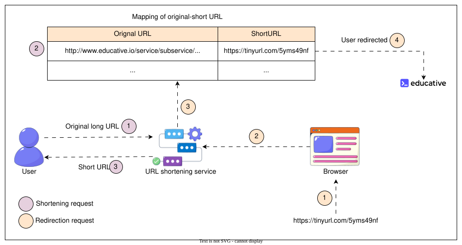
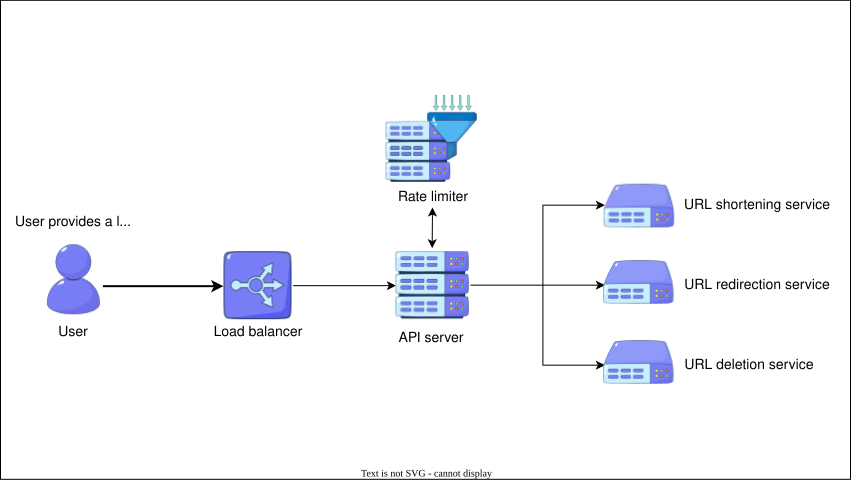
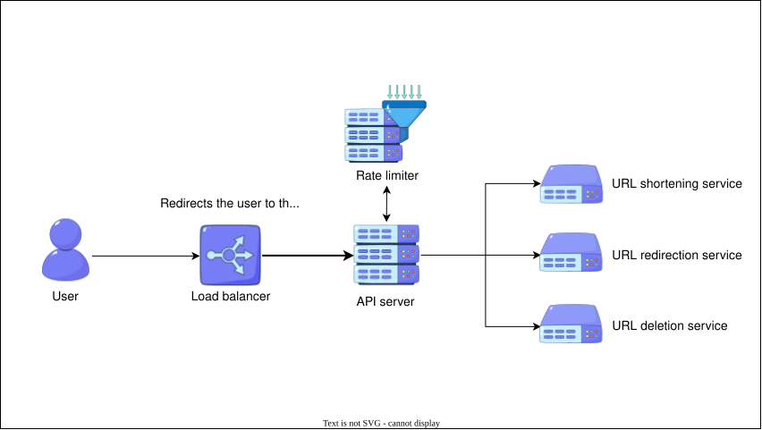
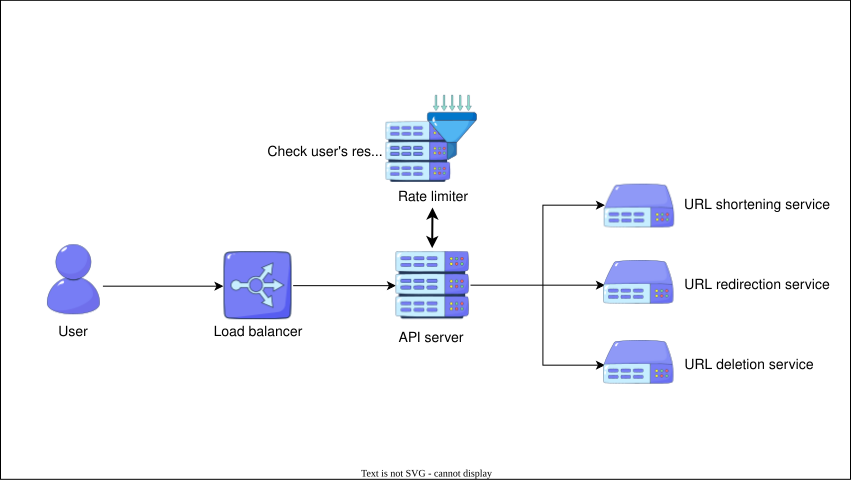
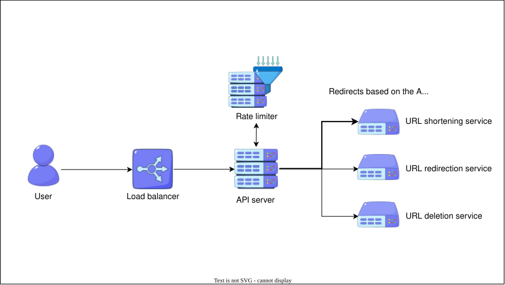
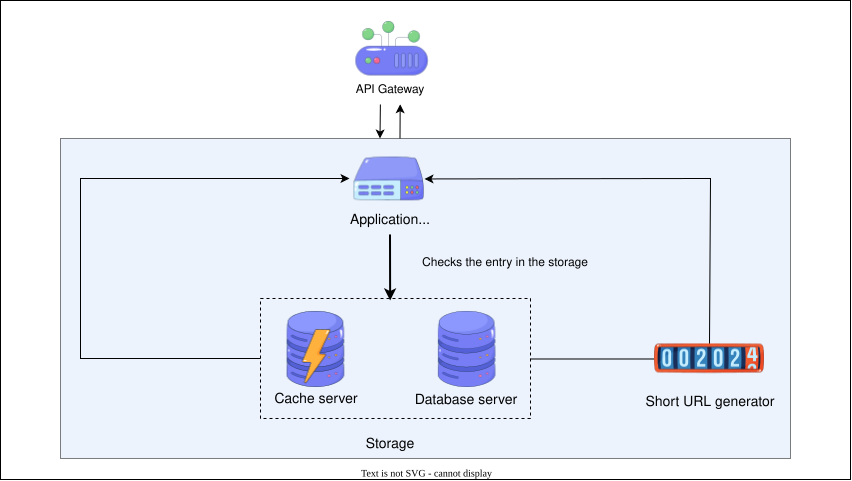

# TinyURL_System_Design

Source: https://www.educative.io/courses/grokking-the-system-design-interview/system-design-tinyurl

---

[Home](https://www.educative.io/)

[Courses](https://www.educative.io/search?tab=courses)

[Grokking Modern System Design Interview](https://www.educative.io/courses/grokking-the-system-design-interview)

# System Design: TinyURL

Learn to design a scalable URL shortening service like TinyURL by defining functional and non-functional requirements, estimating capacity for high traffic, architecting a resilient, efficient system, and evaluating the design against performance, reliability, and scalability goals.

We'll cover the following...

- [Introduction](https://www.educative.io/courses/grokking-the-system-design-interview/system-design-tinyurl#Introduction)
  - [Advantages](https://www.educative.io/courses/grokking-the-system-design-interview/system-design-tinyurl#Advantages)
  - [Disadvantages](https://www.educative.io/courses/grokking-the-system-design-interview/system-design-tinyurl#Disadvantages)
- [Requirements for URL shortening design](https://www.educative.io/courses/grokking-the-system-design-interview/system-design-tinyurl#Requirements-for-URL-shortening-design)
  - [Functional requirements](https://www.educative.io/courses/grokking-the-system-design-interview/system-design-tinyurl#Functional-requirements)
  - [Non-functional requirements](https://www.educative.io/courses/grokking-the-system-design-interview/system-design-tinyurl#Non-functional-requirements)
- [Resource estimation](https://www.educative.io/courses/grokking-the-system-design-interview/system-design-tinyurl#Resource-estimation)
  - [Storage estimation](https://www.educative.io/courses/grokking-the-system-design-interview/system-design-tinyurl#Storage-estimation)
  - [Query rate estimation](https://www.educative.io/courses/grokking-the-system-design-interview/system-design-tinyurl#Query-rate-estimation)
  - [Bandwidth estimation](https://www.educative.io/courses/grokking-the-system-design-interview/system-design-tinyurl#Bandwidth-estimation)
  - [Memory estimation](https://www.educative.io/courses/grokking-the-system-design-interview/system-design-tinyurl#Memory-estimation)
  - [Number of servers estimation](https://www.educative.io/courses/grokking-the-system-design-interview/system-design-tinyurl#Number-of-servers-estimation)
  - [Summarizing estimation](https://www.educative.io/courses/grokking-the-system-design-interview/system-design-tinyurl#Summarizing-estimation)
- [Building blocks we will use](https://www.educative.io/courses/grokking-the-system-design-interview/system-design-tinyurl#Building-blocks-we-will-use)
- [System APIs](https://www.educative.io/courses/grokking-the-system-design-interview/system-design-tinyurl#System-APIs)
  - [Shortening a URL](https://www.educative.io/courses/grokking-the-system-design-interview/system-design-tinyurl#Shortening-a-URL)
  - [Redirecting a short URL](https://www.educative.io/courses/grokking-the-system-design-interview/system-design-tinyurl#Redirecting-a-short-URL)
  - [Deleting a short URL](https://www.educative.io/courses/grokking-the-system-design-interview/system-design-tinyurl#Deleting-a-short-URL)
- [Design](https://www.educative.io/courses/grokking-the-system-design-interview/system-design-tinyurl#Design)
  - [Components](https://www.educative.io/courses/grokking-the-system-design-interview/system-design-tinyurl#Components)
  - [Design diagram](https://www.educative.io/courses/grokking-the-system-design-interview/system-design-tinyurl#Design-diagram)
  - [Workflow](https://www.educative.io/courses/grokking-the-system-design-interview/system-design-tinyurl#Workflow)
  - [Managing unique ID allocation](https://www.educative.io/courses/grokking-the-system-design-interview/system-design-tinyurl#Managing-unique-ID-allocation)
- [URL encoding and readability](https://www.educative.io/courses/grokking-the-system-design-interview/system-design-tinyurl#URL-encoding-and-readability)
  - [Why use encoding](https://www.educative.io/courses/grokking-the-system-design-interview/system-design-tinyurl#Why-use-encoding)
- [Converting base-10 to base-58](https://www.educative.io/courses/grokking-the-system-design-interview/system-design-tinyurl#Converting-base-10-to-base-58)
- [Converting base-58 to base-10](https://www.educative.io/courses/grokking-the-system-design-interview/system-design-tinyurl#Converting-base-58-to-base-10)
- [The scope of the short URL generator](https://www.educative.io/courses/grokking-the-system-design-interview/system-design-tinyurl#The-scope-of-the-short-URL-generator)
- [The sequencer’s lifetime](https://www.educative.io/courses/grokking-the-system-design-interview/system-design-tinyurl#The-sequencers-lifetime)
- [Requirements compliance](https://www.educative.io/courses/grokking-the-system-design-interview/system-design-tinyurl#Requirements-compliance)
  - [Availability](https://www.educative.io/courses/grokking-the-system-design-interview/system-design-tinyurl#Availability)
  - [Scalability](https://www.educative.io/courses/grokking-the-system-design-interview/system-design-tinyurl#Scalability)
  - [Readability](https://www.educative.io/courses/grokking-the-system-design-interview/system-design-tinyurl#Readability)
  - [Latency](https://www.educative.io/courses/grokking-the-system-design-interview/system-design-tinyurl#Latency)
  - [Unpredictability](https://www.educative.io/courses/grokking-the-system-design-interview/system-design-tinyurl#Unpredictability)
- [Conclusion](https://www.educative.io/courses/grokking-the-system-design-interview/system-design-tinyurl#Conclusion)

## Introduction[#](https://www.educative.io/courses/grokking-the-system-design-interview/system-design-tinyurl#Introduction)

A **URL** **shortening** service creates a short alias, or **short link**, for a long URL. When a user clicks the short link, they are redirected to the original, longer address. The diagram below shows how this works.

How URL shortening service works

### Advantages[#](https://www.educative.io/courses/grokking-the-system-design-interview/system-design-tinyurl#Advantages)

The main advantages of a URL shortening service are:

- They are easier to share and type, and fit better where character counts are limited, such as in text messages or on social media.
- They can provide a cleaner, more professional appearance in communications.

### Disadvantages[#](https://www.educative.io/courses/grokking-the-system-design-interview/system-design-tinyurl#Disadvantages)

URL shortening services also have some drawbacks:

- Branding can be diluted when many companies use the same short domain name from a third-party service.
- There is a dependency on the third-party service. If it shuts down, all associated links will break.
- The service’s reliability and security reflect on your brand. Popular custom URLs may also be unavailable if they are already taken.

AI Powered

Saved

1 attempt left

Reset

List four building blocks required for designing TinyURL service

Several building blocks can be considered for the system design of TinyURL. Recognize these building blocks based on the following requisite functionalities in the design:

It’s necessary to:

- Store the shortened URLs.
- Provide unique IDs for each URL.
- Store frequent URL-related requests to serve them efficiently.
- Limit the number of incoming requests.

This is your last attempt.

## Requirements for URL shortening design[#](https://www.educative.io/courses/grokking-the-system-design-interview/system-design-tinyurl#Requirements-for-URL-shortening-design)

Let’s look at the functional and non-functional requirements for the service we’ll be designing:

### Functional requirements[#](https://www.educative.io/courses/grokking-the-system-design-interview/system-design-tinyurl#Functional-requirements)

- **Short URL generation:** Generate a unique short alias for a given URL.
- **Redirection:** Redirect a short link to its original URL.
- **Custom short links:** Allow users to create custom short links for their URLs.
- **Deletion:** Allow users to delete a short link with proper authorization.
- **Update:** Allow users to update the long URL associated with a short link, with proper authorization.
- **Expiry time:** Assign a default expiration time for short links, but allow users to set a custom expiration.

**Note:** The system deletes expired short URLs after five years, even though they are not reused. Retaining them indefinitely would cause the datastore’s search index to grow continuously, which increases query time and overall latency.

### Non-functional requirements[#](https://www.educative.io/courses/grokking-the-system-design-interview/system-design-tinyurl#Non-functional-requirements)

- **Availability:** The system must be highly available. Any downtime will cause URL redirections to fail. This requires significant fault tolerance, as the service’s domain is part of every generated URL.
- **Scalability:** The system must scale horizontally to handle increasing traffic.
- **Readability:** Generated short links must be easy to read and type.
- **Latency:** Redirection must happen with very low latency for a good user experience.
- **Unpredictability:** Generated short URLs should not be guessable. Using sequential IDs would create a security risk, allowing others to find and access links.

**Note:** Predictable short URLs create a security risk because attackers can identify patterns and attempt to guess private links. To mitigate this risk, the system avoids sequential IDs. Instead, it generates random identifiers. This approach produces unique short URLs that are difficult to predict.

Functional and non-functional requirements

## Resource estimation[#](https://www.educative.io/courses/grokking-the-system-design-interview/system-design-tinyurl#Resource-estimation)

Before designing the system, we need to estimate the required resources. These estimations are based on the following assumptions.

**Assumptions**

- The ratio of shortening requests (writes) to redirection requests (reads) is 1:100.
- The system handles 200 million new URL shortening requests per month.
- A URL shortening entry requires 500 bytes of storage.
- Each entry expires after five years unless explicitly deleted.
- The service has 100 million daily active users (DAU).

### Storage estimation[#](https://www.educative.io/courses/grokking-the-system-design-interview/system-design-tinyurl#Storage-estimation)

With 200 million new entries per month stored for 5 years, the total will be 12 billion.

200 Million/month×12 months/year×5 years=12 Billion URL shortening requests200\ \text{Million/month} \times 12\ \text{months/year} \times 5\ \text{years} = 12\ \text{Billion URL shortening requests}200 Million/month×12 months/year×5 years=12 Billion URL shortening requests

At 500 Bytes per entry, the total storage required is 6 TB:12 Billion×500 Bytes=6 TB12\ \text{Billion} \times 500\ \text{Bytes} = 6\ \text{TB}12 Billion×500 Bytes=6 TB

#### URL Shortening Service Storage Estimation Calculator

|  |  |  |
| --- | --- | --- |
| URL shortening per month | 200 | Million |
| Expiration time | 5 | Years |
| URL object size | 500 | Bytes |
| Total number of requests | f12 | Billion |
| Total storage | f6 | TB |

Total storage required by the URL shortening service in 5 years

### Query rate estimation[#](https://www.educative.io/courses/grokking-the-system-design-interview/system-design-tinyurl#Query-rate-estimation)

With a 1:100 write-to-read ratio, 200 million new URLs per month will result in 20 billion redirection requests.

200 Million×100=20 Billion200\ \text{Million} \times 100 = 20\ \text{Billion}200 Million×100=20 Billion

To calculate the Queries Per Second (QPS), we first find the number of seconds in an average month (30.42 days):

30.42 days×24 hours×60 minutes×60 seconds=2628288 seconds30.42\ \text{days} \times 24\ \text{hours} \times 60\ \text{minutes} \times 60\ \text{seconds} = 2628288\ \text{seconds}30.42 days×24 hours×60 minutes×60 seconds=2628288 seconds

This gives us the following rates:

- **Write QPS** (new URLs per second):200 Million2628288 seconds=76 URLs/s\frac{200\ \text{Million}}{2628288\ \text{seconds}} = 76\ \text{URLs/s}2628288 seconds200 Million​=76 URLs/s
- **Read QPS** (redirections per second):100×76 URLs/s=7.6 K URLs/s100 \times 76\ \text{URLs/s} = 7.6\ \text{K URLs/s}100×76 URLs/s=7.6 K URLs/s

### Bandwidth estimation[#](https://www.educative.io/courses/grokking-the-system-design-interview/system-design-tinyurl#Bandwidth-estimation)

**Shortening requests (writes)**: For 76 new URLs per second, the total incoming data is:

76×500 Bytes×8 bits=304 Kbps76 \times 500\ \text{Bytes} \times 8\ \text{bits} = 304\ \text{Kbps}76×500 Bytes×8 bits=304 Kbps

**Redirection requests (reads)**: For 7.6K redirections per second, the total outgoing data is:

7.6 K×500 Bytes×8 bits=30.4 Mbps7.6\ \text{K} \times 500\ \text{Bytes} \times 8\ \text{bits} = 30.4\ \text{Mbps}7.6 K×500 Bytes×8 bits=30.4 Mbps

The total bandwidth required by the URL shortening service

### Memory estimation[#](https://www.educative.io/courses/grokking-the-system-design-interview/system-design-tinyurl#Memory-estimation)

To estimate memory requirements for our cache, we can apply the 80/20 rule, assuming that 20% of URLs generate 80% of the traffic.

First, we calculate the total daily redirection requests:

7.6 K×3600 sec×24 hrs=0.66 billion7.6\ \text{K} \times 3600\ \text{sec} \times 24\ \text{hrs} = 0.66\ \text{billion}7.6 K×3600 sec×24 hrs=0.66 billion

We will cache the top 20% of these daily requests, so the total memory needed is 66 GB.

0.2×0.66 Billion×500 Bytes=66 GB0.2 \times 0.66\ \text{Billion} \times 500\ \text{Bytes} = 66\ \text{GB}0.2×0.66 Billion×500 Bytes=66 GB

#### URL Shortening Service Estimates Calculator

|  |  |  |
| --- | --- | --- |
| URL shortening per month | 200 | Million |
| URL redirection per month | f20 | Billion |
| Query rate for URL shortening | f76 | URLs / s |
| Query rate for URL redirection | f7600 | URLs / s |
| Single entry storage size | 500 | Bytes |
| Incoming data | f304 | Kbps |
| Outgoing data | f30.4 | Mbps |
| Cache memory | f66 | GB |

### Number of servers estimation[#](https://www.educative.io/courses/grokking-the-system-design-interview/system-design-tinyurl#Number-of-servers-estimation)

To estimate the number of servers, we can use the approach from the [back-of-the-envelope calculations](https://www.educative.io/courses/grokking-the-system-design-interview/put-back-of-the-envelope-numbers-in-perspective) lesson. The primary factors are the number of daily active users (DAU) and the request handling capacity of a single server. Assuming a peak load of 100 million requests per second (using DAU as a proxy) and a server capacity of 64,000 requests per second (RPS), we can calculate the number of servers needed.

Number of Servers=Number of requests/secondRPS of server\text{Number of Servers} = \frac{\text{Number of requests/second}}{\text{RPS of server}}
Number of Servers=RPS of serverNumber of requests/second​

Servers needed at peak load=100 million requests/sec64,000 requests/sec per server≈1562.5≈1.6 K servers\text{Servers needed at peak load} = \frac{100\ \text{million requests/sec}}{64{,}000\ \text{requests/sec per server}} \approx 1562.5 \approx 1.6\ \text{K servers}
Servers needed at peak load=64,000 requests/sec per server100 million requests/sec​≈1562.5≈1.6 K servers

The number of servers required for the URL shortening service

### Summarizing estimation[#](https://www.educative.io/courses/grokking-the-system-design-interview/system-design-tinyurl#Summarizing-estimation)

Based on the assumption above, the following table summarizes our estimations:

|  |  |
| --- | --- |
| Type of Operation | Time Estimates |
| New URLs | 76/s |
| URL redirections | 7.6 K/s |
| Incoming data | 304 Kbps |
| Outgoing data | 30.4 Mbps |
| Storage for 5 years | 6 TB |
| Memory for cache | 66 GB |
| Servers | 1600 |

These estimations give us a tangible sense of the system’s size.

## Building blocks we will use[#](https://www.educative.io/courses/grokking-the-system-design-interview/system-design-tinyurl#Building-blocks-we-will-use)

With the estimations done, we can identify the key building blocks in our design. Such a list is given below:

Building blocks in high level design

- [**Database(s)**](https://www.educative.io/courses/grokking-the-system-design-interview/introduction-to-databases)**:** Store the mapping between short and long URLs.
- [**Sequencer**](https://www.educative.io/courses/grokking-the-system-design-interview/system-design-sequencer)**:** Generate unique IDs for new short URLs.
- [**Load balancers**](https://www.educative.io/courses/grokking-the-system-design-interview/introduction-to-load-balancers)**:** Distribute requests across available servers.
- [**Caches**](https://www.educative.io/courses/grokking-the-system-design-interview/system-design-the-distributed-cache)**:** Store frequently accessed URL mappings to reduce latency.
- [**Rate limiters**](https://www.educative.io/courses/grokking-the-system-design-interview/system-design-the-rate-limiter)**:** Prevent system abuse by limiting requests from a single source.

In addition to these core services, our application will require:

- **Servers** to run application logic and handle requests.
- A **Base-58 encoder** to convert numeric IDs into readable alphanumeric strings.

Components in high level design

## System APIs[#](https://www.educative.io/courses/grokking-the-system-design-interview/system-design-tinyurl#System-APIs)

We can define REST API endpoints to expose the service’s core functionality:

- Shortening a URL
- Redirecting a short URL
- Deleting a short URL

System API design overview

### Shortening a URL[#](https://www.educative.io/courses/grokking-the-system-design-interview/system-design-tinyurl#Shortening-a-URL)

To create a short URL, we use the `shortURL()` endpoint:

Ace Editor

1

shortURL(api\_dev\_key, original\_url, custom\_alias=None, expiry\_date=None)

הההההההההההההההההההההההההההההההההההההההההההההההההההההההההההההההההההההההההההההההההההההההההההההההההההההההההההההההההההההההההההההההההההההההההההההההההההההההההההההההההההההההההההההההההההההההההההההההההההההההההההההההההההההההההההההההההההההההההההההההההההההההההההההההההההההההההההההההההההההההההההההההההההההההההההההההההההההההההההההההההההההההההההההההההההההההההההההההההההההההההההההההההההההההההההההההההההההההההההההההההההההההההההההההההההההההההההההההההההההההההההההההההההההההההההההההההההההההההההההההההההההההההההההההההההההההההההההההה

XXXXXXXXXXXXXXXXXXXXXXXXXXXXXXXXXXXXXXXXXXXXXXXXXXXXXXXXXXXXXXXXXXXXXXXXXXXXXXXXXXXXXXXXXXXXXXXXXXXXXXXXXXXXXXXXXXXXXXXXXXXXXXXXXXXXXXXXXXXXXXXXXXXXXXXXXXXXXXXXXXXXXXXXXXXXXXXXXXXXXXXXXXXXXXXXXXXXXXXXXXXXXXXXXXXXXXXXXXXXXXXXXXXXXXXXXXXXXXXXXXXXXXXXXXXXXXXXXXXXXXXXXXXXXXXXXXXXXXXXXXXXXXXXXXXXXXXXXXXXXXXXXXXXXXXXXXXXXXXXXXXXXXXXXXXXXXXXXXXXXXXXXXXXXXXXXXXXXXXXXXXXXXXXXXXXXXXXXXXXXXXXXXXXXXXXXXXXXXXXXXXXXXXXXXXXXXXXXXXXXXXXXXXXXXXXXXXXXXXXXXXXXXXXXXXXXXXXXXXXXXXXXXXXXXXXXXXXXXXXXXXXXXXXXXXXXXXXXXXXXXXXXXXXXXXX

The API call above has the following parameters:

|  |  |
| --- | --- |
| **Parameter** | **Description** |
| `api_dev_key` | A registered user account’s unique identifier. This is useful in tracking a user’s activity and allows the system to control the associated services accordingly. |
| `original_url` | The original long URL that is needed to be shortened. |
| `custom_alias` | The optional key that the user defines as a customer short URL. |
| `expiry_date` | The optional expiration date for the shortened URL. |

A successful call returns the new short URL. On failure, it returns an error code.

### Redirecting a short URL[#](https://www.educative.io/courses/grokking-the-system-design-interview/system-design-tinyurl#Redirecting-a-short-URL)

To redirect a short URL:

Ace Editor

1

redirectURL(api\_dev\_key, url\_key)

הההההההההההההההההההההההההההההההההההההההההההההההההההההההההההההההההההההההההההההההההההההההההההההההההההההההההההההההההההההההההההההההההההההההההההההההההההההההההההההההההההההההההההההההההההההההההההההההההההההההההההההההההההההההההההההההההההההההההההההההההההההההההההההההההההההההההההההההההההההההההההההההההההההההההההההההההההההההההההההההההההההההההההההההההההההההההההההההההההההההההההההההההההההההההההההההההההההההההההההההההההההההההההההההההההההההההההההההההההההההההההההההההההההההההההההההההההההההההההההההההההההההההההההההההההההההההההההההה

XXXXXXXXXXXXXXXXXXXXXXXXXXXXXXXXXXXXXXXXXXXXXXXXXXXXXXXXXXXXXXXXXXXXXXXXXXXXXXXXXXXXXXXXXXXXXXXXXXXXXXXXXXXXXXXXXXXXXXXXXXXXXXXXXXXXXXXXXXXXXXXXXXXXXXXXXXXXXXXXXXXXXXXXXXXXXXXXXXXXXXXXXXXXXXXXXXXXXXXXXXXXXXXXXXXXXXXXXXXXXXXXXXXXXXXXXXXXXXXXXXXXXXXXXXXXXXXXXXXXXXXXXXXXXXXXXXXXXXXXXXXXXXXXXXXXXXXXXXXXXXXXXXXXXXXXXXXXXXXXXXXXXXXXXXXXXXXXXXXXXXXXXXXXXXXXXXXXXXXXXXXXXXXXXXXXXXXXXXXXXXXXXXXXXXXXXXXXXXXXXXXXXXXXXXXXXXXXXXXXXXXXXXXXXXXXXXXXXXXXXXXXXXXXXXXXXXXXXXXXXXXXXXXXXXXXXXXXXXXXXXXXXXXXXXXXXXXXXXXXXXXXXXXXXXXX

The above API call has the following parameters:

|  |  |
| --- | --- |
| **Parameter** | **Description** |
| `api_dev_key` | The registered user account’s unique identifier. |
| `url_key` | The shortened URL against which we need to fetch the long URL from the database. |

A successful call redirects the user to the original URL.

### Deleting a short URL[#](https://www.educative.io/courses/grokking-the-system-design-interview/system-design-tinyurl#Deleting-a-short-URL)

To delete a short URL:

Ace Editor

1

deleteURL(api\_dev\_key, url\_key)

הההההההההההההההההההההההההההההההההההההההההההההההההההההההההההההההההההההההההההההההההההההההההההההההההההההההההההההההההההההההההההההההההההההההההההההההההההההההההההההההההההההההההההההההההההההההההההההההההההההההההההההההההההההההההההההההההההההההההההההההההההההההההההההההההההההההההההההההההההההההההההההההההההההההההההההההההההההההההההההההההההההההההההההההההההההההההההההההההההההההההההההההההההההההההההההההההההההההההההההההההההההההההההההההההההההההההההההההההההההההההההההההההההההההההההההההההההההההההההההההההההההההההההההההההההההההההההההההה

XXXXXXXXXXXXXXXXXXXXXXXXXXXXXXXXXXXXXXXXXXXXXXXXXXXXXXXXXXXXXXXXXXXXXXXXXXXXXXXXXXXXXXXXXXXXXXXXXXXXXXXXXXXXXXXXXXXXXXXXXXXXXXXXXXXXXXXXXXXXXXXXXXXXXXXXXXXXXXXXXXXXXXXXXXXXXXXXXXXXXXXXXXXXXXXXXXXXXXXXXXXXXXXXXXXXXXXXXXXXXXXXXXXXXXXXXXXXXXXXXXXXXXXXXXXXXXXXXXXXXXXXXXXXXXXXXXXXXXXXXXXXXXXXXXXXXXXXXXXXXXXXXXXXXXXXXXXXXXXXXXXXXXXXXXXXXXXXXXXXXXXXXXXXXXXXXXXXXXXXXXXXXXXXXXXXXXXXXXXXXXXXXXXXXXXXXXXXXXXXXXXXXXXXXXXXXXXXXXXXXXXXXXXXXXXXXXXXXXXXXXXXXXXXXXXXXXXXXXXXXXXXXXXXXXXXXXXXXXXXXXXXXXXXXXXXXXXXXXXXXXXXXXXXXXXX

and the associated parameters will be:

|  |  |
| --- | --- |
| **Parameter** | **Description** |
| `api_dev_key` | The registered user account’s unique identifier. |
| `url_key` | The shortened URL that should be deleted from the system. |

A successful call returns a confirmation message, such as `URL Removed`.

The APIs define *what* the system does. The following design section explains *how* it works and details the roles of each component.

## Design[#](https://www.educative.io/courses/grokking-the-system-design-interview/system-design-tinyurl#Design)

Let’s discuss the main design components required for our URL shortening service. Our design depends on each part’s functionality and progressively combines them to achieve the different workflows mentioned in the functional requirements.

### Components[#](https://www.educative.io/courses/grokking-the-system-design-interview/system-design-tinyurl#Components)

We’ll explain the inner workings of the components in our system, as well as their use within the whole system, below. We’ll also highlight the design choices made for each component to achieve the overall functionality.

**Database:** A URL shortening service is read-heavy and requires horizontally scalable storage. We need to store:

- User details
- Mappings of long URLs to their corresponding short URLs

As the URL mappings are independent and don’t have complex relationships, a NoSQL database is a good fit. MongoDB is a strong candidate because:

1. It uses a leader-follower protocol, enabling the use of replicas for heavy read workloads.
2. MongoDB ensures atomicity in concurrent write operations and returns duplicate-key errors to prevent collisions.

AI Powered

Saved

1 attempt left

Reset

Why MongoDB outperforms Cassandra and Riak?

You’re evaluating different NoSQL databases for a read-intensive service. Some options on the table are Cassandra, Riak, and MongoDB. Why might Cassandra or Riak not be good choices compared to MongoDB?

This is your last attempt.

**Short URL generator:** The short URL generator consists of two main parts:

- A sequencer to generate unique IDs
- A Base-58 encoder to enhance the readability of the short URL

Our sequencer generates a unique 64-bit numeric ID (base-10). To create a more readable URL, we use a Base-58 encoder to convert this numeric ID into an alphanumeric string. The rationale for choosing Base-58 is explained later.

The following diagram shows how these components work together.

Internal working of a short URL generator

**Other building blocks:**

- **Load balancing:** The system can use Global Server Load Balancing (GSLB) alongside local load balancers to improve availability. Because there is typically a delay between URL creation and the first access request, eventual consistency across geographically distributed databases is acceptable.
- **Cache:** Memcached is a good choice for our cache because it is simple, horizontally scalable, and meets our needs. To minimize latency, we will use a data-center-specific caching layer rather than a global one.
- **Rate limiter:** To prevent abuse, we will rate-limit users based on their unique `api_dev_key`. The fixed-window counter algorithm is sufficient for this purpose (see [Rate Limiter](https://www.educative.io/courses/grokking-the-system-design-interview/system-design-the-rate-limiter) from “building blocks”), allowing a fixed number of operations per user within a specific timeframe.

1.

How will we maintain a unique mapping if redirection requests can go to different data centers that are geographically apart?
Does our design assume that our DB is consistent geographically?

Show Answer

1 / 3

### Design diagram[#](https://www.educative.io/courses/grokking-the-system-design-interview/system-design-tinyurl#Design-diagram)

The diagram below shows the system’s high-level design.

A design diagram of the URL shortening service

### Workflow[#](https://www.educative.io/courses/grokking-the-system-design-interview/system-design-tinyurl#Workflow)

Let’s analyze the system in-depth and how the individual pieces fit together to provide the overall functionality. Given the functional requirements, the workflow for the abstract design above would be as follows.

1. **Shortening:** When a user requests a shortened URL, the application server forwards the request to the Short URL Generator (SUG). The SUG creates a short link, which is returned to the user and stored in the database.

1.

How does our system avoid duplicate short URL generation?

Show Answer

1 / 2

2. **Redirection:** When a redirection request is received, the application server first checks the cache. If the URL is not in the cache, it queries the database. If a record is found, the server redirects the user to the original long URL.
3. **Deletion:** An authorized user can request the deletion of a short URL. The application server validates the request and removes the corresponding entry from the database. Deletion can also be triggered automatically when a URL expires.
4. **Custom short links:** Users can request custom short links. The system first validates the format of the requested link (e.g., a maximum of 11 characters). The system then checks the database to determine whether the custom short URL is available. If the identifier is available, the system maps the custom short URL to the long URL. If not, the request returns an error.

### Managing unique ID allocation[#](https://www.educative.io/courses/grokking-the-system-design-interview/system-design-tinyurl#Managing-unique-ID-allocation)

When a custom short URL is created, the system must ensure its underlying unique ID is not reused.

The server decodes the custom short URL back to its base-10 equivalent and marks that ID as “used” in the database. This ensures no two long URLs can map to the same short URL. The diagram below shows how the system decodes a short URL and updates the database to track used and unused IDs.

Mapping a short URL to its ID and marking it as used to prevent reuse

This approach improves availability by storing the used/unused ID state in a scalable NoSQL database rather than in memory.

The process is simple: newly generated IDs are added to an “unused” list. Once an ID is assigned to a URL, it is moved to the “used” list. Because Base-58 encoding provides a one-to-one mapping to base-10 IDs, it prevents collisions.

Test your knowledge!

1.

How can we maintain a unique mapping for short URLs when redirection requests are handled by geographically distributed data centers that may not be globally consistent?

A.

Use a global consistent database shared by all data centers to ensure every short URL is unique and accessible from anywhere.

B.

Introduce a unique character in each short URL to indicate the data center that owns it, allowing redirection to the correct location.

C.

Use a random hashing mechanism to assign short URLs to data centers dynamically at runtime.

D.

Replicate all short URLs across all data centers to avoid dependency on any single location.

---

1 / 5

The following diagram illustrates the workflows for URL shortening, redirection, and deletion.

1 / 21

URL shortening: The user initiates the request

1 / 21

URL shortening: The load balancer redirects the request

1 / 21

URL shortening: The eligibility of the user’s request is checked

1 / 21

URL shortening: The request is redirected to the concerned service

1 / 21

URL shortening: The data store entry checkup is performed

Let’s test your understanding with the help of an AI assessment:

AI Powered

Saved

10 attempts left

Reset

Scaling the system

Hi, I’m Ed. In this session, we will focus on some questions related to the system design of TinyURL. Do you want to be mentored or evaluated?

You have 10 attempts to answer.

1.

Upon successful allocation of a custom short URL, how does the system modify its records?

Show Answer

Did you find this helpful?

## URL encoding and readability[#](https://www.educative.io/courses/grokking-the-system-design-interview/system-design-tinyurl#URL-encoding-and-readability)

Let’s clarify two key aspects of the Short URL Generator (SUG):

1. How does encoding improve the readability of the short URL?
2. How are the sequencer and the Base-58 encoder related?

### Why use encoding[#](https://www.educative.io/courses/grokking-the-system-design-interview/system-design-tinyurl#Why-use-encoding)

Our sequencer generates a 64-bit ID in base-10, which can be converted to a base-64 short URL. Base-64 is the most common encoding for alphanumeric strings. However, there are some inherent issues with sticking to base-64 for this design problem: the generated short URL might be hard to read due to look-alike characters. Characters like `O` (capital o) and `0` (zero), `I` (capital I), and `l` (lower case L) can be confused while characters like `+` and `/` should be avoided because of other system-dependent encodings.

So, we slash out the six characters and use base-58 instead of base-64 (includes A-Z, a-z, 0-9, `+` and `/`) for enhanced readability purposes. Let’s look at our base-58 definition.

## Base-58

|  |  |  |  |  |  |  |  |
| --- | --- | --- | --- | --- | --- | --- | --- |
| Value | Character | Value | Character | Value | Character | Value | Character |
| 0 | 1 | 15 | G | 30 | X | 45 | n |
| 1 | 2 | 16 | H | 31 | Y | 46 | o |
| 2 | 3 | 17 | J | 32 | Z | 47 | p |
| 3 | 4 | 18 | K | 33 | a | 48 | q |
| 4 | 5 | 19 | L | 34 | b | 49 | r |
| 5 | 6 | 20 | M | 35 | c | 50 | s |
| 6 | 7 | 21 | N | 36 | d | 51 | t |
| 7 | 8 | 22 | P | 37 | e | 52 | u |
| 8 | 9 | 23 | Q | 38 | f | 53 | v |
| 9 | A | 24 | R | 39 | g | 54 | w |
| 10 | B | 25 | S | 40 | h | 55 | x |
| 11 | C | 26 | T | 41 | i | 56 | y |
| 12 | D | 27 | U | 42 | j | 57 | z |
| 13 | E | 28 | V | 43 | k |  |  |
| 14 | F | 29 | W | 44 | m |  |  |

> The highlighted cells contain the succeeding characters of the omitted ones: `0`, `O`, `I`, and `l`.

## Converting base-10 to base-58[#](https://www.educative.io/courses/grokking-the-system-design-interview/system-design-tinyurl#Converting-base-10-to-base-58)

To convert a base-10 ID to a Base-58 string, we repeatedly use the modulus operator.

**Process:** Continuously divide the base-10 number by 58 and record the remainder. The sequence of remainders, mapped to our Base-58 character set, forms the new string. The last remainder becomes the first character of the string.

**Example:** Let’s assume the unique ID is `2468135791013`. The following steps show us the remainder calculations:

Base-10 = 2468135791013

1. 2468135791013 % 58=172468135791013 \ \% \ 58 = 172468135791013 % 58=17
2. 42554065362 % 58=642554065362 \ \% \ 58 = 642554065362 % 58=6
3. 733690782 % 58=4733690782 \ \% \ 58 = 4733690782 % 58=4
4. 12649841 % 58=4112649841 \ \% \ 58 = 4112649841 % 58=41
5. 218100 % 58=20218100 \ \% \ 58 = 20218100 % 58=20
6. 3760 % 58=483760 \ \% \ 58 = 483760 % 58=48
7. 64 % 58=664 \ \% \ 58 = 664 % 58=6
8. 1 % 58=11 \ \% \ 58 = 11 % 58=1

Writing the remainders in reverse order of calculation gives us the following indexes:

Base-58 indices = [1] [6] [48] [20] [41] [4] [6] [17]

Using the character table, we can map these indexes to characters:

Base-58 = 27qMi57J

> **Note:** Both the base-10 numeric IDs and base-58 alphanumeric IDs represent the same 64-bit value.

The following illustration shows this conversion process.

How a base-10 number is converted into a base-58 alphanumeric short URL

## Converting base-58 to base-10[#](https://www.educative.io/courses/grokking-the-system-design-interview/system-design-tinyurl#Converting-base-58-to-base-10)

Decoding a Base-58 string back to a base-10 number is also necessary, particularly for handling custom URLs.

**Process:** To convert from Base-58 to base-10, multiply each character’s value by 58 raised to the power of its position (starting from 0 on the right). The sum of these products is the final base-10 number.

**Example:** Let’s decode the previous example to see how it works.

Base-58: 27qMi57J

258=1×587=22079841675522\_{58} = 1 \times 58^{7} = 2207984167552258​=1×587=2207984167552

758=6×586=2284121552647\_{58} = 6 \times 58^{6} = 228412155264758​=6×586=228412155264

q58=48×585=31505124864q\_{58} = 48 \times 58^{5} = 31505124864q58​=48×585=31505124864

M58=20×584=226329920M\_{58} = 20 \times 58^{4} = 226329920M58​=20×584=226329920

i58=41×583=7999592i\_{58} = 41 \times 58^{3} = 7999592i58​=41×583=7999592

558=4×582=134565\_{58} = 4 \times 58^{2} = 13456558​=4×582=13456

758=6×581=3487\_{58} = 6 \times 58^{1} = 348758​=6×581=348

J58=17×580=17J\_{58} = 17 \times 58^{0} = 17J58​=17×580=17

Base-10 =17+348+13456+7999592+226329920+31505124864+228412155264+2207984167552= 17 + 348 + 13456 + 7999592 + 226329920 + 31505124864 + 228412155264 + 2207984167552=17+348+13456+7999592+226329920+31505124864+228412155264+2207984167552

Base-10 =2468135791013= 2468135791013=2468135791013.

This is the same unique base-10 ID from the previous example.

The following illustration shows this decoding process.

How a base-58 number is converted into a base-10 numeric ID

## The scope of the short URL generator[#](https://www.educative.io/courses/grokking-the-system-design-interview/system-design-tinyurl#The-scope-of-the-short-URL-generator)

The design of our short URL generator is guided by the following constraints:

- The generated short URL must contain only alphanumeric characters.
- None of the characters should be visually ambiguous.
- The minimum default length of the generated short URL should be six characters.

These constraints determine the range of unique IDs we can use:

- **Starting range:** Our 64-bit sequencer can generate numbers from 1→(264−1)1 \to (2^{64}-1)1→(264−1). To ensure short URLs have a minimum length of six characters, we will only use IDs with at least 10 digits (i.e., starting from 1 billion).
- **Ending point:** The maximum length of a short URL is determined by the largest 64-bit number. We can calculate the number of digits a 64-bit value can represent in a given base:

  - The number of bits to represent one digit in base-n is given by log2n\text{log}\_2{\text{n}}log2​n.
  - Number of digits=Total bits availableNumber of bits to represent one digit\text{Number of digits} = \frac{\text{Total bits available}}{\text{Number of bits to represent one digit}}Number of digits=Number of bits to represent one digitTotal bits available​

Applying this to base-10 and Base-58:

- **Base-10:**

  - Bits per digit = log210\text{log}\_2{10}log2​10 = 3.323.323.32
  - Total digits in a 64-bit ID = 643.32\frac{64}{3.32}3.3264​ === 19.2719.2719.27 (approx. 20 digits)
- **Base-58:**

  - Bits per digit = log258\text{log}\_2{58}log2​58 === 5.855.855.85
  - Total digits in a 64-bit ID = 645.85\frac{64}{5.85}5.8564​ === 10.910.910.9 (approx. 11 characters)

> **Maximum digits:** The calculations show that a 64-bit ID can have up to 20 decimal digits, which corresponds to a Base-58 encoded string of up to 11 characters.

AI Powered

Saved

1 attempt left

Reset

Using shorter sequencer IDs for custom short links

Our system currently uses 10-digit and beyond sequencer IDs. What if we wanted to make them shorter? How could we use the sequencer ID range below 10 digits more effectively?

This is your last attempt.

## The sequencer’s lifetime[#](https://www.educative.io/courses/grokking-the-system-design-interview/system-design-tinyurl#The-sequencers-lifetime)

We can estimate the lifetime of our sequencer based on two factors:

- Total numbers available in the sequencer = 264−1092^{64} - 10^{9}264−109 (starting from 1 Billion)
- Number of requests per year = 200 Million per month×12=2.4 Billion200 \ \text{Million per month} \times 12 = 2.4 \ \text{Billion}200 Million per month×12=2.4 Billion (from our earlier estimations)

Using these values, we can calculate the sequencer's expected lifetime:

Lifetime of the sequencer = total numbers availableyearly requests=264−1092.4 Billion=7,686,143,363.63 years\frac{\text{total numbers available}}{\text{yearly requests}}= \frac{2^{64} - 10^{9}}{2.4 \ \text{Billion}} = 7,686,143,363.63 \ \text{years}yearly requeststotal numbers available​=2.4 Billion264−109​=7,686,143,363.63 years

#### Life expectancy for sequencer

|  |  |  |
| --- | --- | --- |
| Number of requests per month | 200 | Million |
| Number of requests per year | f2.4 | Billion |
| Lifetime of sequencer | f7686143363.63 | years |

> Therefore, our service can run for a long time before the range depletes.

## Requirements compliance[#](https://www.educative.io/courses/grokking-the-system-design-interview/system-design-tinyurl#Requirements-compliance)

Finally, we evaluate our design against the non-functional requirements.

### Availability[#](https://www.educative.io/courses/grokking-the-system-design-interview/system-design-tinyurl#Availability)

Our design must be highly available for both generating and redirecting URLs.

Our core components (databases, caches, servers) support replication, which provides high availability and fault tolerance. The unique ID generation process also relies on a replicable database, which prevents a single point of failure.

For disaster recovery, we can perform daily backups of our storage to a service like Amazon S3. In a worst-case scenario, this might result in the loss of URLs created since the last backup.

Our design uses **global server load balancing (GSLB)** to intelligently distribute traffic across global servers, especially during regional failures.

We also use rate limiters between clients and web servers to protect against DoS attacks and ensure fair usage. This protects system resources and ensures a smooth influx of traffic.

Guarantees provided by our URL shortening service

### Scalability[#](https://www.educative.io/courses/grokking-the-system-design-interview/system-design-tinyurl#Scalability)

Our design is horizontally scalable. The database can be sharded, and we can use consistent hashing to evenly distribute load across both the application and database servers.

Our choice of a NoSQL database like MongoDB is key to this scalability for several reasons:

1. NoSQL databases offer schema flexibility. This is useful because we don’t always store a `UserID` for every URL, such as for anonymous users.
2. NoSQL databases are generally designed for horizontal scaling and automatic data distribution, which is simpler to manage at a large scale than sharding a relational database.

Finally, the 64-bit sequencer provides a vast number of unique IDs, ensuring the system can scale for many years.

### Readability[#](https://www.educative.io/courses/grokking-the-system-design-interview/system-design-tinyurl#Readability)

Using Base-58 instead of Base-64 directly addresses the readability requirement in two ways:

- **Distinguishable characters**: It eliminates visually ambiguous characters like `0` (zero) and `O` (capital o), or `I` (capital i) and `l` (lowercase L).
- **URL-safe characters**: It avoids non-alphanumeric characters like `+` and `/`, which can cause encoding issues in URLs.

This makes the generated URLs less error-prone and easier for users to handle.

### Latency[#](https://www.educative.io/courses/grokking-the-system-design-interview/system-design-tinyurl#Latency)

Several design choices contribute to low latency:

- The URL generation process, including encoding, is computationally fast and adds negligible delay.
- The system is read-heavy. We chose MongoDB for its high throughput and low read latency.
- There is typically a delay before a newly created URL is used, which allows time for data to replicate across distributed databases without impacting the user experience.
- A distributed cache for popular URLs significantly reduces redirection time.

### Unpredictability[#](https://www.educative.io/courses/grokking-the-system-design-interview/system-design-tinyurl#Unpredictability)

To make short URLs unpredictable and secure, we must avoid sequential IDs.

The sequencer assigns ranges of unique IDs to different servers. If a server issued IDs sequentially, the resulting short URLs would be predictable. To avoid this, the server selects an ID at random from its assigned range for each new URL. This makes the generated short URLs harder to predict.

The following table summarizes the techniques for achieving non-functional requirements in a TinyURL system:

## Non-Functional Requirements Compliance

|  |  |
| --- | --- |
| Requirements | **Techniques** |
| Availability | - The Amazon S3 service backs up the storage and cache servers daily. We can restore them upon fault occurrence. - Global server load balancing to handle the system's traffic. - Rate limiters to limit each user's resource allocation. |
| Scalability | - Horizontal sharding of the database. - Distribution of the data based on consistent hashing. - MongoDB - as the NoSQL database. |
| Readability | - Introduction of the base-58 encoder to generate short URLs. - Removal of non-alphanumeric characters. - Removal of look-alike characters. |
| Latency | - Unnoticeable delay in the overall operation. - MongoDB, because of its low latency and high throughput in reading tasks. - Distributed cache to minimize the service delays. |
| Unpredictability | - Randomly selecting and associating an ID to each request, from the pool of unused and readily available unique IDs. |

Now it’s time to assess your understanding with the following quiz:

Technical Quiz

1.

In the URL shortener system’s design, the main reason to change the base of the sequencer to `58` was:

A.

To make the generated short URLs more secure.

B.

To enhance the readability of the generated short URLs.

C.

To improve the system’s availability.

D.

To ensure the system’s low latency.

---

1 / 4

## Conclusion[#](https://www.educative.io/courses/grokking-the-system-design-interview/system-design-tinyurl#Conclusion)

The proposed URL shortening service provides several core features: support for dynamic short URL ranges and short URLs that remain human-readable. Security can be improved by adding a salt to the unique ID before encoding. This makes the resulting short URLs harder to predict.

Newsfeed System Design

System Design: Web Crawler

Ask

[Introduction](https://www.educative.io/courses/grokking-the-system-design-interview/system-design-tinyurl#Introduction)

[Advantages](https://www.educative.io/courses/grokking-the-system-design-interview/system-design-tinyurl#Advantages)

[Disadvantages](https://www.educative.io/courses/grokking-the-system-design-interview/system-design-tinyurl#Disadvantages)

[Requirements for URL shortening design](https://www.educative.io/courses/grokking-the-system-design-interview/system-design-tinyurl#Requirements-for-URL-shortening-design)

[Functional requirements](https://www.educative.io/courses/grokking-the-system-design-interview/system-design-tinyurl#Functional-requirements)

[Non-functional requirements](https://www.educative.io/courses/grokking-the-system-design-interview/system-design-tinyurl#Non-functional-requirements)

[Resource estimation](https://www.educative.io/courses/grokking-the-system-design-interview/system-design-tinyurl#Resource-estimation)

[Storage estimation](https://www.educative.io/courses/grokking-the-system-design-interview/system-design-tinyurl#Storage-estimation)

[Query rate estimation](https://www.educative.io/courses/grokking-the-system-design-interview/system-design-tinyurl#Query-rate-estimation)

[Bandwidth estimation](https://www.educative.io/courses/grokking-the-system-design-interview/system-design-tinyurl#Bandwidth-estimation)

[Memory estimation](https://www.educative.io/courses/grokking-the-system-design-interview/system-design-tinyurl#Memory-estimation)

[Number of servers estimation](https://www.educative.io/courses/grokking-the-system-design-interview/system-design-tinyurl#Number-of-servers-estimation)

[Summarizing estimation](https://www.educative.io/courses/grokking-the-system-design-interview/system-design-tinyurl#Summarizing-estimation)

[Building blocks we will use](https://www.educative.io/courses/grokking-the-system-design-interview/system-design-tinyurl#Building-blocks-we-will-use)

[System APIs](https://www.educative.io/courses/grokking-the-system-design-interview/system-design-tinyurl#System-APIs)

[Shortening a URL](https://www.educative.io/courses/grokking-the-system-design-interview/system-design-tinyurl#Shortening-a-URL)

[Redirecting a short URL](https://www.educative.io/courses/grokking-the-system-design-interview/system-design-tinyurl#Redirecting-a-short-URL)

[Deleting a short URL](https://www.educative.io/courses/grokking-the-system-design-interview/system-design-tinyurl#Deleting-a-short-URL)

[Design](https://www.educative.io/courses/grokking-the-system-design-interview/system-design-tinyurl#Design)

[Components](https://www.educative.io/courses/grokking-the-system-design-interview/system-design-tinyurl#Components)

[Design diagram](https://www.educative.io/courses/grokking-the-system-design-interview/system-design-tinyurl#Design-diagram)

[Workflow](https://www.educative.io/courses/grokking-the-system-design-interview/system-design-tinyurl#Workflow)

[Managing unique ID allocation](https://www.educative.io/courses/grokking-the-system-design-interview/system-design-tinyurl#Managing-unique-ID-allocation)

[URL encoding and readability](https://www.educative.io/courses/grokking-the-system-design-interview/system-design-tinyurl#URL-encoding-and-readability)

[Why use encoding](https://www.educative.io/courses/grokking-the-system-design-interview/system-design-tinyurl#Why-use-encoding)

[Converting base-10 to base-58](https://www.educative.io/courses/grokking-the-system-design-interview/system-design-tinyurl#Converting-base-10-to-base-58)

[Converting base-58 to base-10](https://www.educative.io/courses/grokking-the-system-design-interview/system-design-tinyurl#Converting-base-58-to-base-10)

[The scope of the short URL generator](https://www.educative.io/courses/grokking-the-system-design-interview/system-design-tinyurl#The-scope-of-the-short-URL-generator)

[The sequencer’s lifetime](https://www.educative.io/courses/grokking-the-system-design-interview/system-design-tinyurl#The-sequencers-lifetime)

[Requirements compliance](https://www.educative.io/courses/grokking-the-system-design-interview/system-design-tinyurl#Requirements-compliance)

[Availability](https://www.educative.io/courses/grokking-the-system-design-interview/system-design-tinyurl#Availability)

[Scalability](https://www.educative.io/courses/grokking-the-system-design-interview/system-design-tinyurl#Scalability)

[Readability](https://www.educative.io/courses/grokking-the-system-design-interview/system-design-tinyurl#Readability)

[Latency](https://www.educative.io/courses/grokking-the-system-design-interview/system-design-tinyurl#Latency)

[Unpredictability](https://www.educative.io/courses/grokking-the-system-design-interview/system-design-tinyurl#Unpredictability)

[Conclusion](https://www.educative.io/courses/grokking-the-system-design-interview/system-design-tinyurl#Conclusion)