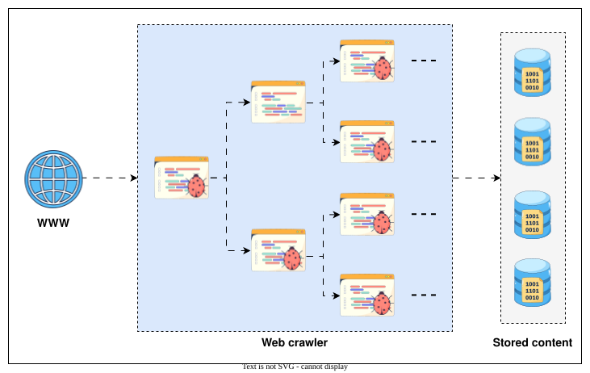
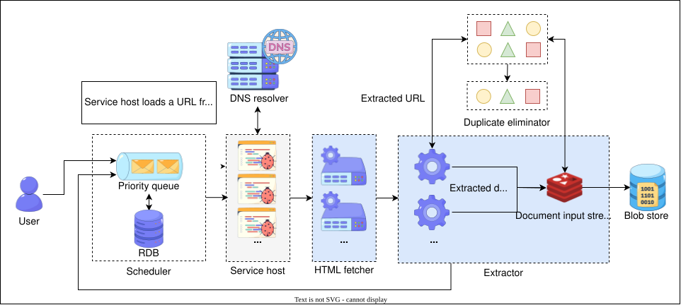
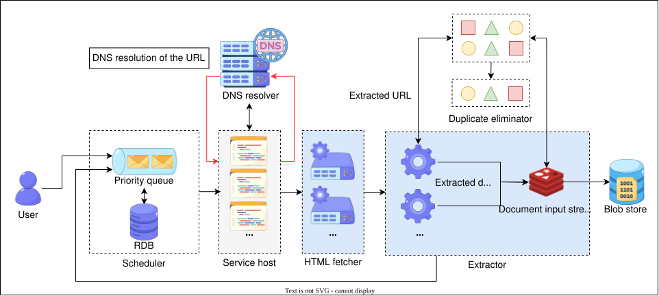
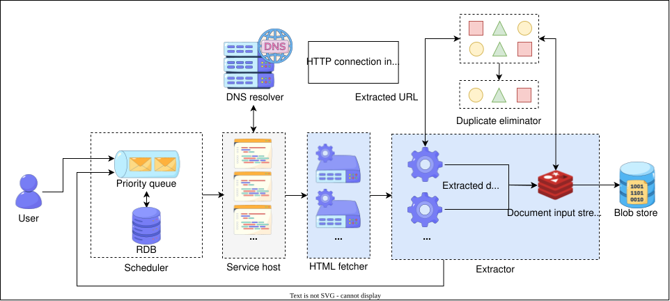
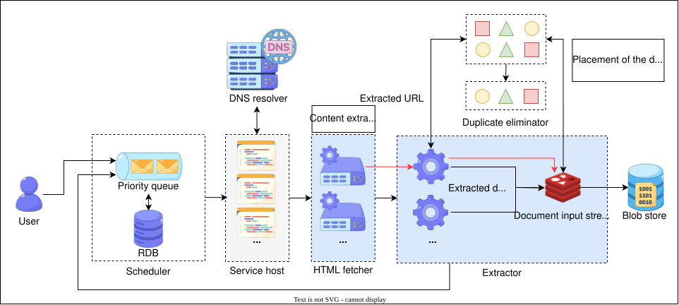
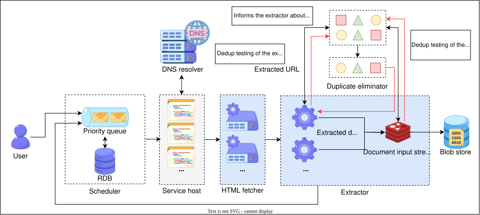

# System_Design_Web_Crawler

Source: https://www.educative.io/courses/grokking-the-system-design-interview/system-design-web-crawler

---

[Home](https://www.educative.io/)

[Courses](https://www.educative.io/search?tab=courses)

[Grokking Modern System Design Interview](https://www.educative.io/courses/grokking-the-system-design-interview)

# System Design: Web Crawler

Learn to design a highly scalable web crawler by quantifying resource needs for massive data volumes. Architect a distributed System Design using key components like the HTML fetcher and scheduler. Implement robust mechanisms to handle challenges like crawler traps and rate limiting, ensuring high throughput and data consistency.

We'll cover the following...

- [Introduction](https://www.educative.io/courses/grokking-the-system-design-interview/system-design-web-crawler#Introduction)
  - [Benefits of a web crawler](https://www.educative.io/courses/grokking-the-system-design-interview/system-design-web-crawler#Benefits-of-a-web-crawler)
  - [Challenges of a web crawler System Design](https://www.educative.io/courses/grokking-the-system-design-interview/system-design-web-crawler#Challenges-of-a-web-crawler-System-Design)
- [Requirements](https://www.educative.io/courses/grokking-the-system-design-interview/system-design-web-crawler#Requirements)
  - [Functional requirements](https://www.educative.io/courses/grokking-the-system-design-interview/system-design-web-crawler#Functional-requirements)
  - [Non-functional requirements](https://www.educative.io/courses/grokking-the-system-design-interview/system-design-web-crawler#Non-functional-requirements)
- [Resource estimation](https://www.educative.io/courses/grokking-the-system-design-interview/system-design-web-crawler#Resource-estimation)
  - [Assumptions](https://www.educative.io/courses/grokking-the-system-design-interview/system-design-web-crawler#Assumptions)
  - [Storage estimation](https://www.educative.io/courses/grokking-the-system-design-interview/system-design-web-crawler#Storage-estimation)
  - [Traversal time](https://www.educative.io/courses/grokking-the-system-design-interview/system-design-web-crawler#Traversal-time)
  - [Server estimation](https://www.educative.io/courses/grokking-the-system-design-interview/system-design-web-crawler#Server-estimation)
  - [Bandwidth estimation](https://www.educative.io/courses/grokking-the-system-design-interview/system-design-web-crawler#Bandwidth-estimation)
- [Building blocks](https://www.educative.io/courses/grokking-the-system-design-interview/system-design-web-crawler#Building-blocks)
- [Design](https://www.educative.io/courses/grokking-the-system-design-interview/system-design-web-crawler#Design)
  - [Components](https://www.educative.io/courses/grokking-the-system-design-interview/system-design-web-crawler#Components)
  - [Workflow](https://www.educative.io/courses/grokking-the-system-design-interview/system-design-web-crawler#Workflow)
- [Design improvements](https://www.educative.io/courses/grokking-the-system-design-interview/system-design-web-crawler#Design-improvements)
- [Crawler traps](https://www.educative.io/courses/grokking-the-system-design-interview/system-design-web-crawler#Crawler-traps)
  - [Classification](https://www.educative.io/courses/grokking-the-system-design-interview/system-design-web-crawler#Classification)
  - [Identification](https://www.educative.io/courses/grokking-the-system-design-interview/system-design-web-crawler#Identification)
  - [Solution](https://www.educative.io/courses/grokking-the-system-design-interview/system-design-web-crawler#Solution)
  - [AI-powered spam filtering before indexing](https://www.educative.io/courses/grokking-the-system-design-interview/system-design-web-crawler#AI-powered-spam-filtering-before-indexing)
  - [Crawling responsibly for AI training data](https://www.educative.io/courses/grokking-the-system-design-interview/system-design-web-crawler#Crawling-responsibly-for-AI-training-data)
- [Requirements compliance](https://www.educative.io/courses/grokking-the-system-design-interview/system-design-web-crawler#Requirements-compliance)
  - [Scalability](https://www.educative.io/courses/grokking-the-system-design-interview/system-design-web-crawler#Scalability)
  - [Extensibility and modularity](https://www.educative.io/courses/grokking-the-system-design-interview/system-design-web-crawler#Extensibility-and-modularity)
  - [Consistency](https://www.educative.io/courses/grokking-the-system-design-interview/system-design-web-crawler#Consistency)
    - [Spam filtering without losing throughput](https://www.educative.io/courses/grokking-the-system-design-interview/system-design-web-crawler#Spam-filtering-without-losing-throughput)
  - [Performance](https://www.educative.io/courses/grokking-the-system-design-interview/system-design-web-crawler#Performance)
  - [Scheduling](https://www.educative.io/courses/grokking-the-system-design-interview/system-design-web-crawler#Scheduling)
- [Conclusion](https://www.educative.io/courses/grokking-the-system-design-interview/system-design-web-crawler#Conclusion)

## Introduction[#](https://www.educative.io/courses/grokking-the-system-design-interview/system-design-web-crawler#Introduction)

A **web crawler** is a bot that systematically scours the World Wide Web (WWW) for content, starting from a pool of seed URLs. It saves the content in data stores for later use. Efficient storage and retrieval are critical for a robust system.

Crawlers fetch web pages, parse content, and extract URLs for further crawling. This is the foundation of search engines. The crawler’s output feeds into subsequent stages:

- Data cleaning
- Indexing
- Relevance scoring (e.g., PageRank)
- URL frontier management
- Analytics

This lesson focuses on the crawler’s System Design, excluding downstream stages like indexing or ranking. For those, refer to the chapter on [distributed search](https://www.educative.io/courses/grokking-the-system-design-interview/system-design-the-distributed-search).

An overview of the web crawler system

### Benefits of a web crawler[#](https://www.educative.io/courses/grokking-the-system-design-interview/system-design-web-crawler#Benefits-of-a-web-crawler)

Beyond data collection, web crawlers provide:

- **Web page testing:** Validating links and HTML structures.
- **Web page monitoring:** Tracking content or structure updates.
- **Site mirroring:** Creating mirrors of popular websites.
- **Copyright infringement checks:** Detecting unauthorized content usage.

### Challenges of a web crawler System Design[#](https://www.educative.io/courses/grokking-the-system-design-interview/system-design-web-crawler#Challenges-of-a-web-crawler-System-Design)

Designing a crawler involves several challenges:

- **Crawler traps:** Infinite loops caused by dynamic links or calendar pages.
- **Duplicate content:** Repeatedly crawling the same pages wastes resources.
- **Rate limiting:** Fetching too many pages from a single domain overloads servers. We need load balancing to manage this.
- **DNS lookup latency:** Frequent DNS lookups slow down the process.
- **Scalability:** The system must handle millions of seed URLs and distribute the load across multiple servers.

A web crawler is a common System Design interview topic to assess how candidates reason about components like the HTML fetcher, extractor, and scheduler. Interviewers often ask questions such as:

- How would you design a scalable crawler using Redis for caching and AWS for infrastructure?
- How would you handle request timeouts and website rate limits?
- What optimization strategies would you use for parsers and fetchers at a FAANG scale?
- How do metrics like response time and cache hit rate help evaluate performance?

Let’s begin by defining the requirements.

## Requirements[#](https://www.educative.io/courses/grokking-the-system-design-interview/system-design-web-crawler#Requirements)

We will highlight the functional and non-functional requirements.

### Functional requirements[#](https://www.educative.io/courses/grokking-the-system-design-interview/system-design-web-crawler#Functional-requirements)

The system must perform the following:

- **Crawling:** Scour the web starting from a queue of seed URLs.

1.

Where do we get these seed URLs from?

Show Answer

1 / 3

- **Storing:** Extract and store content in a blob store for indexing and ranking.
- **Spam filtering:** Classify fetched pages before indexing, so that spam pages are not stored or served, and keep each decision so it can be re-evaluated later.
- **Scheduling:** Regularly schedule crawling to update records.

### Non-functional requirements[#](https://www.educative.io/courses/grokking-the-system-design-interview/system-design-web-crawler#Non-functional-requirements)

- **Scalability:** The system must be distributed and multithreaded to fetch billions of documents.
- **Extensibility:** Support new protocols (beyond HTTP) and file formats via modular extensions.
- **Consistency:** Ensure data consistency across all crawling workers.
- **Performance:** Use self-throttling to limit crawling per domain (by time or count) to avoid overloading hosts and optimize throughput.
- **Throughput under filtering:** Spam classification must not slow down crawling or break politeness limits, and it should avoid wrongly excluding legitimate pages.

- **Improved UI:** Support customized, on-demand crawling beyond routine schedules.

The non-functional requirements of the web crawler system

With requirements established, we can estimate the scale.

## Resource estimation[#](https://www.educative.io/courses/grokking-the-system-design-interview/system-design-web-crawler#Resource-estimation)

We will estimate storage, time, and server requirements.

### Assumptions[#](https://www.educative.io/courses/grokking-the-system-design-interview/system-design-web-crawler#Assumptions)

We assume the following:

- **Total web pages:** 5 billion
- **Text content per page:** 2070 KB
- **Metadata per page:** Metadata 500 bytes

### Storage estimation[#](https://www.educative.io/courses/grokking-the-system-design-interview/system-design-web-crawler#Storage-estimation)

The total storage required for 5 billion pages is:  
Total storage per crawl=5 Billion×(2070 KB+500 B)=10.35 PB\text{Total storage per crawl} = 5\ \text{Billion} \times (2070\ \text{KB} + 500\ \text{B}) = 10.35\ \text{PB}Total storage per crawl=5 Billion×(2070 KB+500 B)=10.35 PB

The total storage required by the web crawler system

### Traversal time[#](https://www.educative.io/courses/grokking-the-system-design-interview/system-design-web-crawler#Traversal-time)

Assuming an average HTTP traversal time of 60 ms, the time to traverse 5 billion pages is:

Total traversal time=5 Billion×60 ms=0.3 Billion seconds=9.5 years\text{Total traversal time} = 5\ \text{Billion} \times 60\ \text{ms} = 0.3\ \text{Billion seconds} = \text{9.5 years}Total traversal time=5 Billion×60 ms=0.3 Billion seconds=9.5 years

A single instance would take 9.5 years. To complete the task in one day, we need a multi-worker architecture.

### Server estimation[#](https://www.educative.io/courses/grokking-the-system-design-interview/system-design-web-crawler#Server-estimation)

Assuming one worker per server, we calculate the number of servers needed to finish in one day:

No. of days required by 1 server to complete the task=9.5 years×365 days≈3468 days\text{No. of days required by 1 server to complete the task} = 9.5\ \text{years} \times 365\ \text{days} \approx 3468\ \text{days}No. of days required by 1 server to complete the task=9.5 years×365 days≈3468 days

Since one server takes 3,468 days, we need **3,468 servers** to complete the task in a single day.

The number of servers required for the web crawler system

### Bandwidth estimation[#](https://www.educative.io/courses/grokking-the-system-design-interview/system-design-web-crawler#Bandwidth-estimation)

Processing 10.35 PB of data per day requires the following total bandwidth:  
  
10.35 PB86400 sec≈120 GB/sec≈960 Gb/sec\frac{10.35\ \text{PB}}{86400\ \text{sec}} \approx 120\ \text{GB/sec} \approx 960\ \text{Gb/sec}86400 sec10.35 PB​≈120 GB/sec≈960 Gb/sec  
  
Distributing this load among 3468 servers3468 \ \text{servers}3468 servers, the bandwidth per server is:  
  
960 Gb/sec3468 servers≈277 Mb/sec per server\frac{960\ \text{Gb/sec}}{3468\ \text{servers}} \approx 277\ \text{Mb/sec per server}3468 servers960 Gb/sec​≈277 Mb/sec per server

The total bandwidth required for the web crawler system

Adjust the assumptions below to see how the estimates change:

#### Estimates Calculator for the Web Crawler

|  |  |  |
| --- | --- | --- |
| Number of Webpages | 5 | Billion |
| Text Content per Webpage | 2070 | KB |
| Metadata per Webpage | 500 | Bytes |
| Total Storage | f10.35 | PB |
| Total Traversal Time on One Server | f9.5 | Years |
| Servers Required to Perform Traversal in One Day | f3468 | Servers |
| Bandwidth Estimate | f958.33 | Gb/sec |

These estimates confirm the need for high-scale tools. We will use the following building blocks:

## Building blocks[#](https://www.educative.io/courses/grokking-the-system-design-interview/system-design-web-crawler#Building-blocks)

The main components of our design are:

Building blocks in high-level design

- [**Scheduler**](https://www.educative.io/courses/grokking-the-system-design-interview/system-design-the-distributed-task-scheduler)**:** Schedules crawling events for URLs.
- [**DNS**](https://www.educative.io/courses/grokking-the-system-design-interview/introduction-to-domain-name-system-dns)**:** Resolves IP addresses.
- [**Cache**](https://www.educative.io/courses/grokking-the-system-design-interview/system-design-the-distributed-cache)**:** Stores fetched documents for quick access.
- [**Blob store**](https://www.educative.io/courses/grokking-the-system-design-interview/system-design-a-blob-store)**:** Stores crawled content.

We also include these specific components:

- **HTML fetcher:** Connects to web hosts to download content.
- **Service host:** Manages worker instances.
- **Extractor:** Parses URLs and documents from web pages.
- **Duplicate eliminator:** Performs deduplication testing on URLs and documents.

The components in a high-level design

We arrange these components to meet our requirements.

## Design[#](https://www.educative.io/courses/grokking-the-system-design-interview/system-design-web-crawler#Design)

This section details the workflow and component interactions.

### Components[#](https://www.educative.io/courses/grokking-the-system-design-interview/system-design-web-crawler#Components)

Key building blocks include:

- **Scheduler:** This is one of the key building blocks that schedules URLs for crawling. It’s composed of the following two units:

  - **Priority queue (URL frontier):** The queue hosts URLs that are made ready for crawling based on the two properties associated with each entry: priority and updates frequency.
  - **Relational database:** It stores all the URLs along with the two associated parameters mentioned above. The database gets populated by new requests from the following two input streams:

    - The user’s *added URLs*, which include seed and runtime added URLs.
    - The crawler’s *extracted URLs*.

1.

Can we estimate the size of the priority queue? What are the pros and cons of a centralized and distributed priority queue.

Show Answer

1 / 2

- **DNS resolver:** Maps hostnames to IP addresses. To reduce latency, we use a custom DNS resolver that caches frequently used IPs.
- **HTML fetcher:** Initiates communication with the host server to download content. While primarily focused on HTTP, it is extendable to other protocols.

1.

How does the crawler handle URLs with variable priorities?

Show Answer

Did you find this helpful?

- **Service host:** The “brain” of the crawler, managing worker instances. It performs three main tasks:

1. Manages the multi-worker architecture. Workers request the next URL from the URL frontier.
2. Resolves IP addresses via the DNS resolver.
3. Triggers the HTML fetcher using the resolved IP.

Service host interaction with other components

- **Extractor:** Parses the web page to extract URLs and content. It sends URLs to the scheduler and content to the **Document Input Stream (DIS)** (e.g., Redis) for processing. Once verified as unique and accepted by the spam classifier, content is stored in the blob store.
- **Duplicate eliminator:** Prevents processing the same content twice. It calculates the checksum of each extracted URL and compares it against the URL checksum data store. If a match is found, the URL is discarded; otherwise, it is added to the store.

Dedup testing in action

The duplicate eliminator repeats this process for document content, storing checksums in the document checksum data store.

The proposed design for the duplicate eliminator can be made robust against these two issues:

1. By using URL redirection, the new URL can pass through the URL dedup test. But, the second stage of the document dedup wouldn’t allow content duplication in the blob storage.
2. By changing just one Byte in a document, the checksum of the modified document is going to come out different than the original one.

- **Blob store:** Because a web crawler is a core component of a search engine, storing and indexing fetched content and related metadata is essential. The system requires distributed storage, such as a blob store, to store large volumes of unstructured data.

The following illustration shows the overall design:

The overall web crawler design

### Workflow[#](https://www.educative.io/courses/grokking-the-system-design-interview/system-design-web-crawler#Workflow)

1. **Assignment to a worker:** The crawler (service host) initiates the process by loading a URL from the URL frontier’s priority queue and assigns it to the available worker.
2. **DNS resolution:** The worker sends the incoming URL for DNS resolution. Before resolving the URL, the DNS resolver checks the cache and returns the requested IP address if it’s found. Otherwise, it determines the IP address, sends it back to the worker instance of the crawler, and stores the result in the cache.

1.

Can we use DFS instead of BFS?

Show Answer

Did you find this helpful?

3. **Communication initiation by the HTML fetcher:** The worker forwards the URL and the associated IP address to the HTML fetcher, which initiates the communication between the crawler and the host server.
4. **Content extraction:** Once the worker establishes the communication, it extracts the URLs and the HTML document from the web page and places the document in a cache for other components to process it.
5. **Dedup testing:** The worker sends the extracted URLs and the document for dedup testing to the duplicate eliminator. The duplicate eliminator calculates and compares the checksum of both the URL and the document with the checksum values that have already been stored. The duplicate eliminator discards the incoming request in case of a match. If there’s no match, it places the newly-calculated checksum values in the respective data stores and gives the go-ahead to pass the content on to spam classification.
6. **Spam classification:** Pages that pass dedup testing are placed on a classification queue. A spam classifier scores each page, and only pages accepted for indexing continue to content storing. This step is described in detail in the “AI-powered spam filtering before indexing” section.
7. **Content storing:** The extractor sends the newly-discovered URLs to the scheduler, which stores them in the database and sets the values for the priority and recrawl frequency variables. The extractor also writes the required portions of the newly discovered document, currently in the DIS, into the database.
8. **Recrawling:** Once a cycle is complete, the crawler goes back to the first point and repeats the same process until the URL frontier queue is empty. The URLs stored in the scheduler’s database have priority and periodicity assigned to them. Enqueuing new URLs into the URL frontier depends on these two factors.

> **Note:** Given the microservices architecture, the design can utilize [client-side load balancing](https://www.educative.io/courses/grokking-the-system-design-interview/client-side-load-balancer-for-twitter).

The slideshow below details the workflow:

1 / 7

Assignment to a worker

1 / 7

DNS resolution

1 / 7

HTTP connection initiation

1 / 7

Content extraction

1 / 7

Dedup testing

Let’s test your understanding with the help of an AI assessment:

AI Powered

Saved

7 attempts left

Reset

Why and when do we need to recrawl?

Hi, I’m Ed. In this session, we will focus on some questions related to the recrawling. Do you want to be mentored or evaluated?”

You have 7 attempts to answer.

We will now refine the design to enhance functionality, performance, and security.

## Design improvements[#](https://www.educative.io/courses/grokking-the-system-design-interview/system-design-web-crawler#Design-improvements)

We address specific shortcomings in the initial design:

- **Shortcoming:** The design currently supports only HTTP and text extraction.
- **Adjustment:**

  - **HTML fetcher:** Add modules for other protocols (e.g., FTP). The crawler invokes the correct module based on the URL scheme. The subsequent steps will remain the same.
  - **Extractor:** Add modules to process non-text media (images, videos) from the Document Input Stream (DIS). These are stored in the blob store alongside text.

The extensibility of the HTML fetcher and extractor

- **Shortcoming:** The design lacks details on distributing work among multiple workers.  
  **Adjustment:** Workers dequeue URLs as they become available. We can distribute tasks using:

  - **Domain-level assignment:** Assign an entire domain to a specific worker (by hashing the hostname). This prevents redundant crawling and supports **reverse URL indexing**.
  - **Range division:** Assign ranges of URLs to workers.
  - **Per URL crawling:** Workers take individual URLs. This requires coordination to avoid collisions.

## Crawler traps[#](https://www.educative.io/courses/grokking-the-system-design-interview/system-design-web-crawler#Crawler-traps)

A **crawler trap** is a URL structure that causes indefinite crawling, exhausting resources.

### Classification[#](https://www.educative.io/courses/grokking-the-system-design-interview/system-design-web-crawler#Classification)

Traps often result from poor website structure:

- **Query parameters:** Useless variations of a page (e.g., `HTTP://www.abc.com?query`).
- **Internal links:** Infinite redirection loops within a domain.
- **Calendar pages:** Infinite combinations of dates.
- **Dynamic content:** Infinite pages generated from queries.
- **Cyclic directories:** Loops like `HTTP://www.abc.com/first/second/first/second/...`.

Classification of web crawler traps

Traps can be accidental or intentional (malicious). They waste throughput and negatively impact the website’s SEO.

### Identification[#](https://www.educative.io/courses/grokking-the-system-design-interview/system-design-web-crawler#Identification)

We identify traps by analyzing:

1. **URL scheme:** Detecting patterns like cyclic directories.
2. **Page count:** Flagging domains with an implausible number of pages.

The identification process of web crawler traps

### Solution[#](https://www.educative.io/courses/grokking-the-system-design-interview/system-design-web-crawler#Solution)

To avoid traps and optimize resources, we implement the following:

1. **Application logic:** Limit crawling on a domain based on page count or depth. The crawler should identify and “no-go” areas.
2. **Robots exclusion protocol:** Fetch and adhere to the `robots.txt` file. This file specifies allowed pages and revisit frequency, preventing unnecessary crawling.

The robots exclusion protocol

> **Note:** `robots.txt` does not prevent malicious traps. Other mechanisms must handle those.

3. **Politeness:** Adjust crawl speed based on the domain’s time to first byte (TTFB). Slower servers receive slower crawls to avoid timeouts and overload.

### AI-powered spam filtering before indexing[#](https://www.educative.io/courses/grokking-the-system-design-interview/system-design-web-crawler#AI-powered-spam-filtering-before-indexing)

Many pages on the web exist only to manipulate search rankings, through keyword stuffing, scraped content, or hidden links. Indexing them wastes storage and processing, and serving them hurts search quality. Google describes its AI-based spam detection system, [SpamBrain](https://developers.google.com/search/blog/2022/04/webspam-report-2021), as identifying spam at crawl time so that those pages can be kept out of the index. Our crawler can apply the same idea.

Spam detection is different from the dedup testing we already do. Dedup compares checksums and only catches exact copies. A spam page can be completely original and still be spam, so detecting it requires a **classifier** that learns patterns from labeled examples, such as page structure, text quality, and link behavior.

- **Asynchronous classification:** Fetching is the crawler’s bottleneck, and classification must not slow it down or break politeness limits. After dedup testing, pages are placed on a classification queue, and a separate pool of classifier workers consumes it. If the classifiers fall behind or fail, pages wait in the queue rather than being lost or skipped, and fetching continues normally.
- **Scores and indexing policy:** The classifier returns a spam probability. An indexing policy turns that score into one of three actions:

  - **Index:** Pages with a low spam score go to storage and indexing.
  - **Exclude:** Pages with a very high score are kept out of the index.
  - **Defer or review:** Uncertain pages are stored for a later recheck or sent for review, instead of being discarded permanently.

A strict threshold saves resources but can exclude legitimate pages, which is costly because those pages then disappear from search. Keeping uncertain cases for later recheck limits that damage.

In the diagrams, excluded pages simply stop after the decision, so only the paths that lead to storage or later handling are drawn.

- **Decision records:** The crawler stores the decision, the score, and the model version with each URL. When a page changes on recrawl, or a new model version is deployed, affected pages are re-queued for classification. This also makes results reproducible: anyone can see which model made a decision and why.

The following diagram shows how fetched pages flow through classification.

Classifying fetched pages before they are indexed

> **Note:** The same classification ideas, scores, thresholds, and the cost of false positives, appear again in the Payment system’s fraud scoring.

### Crawling responsibly for AI training data[#](https://www.educative.io/courses/grokking-the-system-design-interview/system-design-web-crawler#Crawling-responsibly-for-AI-training-data)

Crawlers now also collect text to train and ground large language models. AI companies run dedicated crawlers, such as OpenAI’s GPTBot, and site owners control them through robots.txt, either by user agent or with tokens such as Google-Extended, which opts a site out of use in Google’s AI models without affecting Search indexing.

Our design already checks robots.txt for politeness. To support AI data collection, it must apply rules per user agent, record which policy allowed each page, and recheck that policy before the data is used, because a site can opt out later. Pages collected for training also need extra filtering, such as removing personal data and low-quality or duplicate text, before they reach a training pipeline.

These modifications ensure the crawler is robust and efficient. Next, we validate the architecture against our requirements.

## Requirements compliance[#](https://www.educative.io/courses/grokking-the-system-design-interview/system-design-web-crawler#Requirements-compliance)

We evaluate the design against non-functional requirements.

### Scalability[#](https://www.educative.io/courses/grokking-the-system-design-interview/system-design-web-crawler#Scalability)

The design supports horizontal scaling:

- Components (schedulers, workers, fetchers, stores) can be added or removed on demand.
- Consistent hashing distributes hostnames across workers, allowing seamless addition/removal of servers.

### Extensibility and modularity[#](https://www.educative.io/courses/grokking-the-system-design-interview/system-design-web-crawler#Extensibility-and-modularity)

So far, our design is only focusing on a particular type of communication protocol: HTTP. But according to our non-functional requirements, our system’s design should facilitate the inclusion of other network communication protocols like FTP.

To achieve this extensibility, we only need to add additional modules for the newly required communication protocols in the HTML fetcher. The respective modules will then be responsible for making and maintaining the required communications with the host servers.

Along the same lines, we expect our design to extend its functionality for other MIME types as well. The modular approach for different MIME schemes facilitates this requirement. The worker will call the associated MIME’s processing module to extract the content from the document stored in the DIS.

The requirements met by our web crawler

### Consistency[#](https://www.educative.io/courses/grokking-the-system-design-interview/system-design-web-crawler#Consistency)

The system consists of several crawling workers. Data consistency among crawled content is crucial. So, to avoid data inconsistency and crawl duplication, our system computes the checksums of URLs and documents and compares them with the existing checksums of the URLs and documents in the *URL* and *document checksum* data stores, respectively.

Apart from deduplication, to ensure the data consistency by fault-tolerance conditions, all the servers can checkpoint their states to a backup service, such as Amazon S3 or an offline disk, regularly.

#### Spam filtering without losing throughput[#](https://www.educative.io/courses/grokking-the-system-design-interview/system-design-web-crawler#Spam-filtering-without-losing-throughput)

Classification runs asynchronously from a queue, so fetching speed and politeness are unaffected. Uncertain pages are deferred rather than discarded, and every decision is stored with its model version so it can be re-evaluated.

### Performance[#](https://www.educative.io/courses/grokking-the-system-design-interview/system-design-web-crawler#Performance)

The proposed web crawler’s performance depends on the following factors:

- **URLs crawled per second:** We can improve this factor by adding new workers to the system.
- **Utilizing blob storage for content storing:** This ensures higher throughput for the massive amount of unstructured data. It also indicates a fast retrieval of the stored content, because a single blob can support up to 500 requests per second.
- **Efficient implementation of the****`robots.txt`****file guideline:** We can implement this performance factor by having an application-layer logic of setting the highest precedence of `robots.txt` guidelines while crawling.
- **Self-throttling:** We can have various application-level checks to ensure that our web crawler doesn’t hamper the performance of the website host servers by exhausting their resources.

### Scheduling[#](https://www.educative.io/courses/grokking-the-system-design-interview/system-design-web-crawler#Scheduling)

As was established previously, we may need to recrawl URLs on various frequencies. These frequencies are determined by the application of the URL. We can determine the frequency of recrawl in two different ways:

1. We can assign a default or a specific recrawling frequency to each URL. This assignment depends on the application of the URL defining the priority. A default frequency is assigned to the standard-priority URLs and a higher recrawl frequency is given to the higher-priority URLs. Based on each URL’s associated recrawl frequency, we can decide to enqueue URLs in the priority queue from the scheduler’s database. The priority defines the place of a URL in the queue.
2. The second method is to have separate queues for various priority URLs, use URLs from high-priority queues first, and subsequently move to the lower-priority URLs.

The following table summarizes the techniques for achieving non-functional requirements in a web crawler system:

## Non-Functional Requirements Compliance

|  |  |
| --- | --- |
| **Requirement** | **Techniques** |
| Scalability | - Addition/removal of different servers based on the increase/decrease in load - Consistent hashing to manage server’s addition and removal - Regular backup of the servers in Amazon S3 backup service to achieve fault tolerance |
| Extensibility and Modularity | - Addition of a newer communication protocol module in the HTML fetcher - Addition of new MIME schemes while processing the downloaded document in DIS |
| Consistency | - Calculation and comparison of checksums of URLs and Documents in the respective data stores |
| Spam filtering | - Asynchronous classification queue, off the fetch path - Deferral of uncertain pages for recheck - Decisions stored with score and model version |
| Performance | - Increasing the number of workers performing the crawl - Blob stores for storing the content - High priority to robots.txt file guidelines while crawling - Self-throttle at a domain while crawling |
| Scheduling | - Pre-defined default recrawl frequency, or - Separate queues and their associated frequencies for various priority URLs |

Let’s test your understanding with the help of an AI assessment:

AI Powered

Saved

1 attempt left

Reset

Share strategies for handling IP blocks

Consider a real-time news aggregation platform, where content changes rapidly, and frequent recrawls are crucial for up-to-date information. What immediate steps would you take if the IP faces blocking issues during frequent crawls? Share strategies for handling IP blocks to ensure continuous access to the latest content.

This is your last attempt.

## Conclusion[#](https://www.educative.io/courses/grokking-the-system-design-interview/system-design-web-crawler#Conclusion)

The web crawler system entails a multi-worker design that uses a microservices architecture. Besides achieving the basic crawling functionality, our design provides insights into the potential shortcomings and challenges associated with our design and further rectifies them with appropriate design modifications. The noteworthy features of our design are as follows:

1. Identification and design modification for crawler traps.
2. Extensibility of HTML fetching and content extraction modules.
3. Spam classification before indexing, run off the fetch path so crawling throughput and politeness are unaffected.

System Design: TinyURL

System Design: WhatsApp

Ask

[Introduction](https://www.educative.io/courses/grokking-the-system-design-interview/system-design-web-crawler#Introduction)

[Benefits of a web crawler](https://www.educative.io/courses/grokking-the-system-design-interview/system-design-web-crawler#Benefits-of-a-web-crawler)

[Challenges of a web crawler System Design](https://www.educative.io/courses/grokking-the-system-design-interview/system-design-web-crawler#Challenges-of-a-web-crawler-System-Design)

[Requirements](https://www.educative.io/courses/grokking-the-system-design-interview/system-design-web-crawler#Requirements)

[Functional requirements](https://www.educative.io/courses/grokking-the-system-design-interview/system-design-web-crawler#Functional-requirements)

[Non-functional requirements](https://www.educative.io/courses/grokking-the-system-design-interview/system-design-web-crawler#Non-functional-requirements)

[Resource estimation](https://www.educative.io/courses/grokking-the-system-design-interview/system-design-web-crawler#Resource-estimation)

[Assumptions](https://www.educative.io/courses/grokking-the-system-design-interview/system-design-web-crawler#Assumptions)

[Storage estimation](https://www.educative.io/courses/grokking-the-system-design-interview/system-design-web-crawler#Storage-estimation)

[Traversal time](https://www.educative.io/courses/grokking-the-system-design-interview/system-design-web-crawler#Traversal-time)

[Server estimation](https://www.educative.io/courses/grokking-the-system-design-interview/system-design-web-crawler#Server-estimation)

[Bandwidth estimation](https://www.educative.io/courses/grokking-the-system-design-interview/system-design-web-crawler#Bandwidth-estimation)

[Building blocks](https://www.educative.io/courses/grokking-the-system-design-interview/system-design-web-crawler#Building-blocks)

[Design](https://www.educative.io/courses/grokking-the-system-design-interview/system-design-web-crawler#Design)

[Components](https://www.educative.io/courses/grokking-the-system-design-interview/system-design-web-crawler#Components)

[Workflow](https://www.educative.io/courses/grokking-the-system-design-interview/system-design-web-crawler#Workflow)

[Design improvements](https://www.educative.io/courses/grokking-the-system-design-interview/system-design-web-crawler#Design-improvements)

[Crawler traps](https://www.educative.io/courses/grokking-the-system-design-interview/system-design-web-crawler#Crawler-traps)

[Classification](https://www.educative.io/courses/grokking-the-system-design-interview/system-design-web-crawler#Classification)

[Identification](https://www.educative.io/courses/grokking-the-system-design-interview/system-design-web-crawler#Identification)

[Solution](https://www.educative.io/courses/grokking-the-system-design-interview/system-design-web-crawler#Solution)

[AI-powered spam filtering before indexing](https://www.educative.io/courses/grokking-the-system-design-interview/system-design-web-crawler#AI-powered-spam-filtering-before-indexing)

[Crawling responsibly for AI training data](https://www.educative.io/courses/grokking-the-system-design-interview/system-design-web-crawler#Crawling-responsibly-for-AI-training-data)

[Requirements compliance](https://www.educative.io/courses/grokking-the-system-design-interview/system-design-web-crawler#Requirements-compliance)

[Scalability](https://www.educative.io/courses/grokking-the-system-design-interview/system-design-web-crawler#Scalability)

[Extensibility and modularity](https://www.educative.io/courses/grokking-the-system-design-interview/system-design-web-crawler#Extensibility-and-modularity)

[Consistency](https://www.educative.io/courses/grokking-the-system-design-interview/system-design-web-crawler#Consistency)

[Spam filtering without losing throughput](https://www.educative.io/courses/grokking-the-system-design-interview/system-design-web-crawler#Spam-filtering-without-losing-throughput)

[Performance](https://www.educative.io/courses/grokking-the-system-design-interview/system-design-web-crawler#Performance)

[Scheduling](https://www.educative.io/courses/grokking-the-system-design-interview/system-design-web-crawler#Scheduling)

[Conclusion](https://www.educative.io/courses/grokking-the-system-design-interview/system-design-web-crawler#Conclusion)